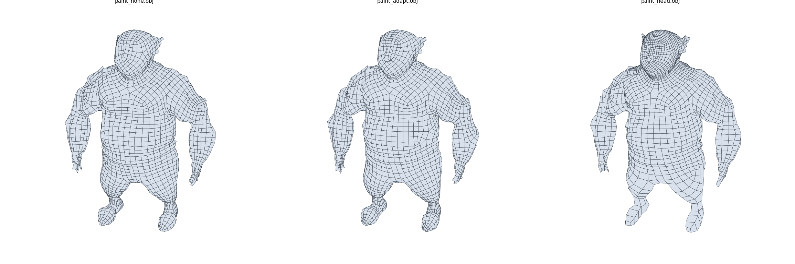
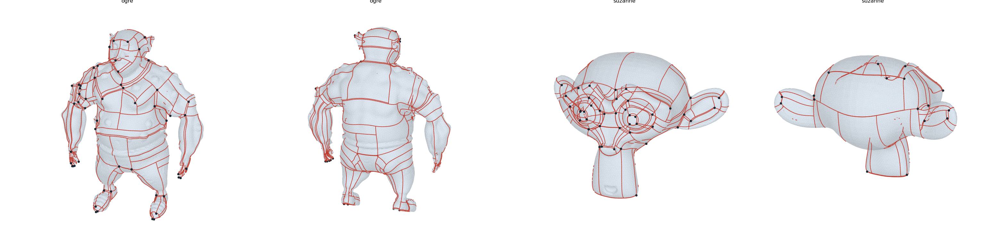
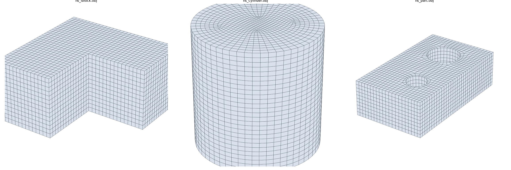
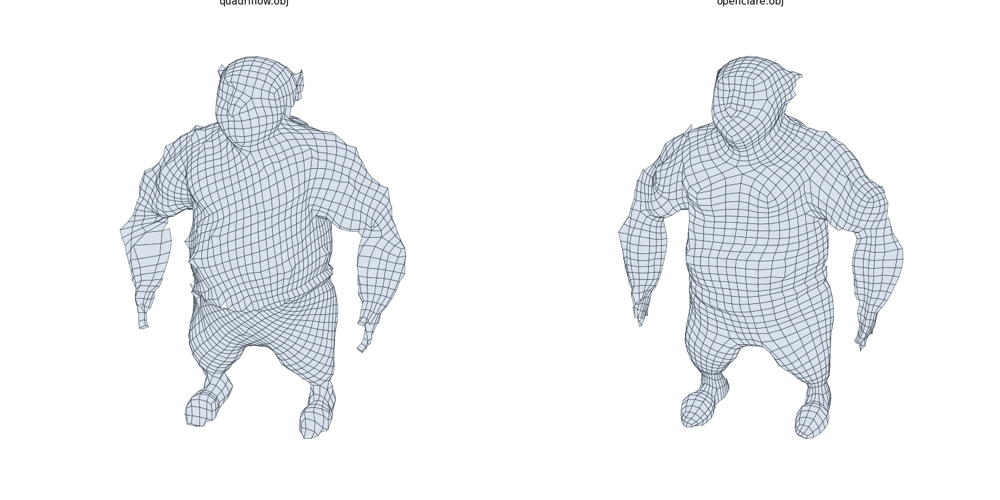
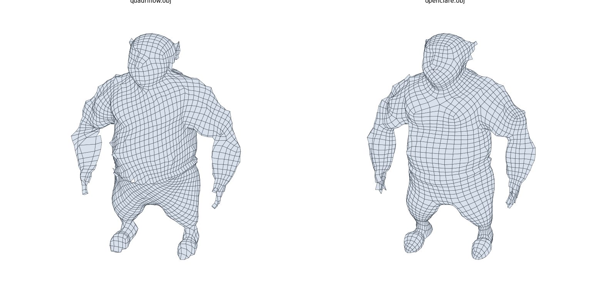

# openclare — specification of the quad retopology engine

**Status: validated on 6 October 2026. Milestones 0 to 9 and quality track Q1 done. Tools tracks T1 (scores, renders, pages per model) and T2 (recording of the stages for Rerun) done and merged. Quality track Q2 (thin parts) done and merged. Track Q2 bis (keeping the volume) done and merged. Milestone 10 (Blender add-on), milestone 12 (creases) and guide curves, in two categories, done and merged on 9 October 2026 (guide curves are not reliable everywhere yet: DT-044). What is left: [ROADMAP.md](ROADMAP.md).**
What was set aside, approximated or put off on the way is followed ticket by ticket in [BACKLOG.md](BACKLOG.md).
The project is called **openclare**, and so is its code since milestone 10 (it was called `retopo` before). The points marked
*to decide* await a decision; they are gathered in section 7.

A word on the labels, which come from the French this document was first written in: J*n* is
milestone *n* (*jalon*), Q*n* a quality track, T*n* a tools track, M*n* a module of the
pipeline, DT-*nnn* a ticket of the backlog (*dette technique*, technical debt). The description
of a module is called its *sheet*.

First chain, for organic shapes: **cross field → seamless parametrization → T-mesh → integer
quantization → integer-grid map → extraction**. This is the MIQ / Integer-Grid Maps / QGP
lineage, chosen because it has the highest quality ceiling on organic shapes.

Second chain, for hard surfaces: **cross field → patches → quantization → filling by
patterns**, the QuadWild lineage. It comes after the first, but the architecture plans for it
from now: the two share their common stages (section 5).

---

## 0. Aim and acceptance criterion

**Aim: a result better than Blender's quad remesh.**
**Priority: organic shapes first;** hard edges, guide curves and local density next.

### The opponent

Blender's quad remesh is QuadriFlow, exposed by the operator
`bpy.ops.object.quadriflow_remesh` (signature read on Blender 5.2.2 LTS). QuadriFlow is itself
Instant Meshes modified to produce far fewer singularities. The chain already written in this
repository is an Instant Meshes: so it is expected **below** the opponent, and serves as a
floor that can be measured.

### Protocol

- Same input meshes, same number of faces asked for (`mode='FACES'`, `target_faces=N`).
- `use_mesh_symmetry=False`: its default is `True`, which would skew the comparison.
- `use_preserve_sharp` and `use_preserve_boundary` switched on when the model has hard edges or
  borders, to compare with the opponent in its best configuration.
- QuadriFlow depends on a seed (`seed`): the median over 5 seeds is compared.

### Metrics

| | Metric | Definition | Role |
|---|---|---|---|
| V | Validity | 100 % quads, manifold, closed if the input is, no inverted face | **blocking** |
| S | Irregular vertices | number of interior vertices of valence ≠ 4, and excess over the topological minimum (4·\|χ\| for a closed surface) | quality |
| C | Complexity of the base complex | number of patches obtained by extending the edges from each irregular vertex; a spiral makes it explode | quality |
| A | Alignment | mean angle between edges and principal curvature directions, weighted by the anisotropy \|k₁−k₂\| | quality |
| F | Shape of the quads | deviation of the angles from 90° (mean, 95th percentile), aspect ratio, spread of the areas | quality |
| H | Fidelity | Hausdorff distance and mean distance to the source, relative to the bounding diagonal | guard |
| N | Budget | relative gap to the number of faces asked for | guard |
| T | Time | computing time | information |

### Acceptance rule

On the organic models of the corpus: **V never worse than QuadriFlow, and a better median on
S, C, A and F**, without degrading H or N beyond a margin.

### Results of milestone 0

Full campaign in [bench/results/RESULTS.md](bench/results/RESULTS.md): 9 models, 3000 quads
asked for, median over 5 seeds. Instructions and limits in [bench/README.md](bench/README.md).

On the five organic models:

| | QuadriFlow (Blender) | Floor (Instant Meshes) |
|---|---|---|
| Valid meshes (V) | 18 out of 25 | 22 out of 25 |
| Alignment (A), degrees | 8.1 to 23.0 | 8.0 to 23.2 |
| Irregular vertices (S) | 8 to 78 | 91 to 212 |
| Patches of the base complex (C), for 3000 faces | 1943 to 2884 | 2319 to 3048 |
| Mean angle deviation (F), degrees | 5.8 to 8.7 | 4.7 to 7.1 |
| Gap to the budget (N) | 1 to 11 % | 2 to 3 % |
| Time (T), seconds | 1.3 to 4.2 | 0.3 to 1.5 |

What these figures establish:

- **QuadriFlow is not always valid.** Folded faces on the torus (4 seeds out of 5), on Suzanne
  (5 out of 5) and on the blob (2 out of 5); a face of zero area on the mechanical part (1 out
  of 5). A finding cross-checked by a second test that does not depend on the source.
- **The floor is far behind on singularities**: 3 to 11 times more than QuadriFlow.
- **On hard surfaces**, QuadriFlow reaches the minimums on the cube: 8 irregular vertices and 6
  patches.

### On a real model: the ogre

The ogre, mascot of the project, is a real sculpt of 4.7 million triangles. The bench measures
it from a source of 200,000 triangles made by our preprocessing. Results at 8000 quads asked
for ([RESULTS-8000.md](bench/results/RESULTS-8000.md); 3000 and 30,000 quads are measured too):

| | QuadriFlow | Floor |
|---|---|---|
| Valid meshes (V) | 0 out of 5 | 0 out of 5 |
| Alignment (A), degrees | 17.8 | 17.7 |
| Irregular vertices (S) | 162 | 455 |
| Hausdorff (H), ‰ | 27.3 | 30.7 |
| Gap to the budget (N) | 3 % | 2 % |
| Time (T), seconds | 4.3 | 2.8 |

- **A single quad size loses fine details.** The fingers and the ears do not survive it
  (Hausdorff 27.3 ‰ for QuadriFlow, 30.7 ‰ for the floor): only a size adapted to the detail
  can keep them.
- **Everybody fails somewhere.** QuadriFlow returns 9 to 14 folded faces at every seed. Our
  floor loses the hands outright: the fingers come off as separate pieces.
- **A real model is far harder than the synthetic corpus**: on alignment, QuadriFlow and the
  floor are close to chance there (22.5°).

A consequence to decide: adaptive density was at rank 4 of the constraints (section 2). On a
character, it is what decides whether the hands still exist. It probably deserves to move up,
at least as an automatic setting driven by curvature.

### On the wider corpus

With the ogre and the seven models of Keenan Crane, the corpus has 13 organic models. At 3000
quads asked for, QuadriFlow gives a valid mesh in 36 runs out of 65, the floor in 47 out of 65.

- **Nobody is valid everywhere.** QuadriFlow simply refuses the raw scan (Pittsburgh Bridge)
  and folds faces on the pig at every seed.
- **Desert Rose (96 shells that go through one another) defeats everybody**; our validity
  metrics are themselves unreliable on it. **Decided: it does not count in acceptance**; it
  will serve as a test case for the repair preprocessing (J11).

Two reservations on the metrics themselves:

- **C saturates.** Close to the number of faces it no longer tells meshes apart: a mesh with
  more singularities may even get a slightly lower C, its lines stopping earlier. It is only
  read together with S.
- **A depends on the scale** at which curvature is read (here that of a quad). On the noisy
  rock, QuadriFlow and the floor are at the level of chance (22.5°).

### Acceptance thresholds (adopted)

On each organic model, median over 5 seeds, at equal budget. Two levels: acceptance (better
than Blender) and the target, more demanding on alignment and structure. The target is a
milestone, not a ceiling: if one can do better, one does not stop there. For comparison, the
marks of the bench, set later, give full marks for alignment at 8°; meshes modelled by hand
(the human bodies of Blender's Essentials library) sit at 9.4° to 9.8°.

| Metric | Acceptance | Target |
|---|---|---|
| V | 5 valid meshes out of 5 | same |
| A | at least 2° better than QuadriFlow, where it does better than 20° | 6° or less on smooth shapes |
| S | at most 1.5 times QuadriFlow | — |
| C | no more than QuadriFlow | half of QuadriFlow |
| F | mean angle deviation no higher than QuadriFlow | same |
| H | Hausdorff at most 1.2 times that of QuadriFlow | same |
| N | gap to the budget of at most 5 % | same |

Alignment comes first and the requirement on irregular vertices is loose: the two are traded
against each other, and alignment is what makes perceived quality.

### Corpus

Milestone 0 runs on a **provisional corpus**, generated entirely in Blender so as to download
nothing, and tracked in `bench/corpus/` (as scenes under `bench/scenes/` since 9 October 2026): five organic shapes (blob, noisy
rock, creature with legs, cage of genus 5, Suzanne), two mechanical ones (part with holes,
cube) and two yardsticks (sphere, torus). They cover the useful cases, but they are synthetic
shapes, not real sculpts.

Real models are added to them, detailed in [bench/scenes/README.md](bench/scenes/README.md):

- **the ogre**, mascot of the project (see above). Its original of 4.7 million triangles
  weighs 200 MB: too much for git, it is kept untracked in `bench/corpus-large/`. Only its
  version of 200,000 triangles is tracked;
- **seven models of Keenan Crane's repository**, free for any use: four characters (Spot, Bob,
  Blub, the pig), an open face (Jerry), a shape of 96 shells (Desert Rose) and a raw scan
  (Pittsburgh Bridge).

The corpus thus has 17 models. Real dense sculpts
other than the ogre are still missing: the classic scans (Stanford) have terms restricted to
research and were set aside.

Since milestone 9: two more mechanical shapes (L-shaped block, cylinder), and three **local
models** fetched from BlenderKit, a terrain and two game characters. Their licence (Royalty
Free) does not allow putting a model back into circulation, even modified: they stay under
`bench/corpus-large/`, out of git, with the meshes made from them; `make blenderkit` downloads
them again. They are measured but do not enter the groups of the acceptance rule, which
everyone must be able to reproduce. Authors, sources and licences of all the models:
[CREDITS.md](CREDITS.md).

---

## 1. References

Each entry was checked on the page of the publisher or of the authors (link).

### The opponent and the floor

| Reference | Role here |
|---|---|
| Huang, Zhou, Niessner, Shewchuk, Guibas, [*QuadriFlow: A Scalable and Robust Method for Quadrangulation*](https://onlinelibrary.wiley.com/doi/10.1111/cgf.13498), SGP 2018 | the opponent (Blender) |
| Jakob, Tarini, Panozzo, Sorkine-Hornung, [*Instant Field-Aligned Meshes*](https://dl.acm.org/doi/10.1145/2816795.2818078), SIGGRAPH Asia 2015 | the floor (the chain already written) |

### Cross field

| Reference | Role here |
|---|---|
| Knöppel, Crane, Pinkall, Schröder, [*Globally Optimal Direction Fields*](https://publications.ri.cmu.edu/globally-optimal-direction-fields), SIGGRAPH 2013 | the formulation chosen: quadratic energy, sparse eigenvalue problem, alignment on curvature |
| Bommes, Zimmer, Kobbelt, [*Mixed-Integer Quadrangulation*](https://cgg.unibe.ch/publication/031044/), SIGGRAPH 2009 | representation by angle + period jumps; the two stages (field, then parametrization) of the lineage |
| Vaxman, Campen, Diamanti, Panozzo, Bommes, Hildebrandt, Ben-Chen, [*Directional Field Synthesis, Design, and Processing*](https://cgg.unibe.ch/publication/016/), Eurographics STAR 2016 | overview of the representations |

### Parametrization and validity

| Reference | Role here |
|---|---|
| Bommes, Campen, Ebke, Alliez, Kobbelt, [*Integer-Grid Maps for Reliable Quad Meshing*](https://cgg.unibe.ch/publication/031197/), SIGGRAPH 2013 | definition of the integer-grid map and conditions of validity |
| Campen, Shen, Zhou, Zorin, *Seamless Parametrization with Arbitrary Cones for Arbitrary Genus*, ACM TOG 39(1), 2019 | fallback with a guarantee if local inversions resist |

### T-mesh and quantization

| Reference | Role here |
|---|---|
| Campen, Bommes, Kobbelt, [*Quantized Global Parametrization*](https://cgg.unibe.ch/publication/031251/), SIGGRAPH Asia 2015 | the backbone: T-mesh, quantization, a valid result guaranteed |
| Eppstein, Goodrich, Kim, Tamstorf, [*Motorcycle Graphs: Canonical Quad Mesh Partitioning*](https://disneyanimation.com/publications/motorcycle-graphs-canonical-quad-mesh-partitioning/), SGP 2008 | principle of the motorcycle graph |
| Heistermann, Warnett, Bommes, [*Min-Deviation-Flow in Bi-directed Graphs for T-Mesh Quantization*](https://cgg.unibe.ch/publication/011282/), SIGGRAPH 2023 | quantization solver without a commercial solver |
| Marinov, Lyon, Born, [*Target face number for quantized global parameterization*](https://www.researchgate.net/publication/403764812_Target_face_number_for_quantized_global_parameterization), CAGD 2026 | holding the quad budget |
| Lyon, Campen, Kobbelt, [*Simpler Quad Layouts using Relaxed Singularities*](https://onlinelibrary.wiley.com/doi/full/10.1111/cgf.14365), CGF 2021 | moving or removing singularities during quantization |

### Extraction

| Reference | Role here |
|---|---|
| Ebke, Bommes, Campen, Kobbelt, [*QEx: Robust Quad Mesh Extraction*](https://cgg.unibe.ch/publication/031204/), SIGGRAPH Asia 2013 | extraction robust to numerical imprecision |
| Ray, [*On Quad Mesh Extraction From Messy Grid Preserving Maps*](https://arxiv.org/abs/2507.15404), 2025 | what tells a real map from an ideal one |

### Preprocessing and scaling up

| Reference | Role here |
|---|---|
| Garland, Heckbert, [*Surface Simplification Using Quadric Error Metrics*](https://dl.acm.org/doi/10.1145/258734.258849), SIGGRAPH 1997 | decimation |
| Botsch, Kobbelt, [*A Remeshing Approach to Multiresolution Modeling*](https://dl.acm.org/doi/10.1145/1057432.1057457), SGP 2004 | isotropic remeshing |
| Rusinkiewicz, [*Estimating Curvatures and Their Derivatives on Triangle Meshes*](https://gfx.cs.princeton.edu/pubs/Rusinkiewicz_2004_ECA/curvpaper.pdf), 3DPVT 2004 | curvatures and principal directions (chosen) |
| Meyer, Desbrun, Schröder, Barr, [*Discrete Differential-Geometry Operators for Triangulated 2-Manifolds*](https://multires.caltech.edu/pubs/diffGeoOps.pdf), VisMath 2002 | alternative for curvatures |
| Ebke, Schmidt, Campen, Kobbelt, [*Interactively Controlled Quad Remeshing of High Resolution 3D Models*](https://history.siggraph.org/learning/interactively-controlled-quad-remeshing-of-high-resolution-3d-models/), SIGGRAPH Asia 2016 | inputs of several million triangles, user guides |

### Second chain, for hard surfaces

| Reference | Role here |
|---|---|
| Pietroni, Nuvoli, Alderighi, Cignoni, Tarini, [*Reliable Feature-Line Driven Quad-Remeshing*](http://vcg.isti.cnr.it/publication/2021/PNACT21/) (QuadWild), SIGGRAPH 2021 | basis of the hard-surface chain: hard edges as borders of patches. Not as good on organic shapes, hence its rank of second chain. Also serves as a fallback if parametrization fails (section 6). |

### Existing code and licences

| Code | Licence | Use allowed here |
|---|---|---|
| [`hjwdzh/QuadriFlow`](https://github.com/hjwdzh/QuadriFlow) | MIT | porting possible; serves mostly as the opponent |
| [`wjakob/instant-meshes`](https://github.com/wjakob/instant-meshes) | BSD 3-Clause | porting possible |
| [`cgg-bern/libSatsuma`](https://github.com/cgg-bern/libSatsuma) (Bi-MDF) | MIT; its optional matching Blossom-V is not free | porting possible, **except Blossom-V** |
| [`komietty/metriko`](https://github.com/komietty/metriko) (full QGP chain) | MPL-2.0; early stage, no handling of borders | porting possible |
| [`nicopietroni/quadwild`](https://github.com/nicopietroni/quadwild), `cgg-bern/quadwild-bimdf` | GPL-3.0 | porting possible |
| `libQEx` | GPL-3.0 | porting possible |
| CoMISo | GPL (version to check before any porting) | porting possible subject to the version |

**The project is under the GPL-3.0-or-later licence.** The aim: not to be limited in reusing
and rewriting existing code, while staying fit for integration into Blender.

- **Reuse**: all the free code of the lineage becomes portable, including QuadWild and libQEx
  (GPL-3.0), and metriko (the MPL-2.0 allows combination with the GPL). So is CoMISo if its
  version of the GPL is compatible, which is still to check. Porting (translating from C++ to
  Rust) creates a derived work: the original copyright notices are kept and the source is
  cited in the file.
- **Blender**: Blender's binaries are distributed under GPL v3 or later, and its extensions
  platform demands precisely GPL-3.0-or-later for an add-on. Integration into Blender's source
  tree, whose own code is under GPL v2 or later, stays a decision of the foundation.
- **What stays forbidden**: non-free code, that is Blossom-V and commercial solvers (Gurobi).
- **The other side of it**: whoever integrates this library into a piece of software must
  distribute that software under the GPL. So it cannot be embedded in a proprietary tool.
- **Reversibility**: as long as no GPL code has been ported, the licence can still be changed.
  After the first port, the derived parts will stay GPL.

### Differences from the original compilation

- QuadWild: the title cited did not exist; the real title is above.
- Bi-MDF: wrongly attributed to Lyon and Campen; the authors are Heistermann, Warnett and
  Bommes.
- "The secret of ZRemesher": commercial remeshers such as ZRemesher are proprietary and
  unpublished. Any claim about how they work is a **hypothesis**, not a reference.
- "Geodesic smoothing" (preprocessing): a term not tied to a method; removed.

---

## 2. Functional specification

**Input.** A dense unstructured triangle mesh, 10⁵ to 10⁷ triangles, OBJ or PLY.

**Inputs accepted.** The core (from the cross field to extraction) demands an oriented surface
where each edge has at most two faces, and checks it. Tolerance to dirty inputs is the business
of preprocessing, which can be swapped:

| Situation | Treatment |
|---|---|
| Open borders | accepted |
| Several separate pieces | accepted, each piece is treated on its own (truly so since track Q1: before, everything was treated as one block) |
| Pieces that go through one another | treated shell by shell today; merging them into one outer skin is a repair preprocessing to come (J11) |
| Edges of three faces or more, inconsistent orientation | refused with a clear diagnosis; repair to come (J11) |

**User constraints, by rank.**

1. Target quad budget.
2. Automatic adaptive density: smaller quads where the shape is thin or strongly curved.
3. Optional preservation of hard edges beyond an angle.
4. Guide curves drawn on the surface.
5. A mask of local density painted on the vertices.
6. Symmetry about a plane (added on 7 October 2026; milestone 9 bis).

Rank 1 conditions acceptance. Adaptive density (rank 2) is **planned for by the interfaces from
now** (a sizing field goes with the work mesh, uniform to begin with) and **delivered right
after the first complete result**, before ranks 3 to 5: on the ogre, it is what decides whether
the hands still exist.

State at milestone 8: ranks 1, 2 and 5 are delivered. Rank 2 and rank 5 go through the same
sizing field (sheet M1 bis); painted density moved ahead of ranks 3 and 4 because it asked for
nothing more. Rank 3 exists in the organic chain, with no guarantee (DT-002); rank 4 is not
started (DT-024).

State on 9 October 2026: rank 3 is guaranteed since milestone 9, rank 4 is delivered (sheet
"Guide curves"; what is not reliable yet is DT-044). Rank 6 is left.

*(Since milestone 9, a single chain serves both uses: hard edges are cuts of its T-mesh. The
paragraph that follows describes the original plan, kept in the backlog, DT-030.)*

**Two uses, two chains.** Organic shapes (sculpts, characters) are served by the first chain.
Hard surfaces (mechanical parts) will be by the second. The user chooses the chain; the
software never assumes that only one exists.

**Output.** A mesh of 100 % quads, manifold, closed or with clean borders, with **as few
irregular vertices as possible**. ("100 % regular quads" is impossible outside the torus:
topology imposes irregular vertices.)

**Further outputs, at the end of the project.** With the mesh:

- the **seams**, that is the edges along which the surface is cut to be unfolded;
- the **UV coordinates** per face corner;
- the **creases**: a weight per edge, computed automatically, so that a subdivision of the mesh
  keeps the hard edges of the source crisp;
- **optimal normals**: the normals per corner that best reproduce the shading of the source on
  the lighter mesh;
- the **Multires reconstruction**: subdivision levels whose displacement is projected back from
  the original sculpt, to recover all its detail above the quad mesh.

The organic chain already computes a parametrization and a cut graph to build the mesh; UVs and
seams will follow from them. For the hard-surface chain, the borders of patches play the same
role.

**Final form of the software.** A library with a C interface, loaded from a Python add-on
(module `ctypes`), to fit into Blender **without copying memory**: the add-on hands over
Blender's arrays of vertices and faces directly, and reads the results back into arrays it
provides.

---

## 3. Pipeline

```
 dense source
     │
 M1  preprocessing ─────────────► work mesh + curvatures
     │
 M2  cross field ───────────────► one cross per face, singularities at vertices
     │
 M3  simplification of singularities
     │
 M4  seamless parametrization ──► (u, v) per corner, real transitions
     │
 M5  T-mesh ────────────────────► rectangular patches, real lengths
     │
 M6  quantization ──────────────► whole lengths
     │
 M7  mesh per rectangle ────────► connectivity from M6, vertices read in the map of M4
     │                            (direct route; M8, extraction, is no longer needed)
 M9  relaxation and projection ─► final quad mesh on the source

 M0  bench: compares any quad mesh with its source
```

Each module has a sheet below, in the same form: input, output, method, hard point, test; then
what was done, measured and left open at the milestone that wrote it.

### M0 — Bench

- **Input**: a source mesh and a quad mesh, whatever tool made it.
- **Output**: the table of the metrics of section 0.
- **Method**: Blender without its interface for QuadriFlow; the executable `openclare` for the
  floor.
- **Test**: known values on primitives (a perfect grid on a torus: S = 0, ideal F).
- **Why first**: without it, "better than Blender" cannot be checked.

### M1 — Preprocessing

- **Input**: raw triangles.
- **Output**: a manifold work mesh, with well-shaped triangles; per vertex, curvatures k₁, k₂,
  principal directions and a confidence index.
- **Method**: cleaning (welding, degenerate triangles); QEM decimation if the input exceeds the
  budget; isotropic remeshing; curvatures by the method of Rusinkiewicz. Decimation alone is
  not enough: it leaves sliver triangles that degrade the solvers of the next modules.
- **Size of the work mesh**: from 50,000 to 200,000 triangles, and at least several triangles
  per quad asked for. *The exact factor is to be measured.*
- **Hard point**: the scale at which to measure curvature on a noisy sculpt.
- **Test**: smallest angles of the triangles; distance to the source; curvatures compared with
  the exact values on a sphere, a cylinder and a torus.

**Done at milestone 1** (`crates/openclare/src/preprocess/`, interface `Preprocessor` and its
factory). Measured on the corpus for a work mesh of 50,000 triangles asked for:

| Model | Triangles | Smallest angle, mean | … 1st percentile | Hausdorff, ‰ | Time |
|---|---|---|---|---|---|
| blob | 124,004 → 50,420 | 45.6° → 52.9° | 35.2° → 41.6° | 2.0 | 1.4 s |
| rock | 81,920 → 56,638 | 55.8° → 54.8° | 48.0° → 42.7° | 1.3 | 1.1 s |
| creature | 78,124 → 51,162 | 43.3° → 53.3° | 32.3° → 42.0° | 0.6 | 1.1 s |
| cage | 26,656 → 48,600 | 40.8° → 52.8° | 28.5° → 41.5° | 4.4 | 0.9 s |
| Suzanne | 15,744 → 49,284 | 35.4° → 52.2° | 11.8° → 39.2° | 3.2 | 1.1 s |
| part (hard edges) | 406 → 53,090 | 3.3° → 49.7° | 0.5° → 29.2° | 0.3 | 1.5 s |
| cube (hard edges) | 3,072 → 50,592 | 45.0° → 46.7° | 45.0° → 39.0° | 0.0 | 0.8 s |

- Topology kept everywhere: same number of components, same borders, no non-manifold edge.
- Hard edges and corners kept exactly (the volume of the cube is exact, the 8 corners are
  there).
- Scaling up: 1.3 million triangles brought down to 100,000 in 10 seconds.
- Curvatures checked on the remeshed torus: right value and direction on more than 97 % of the
  vertices; confidence index close to zero on the sphere, as expected.

Limits found:

- **Hard edges that are not declared.** With no crease angle given, a hard edge is treated as a
  strongly curved zone and wears away by about half an edge length (this is the cage, at
  4.4 ‰).
- **Size of the work mesh** held to within 13 %, not exactly.
- **Non-manifold inputs**: left as they are, neither repaired nor refused.
- **Cylinder**: no test on a cylinder, for want of a primitive; the torus covers the same case.

### M1 bis — Sizing field

- **Input**: the work mesh; the adaptivity setting (from 0 to 1); optionally, a density painted
  per vertex of the input mesh.
- **Output**: per vertex of the work mesh, a factor on the edge length asked for (less than 1:
  smaller quads). It goes with the work mesh and is worth 1 everywhere as long as nothing is
  asked for.
- **Method**: two sources that multiply.
  - *The shape* (rank 2). A chord of length l on a surface of curvature k departs from it by
    k l² / 8: for an error equal everywhere, l varies as 1/√k. Adaptivity is the share of this
    law that is applied (0: a single size; 1: equalized error), within a factor 3 either way.
  - *Painted density* (rank 5). A weight per vertex of the input, from 0 (the least dense) to 1
    (the most dense). A single setting, the contrast, says how many times more quads per unit
    of area a weight of 1 gets than a weight of 0 (4 by default: edges twice as short). Only
    the gap between the weights counts, since the total number of quads is set elsewhere: an
    unpainted vertex is worth 0 and simply serves as the base level. Convention chosen on
    7 October 2026 to match Blender's Weight Paint. Each vertex of the work mesh reads the
    paint at the closest point of the input.

  The field is then smoothed over a quad edge and a half.
- **One rule, read two ways** (12 October 2026, DT-056). What the shape calls for is measured
  once, as lengths (`sizing::Demand`): where it bends, the largest quad that goes round the
  bend in twelve; where it is thin, its girth over the quads wanted round it (track Q2); and
  what the paint multiplies by. A `Reading` then makes sizes of it: the edge of what counts as
  flat, the level that goes with it, how far a bend may take a quad from that level, and a
  largest and a smallest quad. Thin parts are a bound that is not smoothed away; the sizes come
  down to them gently (`grade`).
  - *Sizes asked for* (`Target::SizeRange`, `--largest` and `--smallest`): flat is the largest
    quad, and the two bounds tell. The number of quads is what that makes: a region of area A
    holds A / s² of them. The chain looks at the shape first, on a work mesh of its own, for
    that number, then runs as for a number. `Analysis` does the looking alone: 1.5 to 2.5 s
    once, then 5 ms for the number of quads of any pair of bounds, which is what lets an
    interface show it while a slider moves. `most_quads` (200,000) is the most made: beyond,
    every quad is larger by as much as it takes, and the report says what was called for.
  - *A number asked for*: flat is how the surface typically bends, a bend may take a quad a
    factor 3 either way from the level, no quad is more than 4 times smaller than the edge of
    as many quads of one size, and the level is looked for that gives the number. This is what
    the sizing did before, by rounds of bounding the thin parts and scaling the rest back to
    the number: the meshes of the 17 models of the organic and mechanical groups come out the
    same, face for face, at 1,000, 3,000 and 8,000 quads.
  - What a largest quad is not: a promise on every edge. The mesh follows the sizes as far as
    its layout lets it. On a spindle, with its eight irregular vertices at the tips and as many
    quads round its waist as round its ends, the edges of the waist are a quarter longer than
    asked. The number of quads, for its part, is within 1 % of what the analysis counts.
- **How it acts on the chain**: in two places, and both are needed.
  - *The map* (M4) advances faster where quads must be smaller: the unit of the map is the
    local edge length. Everything downstream (T-mesh, quantization, placement) lives in the map
    and does not need to know the size.
  - *The cross field* (M2) is computed as if the lengths of the surface were divided by the
    local size. Without that the map can only follow the size halfway: a quad mesh changes
    density only by creating irregular vertices, and it is the field that places them. In
    practice, the transport of a direction from a face to its neighbour gets one more term,
    proportional to the variation of the size along the edge crossed.
- **The work mesh follows the smallest quads** (18 October 2026, DT-067, issue #68). The
  quads are read off the triangles of the work mesh, which is made at one size, about half the
  edge of as many quads of one size. Where the sizing asks for quads smaller than its triangles
  (a thin wall, whose quads are as small as it is thick, down to a quarter of that edge) the
  triangles cut through the wall at its rim, and what is read off them lands inside it (jerry
  at 3,030 quads: a wall 0.007 thick, triangles of 0.015). The chain then makes the work mesh
  again, with edges no longer than the quads asked for there (`preprocess::Refinement`, read
  off the first work mesh by the nearest point), and reads the sizes again on it. The
  isotropic remeshing takes an edge length per vertex: an edge is asked the shorter of its
  two ends, so that a place made finer is not worn away from its rim, and the relaxation
  weighs each neighbour by the inverse of the edge asked at it. At most twice the triangles
  asked for; past that the finest edges are let grow, all alike. Models with no part that
  thin are not touched (8 of the 12 of the batch, face for face).
  Measured on 12 models at 2,970, 3,000 and 3,030 quads: 0 invalid as before; mean distance
  0.3853 → 0.3772 ‰, Hausdorff 10.01 → 9.07 ‰; the distance of the thin parts of the source
  to the mesh (`thin_distance`, in quad edges, mean over the 6 models that have any) 0.0816 →
  0.0628, with jerry 0.158 → 0.080, the ogre 0.077 → 0.052, blub 0.088 → 0.070 and the pig
  0.045 → 0.053; closed loops 36.34 → 36.60 %, spiral 4.54 → 4.65 % (within the noise of a 1 %
  change of budget). The work meshes of the models made finer have 1 to 4 % more vertices;
  the second preprocessing and sizing cost about as much as the first ones. Refining the
  first work mesh in place, without making it again, was tried and is worse: the place made
  finer wears away round its rim through the rounds, and the thin parts were no better kept
  (0.112, and the ogre at 3,000 quads invalid).
- **Hard point**: the more the size varies, the more irregular vertices are needed; and a part
  thinner than a quad (an ear) is not seen by curvature alone. This is the subject of track Q2,
  which adds a bound on thin parts (see its sheet).
- **Test**: with neither adaptivity nor paint, a factor of 1 everywhere; the number of quads is
  kept; the mesh is measurably finer where it was asked for.

**Done at milestone 8** (`crates/openclare/src/sizing.rs`, interface `Sizer` and its factory;
transport term in `crossfield/frames.rs`; setting `adaptivity` of the configuration; painted
data passed through `Guides`, beside the mesh, and not in the configuration).



In the picture: a single size; adaptive density at 0.5 (the `organic` preset); painted density,
four times more quads on the head and four times fewer on the legs than on the trunk (weights
1, 0 and 0.5, contrast 16). The three meshes are valid and hold their budget to within 2 %.

**Result.** Medians over the 12 organic models, adaptive density at 0.5 (full tables in
`bench/results/ACCEPTANCE.md`; in the bench, `openclare-uniform` is the variant with a single
size and `openclare` that of the preset):

| | 1000 quads | 3000 quads | 8000 quads |
|---|---|---|---|
| Models always valid: single size / adaptive | 11 / **12** | 12 / **12** | 12 / **12** |
| Alignment (A): single size / adaptive | 9.1° / **8.4°** | 8.4° / **7.6°** | 8.7° / **7.8°** |
| Mean angle deviation (F) | 5.3° / **5.4°** | 5.4° / **5.0°** | 6.1° / **5.6°** |
| Hausdorff, ‰ (H) | 18.5 / **14.1** | 8.1 / **7.2** | 4.7 / **3.5** |
| Irregular vertices (S) | 42 / **42** | 50 / **54** | 67 / **78** |
| Gap to the budget (N) | 0.8 % / **0.5 %** | 1.4 % / **1.1 %** | 0.8 % / **0.8 %** |

- Adaptive density improves alignment and fidelity at every budget, and makes valid the last
  case that was not (the pig at 1000 quads).
- **The acceptance rule against QuadriFlow** stays met in the median with adaptive density,
  with one exception: at 8000 quads, 78 irregular vertices against 70 for QuadriFlow. The
  variant with a single size meets it at the three budgets.

Checked by the tests (`crates/openclare/tests/sizing.rs`): a factor of 1 everywhere by default;
on a spindle, tips finer than the size and all the more so as adaptivity is strong, number of
quads kept; one hemisphere painted at 1 and the other left at 0, with a contrast of 16, give a
sizing field in a ratio of 4, with no jump at the equator; painting everything with the same
weight changes nothing; with a contrast of 9, the mesh obtained has edges three times shorter
on the painted side, stays valid and holds its budget; inconsistent inputs are refused.

What stays open:

- **More irregular vertices**: it is the price of the variation in size (54 in the median
  against 50 at 3000 quads; 88 against 76 on the ogre).
- **Parts thinner than a quad** are still poorly rendered: the ears of the ogre are still its
  largest distance to the source. Curvature is not enough to see them (DT-018).
- **The reach of the cancellation of singularities and the scale at which curvature is read**
  are still counted in nominal edges, not local ones (DT-025).
- **Format of painted density**: a text file, a weight per vertex. Reading Blender's Weight
  Paint will come with the Blender bridge (J10, DT-026).
- **Mechanical parts**: the `hard-surface` preset keeps a single size.

### M2 — Cross field

- **Input**: the work mesh, curvatures and confidence; hard constraints if any (hard edges,
  guide curves).
- **Output**: one cross per face, the matchings between neighbouring faces, and the index of
  each vertex (singularities).
- **Method**: complex representation of order 4 (z = e^{4iθ}), which hides the symmetry by
  quarter turns; a quadratic smoothing energy that takes into account the parallel transport
  between faces.
  - with neither constraint nor alignment: smallest eigenvector of a sparse matrix;
  - with soft alignment on curvature, or hard constraints: a sparse linear system.
  Alignment is weighted by the anisotropy |k₁−k₂| and the confidence: where k₁ ≈ k₂, the
  curvature direction has no meaning and must impose nothing.
- **Hard point**: the noise of curvature creates spurious singularities; tuning of the
  alignment weight.
- **Test**: sum of the indices equal to 4·χ; 8 singularities on a sphere, 0 on a torus; angular
  deviation from the curvature direction on an ellipsoid; determinism.
- **Decided: a field per face.** The paper of Knöppel et al. works per vertex; its formulation
  is adapted to faces, because parametrization (M4) expects a field per face with the
  singularities at vertices.

**Done at milestone 2** (`crates/openclare/src/crossfield/`, interface `CrossFieldSolver` and
its factory; two solvers: `power`, that of this sheet, and `extrinsic`, that of Instant Meshes
read per face, kept as a point of comparison).

Measured on a work mesh of 50,000 triangles, curvature read at the scale of a mesh of 3000
quads, alignment weight 0.05. Each cell gives the number of singularities then the alignment
deviation in degrees:

| Model | Our field | QuadriFlow |
|---|---|---|
| blob | 28 / 1.7 | 38 / 17.5 |
| creature | 38 / 3.4 | 24 / 12.9 |
| cage | 48 / 2.3 | 66 / 8.1 |
| rock | 126 / 10.0 | 8 / 23.0 |
| ogre | 203 / 8.0 | 106 / 19.3 |
| Spot | 74 / 4.7 | 68 / 18.1 |
| Bob | 20 / 1.9 | 32 / 19.4 |
| Blub | 44 / 4.9 | 52 / 16.0 |
| pig | 90 / 5.9 | 122 / 17.4 |

**Beware of reading too much into this table.** Our column measures a *field*; the other
measures a *finished mesh*, whose edges always depart a little from the field that guided it
(distortion of the parametrization, rounding to integers). The mesh that will be drawn from
this field will thus do less well than these figures. What the table establishes: the field
follows curvature closely, at the price of more singularities than QuadriFlow on the noisy
shapes (rock, ogre). The raw material is up to the level.

- **Speed**: 0.2 to 0.5 second for 50,000 triangles.
- **Checked by the tests**: sum of the indices equal to 4 χ for the two solvers; 8
  singularities on the sphere; on the cube, exactly one per corner and all the crosses aligned
  on the axes; field parallel to the borders on an open surface; alignment on the ellipsoid;
  determinism; refusal of a non-manifold mesh.
- **Solver**: conjugate gradient applied straight from the mesh (each face has at most three
  neighbours), with no sparse algebra library. `faer` stays planned for parametrization (M4),
  whose system is of another nature.

Findings useful for what follows:

- **The smoothest field is not the one with the fewest singularities.** On a thick torus, the
  smoothest field carries 16 of them (8 of each sign), because they absorb curvature at a lower
  cost; as soon as curvature is followed, they disappear. This is a lever for M3.
- **The alignment weight sets the trade-off** between the number of singularities and
  alignment. From 0 to 0.5, the creature goes from 18 singularities at 18° of deviation to 44
  singularities at 1.6°. The value 0.05 is a good middle over the whole corpus.
- **Singularities of higher order**: on the ogre, 6 vertices have an index of half a turn or
  more. Rare, but M3 will have to split them or accept them.

### M3 — Simplification of singularities

- **Input**: field and singularities of M2.
- **Output**: a field with fewer singularities, better placed, still satisfying 4·χ.
- **Honest state**: this is the least established module. There is no single reference
  algorithm; what follows is a proposal to validate by experiment.
- **Method proposed**, in two levels:
  1. *Global setting*: the more smoothing dominates alignment, the fewer singularities there
     are.
  2. *Cancellation of pairs*: for a +¼ and a −¼ singularity close to each other, transfer the
     index of one to the other along the shortest path of edges (by changing the period jumps
     along the path), smooth again, and keep the change only if the smoothing energy does not
     rise beyond a threshold.
- **Alternative later in the chain**: Lyon et al. 2021 move or remove singularities during
  quantization.
- **Valences**: the indices ±¼ (valences 3 and 5) are the general case aimed at. The others are
  not forbidden: concave corners and borders call for them.
- **Exit criterion**: a measurable reduction of S and C on the corpus without degrading A. If
  it is not reached in the time allotted, level 1 alone is kept and we move on.

**Done at milestone 3** (`crates/openclare/src/singularity/`, interface `SingularityOptimizer`
and its factory; two implementations: `pair-cancellation`, and `keep` which touches nothing).

The method chosen is level 2 of the sheet, with two points that came from experiment:

- **The field is smoothed again only around the cancelled pair.** Smoothing the whole field at
  each try degraded it everywhere (up to 1° of alignment lost without cancelling anything) and
  cost several seconds. Done locally, the rest of the field stays exactly that of M2.
- **The main setting is a distance**, not an energy threshold: pairs closer than a few quad
  edges are cancelled. A pair tighter than one or two quads is noise that the mesh could not
  express anyway; a distant pair generally describes a real shape.

Singularities of higher order are first split into simple ones.

Measured as at milestone 2 (curvature read at the scale of 3000 quads), pairs cancelled up to 2
quad edges. Each cell: singularities / alignment deviation in degrees.

| Model | Field of M2 | After M3 | Global setting alone |
|---|---|---|---|
| ogre | 203 / 8.0 | **98 / 9.0** | 185 / 9.2 |
| rock | 126 / 10.0 | **74 / 10.9** | 90 / 11.4 |
| pig | 90 / 5.9 | **74 / 6.2** | 90 / 7.1 |
| Spot | 74 / 4.7 | 70 / 4.9 | 74 / 6.3 |
| blob | 28 / 1.7 | 26 / 1.8 | 28 / 1.9 |
| creature, cage, Bob, Blub | unchanged | unchanged | — |

"Global setting alone" is level 1 of the sheet: the same field computed with a weaker alignment
weight (0.02 instead of 0.05).

- **Exit criterion reached.** On the loaded models, M3 removes 18 to 52 % of the singularities
  for 0.3° to 1° of alignment, and does better than the global setting on both counts at once
  (ogre: half as many singularities for the same alignment).
- **Clean models are not touched**: where there is nothing to remove, the field comes out
  identical, bit for bit.
- **Speed**: 0.1 to 0.2 second.
- **Checked by the tests**: a thick torus loses its 16 needless singularities; a sphere keeps
  the 8 its topology imposes; the sum of the indices is kept; the result is deterministic.

What stays open:

- **The effect on the structure (C) is not measured**: a mesh is needed for that, hence
  milestone 4 bis.
- **Same reservations as at milestone 2**: these figures describe a field, not a finished mesh.
- **The reach is a setting**: at 3 quad edges the ogre falls to 58 singularities for 9.7°. The
  right value will be decided on meshes, not on fields.
- **The order is greedy**, the closest pairs first; no move of a lone singularity is tried.

### M4 — Seamless parametrization

- **Input**: the work mesh, the field of M3, the target size h = √(area / budget).
- **Output**: coordinates (u, v) per triangle corner, whose gradient follows the cross, whose
  transitions across the seams are a quarter turn plus a translation (real at this stage),
  **with no inverted triangle**.
- **Method**: a cut graph passing through the singularities; making the field consistent on the
  cut mesh; quadratic minimization of the gap between the gradient of (u, v) and the cross,
  under linear transition constraints. It is a sparse linear system.
- **Hard point, the first of the project**: local inversions. The minimization does not exclude
  them, and a single one is enough to invalidate what follows.
  - line of defence 1: detection, then local reweighting and a new solve;
  - line of defence 2: validity constraints of *Integer-Grid Maps*;
  - fallback: the construction with a guarantee of Campen et al. 2019, clearly heavier.
- **Test**: no inverted triangle on the whole corpus; exact transitions at the seams;
  distortion measured; on a torus, the parametrization is the expected grid.

**Done at milestone 4** (`crates/openclare/src/parametrization/`, interface `Parametrizer` and
its factory).

- **Cut graph**: a spanning tree of the faces, whose complement is pruned down to the
  singularities and the borders. The field is combed along the tree.
- **Solve**: the seam conditions are imposed by an augmented Lagrangian, which keeps a
  symmetric positive definite system. A single Cholesky factorization serves all the
  iterations, and the seams end up exact (a gap of the order of 1e-10).
- **Inversions**: first line of defence only, stiffening. Folded faces and their neighbours are
  made heavier, then the system is solved again.

**Truth milestone: passed.** On the 16 models of the corpus, at 1000, 3000 and 8000 quads
(field simplified by M3):

| | Result |
|---|---|
| Cases with no inverted triangle at all | **48 out of 48** |
| Inverted triangles at the first solve | 0 to 146 depending on the model |
| Stiffening passes needed | 0 to 15 |
| Mean distortion | from 0.001 (cube) to 0.48 (ogre at 1000 quads); 0 = rigid copy of each face |
| Time, 50,000 triangles | 0.2 to 3.6 seconds |

The hardest cases are those where the quad asked for is large compared with the details: the
ogre and the creature at 1000 quads (15 and 14 passes), and the raw scan at 3000 (11 passes).

Checked by the tests: a plane is unfolded rigidly; a cube unfolds with no distortion at all,
its 8 corners on the cut; a torus closes up with the right period (the circumference of the
tube, to within 10 %); the cut surface is always a disc; the field is combed everywhere off the
cut; the result is deterministic.

What stays open, and should not be hidden:

- **This milestone validates only half of the risk.** The map is seamless, but its translations
  are still real. Making them whole (J4 bis, then J7) adds constraints, hence distortion:
  inversions may come back. The final verdict on the lineage will fall there.
- **Very stretched faces**: some are not inverted but squashed (stretch up to 1000 near
  singularities). They are valid, not pretty.
- **Distortion does not depend on the budget at this stage**: the size of the quad only scales
  the map. It will come into play only with the integers.
- **Borders and hard edges**: since milestone 5, they are held on isolines of the map (one
  coordinate constant along each), with no inversion on the corpus. Placing them on *whole*
  lines will come with quantization.
- **Lines of defence 2 and 3** (constraints of *Integer-Grid Maps*, construction with a
  guarantee) not written: stiffening was enough on the corpus.

### Milestone 4 bis — first complete result (provisional)

The first complete chain exists: `integer-grid`. It strings together preprocessing, cross
field, simplification of singularities, integer parametrization, extraction and relaxation.

- **Integer map by greedy rounding** (`parametrization/integer.rs`): solve without integers,
  round the quantities closest to an integer, solve again, until none is left. The whole
  quantities are the coordinates of the singularities, the translations of the seams that no
  singularity fixes, and the grid line of each feature edge.
- **Extraction** (`extract/grid.rs`): each point of the surface belongs to the closest grid
  point; the triangles are refined, the vertices of one cell merged, and two neighbouring cells
  linked. It is the extraction of Instant Meshes fed with a globally consistent grid. It never
  has to follow a line across a seam, and tolerates a few inverted triangles; it is not the
  exact extraction of module M8.
- **Local repair**: the rare faces that are not quads are merged in pairs or cut again.

Measured at 3000 quads on the 12 organic models (Desert Rose outside acceptance):

| | QuadriFlow | **openclare** | Floor |
|---|---|---|---|
| Valid meshes (V) | 36 out of 60 | **9 out of 12** | 47 out of 60 |
| Alignment (A), median | 17.5° | **8.8°** | 16.6° |
| Irregular vertices (S), median | 66 | **50** | 156 |
| Mean angle deviation (F), median | 8.6° | **8.0°** | 6.0° |
| Gap to the budget (N), median | 4 % | **11 %** | 2 % |
| Time, median | 1.9 s | **6.5 s** | 1.2 s |

Structure (C), on the models where our mesh is valid: always fewer patches than QuadriFlow (blob
951 against 2697; cage 427 against 1943; Bob 714 against 2903). The torus comes out as a
perfect grid: no irregular vertex, a single patch.

Against the acceptance thresholds:

| Threshold | Verdict |
|---|---|
| A: at least 2° better than QuadriFlow | **met on the 11 comparable models** |
| C: no more patches than QuadriFlow | **met wherever it can be measured** (8 models) |
| H: Hausdorff at most 1.2 times that of QuadriFlow | met on 10 models out of 11 |
| S: at most 1.5 times QuadriFlow | met on 9 out of 11 (not on the rock nor the creature) |
| F: angle deviation no higher | met on 8 out of 11 |
| V: all the meshes valid | **not met**: 9 out of 12 |
| N: gap to the budget of at most 5 % | **not met**: 1 out of 12, 8 to 18 % of the faces are missing |

**Verdict on the lineage.** The two truth milestones are passed in substance: the chain makes
real quad meshes, structured, better aligned than those of QuadriFlow on every model. It is
not acceptable yet: validity and budget are not held, and these are precisely the two points
that quantization (J5, J6) is made to settle.

What goes wrong, and why:

- **Three invalid meshes** (ogre, Blub, pig): 2 to 6 faces that are not quads are left in them,
  isolated, which the local repair cannot pair up. No hole, no inverted face.
- **The map keeps inverted triangles after rounding** (6 to 80 depending on the model), which
  stiffening no longer resolves: greedy rounding may push two singularities onto the same grid
  point. It is the known limit of this method.
- **A parity dead end, worked around.** Rounded out of order, the last singularities end up
  forced onto half-integers. So the map is computed on a grid twice as coarse and then doubled:
  the free choices fall on even lines. It is less fine, and it is one cause of the budget not
  being held and of stretched quads.
- **Hard edges**: on the cube, the grid-line constraints cannot be reconciled with the rest;
  the chain then falls back on the field alone (8 irregular vertices, but lines shifted from
  the edges). The part with holes, for its part, goes through.
- **Speed**: 2 to 10 seconds, dominated by the repeated solves of the rounding.

### M5 — T-mesh

- **Input**: the seamless parametrization of M4.
- **Output**: a partition of the surface into rectangular patches in the parametric domain,
  with the real length of each arc.
- **Method**: a motorcycle graph. From each singularity traces set off along the isolines; a
  trace stops when it meets another.
- **Hard point**: the numerical robustness of tracing (traces passing through a vertex,
  intersections that are nearly simultaneous).
- **Test**: each patch is a rectangle; the partition covers the whole surface; consistency with
  Euler's formula.
- **Arithmetic of tracing**: decided at milestone 5, see below.

**Done at milestone 5** (`crates/openclare/src/tmesh/`, interface `LayoutBuilder` and its
factory).



- **Walk in the map** (`walk.rs`): a trace advances triangle by triangle. In a triangle the map
  is linear, so the trace is a segment; crossing a seam, its direction turns by the transition
  of that seam; passing through a vertex, it goes on in the triangle whose sector contains its
  direction. The sharing of directions between the sectors around a vertex is decided by exact
  sign tests, one per edge: no direction is counted twice nor forgotten. A singularity of index
  k does send out 4 − k traces.
- **Race** (`motorcycle.rs`): all the traces set off at the same time; at each step, the least
  advanced one crosses its triangle. It stops on the first stretch already laid in that
  triangle. It is an approximation of the ideal race, to within a triangle: the result may
  differ from the exact motorcycle graph, but it is always a valid partition, and that is all
  the rest asks for.
- **Meetings**: across (a T-junction), head on along the same line (both traces stop, a node of
  valence 2), or exactly on a vertex of the mesh (each vertex remembers the first trace that
  crossed it). This last case is no detail: on a cube, all the traces run along edges of the
  mesh.
- **Open borders**: a border is a cut that is there from the start. Traces stop on it; where it
  turns towards the inside of the surface, it sends out traces like a singularity. This demands
  borders laid on isolines: the seamless parametrization (M4) now imposes that each feature
  edge, border or hard edge, keeps one coordinate constant, without forcing it to be whole. If
  that folds the map, it goes back to the version without this constraint and says so.
- **Patches**: each node orders its arcs counter-clockwise; a patch is read by following its
  outline, patch on the left. An interior angle of a quarter turn is a corner, a half turn is a
  T-junction on a side. A patch is accepted if it has exactly four corners and nothing else.
- **Arithmetic**: ordinary floating point, with a single tolerance of 1e-6 grid unit (the map
  is exact to within 1e-10, a triangle measures a few tenths of a unit). Below it, a trace that
  grazes a vertex passes through that vertex, and two traces on neighbouring lines are on the
  same line. Neither exact predicates nor rationals: on the corpus, it is not needed.

**Result.** On the 16 models of the corpus, at 1000, 3000 and 8000 quads (field simplified by
M3, hard edges at 30° for the two mechanical parts; full table in `bench/results/TMESH.md`,
made by `bench/tmesh.py`):

| | Result |
|---|---|
| Valid partitions (all patches rectangular, exact area covered, Euler) | **48 out of 48** |
| Lost traces, overlapping traces | 0 |
| Inverted triangles in the map, borders off the isolines | 0 |
| Gap in area between the rectangles and the map | of the order of 1e-10 in relative value |
| Patches, 12 organic models at 3000 quads | 60 to 340, median 185 (about 3 per singularity) |
| Patches narrower than half a quad, same models | 27 % (36 % at 1000 quads, 22 % at 8000) |
| Time of tracing, 50,000 triangles | less than 0.15 second |

Textbook cases: the cube gives its 6 faces, 20 nodes (8 corners, 12 edge midpoints where the
traces meet head on) and 24 arcs; the open plane gives a single rectangle bordered by its
outline; the torus, with no singularity, is not cut at all.

Checked by the tests (`crates/openclare/tests/tmesh.rs`): on a sphere, a cube with hard edges,
an open plane, a torus with and without singularities, each patch has four corners and equal
opposite sides, each half-arc borders exactly one patch, the outlines close up, the sum of the
areas of the rectangles is the area of the map, and nodes − arcs + patches is worth the Euler
characteristic of the surface; the result is deterministic.

What stays open:

- **A quarter of the patches are slivers.** Two singularities that are nearly aligned leave
  between their traces a strip narrower than half a quad. It is expected with a map of real
  translations, and it is precisely the work of quantization (M6): to give these strips a whole
  width, zero most often, which closes them. So the number of patches of today is not that of
  the final mesh.
- **Hard edges are not arcs.** They are on isolines of the map, and on the cube the traces
  follow them by themselves, but in general nothing makes a hard edge carry an arc, so nothing
  will let M6 give it a whole coordinate. *Settled at milestone 9: see below.*
- **A piece with neither singularity nor border** (a torus) has no T-mesh: quantization will
  have to treat its two periods apart.
- **The race is approximate** (to within a triangle) and traces are not shortened: the T-mesh
  is not the simplest possible. Lyon et al. 2021 show that one can do better by choosing which
  traces to extend; to look at if M6 struggles.
- **No formal guarantee** of termination or validity outside the corpus: a trace that exceeds
  20 times the side of the map is given up and counted, and the partition is then declared
  invalid. It has never happened.

**Completed at milestone 9: borders and hard edges are "walls"** (`tmesh/walls.rs`, which
replaces the handling of borders alone). Decision of 7 October 2026: rather than write the
second chain planned for hard surfaces (patches in the manner of QuadWild, ticket DT-030), hard
edges become cuts of the T-mesh, like open borders. Everything downstream is unchanged.

- **A wall** is an edge along which the mesh must have edges: an open border, or an edge that
  the work mesh marks as a feature. Walls are laid like traces before the race, one per
  straight stretch, between the vertices where they turn, stop or join: the *corners*, which
  become nodes.
- **Around a vertex**, its walls cut the surface into sectors. In the map, each sector covers a
  whole number of quarter turns: two where a wall merely passes, one at a salient corner, three
  or more where it turns into the surface. A sector of k quarter turns sends out k − 1 traces,
  exactly as a singularity does all around itself. A singularity laid on a wall follows the
  same rule: its sectors simply do not add up to four.
- **Traces stop on a wall** as on another trace, from either side.
- **A closed wall with no corner** (the rim of a cylinder) gets a node with no role, to carry
  its single arc.
- **Downstream**: two walls cannot close onto each other in quantization (a thin strip between
  two hard edges keeps at least one row of quads); a vertex of the mesh born on a wall stays on
  it during relaxation, and a vertex born on a corner does not move. These memberships are
  handed on by the mesh itself, no longer guessed from distance.

**Since 11 October 2026 the hard edges of the `hard-surface` preset are lines that may be let
go**, as guide curves are (`edge_angle` at 30 degrees, `crease_angle` at none), and hard edges
of the mesh, sharp and creased, wherever they are kept. On the four mechanical parts below
every one is kept and the meshes are those of milestone 9 (the cylinder has 3040 quads for
3059). On an assembled model every edge sharper than 30 degrees could not be on a grid line:
the body of a film camera has 2014 of them, bevels and facets closer together than a triangle
of the work mesh, the map folded, and the whole piece went to the fallback chain, which gave
nothing for half of them. And a piece smaller than a quad of the mesh asked for, which no
chain makes anything of, comes out as its bounding box, six quads, instead of being missing.

**Result of milestone 9.** With the `hard-surface` preset (edges of more than 30°, a single
size), on the four mechanical parts of the corpus (the part with holes, the cube, and two
shapes added for this milestone: an L-shaped block, one edge of which is re-entrant, and a
cylinder, whose hard edges are closed curves):



| Medians over the 4 parts, at 3000 quads | QuadriFlow | `integer-grid` | **openclare, J9** |
|---|---|---|---|
| Parts always valid | 2 out of 4 | 4 out of 4 | **4 out of 4** |
| Irregular vertices | 10 | 10 | **10** |
| Patches of the base complex | 352 | 372 | **46** |
| Alignment | 2.6° | 1.2° | **1.0°** |
| Mean angle deviation | 1.7° | 1.7° | **0.7°** |
| Hausdorff, ‰ of the diagonal | 5.2 | 1.0 | **0.5** |
| Gap to the budget | 3.3 % | 1.9 % | **0.8 %** |
| Time | 1.2 s | 5.3 s | **1.4 s** |

(`integer-grid` is our provisional chain, the only one that more or less held hard edges before
this milestone.) On mechanical parts, openclare is ahead of QuadriFlow and of `integer-grid` on
the simplicity of the structure and the shape of the quads. The cube and the L-shaped
block come out exact: no gap to the source, all the angles at 90°. The same table at 1000 and
8000 quads is in `bench/results/ACCEPTANCE.md`; the 4 parts are valid there too.

Three reservations on these measurements. The alignment threshold of the acceptance rule ("2°
better than QuadriFlow") has no meaning here: QuadriFlow is already under 3°, one cannot do 2°
better. At 1000 quads, the part with holes departs from its source more than that of
QuadriFlow (15 ‰ against 8): at this budget a quad is larger than some of its details, and two
neighbouring corners merge. Lastly, at 8000 quads, QuadriFlow did not finish on the L-shaped
block in ten minutes; I stopped it, and it was not run on the cylinder at this budget.

Checked by the tests (`crates/openclare/tests/hard_surface.rs`, `tmesh.rs`): the T-mesh of the
cube is the cube itself (8 nodes, 12 arcs, 6 patches, no trace); on the L-shaped block, the two
re-entrant corners each send out two traces and each L-shaped face is cut into three
rectangles; the two rims of the cylinder are whole cuts of the same length; the mesh of the
L-shaped block has a vertex on each of its 12 corners and an edge along each of its 18 edges,
to within 1e-6, with no irregular vertex other than these corners; the cylinder keeps a closed
edge loop on each rim; a plate a quarter of a quad thick keeps its two outlines and a row of
quads on its edge.

The cylinder flushed out three old defects, all linked to the flat triangles along hard edges,
and all fixed:

- preprocessing sometimes leaves triangles of nearly no area, which made the seamless map
  collapse (already at milestone 7): parametrization now ignores them;
- a triangle with two sides on the same hard edge (it cuts a slight angle of the line) is bound
  to be flattened in the map as soon as that line is an isoline: it was counted as an inverted
  triangle, and the map gave up holding the hard edges;
- the angle of such a flat triangle was read with a sign at random, which skewed the count of
  quarter turns around the vertices of a wall.

Removing these triangles at the source is still to do (DT-031).

First models from outside, first lessons (three models from BlenderKit, see CREDITS.md):

- a **terrain** of 543,557 triangles goes through: a valid mesh, budget held to 1 %. No tool aligns its
  edges there better than chance (DT-033);
- a **character in 164 separate pieces** made tracing crash, on a case the corpus did not
  contain: a vertex where two sheets of surface touch at a point. Fixed (such a vertex is
  treated as as many vertices as it has sheets) and covered by a test. The whole model, for its
  part, still does not go through: for want of treating each piece for itself, the whole chain
  falls back (DT-032);
- a **character with non-manifold edges** is refused with a clear diagnosis, as planned.

What stays open:

- **On a cylinder, the quads of the wall are stretched** (ratio 1.3). The number of lines that
  go down the wall is the one that comes out of the top and bottom discs, and these discs,
  whose rings shrink towards the centre, want fewer of them than the wall (DT-029).
- **A hard edge that the field does not follow** (it is then not on an isoline) makes the
  T-mesh invalid, and the chain falls back on `integer-grid`. It did not happen on the corpus.
- **Only the edges detected by angle** are walls. Edges or zones named by the user (Face Sets,
  strokes drawn) will go through the same mechanism, to be plugged in (DT-024). So will
  symmetry (J9 bis).

### M6 — Quantization

- **Input**: T-mesh and real lengths.
- **Output**: a whole length per arc, such that the opposite sides of each patch have the same
  sum, that validity is preserved, and that the total of quads comes close to the budget.
- **Method**: Bi-MDF. An approximate solver first, exact refinement next. Quad budget after
  Marinov et al. 2026.
- **Hard points**: the exact refinement rests on a weighted matching in a general graph, to be
  written in Rust. Bi-MDF was evaluated by its authors on QuadWild; its application to our
  T-mesh is to be confirmed.
- **Test**: constraints satisfied exactly; the optimum recovered on small T-meshes built by
  hand; gap to the budget measured (metric N).

**Done at milestone 6** (`crates/openclare/src/quantization/`, interface `Quantizer` and its
factory).

- **The problem** (`flow.rs`): a strip of quads crosses a rectangle from one side to the
  opposite side. So the lengths of the arcs of two opposite sides must have the same sum: it is
  a conservation of flow, on a network whose edges have no direction (a strip has neither start
  nor end). It is exactly the minimum-deviation bi-directed flow of Bi-MDF. On an open border,
  strips stop freely.
- **The solver, approximate**: start from zero everywhere (balanced) and apply closed walks
  that keep each rectangle balanced: crossing a rectangle, two arcs move the same way; turning
  back on the same side, they move in opposite ways. A walk that lowers the cost is applied, by
  steps of 32, 16, … then 1, until none is found any more. The walks are looked for as negative
  cycles (Bellman-Ford). The cost of an arc is the squared gap to its real length, relative to
  that length: one edge more or less counts on a short arc, not on a long one.
- **What must not close up** (`lattice.rs`): an arc of length zero merges its two ends, a
  rectangle with no width folds its two long sides onto each other. To know whether the result
  is sound, **the connectivity of the quad mesh** that these lengths represent **is built**,
  and checked: manifold, same topology as the surface, and for only irregular vertices the
  singularities of the field, each with its valence (a rule relaxed at milestone 7 for borders,
  see below). Each defect is traced back to what closed up at that place; the matching arc gets
  a minimum length of 1, and the problem is solved again.
- **The budget**: the real lengths are multiplied by a common factor, adjusted (proportion,
  then bisection) until it falls within 2 % of the number of quads asked for. A slight fixed
  offset per arc keeps equal arcs from all tipping together: without it, a cube goes from 22 to
  24 edges per side at once, that is 15 % of the quads.

**Result.** On 15 models of the corpus (the torus has no T-mesh), at 1000, 3000 and 8000 quads
(full table in `bench/results/QUANTIZATION.md`, made by `bench/quantize.py`):

| | Result |
|---|---|
| Valid quantizations (opposite sides equal, sound quad mesh) | **45 out of 45** |
| Gap to the number of quads asked for | median 1.3 %, worst case 3.9 % |
| Arcs of length zero, organic models | 16 to 25 % depending on the budget |
| Rectangles closed up (with no area), organic models | 19 to 31 %: the slivers of milestone 5 |
| Arcs kept open to keep the structure sound | 29 in total over the 12 organic models at 3000 quads (39 before the relaxing of milestone 7) |
| Mean gap to the real length | 0.3 edge |
| Time | less than 0.15 s at 1000 and 3000 quads; 1 s at worst at 8000 |

The threshold **N** (budget held to within 5 %), missed at milestone 4 bis (11 %), is met here.
And the connectivity obtained is that of a mesh all in quads, manifold, with no irregular
vertex other than the singularities: the threshold **V** is met on paper, it is left to confirm
it with positions (J7).

Checked by the tests: on small networks, the solver recovers the exact optimum (compared with
full enumeration) in 58 cases drawn at random out of 60, and is never unbalanced; a lower bound
is respected; strips stop on borders. On a sphere, a cube, an open plane and a torus with
sixteen singularities: opposite sides equal, sound quad mesh, right number of quads. The plane
at 400 quads gives exactly its grid of 20 by 20. At a very low budget (60 quads), the slivers
close up without merging singularities or pinching the tube.

What stays open:

- **The solver is approximate.** It judges each walk on its moves taken one by one, and may be
  wrong when a walk passes again through the same arc: two cases out of sixty in the test. The
  exact refinement of Bi-MDF (matching) is not written; nothing on the corpus calls for it.
- **The arcs kept open** give narrow strips of quads (one quad wide for a real width that is
  far less). It is the price of faithfulness to the field: agreeing instead to merge two close
  opposite singularities (Lyon et al. 2021) would give a simpler mesh. To see with the results
  of milestone 7.
- **Budget**: the finest step is a whole strip, that is 2 to 4 % of the quads at 1000 quads.
- **A piece with neither singularity nor border** (a torus) has no T-mesh, hence nothing to
  quantize: its two periods will have to be rounded apart.
- **Hard edges**: still not arcs (see M5), hence not yet on whole lines.

**Proven statements, checked and used** (`quantization/tubes.rs`, `quantization/mod.rs`). The
research note on closing helices (`docs/research/closing-helices`, its cores machine-checked in
Lean) proves statements about the turns the closing of loops works with. A turn keeps both
components of its motion: `shift` (across) and `along`. In builds with debug assertions the
engine checks, and panics with the place if one breaks: every coefficient of a turn is whole;
each arc's column of the balances has an entry `±1` per half on a rim (handshake); at the whole
lengths of every search, on a piece that is a closed sphere (no border, Euler characteristic 2,
computed per piece of the T-mesh), `along + shift` of every turn is even; and the strips walked
at whole lengths have their way round as length along. The tests check the same in release on
a cube, a sphere, the ogre, and (ignored, from the bench) suzanne and jerry; they show that a
torus and an open tube do have rings of an odd number of quads, so the parity check must be,
and is, skipped there. **The parity is false on a surface with borders** (an open cylinder three
quads round is a ring of three quads; Remark "Borders" of the note): it is applied only to
pieces found to be closed spheres, never to suzanne or jerry, which have borders. The other
parity in the engine, the doubled grid of the integer-grid parametrization (M4), is local to
each cone point and holds with borders. Two prunings follow, both leaving the meshes as they
were: in the repair aimed at one turn shifted by one, on a sphere, a walk that changes its
length along by an even number cannot close it and is turned down unjudged (Corollary "Parity"
(c)); a turn whose shift has coefficients of one sign, already at the least the bounds allow,
is not aimed at (Remark "Sign-definite turns"; twice on the ogre at 3000 quads, 0.14 % of its
states scanned). The parity turns down about 2 000 walks on the male body, but each was cheap
to judge: the time goes into finding walks, which it does not change. The repair also builds
the quad mesh only for a walk it would otherwise take (no theorem needed): on the 12-model
batch at 3000 quads the processor time of quantization goes from 72.0 s to 63.5 s, on the
male body from 63 s to 54 s, with byte-identical meshes (36 of 36 on the batch). A balance
system with an odd right-hand side has no whole solution (handshake), but the search only ever
keeps `B x = 0`: nothing to prune there.

**Slow quality: rings chosen by an exact solver** (`quantization/rings.rs`,
`crates/openclare-highs`). Choosing which turns to close together is NP-hard (the research
note); the engine chooses by walks, a few rings at a time. With `quality = slow`, three rounds
follow the engine. Each poses, for the lengths the engine kept (the fewest spirals), a
mixed-integer program: whole lengths that balance every rectangle, keep within the bounds of
separation and four quad edges of their targets, the engine's cap on the mean deviation and its
quad budget (taken to first order with 80 % of the room, counted exactly after, linearized
again where it misses), and close as much as can be of the strips of quads those lengths make
that the real lengths would close (leaning less than 0.12), each weighted by its length round.
A strip counts as closed only where it **keeps its walk**: where it crosses each arc it stays
inside that arc, half a quad edge from either end, two linear inequalities per crossing
(`tubes::lattice_walks`); without them the program closes strips that the new lengths turn into
other walks, and the count means nothing. A second solve keeps those rings closed and lowers the
deviation. The lengths are meshed (as a lattice), arcs that pinch are held open and the round
solved again; the strips of the new lengths join the rings; three rounds. Each round's lengths
join the engine's own candidates on the same terms (budget, cap, folds, fewer spirals than the
plain lengths) and the fewest spirals by the engine's own count go first: never more spirals
than the engine by that count. The core poses the problem through a trait, `RingSelector`, and
has a mute implementation; the solver, HiGHS, is in a crate of its own, which the command line
tool injects (`--quality slow`). Each solve stops at `slow_time_limit` seconds, with the
engine's lengths as a start. On the 12-model batch at three budgets (36 runs; Intel Core
i7-7700K, 4 cores at 4.2 GHz, three runs at a time, load average 5 to 7), share of spiral loop
edges, runs better / worse than the engine and than the best of the engine and three other draws
of its per-arc preferences (4.18 %), and time per model:

| | Spiral edges | vs engine | vs other draws | Wall | Processor |
|---|---|---|---|---|---|
| Engine (standard quality) | 4.65 % | | 0 / 8 | 6 s | 9 s |
| Slow, 5 s per solve | 3.13 % | 10 / 0 | 8 / 6 | 26 s | 30 s |
| Slow, 10 s per solve | 2.98 % | 12 / 0 | 10 / 5 | 46 s | 52 s |
| Slow, 20 s per solve (default) | 2.86 % | 13 / 0 | 11 / 5 | 76 s | 82 s |

Other measures barely move (36 of 36 valid, mean distance 0.378 against 0.377 thousandths of
the size, angle deviation 4.94° against 4.90°, the same irregular vertices); the closed loop
edges go from 36.7 % to 37.9 %. The standard quality
is byte for byte what it was (36 of 36 meshes).
The gain needs a solver that finishes: at 5 s per solve, on a loaded machine, half the pieces
had no solution in time and the rounds were no better than other draws of the engine's per-arc
preferences. Closing the most rings is not on its own the way to fewer helices (in place of the
engine's lengths, the rounds spiral as much); it is a source of candidates, kept by the count of
spirals. Results depend on how far the solver got, so on the load: the slow quality is not
reproducible to the byte.

### M7 and M8 — From the quantized T-mesh to the quad mesh

The specification planned two modules: M7, an integer-grid map constrained by the quantized
lengths, with no inverted triangle; M8, the exact extraction of its isolines (the principle of
QEx). **Decision of 7 October 2026: the direct route.** These two modules are not written
(ticket DT-001); they are replaced by what follows.

- **Input**: the work mesh, the seamless map, the T-mesh, the quantization.
- **Output**: the quad mesh, its vertices laid on the work mesh.
- **Method**: the connectivity is the one that quantization built and checked (M6). A vertex
  located on an arc is placed along the trace of which the arc is a piece. A vertex inside a
  rectangle is placed by starting from the border of the rectangle and walking in the seamless
  map towards the inside. The whole grid of each rectangle is thus stretched over its real
  extent.
- **Hard point**: where the whole lengths depart from the real ones, the lines of the grid
  break at the borders between rectangles; relaxation (M9) softens it.
- **Test**: 100 % quads, manifold; number of faces equal to that of the quantization; vertices
  on the surface; valences in keeping with the indices of the field.

**Done at milestone 7** (`crates/openclare/src/meshing/`, interface `Mesher` and its factory;
chain `quad-layout` in `remesher.rs`, which became that of the presets).



- **Reading the map**: the T-mesh keeps, for each trace, its path in the map (triangle by
  triangle) and, for each arc, the portion of trace it covers. Placing a point comes down to
  finding a point of a trace, then walking in a straight line in the map, with the same
  mechanics as tracing. On the corpus, no vertex had to be placed otherwise.
- **Merged vertices**: a vertex born of the merging of several points (a sliver closed up) is
  put at their mean, unless it contains a singularity or a border corner, which does not move.
- **Relaxation**: two passes only. The raw placement is already valid everywhere; relaxation
  improves the shape of the quads, but beyond a few passes it wears fine details away and
  degrades fidelity (ticket DT-019).
- **Two rules of quantization relaxed** in view of the first meshes, both for open borders. A
  singularity that the lengths bring onto a border becomes a corner of the border, instead of
  being held a fraction of an edge away from it. Two border corners that nearly coincide (a
  tiny stair step in the map) may merge. Without that, rows of squashed quads ran along the
  borders. The decision to keep *singularities* apart from one another is unchanged.
- **Fallback**: a surface of which one piece has neither singularity nor border (a torus) has
  no complete T-mesh; the chain then hands over to `integer-grid` and says so (ticket DT-003).

**Result.** On the 12 organic models, at 3000 quads, medians (full tables in
`bench/results/RESULTS.md`):

| | QuadriFlow | openclare, J4 bis | **openclare, J7** |
|---|---|---|---|
| Models always valid (V) | 5 out of 12 | 9 out of 12 | **12 out of 12** |
| Alignment (A) | 17.5° | 8.8° | **8.6°** |
| Irregular vertices (S) | 66 | 50 | **50** |
| Patches of the base complex (C) | 2697 | 951 | **1886** |
| Mean angle deviation (F) | 8.6° | 8.0° | **7.8°** |
| Hausdorff, ‰ of the diagonal (H) | 17.7 | 9.3 | **9.1** |
| Gap to the budget (N) | 4.1 % | 11.1 % | **1.4 %** |
| Time (T) | 1.9 s | 6.5 s | **2.2 s** |

**The acceptance rule is met at 3000 quads**: validity never worse than that of QuadriFlow,
better medians on S, C, A and F, without degrading H or N. The two thresholds that milestone 4
bis missed, V and N, are met.

At the other budgets: 12 models valid out of 12 at 8000 quads (budget held to within 1.6 %), 11
out of 12 at 1000 quads. The comparison references were not complete there; they were completed
at milestone 8 (see M9).

What should not be hidden:

- **Model by model, not everything is met.** At 3000 quads, the thresholds A, H, N and V are
  met on the 11 models where QuadriFlow gives a mesh (it fails on bridge, where ours is valid).
  F (shape of the quads) is not on rock, creature and spot; S not on rock and creature; C not
  on rock. The raw scan (rock) is our worst case: QuadriFlow ignores the surface noise there,
  our field follows it.
- **The base complex doubled** compared with milestone 4 bis (1886 against 951): the
  T-junctions of the T-mesh shift the lines on either side (ticket DT-020).
- **Parts thinner than a quad**: at 1000 quads, two faces of the pig (ears) are counted
  inverted, and the ears of the ogre lose their volume (ticket DT-018).
- **Narrow strips** where two close singularities are held apart (ticket DT-005).

### M9 — Relaxation and projection

- **Input**: the quad mesh, the original dense source.
- **Output**: final positions on the source.
- **Method**: tangential smoothing and projection to the closest point, feature lines and
  corners preserved. Already in place and reused as it is. Ray casting along the normal is set
  aside: it misses the surface or hits the back face. A more thorough shape optimization (of
  the ARAP kind) can be considered next.
- **Test**: metrics H and F; no inverted face.

**Done at milestone 8** (`crates/openclare/src/relax.rs`, interface `Relaxer` and its factory:
two implementations, `laplacian`, the original one, and `squaring`, the new one, which the
`quad-layout` chain uses).



Milestone 7 had shown that the original smoothing (each vertex towards the mean of its
neighbours) levelled off: beyond two passes it wore thin parts down and ended up inverting a
face. The new relaxation changes three things.

- **What one pulls towards.** Each quad proposes, for its four corners, the rectangle that
  resembles it most: same centre, same plane, sides equal to the mean of its opposite sides. A
  vertex goes towards the mean of what its quads propose, with a quarter of ordinary smoothing
  to even out the sizes. Angles are thus corrected without touching the dimensions: nothing
  pushes the mesh to shrink.
- **How one moves.** The move is made tangent to the surface before the projection to the
  closest point: a vertex slides, it does not sink in. The closest point is looked for on the
  side of the source the mesh faces there: the meshing reads its vertices off the work mesh,
  which may be coarser than a thin wall is thick and cut through it, and the nearest side is
  then as often as not the back one (jerry at 3,030 quads had one quad turned over that way,
  on a wall about a fifth of the edge asked for thick, before this was so).
- **Guards.** A vertex never goes farther than half an edge from the place where the map
  had put it: this is what protects tips and thin parts. And a move that would flatten or turn
  over a quad is not made. Turned over means against the way the mesh round the quad faces, not
  against the quad's own normal: a quad the meshing left turned over whole is a proper rectangle
  seen from its own side. Such a quad proposes no rectangle, and the quads round it bring it
  back (jerry at 8,000 quads had one, on a thin part, before this was so). And a quad that
  faces the right way may not be turned over, even when no corner of it gets flatter than one
  that was already bent inwards.

With these guards, sixty passes still improve the shape without damaging anything, where the
old smoothing had to stop at two.

**Result.** Medians over the 12 organic models (full tables and detail per model in
`bench/results/ACCEPTANCE.md`, made by `bench/acceptance.py`):

| At 3000 quads | QuadriFlow | openclare, J7 | **openclare, J8** |
|---|---|---|---|
| Models always valid (V) | 5 out of 12 | 12 out of 12 | **12 out of 12** |
| Mean angle deviation (F) | 8.6° | 7.8° | **5.4°** |
| Hausdorff, ‰ of the diagonal (H) | 17.7 | 9.1 | **8.1** |
| Alignment (A) | 17.5° | 8.6° | **8.4°** |
| Time (T) | 1.9 s | 2.2 s | **2.2 s** |

Relaxation gains most on the shape of the quads (7.8° to 5.4°), and a little on fidelity (9.1
to 8.1 ‰). The thresholds F and H are now met on the 12 models, one by one, and no longer only
in the median.

**The acceptance rule is now established at the three budgets**, QuadriFlow having been
measured on the whole corpus at 1000 and 8000 quads (ticket DT-022, closed):

| Medians, 12 organic models | 1000 quads | 3000 quads | 8000 quads |
|---|---|---|---|
| Models always valid: openclare / QuadriFlow | 11 / 4 | 12 / 5 | 12 / 3 |
| Alignment (A): openclare / QuadriFlow | 9.1° / 18.0° | 8.4° / 17.5° | 8.7° / 15.8° |
| Irregular vertices (S): openclare / QuadriFlow | 42 / 62 | 50 / 66 | 67 / 70 |
| Patches of the base complex (C): openclare / QuadriFlow | 553 / 891 | 1886 / 2697 | 4436 / 7342 |
| Mean angle deviation (F): openclare / QuadriFlow | 5.3° / 9.7° | 5.4° / 8.6° | 6.1° / 6.4° |
| Hausdorff, ‰ (H): openclare / QuadriFlow | 18.5 / 38.9 | 8.1 / 17.7 | 4.7 / 6.9 |
| Gap to the budget (N): openclare / QuadriFlow | 0.8 % / 5.9 % | 1.4 % / 4.1 % | 0.8 % / 3.0 % |
| Time (T): openclare / QuadriFlow | 1.4 s / 1.3 s | 2.2 s / 1.9 s | 6.8 s / 4.1 s |

In the median, everything is better than QuadriFlow at the three budgets, except time. Model by
model, the thresholds missed are: at 1000 quads, S on rock and creature, H on cage, V on pig
(one face counted inverted on an ear, DT-018); at 3000, S on rock and creature, C on rock; at
8000, S and C on rock, S and F on creature, F on spot, C on jerry. At 8000 quads the lead on
the shape of the quads shrinks (6.1° against 6.4°): sixty passes are no longer quite enough
when the mesh is finer (DT-023).

What stays open:

- **Alignment hardly moves** (8.6° to 8.4° at 3000 quads): it is played upstream, in
  the field and the T-mesh, not in relaxation.
- **The sizes of the quads are a little less equal** than with the old smoothing (variation of
  area from 0.34 to 0.38 on blob): the rectangles keep the sizes that quantization gives them.
- **Cost**: 1.7 s on the ogre at 8000 quads, that is a sixth of the total time. At this budget
  openclare is slower than QuadriFlow (6.8 s against 4.1 s) (ticket DT-023).
- **The thresholds S and C** stay missed on rock and creature (DT-021): relaxation does not
  change the connectivity.
- **The second part of milestone 8**, adaptive density, has been done since: see M1 bis.

### Track Q1 — Models in several pieces

Born of two game characters fetched from BlenderKit (see CREDITS.md), which showed that the
specification was not respected on one point: "several separate pieces: accepted, each piece is
treated on its own". The code treated everything as one block.

- **Each piece for itself** (`remesher.rs`). The input mesh is split into connected pieces;
  each goes alone through the whole chain, with its work mesh, to its measure, and its own
  fallback if the main chain cannot treat it. A stubborn piece no longer drags the others
  along.
- **Several at a time** (since 11 October 2026): the pieces do not depend on one another, and
  are meshed on as many threads as the machine has cores, the largest first. The result is
  the same as one after the other. A recorder that keeps what the stages show still gets
  them one after the other.
- **The budget** is shared in proportion to area, weighted by painted density if there is one
  (a piece painted at 1 gets more quads than a piece left at 0). Each piece gets at least what
  a shape cannot do without: 1 quad for an open sheet, 6 for a ball (a cube), 16 for a shape
  with a hole (a ring of 4 by 4). What these minimums take is taken back from the large pieces.
- **A piece thin all along is given the quads its thickness calls for.** A ring of wire with
  a five-hundredth of the area of its model gets its floor of 16 quads, with edges four times
  longer than the wire is thick, and comes out crumpled: its work mesh is sound, the quads
  cannot go round it. Such a piece is given the quads it takes for an edge no longer than a
  quarter of its girth (a sixth with the `organic` preset, which asks for six quads round a
  thin part), no shorter than a sixteenth of the edge asked for over the whole model. Since
  12 October 2026 they come out of the number asked for, which is kept: the other pieces have
  that many fewer, and keep half of the number between them whatever is called for. (From 11
  to 12 October they were added on top of it, under a setting, `preserve_volumes`: asking for
  sizes, where the number is a result, is what that was for.) With sizes asked for there is
  nothing to share: each piece makes the quads its shape calls for.
- **What is thin all along** (`thickness.rs`, `typical_girth`) is told in four steps, the
  cheap ones first, each of which most pieces fail:
  - *slender*: little surface for the room it takes, less than half the square of the
    diagonal of its bounding box. A ring thirty times its wire across has 0.16, a rod ten
    times its width long 0.3; a ball has 1, a disc 1.5, a cube 2. A rivet is small, not
    slender, and six quads make a rivet;
  - *closed*: what follows is about the inside of the piece, and a sash of cloth open all
    round has none to speak of;
  - *not thick*: at least twice its volume over its area across, which spares a sculpt of
    millions of triangles its rays;
  - *not a sheet*: how far across it is under half of its surface (rays, as for thin parts),
    and how much inside it has for its surface in parts of that, a quarter for a wire and a
    half for a sheet. Beyond 0.35 it is a sheet, however thin: a band round a lens, a plate.
    Its other width comes from that same figure, not from a chord through it: a chord
    through a thin wall that curves leaves it at once.
- **A piece with neither singularity nor wall** (a ring, a torus): it had nothing to start
  from to be cut (DT-003). One of its vertices, any, serves as the starting point and sends out
  a trace in each of its four directions; they go round the piece and stop on one another.
  Quantization closes the slivers, and the torus comes out as one regular grid.
- **The scale at which curvature is read** is capped at a tenth of the size of the piece: on a
  ring that is asked for six quads, the scale of a quad averaged the curvature of the whole
  ring, and the map folded.
- **The report** says how many pieces went through the fallback, how many could not be meshed,
  and for what reasons.

**Result.**

| | Before | After |
|---|---|---|
| `mahaveer`, 164 pieces, 8000 quads: time | 84 s | **15 s** |
| … pieces through the main chain | 0 | **150** (6 through the fallback, 8 with no mesh) |
| … gap to the budget | 28 % | **1.8 %** |
| … faces that are not quads | 18 out of 5779 | **9 out of 7854** |
| Desert Rose, 96 shells, 3000 quads: time | 137 s | **12 s** |
| … shells through the main chain | 0 | **84** |
| Torus: chain used | fallback | **main**, one regular grid |

On the corpus of the acceptance rule, nothing moved: 12 organic models valid out of 12 at the
three budgets, 4 mechanical parts out of 4, same medians. Suzanne, made of three pieces, now
goes through piece by piece. `marine`, refused as a whole before, gives a partial mesh: its
pieces with non-manifold edges are left aside, the others are meshed.

Checked by the tests (`crates/openclare/tests/pieces.rs`): a mesh is indeed split into its
pieces, each vertex finding its origin again; two balls of which one has four times the area of
the other get quads in that ratio; a ring laid beside a ball goes, like it, through the main
chain; a bead a hundred times smaller than the ball still gets enough to exist; painting one
piece denser takes quads away from the others.

What stays open:

- **These two models are still not valid as a whole**: a few pieces still go through the
  fallback or do not come out of it, and the rose keeps its shells that go through one another
  (DT-034, J11).
- **Non-manifold edges** (`marine`) stay refused: that is the business of milestone 11.

### Track Q2 — Thin parts: keeping the volume

Born of a remark of the author on his sculpt, on 8 October 2026: the fingers and ears of the
ogre are a real problem for every remesher, and one must manage to keep at least their volume.


**The diagnosis**, measured before writing anything:

- A part thinner than a quad cannot be rendered by quads of that size: only one or two go
  round it, and it comes out as a blade. On the ogre at 3000 quads, the thumb was a single
  folded quad.
- Curvature is not enough to see it: it is read at the scale of half a quad, on purpose, so as
  not to follow the grain of the skin. A finger thinner than that goes unnoticed.
- The cancellation of pairs of singularities (M3) finished the job. A finger needs
  singularities at its tip and at its base; less than two edges from each other, they were
  taken for noise and cancelled.

**What was done**:

- **Measuring thickness** (`crates/openclare/src/thickness.rs`). Under each vertex of the work
  mesh, rays cast through the inside of the shape give two lengths: the thickness *across*, to
  the opposite face (it is the shape diameter function of Shapira, Shamir and Cohen-Or, 2008,
  with seven rays instead of thirty), and the *girth* of the part, at its narrowest: at
  mid-thickness, the shortest chord that runs along the surface gives the other width. A finger
  is as wide as it is thick; an ear or a sheet are far wider, and are not taken for fingers.
  The rays go through the spatial structure that already served projection, to which ray
  casting had to be added.
- **Bounding the size** (M1 bis, `sizing.rs`). Where the girth of a part does not let
  `quads_around` quads of the planned size go round, the size is lowered so that they do. It
  then goes up again moving away, by half an edge per edge travelled: an average, as for the
  rest of the field, would have drowned a finger in what surrounds it. The rest of the mesh
  grows coarser so that the number of quads stays the one asked for; a few rounds of the loop
  bring the two into agreement. The size does not go below a quarter of the size asked for: at
  a sixth, quads turned over on the thinnest sheets (the ears of `jerry`).
- **Counting the reach of singularities in local quads** (M3). Two singularities are close
  when few quads separate them, where they are. On a finger meshed finely, those it needs are
  no longer cancelled. It is half of DT-025.
- **A setting**, `quads_around` (`--quads-around`): the number of quads wanted at least around
  a thin part. 6 in the `organic` and `animation` presets; 0, that is thickness is not looked
  at, in `hard-surface`, where the size is single.
- **Two more measures in the bench** (`metrics.rs`, `openclare measure`): the mean distance
  between the thin parts of the source (thinner than a quad edge) and the mesh, in quad edges;
  and the volume kept, for closed shapes.

**Results**, adaptive variant, distance over the thin parts as a percentage of a quad edge
(lower is better):

| Model | 1000 quads, before → after | 3000 quads, before → after | 8000 quads, before → after | QuadriFlow at 3000 |
|---|---|---|---|---|
| ogre | 20 → 8 | 30 → 9 | 15 → 6 | 54 |
| pig | 17 → 7 | 19 → 5 | 21 → 8 | 68 |
| jerry | 22 → 16 | 31 → 17 | 25 → 11 | 23 |
| blub | 22 → 9 | 14 → 11 | — | 46 |
| suzanne | 12 → 7 | 13 → 11 | — | 16 |
| spot | 14 → 21 | 7 → 7 | — | 56 |

"Before" is the variant with a single size, which did not change; a dash means that at this
budget the model no longer has anything thinner than a quad. On the rest:

- **Validity**: the 12 organic models stay valid at the three budgets. The rose becomes valid
  at 8000 quads, which it was not.
- **The models with no thin part come out identical** (blob, rock, creature, cage, bob, and the
  four mechanical ones).
- **Fidelity**: the Hausdorff distance of the pig is halved at 3000 quads (22 → 11 ‰); at 1000
  quads, pig goes from 33 to 20 ‰, jerry from 34 to 26, bridge from 17 to 11.
- **Scores**: the mean of the organic models goes from 71 to 70 at 1000 quads, stays at 76 at
  3000 and goes up from 79 to 81 at 8000.

**What it costs**, and must be said:

- **More irregular vertices** where there are thin parts: the ogre goes from 88 to 155 at 3000
  quads (44 → 102 at 1000), jerry from 102 to 162. Each finger asks for some at its tip and at
  its base, and the local reach leaves more of them in dense zones. The regularity score of the
  ogre goes down (73 → 51 at 3000) and its overall score with it (71 → 68): the scale does not
  see thin parts, it only sees their price.
- **The rest is a little coarser**: on the ogre at 1000 quads, the mean distance to the source
  goes from 2.2 to 2.5 ‰ and the mean angle deviation from 7.5° to 9.1°.
- **A detail smaller than a quad stays out of reach**: the tail of `spot` at 1000 quads, a
  button smaller than a quad, is rendered less well than before (Hausdorff 10 → 16 ‰).
- **Time**: 30 to 50 % more on the models concerned.

What stays open:

- **Ears and thin sheets** (DT-018): the measure of girth leaves them aside on purpose, and
  their rim stays rough.
- **The volume itself** (DT-037): the vertices are laid on the surface, so the mesh is
  inscribed in the shape and loses volume wherever it bulges: 1.2 % on the ogre at 3000 quads,
  3.5 % at 1000. A finger with six faces whose vertices touch the surface has only 83 % of the
  section of the finger. The natural sequel is to adjust the vertices so that the mesh passes
  *through the middle* of the surface rather than below it.
- **Deep pockets** (DT-036): the Hausdorff distance of the ogre (27 ‰ at 3000 quads) does not
  come from its fingers but from two small pockets behind the eyes, which the mesh closes over.
- **Limits of the bound** (DT-038): no ceiling on the share of the budget that thin parts take;
  thickness is not shown in Rerun; the scores do not count it.

### Track Q2 bis — Keeping the volume

Opened on 8 October 2026, straight after the thin parts: the author holds the volume of the
shape for very important, and the bench had just shown that every mesh was losing some.

**The diagnosis.** Relaxation leaves every vertex on the source surface. Wherever that surface
bulges, the faces then run under it, flat between their corners: the mesh is *inscribed* in the
shape. The ogre kept 96.5 % of its volume at 1000 quads, 98.9 % at 3000, 99.6 % at 8000; the
other closed models between 97 and 98 % at 1000 quads. On a thin part it is far worse: six
faces round a finger hold 83 % of its section, four faces 64 %.

**What was done** (`crates/openclare/src/fitting.rs`, a stage of its own with its `Fitter`
interface and factory, called last):

- **Fit the faces, not the corners.** Sixteen points are looked at on each quad. For each, the
  nearest point of the source that faces the same way gives how far the surface is from the
  face there, and on which side. Each corner then moves along its normal by the average of what
  the points around it ask for, weighted by how close they are to it. Eight rounds. At the end
  as much of the mesh is above the surface as below, which is what keeping the volume means.
- **Looking from the mesh rather than from the source** keeps the number of points in step
  with the quads: a finger meshed four times finer gets four times the points per length,
  where a fixed sampling of the source would have left it one or two.
- **What does not move**: vertices on hard edges and corners, and those of a border. A flat
  face asks for nothing, so mechanical parts stay exact.
- **Two guards.** A vertex goes no farther than a quarter of its shortest edge: six faces round
  a finger call for an eighth, and much more is not a matter of volume. And a face that the
  move folds, or tilts by more than 20 degrees, is put back where it was: on Desert Rose, whose
  shells cross each other, a face was being pulled towards the wrong shell and came out
  inverted.
- **One setting**, `volume_fit` (`--volume-fit`): 0 leaves the vertices on the surface, as
  before; 1, the default in the three presets, fits all the way; in between, part of the way.

**Results**, adaptive variant, medians over the 22 models of the bench, before → after:

| Quads asked for | Volume kept | Mean distance to the source | Hausdorff distance | Thin parts, share of a quad edge |
|---|---|---|---|---|
| 1000 | 98.24 → 100.01 % | 1.20 → 0.61 ‰ | 9.9 → 8.4 ‰ | 10.7 → 9.7 % |
| 3000 | 99.39 → 100.00 % | 0.49 → 0.25 ‰ | 6.5 → 5.9 ‰ | 13.8 → 11.3 % |
| 8000 | 99.77 → 100.00 % | 0.19 → 0.11 ‰ | 3.3 → 2.5 ‰ | 12.7 → 10.8 % |

- **The ogre** keeps 99.8 % of its volume at 1000 quads and 100.0 % at 3000 and 8000.
- **Validity**: no model loses it at any budget, for any of the three chains of the project.
  The uniform variant gains the pig at 1000 quads and Desert Rose at 8000.
- **Alignment and quad shape** move by a tenth of a degree, the mean angle deviation up by
  0.05 to 0.25 degree.
- **Mechanical parts**: the cylinder goes from 99.5 to 99.99 % of its volume at 1000 quads;
  the cube and the L-shaped block stay exact.

**What it costs, and what it does not do:**

- **The vertices are no longer on the surface.** They sit a little outside where the shape
  bulges, a little inside where it is hollow. Anything that expects them on the source should
  run with `--volume-fit 0`.
- **The Hausdorff distance of the ogre goes up a little** at 1000 and 3000 quads (27.3 to
  28.4 per mille at 3000): it comes from two pockets behind the eyes (DT-036), which fitting
  does not reach.
- **Rims stay inscribed**: the vertices of a hard edge or of a border do not move, so the rim
  of a cylinder is still a polygon inside its circle.
- **Subdivision still shrinks the mesh.** Fitting makes the quad mesh itself keep the volume,
  not the smooth surface a Catmull-Clark subdivision makes of it (DT-039).

### Milestone 12 — Creases

Done on 8 and 9 October 2026, at the author's suggestion ("computing and exporting creases
could be very nice"), ahead of the order of the table below.

**What for.** A quad mesh is made to be subdivided, and subdivision rounds everything off:
subdivided twice, a cube of 1000 quads ends up 19 per mille of its diagonal away from the
cube. A crease weight on an edge, from 0 to 1, tells the subdivision to keep that edge sharp,
wholly or in part.

**What was done** (`crates/openclare/src/creases.rs`, called at the very end of a chain):

- **Along a hard edge of the input**: weight 1. The chain knows these edges since milestone 9.
- **Where the source folds without being marked hard**: the source is looked at on either side
  of each edge, close to it and at the middle of the two faces, three points along the edge
  each time. If at least 60 % of the turn between the two faces happens close to the edge,
  the source has a fold there, and the weight goes from 0 at 30 degrees to 1 at 70. Where the
  surface turns evenly from one face to the other it is just curved, and no weight is given:
  subdivision is right to round it.
- **Out of the engine**: the report of a run lists the creased edges with their weights; the
  C interface gives them (`openclare_result_copy_creases`); the add-on writes them to the
  `crease_edge` attribute, which Blender's Subdivision Surface modifier reads (box *Creases*
  of the Export section).

**Does it help?** Measured with Blender's own subdivision (`bench/creases.py`, results in
`bench/results/CREASES.md`): each mesh subdivided twice with its weights and without, both
measured against the source. Hausdorff distance in per mille of the diagonal, without → with:

| Model | 1000 quads | 3000 quads |
|---|---|---|
| cube | 19.2 → 0.0 | 11.2 → 0.0 |
| lblock | 17.4 → 0.0 | 9.9 → 0.0 |
| cylinder | 11.5 → 2.0 | 6.3 → 1.2 |
| part | 18.4 → 15.1 | 10.1 → 1.4 |
| jerry | 30.9 → 29.7 | 22.9 → 22.5 |
| ogre | 28.8 → 28.9 | 29.6 → 29.7 |
| pig | 17.6 → 17.4 | 13.4 → 13.4 |

- **On mechanical shapes the criterion of the milestone is met, and by far**: the subdivided
  cube and L-shaped block are the source again, to the last digit shown.
- **On organic shapes it changes little**, either way: a few dozen edges get a weight (124 on
  the ogre at 3000 quads, most of them partial), the mean distance improves by one per cent
  or less, the Hausdorff distance moves by less than one per cent. Models with no fold (blob,
  creature, bob, sphere, torus) get no crease at all, as they should.
- **A side finding**: subdivision loses volume again. The ogre at 1000 quads keeps 99.8 % of
  its volume as a quad mesh and 96.4 % once subdivided twice. That is DT-039, now measured.

What is left open is in DT-043.

### Guide curves

Done on 9 October 2026, at the author's request: curves drawn on the model, held on it by a
Shrinkwrap in Blender, that the quad mesh should have lines of edges along. It was rank 4 of
the constraints of the specification (DT-024).

**How.** The chain already follows lines of edges of the work mesh: creases and borders. A
curve is made into one.

- **Laying the curve** (`preprocess/imprint.rs`). The curve is cut into the mesh during
  preprocessing, once the mesh is light and before it is evened out. It is taken in stretches
  about as long as an edge, each brought back onto the surface. Every vertex near the curve is
  told which side of it it is on, from the stretch nearest to it; an edge whose two ends are on
  either side is crossed, and is split where it is crossed, or its nearest end is moved there
  when the crossing is close to it. The pieces between two crossings are edges of the mesh by
  then, and are marked to be kept like a crease. Where a crossing was missed, the line goes on
  along the edges that are there.
- **From there on, the chain does what it does for creases**: the cross field has an arm along
  the line, the map keeps the line on a grid line, the layout has a wall along it, and the quad
  mesh ends up with edges exactly on it, held on it through relaxation and fitting.
- **A line drawn is not a hard edge**: the edges along guide curves are listed apart in the
  report, and are neither marked sharp nor creased for being there.
- **Triangles that a line runs round.** A curve that bends within a triangle leaves two of its
  edges in a row on that triangle, which is then bound to be flat in the map. Three things
  were needed for that: such triangles are not counted as folds of the map, even where the
  field could not settle on a line that bends that much; after the mesh is evened out their
  third edge is turned wherever that leaves the surface as it is; and where it could not be
  turned, a trace of the layout that comes to it stops there as on the wall itself, instead of
  stepping into a triangle with no inside.
- **Letting go.** When the map cannot keep every line on a grid line without folding, the
  guide curves are let go before the creases are: each curve is tried alone, then those that
  can be kept together. A curve let go is still followed by the cross field, so edges run
  along it nearby; it just has none exactly on it. If the layout then still fails, the piece
  is done again without its curves rather than handed to the other chain. The report says how
  many pieces had curves let go.
- **Into the engine**: `Guides::curves` in the library; `--curves` on the command line; four
  arguments of `openclare_remesh` in the C interface; in the add-on, a collection of curve
  objects, read as they are seen, modifiers applied.
- **Two categories of curves** (9 October 2026, at the author's request). A *guide* curve is
  what is described above. A *sharp* curve (`GuideCurve::sharp`; a line `sharp` in the file of
  `--curves`; the flag `OPENCLARE_CURVE_SHARP` in the C interface) goes through the chain the
  same way, and differs at the very end: the edges along it are listed with the hard edges of
  the result, so they are marked sharp and creased in full. It is the way to say where a
  sculpt has a hard edge without marking edges of the dense mesh, which the author had found
  close to impossible (DT-024). In the add-on each category has its collection and its colour
  in the viewport, cyan for guides and violet for sharp curves, and a box of the panel with
  four buttons: *Assign* moves the selected curves to the category, *Remove* takes them out,
  *Select* and *Deselect* act on all its curves. A run takes the curves of both categories,
  and a curve is in one only: the two boxes are shown together for that to be plain (a first
  version had a switch between the two, which read as a choice of one or the other). Checked by a test of the engine (a loop on a sphere, as a
  guide then as a sharp curve) and by the test of the add-on.


**What it gives.** On simple shapes it is exact: an edge loop on a circle of latitude of a
sphere, a line across a flat sheet, two lines that cross sharing a vertex (tests in
`tests/guide_curves.rs`). On the ogre, with curves cut out of it by planes and balls:

| Curves | Quads asked for | Result |
|---|---|---|
| Line down the front of the body | 3000 | kept: 29 edges along it |
| Line down the back | 3000 | kept: 26 edges |
| Rings round the belly and both arms | 3000 | two kept (41 edges), one let go |
| Those rings and the two lines together (the picture, left) | 3000 | 102 edges along them, one curve let go |
| Loops round both eyes, the nose and the mouth | 8000 | kept: 40 edges |
| The same four loops | 3000 | let go: each is under nine quad edges round |
| Profile of the face, over the nose and into the mouth | 3000 | let go |
| Line through the crotch | 3000 | let go |

Every one of these runs gives a valid mesh of quads from the main chain; "let go" means
without edges on the curve, not a failure.

What is left open is in DT-044.

### Materials, and mending the input

Done on 9 October 2026, at the author's request, on a car of his in thirteen materials: the
borders between materials as lines the quad mesh should keep, and the materials themselves on
the result.

- **Groups of triangles** (`Guides::groups`; `--groups` on the command line; one more argument
  of `openclare_remesh`): a whole number per triangle of the input, its material in Blender.
  An edge between two triangles of different groups is a line to follow, of the same kind as a
  guide curve: a line of edges, neither sharp nor creased, let go before a crease is. Lines
  can also be given outright, each by where its two ends are (`Guides::lines`).
- **Lines by where they are**: preprocessing cleans the mesh and numbers its vertices anew,
  and each piece has its own numbers, so a line is told by the position of its ends and found
  again among the edges of the source (`preprocess::Request::lines`).
- **The group of each face** of the result is that of the triangle of the input under its
  middle (`Report::face_groups`, `openclare_result_copy_face_groups`). The add-on gives the
  result the materials of the object and each quad its own (box *Materials* of the section
  *Export*).
- **Mending the input** (`TriMesh::stitched`), which that car needed before anything else. A
  modifier that splits edges for shading, or a format that gives each face vertices of its
  own, tears a surface into as many pieces as it has faces or panels: open borders that
  coincide are stitched, unless that would leave an edge with more than two faces. And where
  the input itself has an edge with more than two faces, the faces are taken apart along it,
  each keeping the edge as a border: every piece is then a surface, where the whole piece was
  refused before. A mesh with nothing to mend is left exactly as it is.

**What it gives.** Tests (`tests/groups.rs`, and the test of the add-on): a ball written one
triangle at a time is one closed piece again; three sheets that meet along a line come apart
in three; on a flat sheet in two materials the border is a line of edges and every quad is
of the material of its side. On the car at 8000 quads: 17 pieces instead of 373, 6995 quads
instead of 1787, every quad with a material, but the borders between materials let go nearly
everywhere (DT-047). The models of the acceptance rule come out as before, to the vertex.

---

## 4. Milestones

Each milestone produces something that can be checked and ends with **a stop for review**.

What is left to do, by order of importance, is in [ROADMAP.md](ROADMAP.md) since 8 October
2026; the tables below record what each milestone was and what it delivered.

| Milestone | Content | What can be checked at the end |
|---|---|---|
| J0 | Bench, corpus, factory of chains | **Done.** Figures of QuadriFlow and of the floor; thresholds adopted |
| J1 | Preprocessing (M1) | **Done.** Work meshes and curvatures, analytic tests |
| J2 | Cross field (M2) | **Done.** Fields visualized, singularities counted |
| J3 | Singularities (M3), bounded duration | **Done.** Gain measured on S: exit criterion reached |
| J4 | Seamless parametrization (M4) | **Done.** Truth milestone passed: no inversion on the whole corpus |
| J4 bis | Greedy rounding of the translations (in the manner of MIQ) and extraction; single configuration and presets | **Done.** First complete result, provisional, measured against QuadriFlow |
| J5 | T-mesh (M5) | **Done.** Valid partitions into rectangles on the whole corpus, open borders included |
| J6 | Quantization (M6) | **Done.** Constraints satisfied, budget held to within 4 %, connectivity of the quad mesh built and sound on the whole corpus |
| J7 | Quad mesh from the quantized T-mesh, by the direct route (in place of M7 and M8) | **Done.** Complete result; acceptance rule met at 3000 quads. Greedy rounding stays as a fallback (DT-009) |
| J8 | Relaxation; adaptive density, then constraints of rank 3 to 5 | **Done**: relaxation, adaptive density (rank 2) and painted density (rank 5). Acceptance rule met at the three budgets, shape of the quads well ahead of QuadriFlow. Rank 4, guide curves, was left (DT-024, done since); rank 3 belongs to milestone 9 |
| J9 | Hard surfaces: hard edges guaranteed, by "walls" in the T-mesh of the existing chain (in place of the patch chain, DT-030) | **Done.** Mechanical parts compared with QuadriFlow; edges and corners recovered exactly |
| J9 bis | Symmetry: a model symmetric about a plane gives a symmetric mesh (DT-028). **Put off**: comes after the work on quality (decision of 8 October 2026) | No gap between the mesh and its mirror image; an edge loop on the plane of symmetry |
| J10 | Export of seams and UVs; library with a C interface and Python add-on without copying memory | Remeshing run from Blender, UVs and seams read back in the scene. **Done, merged**: code renamed to `openclare`, C library (`openclare-capi`), add-on (`make addon`) with a preset, a number of quads, a vertex group for density, guide curves, and the export of two UV layers, seams, sharp edges and creases. Left: edges marked in Blender as input, stopping a run (DT-041) |
| J11 | Repair preprocessing: merging of pieces that go through one another, non-manifold edges | Desert Rose remeshed as one valid skin |
| J12 | Automatic creases: a crease weight per output edge | After subdivision, the creased mesh is closer to the source than the same one without creases. **Done, merged**: yes on mechanical shapes (the subdivided cube is the cube again), little change on organic ones |
| J13 | Optimal normals per corner | Angular gap between the shading of the lighter mesh and that of the source |
| J14 | Multires reconstruction: subdivision levels with displacement projected back | At each level, the gap to the original sculpt goes down until it is recovered |

**Quality tracks.** Since 8 October 2026, what moves the quality or the robustness of the mesh
forward comes before the feature milestones (J9 bis, J10 and after). These tracks are numbered
apart and start from the backlog.

| Track | Content | What can be checked at the end |
|---|---|---|
| Q1 | Models in several pieces (DT-032) and pieces with neither singularity nor border (DT-003) | **Done.** Each piece meshed for itself; a ring goes through the main chain |
| Q2 | Parts thinner than a quad: fingers, ears (DT-018). Keep at least their volume | **Done for the fingers, merged.** Enough quads around each thin part (`quads_around`); the distance over the thin parts of the ogre goes from 30 to 9 % of an edge at 3000 quads. Thin sheets are left (DT-018); the fitting of the volume became track Q2 bis |
| Q2 bis | Keeping the volume (DT-037): a last stage, fitting, moves the vertices off the surface for the faces to run through it rather than under it (`volume_fit`) | **Done, merged.** Median volume kept 100.0 % at the three budgets (98.2 % at 1000 quads before); mean distance to the source halved; no model loses its validity |
| Q3 | Alignment: cross field on noisy surfaces, local scales, tuning of the presets (DT-021, DT-025, DT-013) | Alignment gap reduced: median alignment better at the three budgets, noisy surfaces included |
| Q4 | Global structure: simplification of the T-mesh, narrow strips (DT-020, DT-007, DT-005) | Fewer patches in the base complex |

**Tools tracks**, opened on 8 October 2026: what it takes to look at the results and judge
them.

| Track | Content | State |
|---|---|---|
| T1 | Scores from 0 to 100 per model, remesher and criterion (`make scores`); renders by Blender (`scripts/render.py`); a page per model with pictures and scores (`make pages`, `docs/models/`) | **Done, merged** |
| T2 | The stages of the chain shown to a `Recorder` (module `recorder`, with no dependency; `Silent` by default). Two crates apart, built on demand: `openclare-rerun` writes a `.rrd` file (`openclare remesh --record`), `openclare-viewer` embeds the viewer of Rerun (`openclare-view`). `make view MODEL=ogre` strings it all together. What is not shown is followed by DT-035 | **Done, merged** |

Milestone 4 bis is a deliberate shortcut: a greedy rounding of the translations, as in MIQ,
gives a first complete mesh well before the T-mesh and quantization. It is less robust and will
be replaced at milestone 7; its point is to know early where we stand.

---

## 5. Architecture and technical stack

### Modular architecture

Requirement: to host several chains (organic, hard surface, and the present floor) without
rewriting what they have in common.

**A chain is a `Remesher`**, obtained from a factory from its name
(`remesher::create(Method)`). The executable (`--method`) and the bench go only through it:
adding a chain comes down to adding a variant of `Method` and a line in the bench. In place:
`instant-meshes`. To come: the organic chain and the hard-surface chain.

**A stage is an interface (trait)**, with its own factory, so that the chains are composed of
the same bricks:

| Stage | Role | Organic chain | Hard-surface chain |
|---|---|---|---|
| `Preprocessor` | work mesh and curvatures (M1) | shared | shared |
| `CrossFieldSolver` | cross field (M2) | soft alignment on curvature | hard constraints on hard edges |
| `SingularityOptimizer` | simplification (M3) | shared | shared |
| `LayoutBuilder` | global structure with real lengths | parametrization and T-mesh (M4, M5) | tracing and patches |
| `Quantizer` | whole lengths (M6) | shared | shared |
| `Mesher` | quad mesh from the quantized structure | a grid per rectangle, read in the map (M7) | filling by patterns |
| `Relaxer` | final placement (M9) | shared | shared |

Written to date: `Remesher` (three chains: `instant-meshes`, `integer-grid` and `quad-layout`),
`Preprocessor`, `CrossFieldSolver`, `SingularityOptimizer`, `Parametrizer` (two
implementations: `seamless` and `integer-grid`) and `LayoutBuilder` (one implementation:
`motorcycle`, which strings together the seamless parametrization and the tracing of the
T-mesh), `Quantizer` (one implementation: `walk-cancelling`) and `Mesher` (one implementation:
`patch-grid`), `Relaxer` (two implementations: `laplacian` and `squaring`), `Sizer` (one
implementation: `curvature`, for the sizing field) and `Fitter` (one implementation:
`least-squares`, for the volume). The `quad-layout` chain strings them together; it is that of
the presets. All the stages of the table now have their interface.

So the two chains differ only by two stages, `LayoutBuilder` and `Mesher`, plus the setting of
the cross field. The types exchanged between stages (work mesh, cross field, structure with
real then whole lengths, quad mesh) are those of the sheets of section 3.

Rule of conduct: an interface is written with its first implementation, not before, so that it
is dictated by a real need. Its contract, for its part, is already set by the sheets.

### Stack

- **Language**: Rust, in the existing workspace.
- **Mesh**: flat arrays and a table of opposite half-edges (`Topology`), to be extended with
  data per corner for (u, v).
- **Sparse linear algebra**: `faer` (pure Rust, MIT licence), wrapped in `linalg.rs` so that
  the rest of the code never names it. Its sparse Cholesky factorization serves
  parametrization; the cross field does without it (conjugate gradient). `faer` offers no
  high-level factorization for symmetric indefinite systems, hence the formulation chosen in
  M4.
- **Spatial queries**: the existing BVH.
- **Blender**: used only by the bench, never as a dependency.

### Configuration and presets

In the spirit of Blender: a preset is only a named set of parameters. The user keeps control of
each setting, can save their own, and the project provides a few, documented.

In place since milestone 4 bis (`crates/openclare/src/config.rs`):

```rust
pub struct RemeshConfig {
    pub method: Method,              // which chain
    pub target: Target,              // number of quads or edge length
    pub alignment: f64,              // pull towards curvature (M2)
    pub singularity_reach: f64,      // pairs cancelled within so many quad edges (M3)
    pub singularity_tolerance: f64,  // what a cancellation is allowed to cost (M3)
    pub crease_angle: Option<f64>,   // hard edges: None, or dihedral threshold in degrees
    pub adaptivity: f64,             // size of the quads after the shape: 0 single, up to 1 (M1 bis)
    pub quads_around: f64,           // quads at least around a thin part; 0: not looked at (Q2)
    pub volume_fit: f64,             // 0: vertices on the surface; 1: mesh fitted to the volume (Q2 bis)
    pub density_contrast: f64,       // painted density: ratio between a weight of 1 and a weight of 0
    pub seed: u64,
}
```

What the user draws on a particular model is not a setting and does not go into the
configuration: it goes with the mesh, in `Guides` (painted density and, since 9 October 2026,
guide curves).

- **All the fields are public** and can be changed one by one.
- **Saving a preset** is writing the configuration into a small text file (`key = value`, one
  line per field); reading it back gives the same configuration again. A file can be edited by
  hand, and what it does not mention keeps its default value.
- **Three presets provided**, listed by `openclare presets`:

| Preset | What it favours | Present settings |
|---|---|---|
| `organic` | fidelity to the sculpt | alignment 0.05; cancellation up to 2 quad edges; adaptivity 0.5; 6 quads around thin parts |
| `animation` | few irregular vertices, to deform well | like `organic`, cancellation up to 3 edges |
| `hard-surface` | hard edges | edges of more than 30° preserved; alignment 0.02; single size; thickness not looked at |

These values are a starting point, to be tuned on the corpus. (Written at milestone 4 bis:
`hard-surface` ran on the organic chain for want of a hard-surface chain; since milestone 9 the
one chain guarantees hard edges.)

Differences from the original proposal, and why:

- `f64` everywhere instead of `f32`: it is the type of the whole core.
- `preserve_sharp_edges` and `sharp_angle_threshold` merged into `crease_angle: Option<f64>`:
  no threshold without preservation, nor the reverse.
- `singularity_reach` added: milestone 3 showed that the main setting of cancellation is a
  distance, the tolerance being only a guard.
- `method` added: hard surfaces will have their own chain.
- `adaptivity` and `density_contrast` added at milestone 8 with density; the files saved before
  stay readable.
- `quads_around` added at track Q2 for thin parts, `volume_fit` at track Q2 bis for the volume;
  the latter is worth 1 in the three presets.

### With the C library in view (J10)

The move to a library is made at the end, but it will cost little if the core respects a few
rules from now:

- **Data in flat contiguous arrays** (positions, indices), as today: these are exactly the
  buffers that `ctypes` and Blender know how to share.
- **Inputs borrowed, never owned**: the stages read slices and do not demand to take ownership
  of the caller's data.
- **No global state**; everything goes through the parameters, so that a Blender session can
  run several remeshes.
- **Errors returned as values**, never by an abrupt stop: an error must not bring Blender down.
- **A thin C interface**, in a crate apart, laid on top of `Remesher`; the core knows nothing
  of it.

**Done at milestone 10, first step** (`crates/openclare-capi`, `blender/openclare`):

- **One call**, `openclare_remesh`, takes the mesh as flat arrays and gives back a handle to
  read the quads from, or the reason there are none. A panic in the engine comes back as an
  error, never as a crash of the host.
- **Blender's arrays are read where they are.** The interface takes them the way Blender keeps
  a mesh: three floats per vertex, three corners per triangle, and the vertex of each corner.
  The add-on passes the addresses of Blender's own arrays (`as_pointer`), checked on Blender
  5.2: nothing is copied on the Python side. The engine then builds its working mesh from
  them in double precision; that one conversion is the only copy.
- **Settings travel as text**: the name of a preset and the `key = value` lines of a saved
  configuration on top of it (`RemeshConfig::apply_text`). A setting added to the engine
  needs no change to the interface.
- **The add-on** is a Blender extension (`blender_manifest.toml`): a panel in the sidebar of
  the 3D viewport, an operator that remeshes the active object as it is seen (modifiers
  applied) and puts the result next to it as a new object. `make addon` builds the archive,
  `make addon-test` runs it in a Blender without interface.
- **What it does not do yet** is in DT-041.

### What is reused from the existing code

| Existing module | Reused for |
|---|---|
| `crates/openclare/src/mesh/` | containers, connectivity, OBJ, subdivision, test primitives |
| `crates/openclare/src/geometry.rs` | normals, areas, detection of hard edges |
| `crates/openclare/src/spatial/bvh.rs` | projection onto the source (M1, M9) |
| `crates/openclare/src/relax.rs` | M9 |
| `crates/openclare/src/field/orientation.rs` | detection of singularities, to adapt to the field per face |
| `crates/openclare/tests/pipeline.rs` | invariants: Poincaré-Hopf, Euler, manifold, determinism |

Kept only as a floor for comparison, outside the target chain: `field/position.rs`,
`extract/`, `hierarchy.rs`, `pipeline.rs`.

---

## 6. Risks

| Risk | Consequence | Fallback |
|---|---|---|
| Local inversions that cannot be undone (M4, M7) | no valid mesh | construction with a guarantee (Campen et al. 2019); as a last resort, the patch lineage from the field of M3, since M1 to M3 and M6 are common to both, by porting QuadWild |
| Tracing not robust (M5, M8) | inconsistent T-mesh or mesh | for the T-mesh, the risk did not materialize on the corpus (J5); exact arithmetic in reserve. Porting of libQEx for extraction |
| Matching solver too heavy to write (M6) | no optimal quantization | the approximate solver is enough on the corpus (J6); matching stays in reserve |
| No established algorithm for M3 | singularities in excess | global setting alone; simplification during quantization (Lyon et al. 2021) |
| Adaptive density | distortion, more singularities | put off to rank 4, outside the acceptance criterion |
| Not beating QuadriFlow | aim not reached | measured from J7, not discovered at the end |

Two points that should not be hidden. QuadriFlow is fast and robust (validated by its authors
on 17,791 objects, less than ten seconds per model): the target is to beat it in **quality**,
not at once in speed or robustness. And the amount of work is counted in months; I have no
reliable basis to estimate it more finely.

---

## 7. Decisions

Pending:

1. **Corpus**: other sculpts to add later.

Taken:

- aim: better than QuadriFlow, Blender's built-in remesher; the target is a milestone, not a
  ceiling;
- priority: organic shapes first, hard surfaces next;
- lineages: parametrization and isolines for organic shapes, patches for hard surfaces;
- modular architecture with factories;
- arithmetic of tracing (M5): floating point and a single tolerance, enough on the corpus;
- route of milestone 7: direct; the integer-grid map and the exact extraction are put in the
  backlog (DT-001);
- two close singularities stay apart (DT-005);
- the code was renamed `openclare` at milestone 10, on 8 October 2026 (DT-015); it was called
  `retopo`;
- everything that is set aside, approximated or put off gets a numbered ticket in BACKLOG.md;
- density: a single sizing field for adaptive density and painted density; the latter is given
  as weights from 0 (lowest density) to 1 (highest density), with a contrast that can be set,
  and is painted in Weight Paint in Blender (DT-026);
- symmetry: entered in the roadmap (milestone 9 bis, DT-028);
- order of the work (8 October 2026): what moves the quality of the mesh forward comes before
  side features (symmetry, export, interface);
- licence of the author's models (8 October 2026): CC BY-SA 4.0, the equivalent of the GPL for
  a work; credits of all the models in CREDITS.md;
- hard surfaces: no second chain for now; hard edges are cuts of the T-mesh of the existing
  chain, and the patch chain is put in the backlog (DT-030);
- GPL-3.0-or-later licence;
- acceptance thresholds of section 0;
- cross field per face;
- adaptive density planned from the start, delivered right after the first complete result;
- MIQ shortcut (milestone 4 bis) for a first complete result sooner;
- export of seams and UVs, and final form as a C library driven by a Python add-on without
  copying memory;
- sources in English from the start; documents written in French first, in English since
  8 October 2026 and all translated on 9 October 2026 (DT-016);
- core strict on inputs (oriented surface, two faces per edge at most), tolerance housed in
  preprocessing; Desert Rose outside acceptance;
- roadmap extended: automatic creases, optimal normals, Multires reconstruction (J12 to J14);
- a single configuration `RemeshConfig` and three presets (animation, organic, hard surface),
  introduced with the first complete chain (J4 bis).
