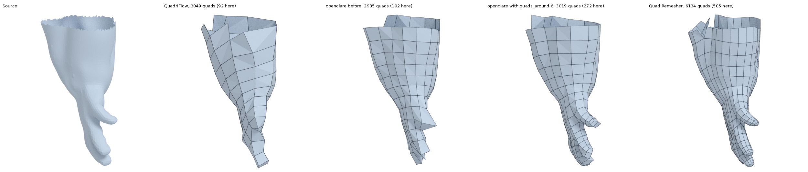

# openclare

Retopologie automatique en quads, alignée sur un champ de directions, écrite en Rust.
Objectif : une alternative open source à Quad Remesher, meilleure que le remaillage quad de
Blender.


What is left to do, in order: [ROADMAP.md](ROADMAP.md).

## In Blender

openclare comes as a Blender add-on (Blender 4.2 or later; built here for Linux, 64-bit Intel
or AMD). Build its archive:

```bash
make addon
```

Then, in Blender: *Edit > Preferences > Get Extensions*, the arrow at the top right, *Install
from Disk*, and pick `dist/openclare-0.1.0-linux-x64.zip`. A tab named *openclare* appears in
the sidebar of the 3D viewport (key N): choose a preset and a number of quads, select a mesh,
press *Remesh to Quads*. The result is a new object, `<name>.quads`, at the same place as the
original, which is left as it is. What is remeshed is the object as it is seen, modifiers
applied.

This is a first version: a preset, a number of quads and a button. Blender waits while the
engine runs (about eight seconds for the 200,000 triangles of the ogre at 3000 quads). Density
from Weight Paint, hard edges from the marked ones and UV layers come next
([ROADMAP.md](ROADMAP.md)).

The add-on calls the engine through a C interface (`crates/openclare-capi`), which any other
host can use: one call, flat arrays in, quads out, settings as the text of a saved
configuration. Blender's own arrays are read where they are, without a copy on the Python
side.

## État

La chaîne cible, `quad-layout`, va de bout en bout (triangles en entrée, quads en sortie) :
champ de croix aligné sur la courbure, simplification des singularités, carte sans couture,
T-mesh, quantification, puis une grille de quads par rectangle du T-mesh.

Sur les douze modèles organiques du corpus, à 3000 quads, elle fait **mieux que le remaillage
quad de Blender** (QuadriFlow) sur tous les critères retenus : maillages toujours valides (12
modèles sur 12, contre 5), arêtes deux fois mieux alignées sur la forme (8,6° contre 17,5°), moins
de sommets irréguliers, nombre de quads demandé tenu à 1,4 % près. Face à Quad Remesher, ses
quads sont plus réguliers (écart d'angle moyen 5,4° contre 7,2°) ; ses arêtes suivent encore un
peu moins bien la forme. La taille des quads s'adapte à la forme, et se règle aussi en peignant
une densité sur le modèle.

Les **arêtes vives** sont suivies exactement : avec le préréglage `hard-surface`, le maillage a
une arête le long de chaque arête vive de la pièce et un sommet sur chaque coin.

Deux autres chaînes restent dans le dépôt : `integer-grid`, la version provisoire, qui sert de
repli pour les surfaces sans singularité ni bord (un tore), et `instant-meshes`, le plancher de
comparaison.

Le cahier des charges, les mesures et la feuille de route sont dans
[ALGORITHME.md](ALGORITHME.md) ; ce qui a été écarté ou reporté en chemin, dans
[BACKLOG.md](BACKLOG.md) ; les auteurs, sources et licences des modèles 3D utilisés, dans
[CREDITS.md](CREDITS.md).

## Utilisation

```bash
cargo build --release
```

```bash
./target/release/openclare remesh entree.obj sortie.obj --quads 5000
```

Pour essayer sans maillage sous la main (`torus`, `sphere`, `cube`, `plane`) :

```bash
./target/release/openclare primitive torus tore.obj
```

### Préréglages

Un préréglage est un jeu de paramètres nommé ; chaque paramètre reste réglable par-dessus.

```bash
./target/release/openclare presets
```

```bash
./target/release/openclare remesh entree.obj sortie.obj --preset animation --quads 8000 --alignment 0.1
```

Pour enregistrer les réglages d'un lancement et les réutiliser comme préréglage personnel :

```bash
./target/release/openclare remesh entree.obj sortie.obj --preset organic --singularity-reach 4 --save-config perso.txt
```

```bash
./target/release/openclare remesh autre.obj sortie.obj --config perso.txt
```

`openclare --help` liste toutes les options. Pour mesurer un résultat et le comparer à Blender et à
Quad Remesher, voir [bench/README.md](bench/README.md).

Comme bibliothèque :

```rust
use openclare::{RemeshConfig, Target};

let mut config = RemeshConfig::for_organic(Target::QuadCount(5000));
config.alignment = 0.1;
let (quads, report) = config.remesh(&triangles)?;
```

La taille des quads suit la forme (réglage `--adaptivity`, de 0 pour une taille unique à 1) et,
si on en fournit une, une densité peinte : un fichier d'un poids par sommet de l'entrée, de 0
(le moins dense) à 1 (le plus dense). `--density-contrast` règle l'écart entre les deux : à 4,
la valeur par défaut, les zones peintes à 1 ont quatre fois plus de quads par unité d'aire.

```bash
./target/release/openclare remesh entree.obj sortie.obj --quads 3000 --adaptivity 0.7 --density poids.txt --density-contrast 8
```

Les parties fines gardent leur volume : là où la forme est trop mince pour les quads demandés
(un doigt, le bout d'une oreille), ils sont rendus assez petits pour qu'il en passe un certain
nombre autour, et un peu plus grands ailleurs, pour le même total. Ce nombre se règle avec
`--quads-around` : 6 dans les préréglages `organic` et `animation`, 0 (on ne regarde pas
l'épaisseur) dans `hard-surface`.

```bash
./target/release/openclare remesh entree.obj sortie.obj --quads 3000 --quads-around 8
```



Le maillage garde aussi le volume de la forme. Des sommets posés sur la surface donnent des
faces qui passent en dessous partout où elle est bombée ; une dernière étape les écarte donc
un peu de la surface, le long de leur normale, pour que les faces passent au travers plutôt
qu'en dessous. `--volume-fit` règle cet écart, de 0 (sommets sur la surface) à 1 (la valeur
par défaut).

```bash
./target/release/openclare remesh entree.obj sortie.obj --quads 3000 --volume-fit 0
```

Pour voir le T-mesh d'un modèle, ses coupes écrites comme des lignes sur la surface :

```bash
./target/release/openclare tmesh entree.obj --quads 3000 --simplify 2 --traces coupes.obj
```

Et pour le quantifier :

```bash
./target/release/openclare quantize entree.obj --quads 3000 --simplify 2
```

### Notes comparatives

Une note de 0 à 100, globale et par critère, pour chaque modèle du banc et chaque remailleur.
Le rapport (en anglais) est dans [bench/results/SCORES.md](bench/results/SCORES.md) ; il
explique comment chaque note est calculée.

```bash
make scores
```

Pour les notes d'un seul modèle, ou d'un maillage quelconque face à sa source :

```bash
make scores MODEL=ogre TARGET=8000
```

```bash
python3 scripts/scores.py mesh source.obj quads.obj --target 3000
```

### Une page par modèle

Ce que chaque remailleur fait de chaque modèle, en images, avec ses notes :
[docs/models/](docs/models/README.md). Les images sont rendues par Blender.

```bash
make pages
```

### Regarder la chaîne travailler

Chaque étape de la chaîne peut montrer ce qu'elle produit : maillage de travail et courbure,
taille demandée aux quads, champ de croix et singularités avant et après simplification,
coupes et nœuds de la structure globale, longueurs entières, quads avant et après relaxation.
Le tout s'enregistre dans un fichier `.rrd` que l'on ouvre dans la visionneuse de
[Rerun](https://rerun.io). Deux lignes de temps, à choisir en bas de la fenêtre :

- `step`, celle qui s'ouvre : une étape à la fois. Chaque étape remplace la précédente, sur
  la surface où elle se lit ; les flèches gauche et droite passent de l'une à l'autre, et la
  dernière montre le maillage final seul.
- `stack` : tout ce qui a été montré jusque-là reste, pour superposer deux étapes (les coupes
  sur le maillage final, par exemple) en masquant les calques dont on ne veut pas.

```bash
make view MODEL=ogre
```

Cette commande construit ce qu'il faut, remaille le modèle en enregistrant, puis ouvre la
visionneuse. La première construction est longue (Rerun compte plusieurs centaines de
dépendances) et demande Rust 1.95.

Rien de tout cela ne pèse sur le reste. La bibliothèque `openclare` ne connaît qu'une interface,
`Recorder`, et son implémentation muette `Silent`, celle qui sert par défaut : elle ne garde
rien et les étapes ne préparent alors rien. Rerun vit dans deux crates à part, construites
seulement sur demande :

| Crate | Rôle | Se construit avec |
|---|---|---|
| `openclare-rerun` | implémentation de `Recorder` qui écrit un `.rrd` ; donne l'option `--record` à `openclare remesh` | `cargo build --release -p openclare-cli --features rerun` |
| `openclare-viewer` | la visionneuse de Rerun embarquée, exécutable `openclare-view`, pour qui travaille sur le projet : rien d'autre à installer, et la bonne version | `cargo build --release -p openclare-viewer` |

À la main :

```bash
target/release/openclare remesh modele.obj quads.obj --quads 3000 --record modele.rrd
```

```bash
target/release/openclare-view modele.rrd
```

Un `.rrd` se lit avec la visionneuse de la version qui l'a écrit, ici la 0.36. Qui a déjà
Rerun 0.36 installé peut s'en servir à la place de `openclare-view`.

## Organisation

| Module | Rôle |
|---|---|
| `mesh` | conteneurs (`TriMesh`, `PolyMesh`), connectivité, OBJ, subdivision, primitives de test |
| `geometry` | normales, aires, détection des arêtes caractéristiques |
| `hierarchy` | graphe multi-résolution pour résoudre du grossier au fin |
| `field` | champ d'orientation (4-RoSy), champ de position (4-PoSy), contraintes, singularités |
| `extract` | du champ ou de la carte entière au graphe de quads, puis aux faces |
| `sizing` | champ de taille : quads plus petits là où la forme se courbe ou là où on l'a peint |
| `relax` | étape de relaxation : placement final, quads tirés vers des rectangles, sur la surface et les arêtes vives |
| `spatial` | BVH pour la projection sur la surface source |
| `pipeline` | enchaînement complet de la chaîne Instant Meshes |
| `remesher` | interface commune aux chaînes, fabrique qui les crée par nom, et les chaînes `quad-layout` et `integer-grid` |
| `preprocess` | étape de prétraitement : nettoyage, décimation, remaillage isotrope, courbures |
| `crossfield` | étape du champ de croix : une croix par face, alignement sur la courbure, singularités |
| `singularity` | étape de simplification : annulation des paires de singularités inutiles |
| `parametrization` | étape de paramétrisation : graphe de coupe, carte (u, v) sans couture |
| `tmesh` | étape de structure globale : traces depuis les singularités, patchs rectangulaires |
| `quantization` | étape de quantification : longueurs entières, connectivité du maillage quad |
| `meshing` | étape de maillage : une grille de quads par rectangle, sommets lus dans la carte |
| `linalg` | algèbre linéaire creuse (enveloppe de la bibliothèque `faer`) |
| `config` | configuration unique d'un remaillage, préréglages, enregistrement et relecture |
| `curvature` | courbures et directions principales |
| `metrics` | mesures de qualité d'un maillage quad par rapport à sa source |
| `fitting` | étape d'ajustement : les sommets quittent la surface pour que le maillage garde le volume |
| `thickness` | épaisseur de la forme sous chaque sommet, mesurée par des rayons à travers l'intérieur |
| crate `openclare-capi` | interface C du moteur : une bibliothèque partagée, pour Blender et d'autres hôtes |
| `recorder` | interface `Recorder` par laquelle les étapes montrent leur travail, et `Silent`, qui n'écoute rien ; aucune dépendance |

La chaîne actuelle est décrite dans
[docs/REFERENCE_INSTANT_MESHES.md](docs/REFERENCE_INSTANT_MESHES.md).

## Tests

```bash
cargo test
```

Les tests vérifient des invariants plutôt que des valeurs figées : théorème de Poincaré-Hopf sur
les singularités du champ, caractéristique d'Euler conservée, maillage fermé et variété, sommets
sur la surface, coins et arêtes vives retrouvés exactement, déterminisme.

## Licence

Le code : GPL-3.0-or-later, voir [LICENSE](LICENSE).

Les modèles 3D de l'auteur du projet (l'ogre) : CC BY-SA 4.0. Ceux de tiers gardent chacun leur
licence ; tout est détaillé dans [CREDITS.md](CREDITS.md).
