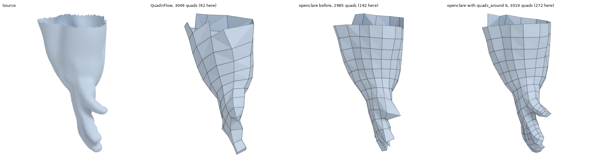

# openclare

Automatic quad retopology, aligned on a field of directions, written in Rust.
The aim: an open-source alternative to Quad Remesher, better than Blender's quad remesher.


What is left to do, in order: [ROADMAP.md](ROADMAP.md).

## In Blender

openclare comes as a Blender add-on (Blender 4.2 or later; built here for Linux, 64-bit Intel
or AMD). Build its archive:

```bash
make addon
```

Then, in Blender: *Edit > Preferences > Get Extensions*, the arrow at the top right, *Install
from Disk*, and pick `dist/openclare-0.1.0-linux-x64.zip`. A tab named *openclare* appears in
the sidebar of the 3D viewport (key N): select a mesh, set what follows, press *Remesh to
Quads*. The result is a new object, `<name>.quads`, at the same place as the original, which
is left as it is. What is remeshed is the object as it is seen, modifiers applied.

| Setting | What it does |
|---|---|
| Preset | What the mesh is for: organic, animation, hard surface |
| Quads | The number of quads asked for |
| Adaptive Size | How much the size of the quads follows the curvature: at 0 % they are all the same size; towards 100 % they get smaller where the shape bends and larger where it is flat, for the same number in total. Each preset brings its own value (50 %, or 0 % for hard surfaces) |
| Density | A vertex group of the object, painted in Weight Paint: quads are smallest where the weight is 1, largest where it is 0 |
| Factor | How many times more quads a weight of 1 gets than a weight of 0, for the same area |
| Curves | Curves drawn on the model, in two categories, each with its collection. *Guide* (cyan): the result has a line of edges along each. *Sharp* (violet): that line is made of hard edges, marked sharp and creased. *Assign* moves the selected curves to the category shown and gives them its colour, *Remove* takes them out, *Select* and *Deselect* act on all its curves. Curves are taken with their modifiers, so a Shrinkwrap is what keeps a curve on the model. A curve that cannot be kept as a line of edges is let go, and the report says so |

A section *Export* says what the result carries besides its quads, each with its box to tick:

| Export | What the result gets |
|---|---|
| UV Layers: Grid | A UV layer, `openclare grid`, where every quad is a unit square: stripes and checkers follow the edges across the surface. Parts of it lie on top of each other: it is for patterns that repeat, not for painting |
| UV Layers: Atlas | A UV layer, `openclare atlas`, made of islands that never overlap, packed into the unit square, to paint or bake on; its seams are marked on the edges. Every quad takes the same room in it, whatever its size on the surface |
| Edges: Sharp | The edges that follow a hard edge of the original are marked sharp. Only a preset that keeps hard edges (*Hard surface*) has any |
| Edges: Creases | The edges that should stay sharp when the result is subdivided get a crease weight, which a Subdivision Surface modifier reads: 1 along a hard edge of the original, less where the original folds without being marked hard |

Blender waits while the engine runs (about eight seconds for the 200,000 triangles of the ogre
at 3000 quads), and says where it is: the status bar shows each stage as it begins, the cursor
counts them, and they are written to the Info log. Reading the edges marked sharp in Blender
as hard edges to keep comes next ([ROADMAP.md](ROADMAP.md)).


From the command line the same curves go in as a text file, `--curves curves.txt`: one point
per line as `x y z`, a blank line between two curves, and a line saying `closed` for one that
joins its first point.

The add-on calls the engine through a C interface (`crates/openclare-capi`), which any other
host can use: one call, flat arrays in, quads out, settings as the text of a saved
configuration, and a function of the host's called as each stage begins, which can stop the
run. Blender's own arrays are read where they are, without a copy on the Python
side.

## Where it stands

The chain the project is about, `quad-layout`, runs end to end (triangles in, quads out): a
cross field aligned on curvature, simplification of its singularities, a seamless map, a
T-mesh, its quantization, then one grid of quads per rectangle of the T-mesh, relaxed and
fitted to the shape.

On the twelve organic models of the bench, at 3000 quads, it does **better than Blender's quad
remesher** (QuadriFlow) on every criterion kept: meshes always valid (12 models out of 12,
against 5), edges twice as well aligned on the shape (7.7 degrees off against 17.5), fewer
irregular vertices, the number of quads asked for held within 1 %. Against Quad Remesher its
quads are more regular (mean angle deviation 5.0 degrees against 6.5); its edges still follow
the shape a little less well. The size of the quads adapts to the shape, and can also be set by
painting a density on the model. The marks of every remesher on every model are in
[bench/results/SCORES.md](bench/results/SCORES.md).

**Hard edges** are followed exactly: with the `hard-surface` preset, the mesh has an edge along
every hard edge of the part and a vertex on every corner.

Two other chains stay in the repository: `integer-grid`, the provisional one, which serves as
a fallback where the main chain gives up, and `instant-meshes`, the floor the others are
measured against.

The specification and what each milestone delivered are in [ALGORITHM.md](ALGORITHM.md); what
is left to do, in [ROADMAP.md](ROADMAP.md); what was set aside or put off on the way, in
[BACKLOG.md](BACKLOG.md); the authors, sources and licences of the 3D models used, in
[CREDITS.md](CREDITS.md).

## Use

```bash
cargo build --release
```

```bash
./target/release/openclare remesh input.obj output.obj --quads 5000
```

To try it with no mesh at hand (`torus`, `sphere`, `cube`, `plane`):

```bash
./target/release/openclare primitive torus torus.obj
```

### Presets

A preset is a named set of settings; each setting can still be changed on top of it.

```bash
./target/release/openclare presets
```

```bash
./target/release/openclare remesh input.obj output.obj --preset animation --quads 8000 --alignment 0.1
```

To save the settings of a run and use them again as a preset of your own:

```bash
./target/release/openclare remesh input.obj output.obj --preset organic --singularity-reach 4 --save-config mine.txt
```

```bash
./target/release/openclare remesh other.obj output.obj --config mine.txt
```

`openclare --help` lists every option. To measure a result and compare it with Blender and
Quad Remesher, see [bench/README.md](bench/README.md).

As a library:

```rust
use openclare::{RemeshConfig, Target};

let mut config = RemeshConfig::for_organic(Target::QuadCount(5000));
config.alignment = 0.1;
let (quads, report) = config.remesh(&triangles)?;
```

The size of the quads follows the shape (setting `--adaptivity`, from 0 for quads of one size
to 1) and, if one is given, a painted density: a file of one weight per vertex of the input,
from 0 (least dense) to 1 (most dense). `--density-contrast` sets how far apart the two are:
at 4, the default, the places painted at 1 have four times the quads per unit of area.

```bash
./target/release/openclare remesh input.obj output.obj --quads 3000 --adaptivity 0.7 --density weights.txt --density-contrast 8
```

Thin parts keep their volume: where the shape is too thin for the quads asked for (a finger,
the tip of an ear), they are made small enough for a given number of them to go round it, and
a little larger elsewhere, for the same total. That number is set with `--quads-around`: 6 in
the `organic` and `animation` presets, 0 (thickness is not looked at) in `hard-surface`.

```bash
./target/release/openclare remesh input.obj output.obj --quads 3000 --quads-around 8
```



The mesh also keeps the volume of the shape. Vertices sitting on the surface give faces that
run under it wherever it bulges; a last stage therefore moves them a little off the surface,
along their normals, for the faces to run through it rather than under it. `--volume-fit` sets
how far, from 0 (vertices on the surface) to 1 (the default).

```bash
./target/release/openclare remesh input.obj output.obj --quads 3000 --volume-fit 0
```

To see the T-mesh of a model, its cuts written as lines on the surface:

```bash
./target/release/openclare tmesh input.obj --quads 3000 --simplify 2 --traces cuts.obj
```

And to quantize it:

```bash
./target/release/openclare quantize input.obj --quads 3000 --simplify 2
```

### Marks

A mark from 0 to 100, overall and per criterion, for every model of the bench and every
remesher. The report is in [bench/results/SCORES.md](bench/results/SCORES.md); it says how
each mark is made.

```bash
make scores
```

For the marks of one model, or of any mesh against its source:

```bash
make scores MODEL=ogre TARGET=8000
```

```bash
python3 scripts/scores.py mesh source.obj quads.obj --target 3000
```

### One page per model

What each remesher makes of each model, in pictures, with its marks:
[docs/models/](docs/models/README.md). The pictures are rendered by Blender.

```bash
make pages
```

### Watching the chain at work

Each stage of the chain can show what it makes: the work mesh and its curvature, the size
asked of the quads, the cross field and its singularities before and after simplification,
the cuts and nodes of the layout, the whole lengths, the quads before and after relaxation.
All of it is recorded in a `.rrd` file to open in the viewer of [Rerun](https://rerun.io).
Two timelines, to pick at the bottom of the window:

- `step`, the one it opens on: one stage at a time. Each stage takes the place of the one
  before, on the surface it is read on; the left and right arrows go from one to the next, and
  the last shows the final mesh alone.
- `stack`: everything shown so far stays, to lay one stage over another (the cuts over the
  final mesh, say), hiding the layers that are not wanted.

```bash
make view MODEL=ogre
```

This command builds what it takes, remeshes the model while recording, then opens the viewer.
The first build is long (Rerun comes with several hundred dependencies) and needs Rust 1.95.

None of this weighs on the rest. The `openclare` library knows one interface only, `Recorder`,
and its silent implementation `Silent`, the default one: it keeps nothing, and the stages then
prepare nothing. Rerun lives in two crates apart, built on demand only:

| Crate | What it is | Built with |
|---|---|---|
| `openclare-rerun` | the `Recorder` that writes a `.rrd`; gives `openclare remesh` its `--record` option | `cargo build --release -p openclare-cli --features rerun` |
| `openclare-viewer` | the Rerun viewer built in, executable `openclare-view`, for those who work on the project: nothing else to install, and the right version | `cargo build --release -p openclare-viewer` |

By hand:

```bash
target/release/openclare remesh model.obj quads.obj --quads 3000 --record model.rrd
```

```bash
target/release/openclare-view model.rrd
```

A `.rrd` is read by the viewer of the version that wrote it, here 0.36. Whoever has Rerun 0.36
installed can use it instead of `openclare-view`.

## Layout of the code

| Module | What it does |
|---|---|
| `mesh` | containers (`TriMesh`, `PolyMesh`), connectivity, OBJ, subdivision, test primitives |
| `geometry` | normals, areas, detection of feature edges |
| `hierarchy` | multi-resolution graph, to solve from coarse to fine |
| `field` | orientation field (4-RoSy), position field (4-PoSy), constraints, singularities |
| `extract` | from the field or the integer map to the graph of quads, then to faces |
| `sizing` | sizing field: quads smaller where the shape bends, where it is thin, or where it was painted |
| `relax` | relaxation stage: final placement, quads drawn towards rectangles, on the surface and on hard edges |
| `spatial` | BVH, for projecting onto the source surface and casting rays through it |
| `pipeline` | the whole Instant Meshes chain |
| `remesher` | the interface the chains share, the factory that makes them by name, and the `quad-layout` and `integer-grid` chains |
| `preprocess` | preprocessing stage: cleaning, decimation, isotropic remeshing, curvature, guide curves laid into the mesh |
| `crossfield` | cross field stage: one cross per face, alignment on curvature, singularities |
| `singularity` | simplification stage: cancelling the pairs of singularities that are not needed |
| `parametrization` | parametrization stage: cut graph, seamless (u, v) map |
| `tmesh` | layout stage: traces from the singularities, rectangular patches |
| `quantization` | quantization stage: whole lengths, connectivity of the quad mesh |
| `meshing` | meshing stage: one grid of quads per rectangle, vertices read off the map |
| `linalg` | sparse linear algebra (a wrapper round the `faer` library) |
| `config` | the one configuration of a run, presets, saving and reading back |
| `curvature` | curvatures and principal directions |
| `metrics` | quality measures of a quad mesh against its source |
| `fitting` | fitting stage: the vertices leave the surface for the mesh to keep the volume |
| `creases` | crease weight per edge, for subdivision to keep the hard edges and folds of the source |
| `uv` | two layers of texture coordinates unfolded from the quad mesh: the grid and the atlas |
| `thickness` | thickness of the shape under each vertex, measured by rays through its inside |
| `recorder` | the `Recorder` interface through which the stages show their work, and `Silent`, which listens to nothing; no dependency |
| crate `openclare-capi` | C interface of the engine: a shared library, for Blender and other hosts |

The chain the project started from is described in
[docs/REFERENCE_INSTANT_MESHES.md](docs/REFERENCE_INSTANT_MESHES.md).

## Tests

```bash
cargo test
```

The tests check invariants rather than frozen values: the Poincaré-Hopf theorem on the
singularities of the field, the Euler characteristic kept, a closed manifold mesh, vertices on
the surface, corners and hard edges found exactly, determinism.

## Licence

The code: GPL-3.0-or-later, see [LICENSE](LICENSE).

The 3D models by the author of the project (the ogre): CC BY-SA 4.0. Those by others each keep
their licence; all of it is in [CREDITS.md](CREDITS.md).
