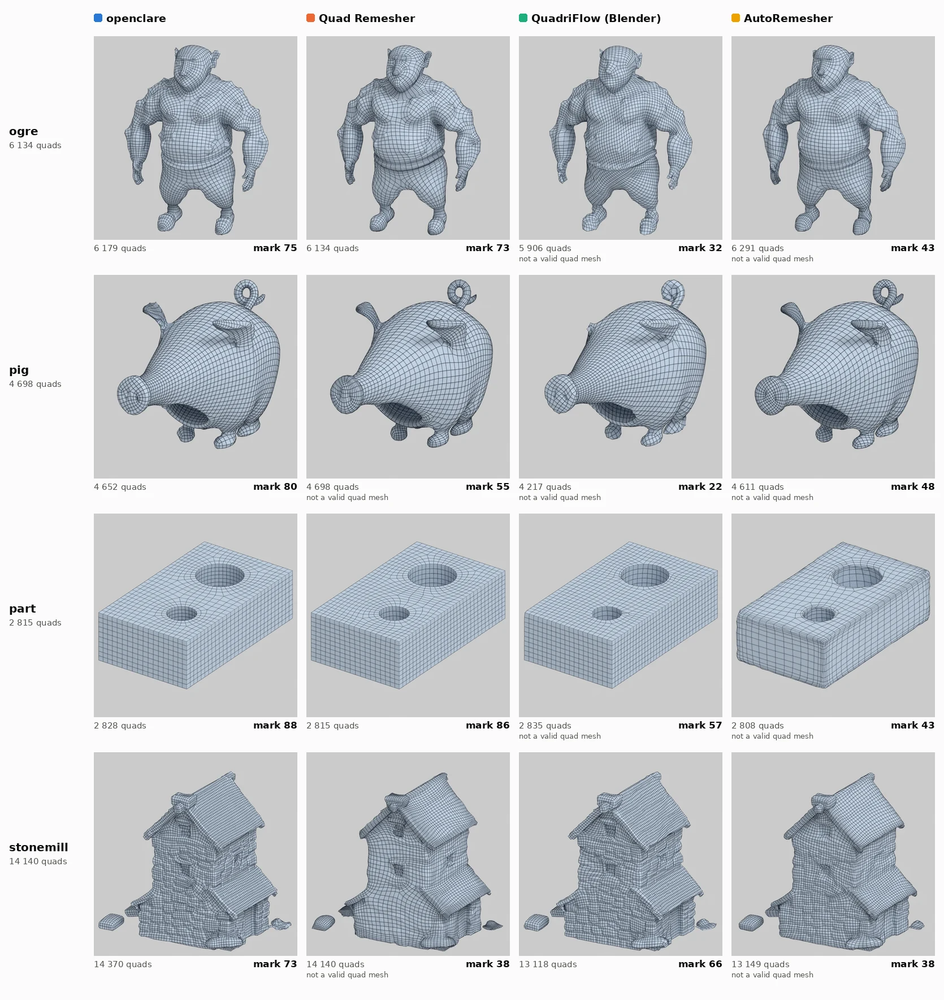
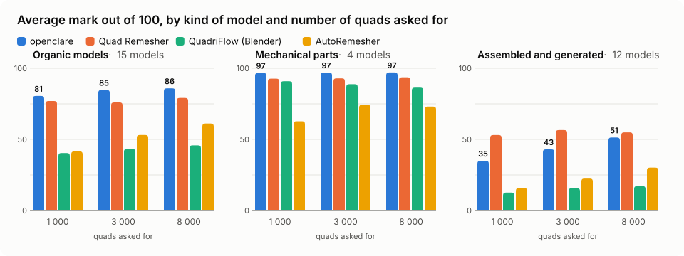
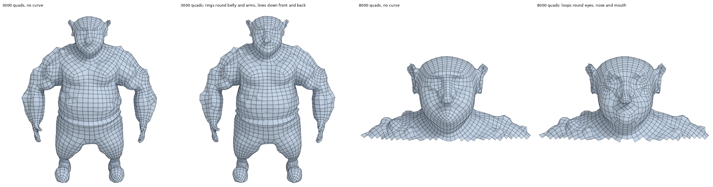

# openclare

Automatic quad retopology for Blender: a mesh of triangles in, a mesh of quads out, its edges
following the shape. Open source, written in Rust. The aim: an open alternative to the commercial
remeshers, better than QuadriFlow, the one built into Blender.

## Three remeshers side by side

<picture>
  <source media="(prefers-color-scheme: dark)" srcset="docs/images/dashboard/gallery-dark.webp">
  
</picture>

Each row at the same number of quads, asked of every remesher. The mark weighs
validity, alignment on the shape, the shape of the quads, the distance to the model, the
irregular vertices and the speed.

<picture>
  <source media="(prefers-color-scheme: dark)" srcset="docs/images/dashboard/marks-dark.svg">
  
</picture>

Every model, every remesher, in pictures: [docs/models](docs/models/README.md). The marks in
full: [SCORES.md](bench/results/SCORES.md).

## The Blender add-on

### Installing

One archive holds everything: the add-on and its engine, compiled. There is nothing else to
install, no Python package, no program beside it, and nothing is downloaded when it runs.

1. Take the archive of your system from the [releases](https://github.com/marcgardent/openclare/releases)
   (`openclare-<version>-linux-x64.zip` or `openclare-<version>-windows-x64.zip`), or build it
   ([CONTRIBUTING.md](CONTRIBUTING.md)).
2. In Blender 4.2 or later: *Edit > Preferences > Get Extensions*, the arrow at the top right,
   *Install from Disk*, and pick the archive.

A tab named *openclare* appears in the sidebar of the 3D viewport (key N). The Linux build runs
wherever Blender does (glibc 2.28 or later). The Windows build passes the tests of the engine but
has not yet been run in a Blender for Windows; there is no build for macOS yet.

### Using it

Select a mesh, set what follows, press *Remesh to Quads*. The result is a new object,
`<name>.quads`, at the same place as the original, which is left as it is. What is remeshed is the
object as it is seen, modifiers applied. Blender waits while the engine runs (about eight seconds
for the 200,000 triangles of the ogre at 3000 quads); the status bar shows each stage as it
begins.

| Setting | What it does |
|---|---|
| Object | The object to remesh. Left empty, it is the active object, and the panel says which that is |
| Preset | What the mesh is for: organic, animation, hard surface |
| Ask For | *Number*: a number of quads, kept; the shape says where they are smaller. *Sizes*: the largest and the smallest quad; the shape says which where, and the number of quads is what that makes |
| Quads | With *Number*: the number of quads asked for. A part that is thin all along (a ring, a strap, a wire) is given the quads its thickness calls for out of that number |
| Largest, Smallest | With *Sizes*: the edges of the largest and of the smallest quads, in the units of the scene. Flat and thick parts get the largest; thin parts and tight bends get smaller ones, down to the smallest. Set from the size of the object when left at 0. The run says how many quads the shape called for |
| Adaptive Size | How much the size of the quads follows the curvature: at 0 % they are all the same size; towards 100 % they get smaller where the shape bends and larger where it is flat. Each preset brings its own value |
| Density | A vertex group of the object, painted in Weight Paint: quads are smallest where the weight is 1, largest where it is 0 |
| Factor | How many times more quads a weight of 1 gets than a weight of 0, for the same area |
| Density from Shape | Writes the density the shape calls for, the sizes *Adaptive Size* and thin parts give for the number or the sizes asked for, as the vertex group `openclare density` of the object, and makes it the *Density* with *Adaptive Size* off, for the shape to count once. Paint on top of it in Weight Paint where more or less detail is wanted. Where the shape asks for quads smaller than *Factor* allows, the weight stays at 1, and the report says which *Factor* would hold them all |
| Curves | Curves drawn on the model, in two categories. *Guide* (cyan): the result has a line of edges along each. *Sharp* (violet): that line is made of hard edges, marked sharp and creased. *Assign*, *Remove*, *Select* and *Deselect* act on each category. Curves are taken with their modifiers, so a Shrinkwrap keeps a curve on the model. A curve that cannot be kept as a line of edges is let go, and the report says so |

What the result carries besides its quads, each with its box to tick:

| Export | What the result gets |
|---|---|
| UV Layers: Grid | A UV layer, `openclare grid`, where every quad is a unit square: stripes and checkers follow the edges across the surface. Parts of it lie on top of each other: it is for patterns that repeat, not for painting |
| UV Layers: Atlas | A UV layer, `openclare atlas`, made of islands that never overlap, packed into the unit square, to paint or bake on; its seams are marked on the edges. Every quad takes the same room in it, whatever its size on the surface: small quads, where the detail is, get more texels |
| Edges: Sharp | The edges that follow a hard edge of the original are marked sharp. Only a preset that keeps hard edges (*Hard surface*) has any |
| Edges: Creases | The edges that should stay sharp when the result is subdivided get a crease weight, which a Subdivision Surface modifier reads |
| Surface: Materials | Each quad gets the material of the surface it lies on, and the borders between materials are kept as lines of edges where that can be done |

### The relief of the original

With a result selected, *Bake Height Map* reads the relief of the original onto it: a height map
on its atlas, measured from the result subdivided, and the modifiers or the material that show it.
On the ogre at 3000 quads, the surface shown is then 0.12 per mille of the size of the model away
from the sculpt on average, against 0.92 subdivided without the relief; the bake takes a second.

| Relief | |
|---|---|
| Levels | How many times the result is subdivided under the relief: more of them carry finer detail, at four times the faces each |
| Resolution | The size of the height map, from 512 to 4096 texels a side |
| Apply As: Modifier | A Displace modifier after the Subdivision Surface. Shown in every view and by every renderer, applied or exported as geometry |
| Apply As: Material | The displacement of the material, with adaptive subdivision: Cycles dices the surface to the size of a pixel when it renders, for more detail and less memory. Nothing moves in Solid view |
| File | Writes the height map beside the model as well: OpenEXR, 32 or 16 bits (the heights themselves, midlevel 0, scale 1), or PNG, 16 bits (heights between 0 and 1, midlevel 0.5, the scale the panel shows) |
| Folder | Where the file goes (`//` is the folder of the `.blend`) |

## Further

- [USAGE.md](USAGE.md): the command line, sizes and their analysis, the library, the C interface
  for other hosts, and watching the chain at work.
- [CONTRIBUTING.md](CONTRIBUTING.md): building, testing, the bench, the layout of the code.
- [ALGORITHM.md](ALGORITHM.md): how it works, stage by stage, and what each milestone delivered.
- [ROADMAP.md](ROADMAP.md): what is left to do. Tickets are the
  [issues](https://github.com/marcgardent/openclare/issues).
- [CREDITS.md](CREDITS.md): the authors, sources and licences of the 3D models and tools used.

## Licence

The code: GPL-3.0-or-later, see [LICENSE](LICENSE). The 3D models by the author of the project
(the ogre, the car): CC BY-SA 4.0. Those by others each keep their licence, all listed in
[CREDITS.md](CREDITS.md).
