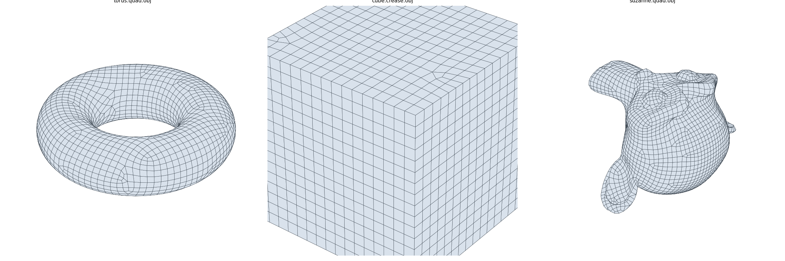

# retopo

Retopologie automatique en quads, alignée sur un champ de directions, écrite en Rust.
Objectif : une alternative open source à Quad Remesher.



## État

Première chaîne complète et fonctionnelle, de bout en bout : maillage triangulé en entrée,
maillage 100 % quads en sortie. Elle réimplémente l'approche d'*Instant Field-Aligned Meshes*
(Jakob et al., 2015), qui sert de socle au reste.

Ce qui marche :

- nombre de quads cible ou longueur d'arête cible ;
- sortie quads purs (par défaut) ou quad-dominante ;
- suivi des bords ouverts et des arêtes vives (`--crease-angle`), coins conservés ;
- résultat projeté sur la surface d'origine, déterministe (graine fixée) ;
- ~4,5 s pour 100 000 quads sur un seul cœur.

Cette chaîne est un **plancher de comparaison**, pas la cible : il reste 3 à 6 % de sommets
irréguliers parasites. La cible, son critère d'acceptation (faire mieux que le remaillage quad de
Blender) et ses jalons sont dans le cahier des charges [ALGORITHME.md](ALGORITHME.md).

## Utilisation

```bash
cargo build --release
```

```bash
./target/release/retopo remesh entree.obj sortie.obj --quads 5000 --crease-angle 30
```

Pour essayer sans maillage sous la main (`torus`, `sphere`, `cube`, `plane`) :

```bash
./target/release/retopo primitive torus tore.obj
```

`retopo --help` liste les options, dont `--method` qui choisit la chaîne de remaillage (une seule
pour l'instant, `instant-meshes`). Pour mesurer un résultat et le comparer à Blender, voir
[bench/README.md](bench/README.md).

Comme bibliothèque :

```rust
use retopo::{Params, Target, remesh};

let params = Params { target: Target::QuadCount(5000), crease_angle: Some(30.0), ..Default::default() };
let (quads, report) = remesh(&triangles, &params)?;
```

## Organisation

| Module | Rôle |
|---|---|
| `mesh` | conteneurs (`TriMesh`, `PolyMesh`), connectivité, OBJ, subdivision, primitives de test |
| `geometry` | normales, aires, détection des arêtes caractéristiques |
| `hierarchy` | graphe multi-résolution pour résoudre du grossier au fin |
| `field` | champ d'orientation (4-RoSy), champ de position (4-PoSy), contraintes, singularités |
| `extract` | du champ au graphe de quads, puis aux faces |
| `relax` | lissage final contraint à la surface et aux arêtes vives |
| `spatial` | BVH pour la projection sur la surface source |
| `pipeline` | enchaînement complet de la chaîne Instant Meshes |
| `remesher` | interface commune à toutes les chaînes, et fabrique qui les crée par nom |
| `preprocess` | étape de prétraitement : nettoyage, décimation, remaillage isotrope, courbures |
| `crossfield` | étape du champ de croix : une croix par face, alignement sur la courbure, singularités |
| `curvature` | courbures et directions principales |
| `metrics` | mesures de qualité d'un maillage quad par rapport à sa source |

La chaîne actuelle est décrite dans
[docs/REFERENCE_INSTANT_MESHES.md](docs/REFERENCE_INSTANT_MESHES.md).

## Tests

```bash
cargo test
```

Les tests vérifient des invariants plutôt que des valeurs figées : théorème de Poincaré-Hopf sur
les singularités du champ, caractéristique d'Euler conservée, maillage fermé et variété, sommets
sur la surface, coins et arêtes vives retrouvés exactement, déterminisme.

## Licence

GPL-3.0-or-later, voir [LICENSE](LICENSE).
