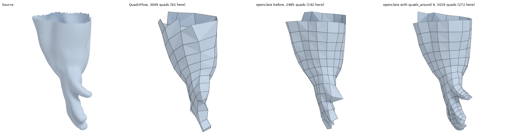
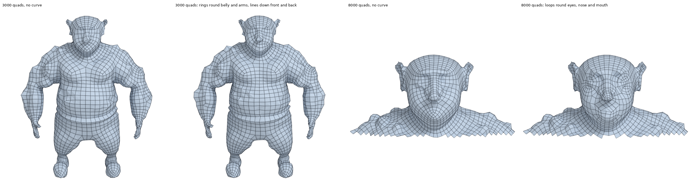

# Advanced usage

What the Blender add-on does is described in the [README](README.md). This page is for the rest:
the command line, the settings behind the panel, the library, and the tools to look inside a run.

## The command line

```bash
cargo build --release
```

```bash
./target/release/openclare remesh input.obj output.obj --quads 5000
```

To try it with no mesh at hand (`torus`, `sphere`, `cube`, `plane`, `lblock`, `cylinder`):

```bash
./target/release/openclare primitive torus torus.obj
```

`openclare --help` lists every command and option.

## Presets and saved settings

A preset is a named set of settings; each setting can still be changed on top of it.

```bash
./target/release/openclare presets
```

```bash
./target/release/openclare remesh input.obj output.obj --preset animation --quads 8000 --alignment 0.1
```

To save the settings of a run and use them again as a preset of your own:

```bash
./target/release/openclare remesh input.obj output.obj --preset organic --singularity-reach 4 --save-config mine.txt
```

```bash
./target/release/openclare remesh other.obj output.obj --config mine.txt
```

## A number of quads, or their sizes

`--quads` asks for a number of quads, and that number is kept. The shape says where they are
smaller: where it bends more than it typically does, and round its thin parts.

The number is a consequence, though: what one usually means is how coarse the mesh may be where
nothing happens, and how fine where the shape is thin or bends. `--largest` and `--smallest` ask
for that, as edge lengths in the units of the mesh. Each point gets the size its shape calls for
between the two, and the run says how many quads that made and how much of the surface would
have called for quads smaller than the smallest.

```bash
./target/release/openclare remesh input.obj output.obj --largest 0.25 --smallest 0.05
```

`--most-quads` (200,000 by default) is the most that are made: where the shape calls for more,
every quad is made larger, and the run says so.

`analyse` looks at the shape once and prints, for a range of smallest quads, how many quads each
would make, with a pair of sizes to start from: what a pair of sizes costs is known before
anything is meshed. Counting a pair takes a few milliseconds once the shape is analysed.

```bash
./target/release/openclare analyse input.obj
```

## How the size follows the shape

`--adaptivity` says how much the size of the quads follows the curvature: 0 for quads of one size,
1 for the error to the surface evened out. A painted density can be given too: a file of one
weight per vertex of the input, from 0 (least dense) to 1 (most dense). `--density-contrast` sets
how far apart the two are: at 4, the default, the places painted at 1 have four times the quads
per unit of area.

```bash
./target/release/openclare remesh input.obj output.obj --quads 3000 --adaptivity 0.7 --density weights.txt --density-contrast 8
```

With sizes asked for (`--largest`), `--quads-a-turn` takes the place of `--adaptivity`: it is the
number of quads that go round a cylinder, whatever its radius (12 by default). Where the surface
bends, the quads are as small as it takes for that many to go round the circle it bends along, no
larger than the largest and no smaller than the smallest. 0 does not look at how the surface
bends. With `--quads` the number sets the scale and this setting is not read.

```bash
./target/release/openclare remesh input.obj output.obj --largest 0.2 --smallest 0.02 --quads-a-turn 16
```

Thin parts keep their volume: where the shape is too thin for the quads (a finger, the tip of an
ear), they are made small enough for a given number of them to go round it. That number is set
with `--quads-around`: 6 in the `organic` and `animation` presets, 0 (thickness is not looked at)
in `hard-surface`.

```bash
./target/release/openclare remesh input.obj output.obj --quads 3000 --quads-around 8
```



A separate piece that is thin all along (a ring, a strap, a wire) gets the quads its thickness
calls for out of the number asked for: the other pieces have that many fewer, and keep half of
the number between them whatever is called for. The run says how many were moved.

The mesh also keeps the volume of the shape. Vertices sitting on the surface give faces that run
under it wherever it bulges; a last stage moves them a little off the surface, along their
normals, for the faces to run through it rather than under it. `--volume-fit` sets how far, from
0 (vertices on the surface) to 1 (the default).

```bash
./target/release/openclare remesh input.obj output.obj --quads 3000 --volume-fit 0
```

A mesh that will be subdivided is better fitted for what the subdivision makes of it: the
Catmull-Clark limit surface, which runs inside the faces wherever the shape bulges.
`--fitter limit-surface` moves the vertices for that surface, not the faces, to keep the volume
(experimental, off by default): the subdivided mesh comes closer to the shape, the quad mesh
itself a little less close.

```bash
./target/release/openclare remesh input.obj output.obj --quads 3000 --fitter limit-surface
```

## Guide curves

Curves drawn on the model become lines of edges of the result. From the command line they go in
as a text file, `--curves curves.txt`: one point per line as `x y z`, a blank line between two
curves, and a line saying `closed` for one that joins its first point.



## Poles placed by hand

`--poles poles.txt` places poles: one per line as `x y z valence`, the valence 3 or 5. The quad
mesh has a vertex of that valence on the surface where each is (within a quad), and places the
other poles the shape needs freely: it adds, removes or moves those to balance the ones placed.
`--poles-out <file>` writes the poles of the result in the same form, so that the poles of one
run can be placed on another, at another number of quads, say.

```bash
./target/release/openclare remesh blob.obj blob-8000.obj --quads 8000 --poles-out poles.txt
./target/release/openclare remesh blob.obj blob-1000.obj --quads 1000 --poles poles.txt
```

With `--symmetry`, only the poles on the positive side count: that half is mirrored.

## Flat parts as n-gons

`--faces ngons` (experimental) merges the quads of each flat part into convex faces of many
sides: the cap of a cylinder is one face, a cube is six, the part round a hole a few sectors. The result has
fewer faces and subdivides as the quads do, provided the creases are set on it: `--creases-out
<file>` writes them, one edge per line as its two vertices, numbered as in the output, and a
weight from 0 to 1. A flat part is only merged where full creases cut it off from the rest.
A flat part with a convex outline is not meshed at all: a cube comes out as 6 quads whatever
is asked for; the quads asked for a cylinder all go to its side, and with `--quads-a-turn 12`
it has 12 quads round it, where its caps would leave it 8.

```bash
./target/release/openclare remesh part.obj part-ngons.obj --preset hard-surface --quads 3000 --faces ngons --creases-out part-ngons.creases
```

## Symmetry

`--symmetry x` (or `y`, `z`; `symmetry = x` in a saved configuration) says that the plane through
the origin of the model, across that axis, is a plane of symmetry. The plane is drawn into the
model as a line of edges, the whole model is remeshed, and the half on the positive side is kept
and mirrored: the result is its own mirror image, with a loop of edges on the plane. A painted
density, groups (materials), guide curves and edges given as hard edges go through the cut.

A model that is not on both sides of the plane, or whose mirror image is more than 2 % of its
size away from its surface somewhere, is refused: its negative side would be replaced by
something else. Where the line on the plane could not be kept, the run says how many vertices were
put on the plane from more than half a quad away: the two halves then meet across their quads.

```bash
./target/release/openclare remesh head.obj quads.obj --quads 3000 --symmetry x
```

## Slow quality: loops closed by an exact solver

Lines of quads that go round a part (a limb, a neck, a finger) are closed into rings where the
whole lengths would wind them into spirals. Which of them to close together is a hard choice,
and the engine makes it quickly, a few rings at a time. `--quality slow` adds, after the engine,
three rounds in which an exact solver ([HiGHS](https://highs.dev), a mixed-integer solver)
chooses lengths that close as many of those rings as it can, within the same budget of quads
and the same distance from the real lengths; the engine keeps them only where they make fewer
spirals than its own.

```bash
./target/release/openclare remesh input.obj output.obj --quads 3000 --quality slow
```

On the 12 models of the quick batch, at 2970, 3000 and 3030 quads, the edges of spiral loops go
from 4.6 % to 2.9 % of the loop edges (better on 13 runs of 36, worse on none), for 60 s of
processor time per model instead of 9 s (Intel Core i7-7700K of 2017, 4 cores, 8 threads, three
runs at a time, load average 6 to 9). A piece where the engine's lengths leave no loop winding
as a spiral is not handed to the solver: the mesh is then the standard one to the byte, at no cost
(14 of the 36 runs).

Each solve stops at a **work limit**, `--slow-work-limit` (15 by default), counted in millions
of simplex iterations of the solver times arcs of the layout. It does not depend on the load of
the machine: two slow runs give the same mesh to the byte (checked on 8 models run one at a
time and three at a time, load average 4 to 9). It is not a time either: on the machine above, a
solve takes from a fraction of a second to about 100 seconds, a piece from a few seconds to a
few minutes. `--slow-time-limit` (300 seconds by default) is a bound for safety only: where it
stops a solve, the result depends on the load again. `--slow-work-limit 0` stops on the time
alone, as before. In a saved configuration: `quality = slow`, `slow_work_limit = 15`,
`slow_time_limit = 300`.

The solver is in a crate of its own (`crates/openclare-highs`), built from its sources with
cmake and a C++ compiler; `cargo build --release --no-default-features` builds the command line
tool without it, and `--quality slow` is then refused.

## Inside the chain

To see the T-mesh of a model, its cuts written as lines on the surface:

```bash
./target/release/openclare tmesh input.obj --quads 3000 --simplify 2 --traces cuts.obj
```

And to quantize it:

```bash
./target/release/openclare quantize input.obj --quads 3000 --simplify 2
```

`openclare remesh --notes` prints what the stages remark on: how many triangles folded and where,
how many guide edges were let go, why a piece went to the other chain.

### Watching the chain at work

Each stage of the chain can show what it makes: the work mesh and its curvature, the size asked
of the quads, the cross field and its singularities before and after simplification, the cuts and
nodes of the layout, the whole lengths, the quads before and after relaxation. All of it is
recorded in a `.rrd` file to open in the viewer of [Rerun](https://rerun.io). Two timelines, to
pick at the bottom of the window:

- `step`, the one it opens on: one stage at a time. Each stage takes the place of the one before,
  on the surface it is read on; the left and right arrows go from one to the next, and the last
  shows the final mesh alone.
- `stack`: everything shown so far stays, to lay one stage over another (the cuts over the final
  mesh, say), hiding the layers that are not wanted.

```bash
make view MODEL=ogre
make view MODEL=venturi QUADS=8000 OPTIONS='--groups bench/out/venturi/source.groups'
```

The stage `map` shows what the layout is cut from: its grid lines (`u-lines`, `v-lines`), the
triangles it folds or flattens (`folded-or-flat`), those that folded when every line was put on a
grid line (`folded-with-every-line`), and the guide lines kept and let go.

A model that is very small or very large (less than 1 or more than 1000 across) is shown at a
power of ten times its size, which a note of the recording gives.

`make view` builds what it takes, remeshes the model while recording, then opens the viewer. The
first build is long (Rerun comes with several hundred dependencies) and needs Rust 1.95. None of
it weighs on the rest: the library knows one interface only, `Recorder`, and its silent
implementation `Silent`. Rerun lives in two crates apart, built on demand only:

| Crate | What it is | Built with |
|---|---|---|
| `openclare-rerun` | the `Recorder` that writes a `.rrd`; gives `openclare remesh` its `--record` option | `cargo build --release -p openclare-cli --features rerun` |
| `openclare-viewer` | the Rerun viewer built in, executable `openclare-view` | `cargo build --release -p openclare-viewer` |

```bash
target/release/openclare remesh model.obj quads.obj --quads 3000 --record model.rrd
```

```bash
target/release/openclare-view model.rrd
```

A `.rrd` is read by the viewer of the version that wrote it, here 0.36.

## Measuring a result

```bash
./target/release/openclare measure source.obj quads.obj --target 3000
```

Its last lines are the reflection check: what of the mesh, taken as a cage for Catmull-Clark,
will make a reflection pinch or wobble once subdivided. Triangles and n-gons on a curved zone
(pinch), n-gons off their plane, poles on a curved zone, each ranked by an angle in degrees;
faces whose corner quads fold or are thin. The angle is measured on the cage, not on the
subdivided surface. An OBJ carries no crease: without them only the borders of the mesh are
sharp, and the creases `remesh --creases-out` wrote are given back with `--creases`:

```bash
./target/release/openclare remesh source.obj quads.obj --faces ngons --creases-out quads.creases
./target/release/openclare measure source.obj quads.obj --creases quads.creases
```

`detail` measures what a subdivision level misses of its source (the Multires baseline, PRO #6):
the distance from 60,000 points spread on the source by area to the level, its 99th percentile and
median in % of the diagonal of the source's bounding box, and the edges longer than 4 times the
median edge, a vertex thrown onto another part:

```bash
./target/release/openclare detail source.obj level-2.obj --json
```

`level` places a subdivision level on its source, the guarded projection of the Multires (PRO #6):
each vertex goes along its normal, both ways, onto the side of the source that faces its way, no
farther than `reach` times its shortest edge (1), else to the closest such point, else along its
normal as far as the reach allows; a vertex inside a creased line of the level goes to the source's
hard edges (sharper than `crease_angle`, 30 degrees); a face that comes out folded has its vertices
taken back. The output keeps the vertices and faces of the level; the report counts what became of
the vertices and measures the level as `detail` does (`samples = 0` skips that):

```bash
./target/release/openclare level source.obj level-2.obj placed-2.obj --creases level-2.creases \
    --settings "reach = 1; samples = 0" --status placed-2.status
```

`repair` cleans a cage up for its reflections in place, every vertex, edge and face kept: it
flattens the n-gons off their plane, makes the faces whose corner quads fold or are thin
star-shaped again, and proposes creases on edges already folding by `--crease-fold` degrees or more
(30), where they cure a pinch or a pole on a curved zone. Each repair is kept only if the score of
the check gets better, by an order that puts folded faces before any angle, and the angles of
pinches and poles before those of n-gons off their plane; no vertex moves further than `--bound`
times its shortest edge (0.1). It prints the score before, after, and with the proposed creases,
kind by kind, and why each fault is left. The creases are read and written as `--creases-out`
writes them; the proposed ones are written with the others only with `--apply-creases`:

```bash
./target/release/openclare repair quads.obj repaired.obj --creases quads.creases \
    --apply-creases --creases-out repaired.creases
```

The angles are those of the check, measured on the cage: "repaired" means by that measure, not on
the subdivided surface.

The marks from 0 to 100 the bench gives, for any mesh against its source:

```bash
python3 scripts/scores.py mesh source.obj quads.obj --target 3000
```

## As a library

```rust
use openclare::{RemeshConfig, Target};

let mut config = RemeshConfig::for_organic(Target::QuadCount(5000));
config.alignment = 0.1;
let (quads, report) = config.remesh(&triangles)?;
```

Sizes instead of a number: `Target::SizeRange { largest, smallest }`. `openclare::Analysis::of`
measures a shape once, then `quads`, `below` and `proposal` answer at once for any pair of sizes;
`at_vertices` gives the size at each vertex for a pair of sizes, `at_vertices_for` for a number of
quads.

The core depends on no solver: the slow quality asks one through the trait
`openclare::quantization::RingSelector`, injected in the configuration. Without one, the slow
quality is the standard one.

```rust
use openclare::config::Quality;
use openclare::quantization::Selector;

config.quality = Quality::Slow;
config.ring_selector = Selector::new(openclare_highs::HighsSelector::default());
```

## From another host

The add-on calls the engine through a C interface (`crates/openclare-capi`), which any other host
can use: one call, flat arrays in, quads out, settings as the text of a saved configuration, and a
function of the host's called as each stage begins, which can stop the run. Blender's own arrays
are read where they are, without a copy on the Python side. The C interface and the add-on do not inject a solver yet: through
them, `quality = slow` is the standard quality.
