# Glossary

*[Version française](GLOSSARY.fr.md)*

The geometric objects and terms used by openclare, its bench and the two research papers,
[Closing Edge Loops at Quantization Time](research/closing-loops/paper.tex) and
[Turns of a T-Mesh](research/turns-of-a-t-mesh/paper.tex). Names in `code` are those
of the engine's source.

The entries follow the chain: the mesh, the field, the map, the layout, the quantization, the
loops, then the theory of turns and the measures.

The pictures are drawn by [glossary/make_figures.py](glossary/make_figures.py). Those that show
a quad mesh with poles are computed, not drawn by hand: the shifts written on them are measured
by walking the edge loops of that mesh.

## 1. Meshes

**Triangle mesh**. The input: a surface made of triangles, such as a sculpt or a scan.

**Quad mesh**. The output: a surface made only of quadrilaterals. openclare never produces
triangles or n-gons.

**Valence**. The number of edges that meet at a vertex.

**Regular vertex**. An inner vertex of valence 4 in a quad mesh, or of valence 3 on a border.

**Irregular vertex, singular vertex, pole**. An inner vertex whose valence is not 4. In
practice it has valence 3 or 5, rarely 2 or 6. Edge flow turns around it. Artists call these
vertices poles.

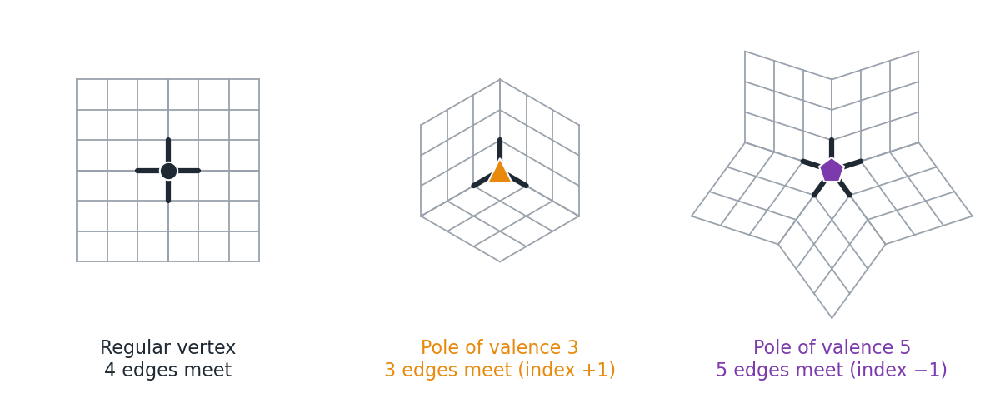

*Four edges meet at a regular vertex; three or five meet at a pole, where the edge flow turns.*

**Index**. 4 minus the valence: +1 for valence 3, −1 for valence 5. On a closed surface the
indices add up to 4 × (2 − 2g), where g is the genus (Gauss–Bonnet). On a sphere they add up to
8, so a quad mesh of a sphere has at least eight poles of valence 3.

**Genus**. The number of handles of a closed surface: 0 for a sphere, 1 for a torus.

**Closed surface, border**. A surface with no border edge, such as a ball. Suzanne and jerry
have borders. Several theorems of the note hold only on closed surfaces of genus 0.

**Piece**. A connected part of the input. Pieces are meshed separately and share the quad
budget.

**Work mesh**. The input remeshed into regular triangles before anything else. All later stages
compute on it.

**Base complex**. The partition of a quad mesh into the largest rectangular blocks of quads
bounded by the lines leaving the poles. Fewer patches mean a simpler structure. A cube-like
sphere has 6.

**Edge loop**. A line of edges that goes straight through every regular vertex. It stops at a
pole or a border, or comes back to where it started.

**Strip, quad strip**. A row of quads joined by their opposite edges: the quads between two
neighbouring edge loops.

**Ring, closed loop**. An edge loop or strip that comes back to its start and closes on itself.

**Spiral, helix**. An edge loop or strip that comes back beside its start, one or more rows
further along, and winds round the part like a thread on a screw. It is the main defect
openclare fights. Bommes et al. call it a *q-helix*.

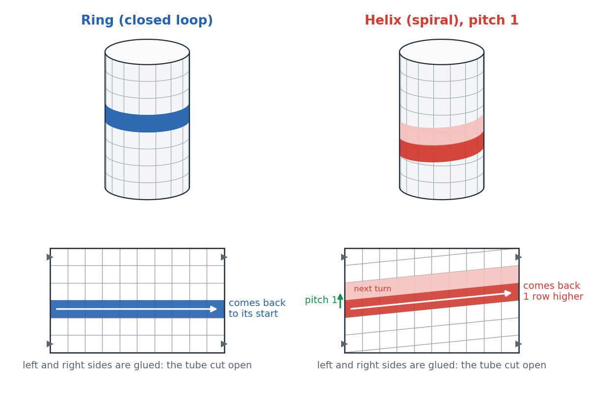

*A ring comes back to its start; a helix comes back one row higher and winds on like a screw
thread. Below, the same tube cut open and laid flat.*

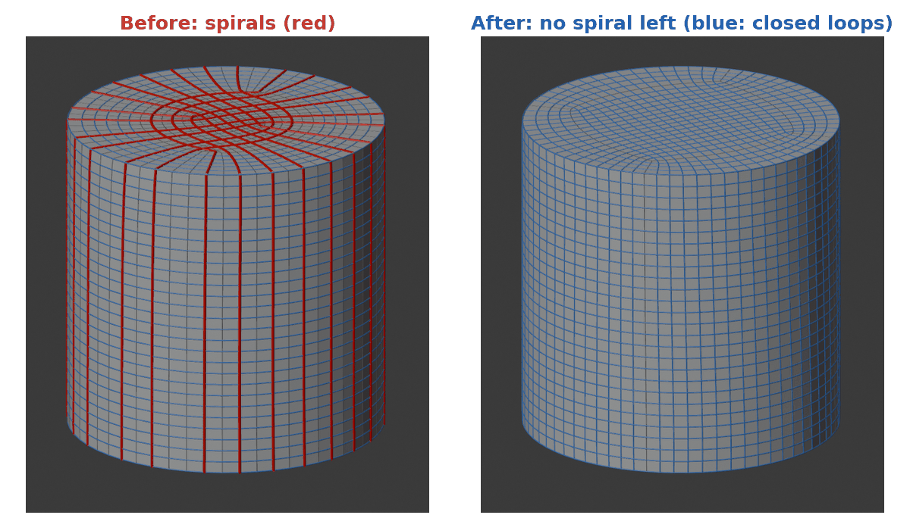

*openclare on a cylinder: before, the loops spiral (red); after closing them, every loop is a
ring (blue).*

**Open loop**. An edge loop that ends at a pole or a border.

**Inverted face, fold**. A quad that faces the opposite way from the source surface. A single
one makes the mesh invalid.

**Degenerate face**. A face with no area.

## 2. The cross field

**Principal curvature directions**. At each point of a surface, the two directions in which it
bends most and least.

**Cross field**. At each point, a cross with four arms at right angles that says which way the
edges of the quads should run. It is also called a 4-RoSy field (four-fold rotational
symmetry).

**N-RoSy field**. The same idea with N arms. A 6-RoSy field, a star with six arms, gives
triangle and hexagonal meshes (DT-068).

**Power field**. How openclare computes the cross field (Knöppel et al. 2013): the cross is
written as the complex number e^{4iθ}, and the smoothest field that also follows the curvature
is solved as a linear system.

**Confidence**. How far the two principal curvatures differ at a point. Where they are nearly
equal, as on a sphere, their directions mean nothing and are not followed (the confidence
floor, `CONFIDENCE_FLOOR`).

**Singularity of the field**. A point round which the cross turns by a quarter turn or more. It
becomes a pole of the mesh.

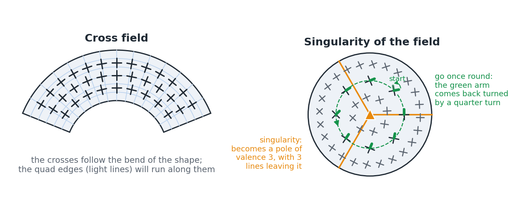

*Left: the crosses follow the bend of the shape. Right: going once round a singularity, the
cross comes back turned by a quarter turn; three lines leave it and it becomes a pole of
valence 3.*

**Period jump**. The number of quarter turns by which the cross is re-labelled across an edge
of the work mesh.

**Pair cancellation, singularity reach**. Removing a valence-3 and a valence-5 singularity that
are close to each other, to simplify the mesh. `singularity_reach` sets how far apart they may
be.

## 3. The map

**Seamless map, integer-grid map**. A flattening of the surface into the plane in which the
cross field becomes the horizontal and vertical directions. Across a cut it changes only by a
quarter-turn and a translation.

**Seam**. A cut in the surface along which the map is opened flat.

**Cone point**. A singular vertex seen in the flat map: the angle round it is 270° for valence
3 and 450° for valence 5, instead of 360°.

**Flat metric with cone points**. A quad mesh seen as a surface made of unit squares: flat
everywhere except at its poles.

**Developing map**. The map obtained by unfolding the surface patch by patch into the plane
along a path. Following different paths can bring different positions back.

**Holonomy**. What a closed path brings back after it is unfolded: a rotation by quarter turns
and a translation. The translation of a turn is its shift.

## 4. The layout

**Separatrix**. A line of the field that leaves a singularity: 3 lines leave a valence-3 vertex
and 5 leave a valence-5 vertex. Separatrices become edge loops that end at poles.

**Trace**. A separatrix followed across the surface until it meets another trace or a border.
It is called a *motorcycle* because it stops where it hits another one, like the bikes in the
film Tron.

**Head-on merge**. Two traces that run into each other from opposite directions are joined into
one, instead of one stopping on the other.

**T-mesh**. The layout made by the traces: a partition of the surface into rectangles whose
corners may sit in the middle of another rectangle's side.

**Patch**. One rectangle of the T-mesh. It becomes a grid of quads.

**Node**. A point where traces meet or stop: a singular vertex, or a T-junction.

**T-junction**. A node where one trace stops on another, so that it is a corner of some patches
and lies in the middle of a side of another.

**Arc**. A piece of a trace between two nodes: a side, or a part of a side, of a patch.
Quantization gives each arc a whole length.

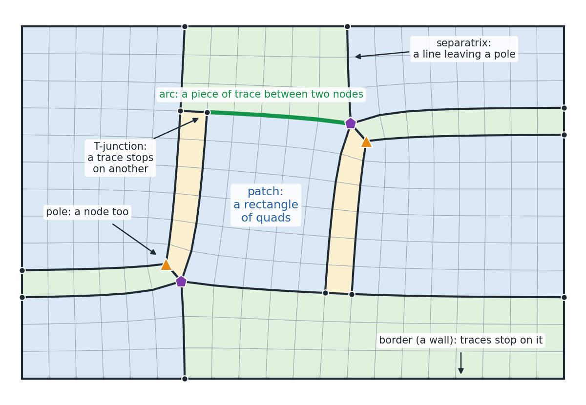

*The lines leaving the poles run until they hit another line or the border, and cut the surface
into rectangles of quads, the patches. Computed on a small quad mesh with two 3/5 pairs.*

**Wall**. A border or hard edge that traces may not cross.

**Patch grid meshing**. Turning every patch, once it has whole side lengths, into its grid of
quads.

## 5. Quantization

**Quantization**. Choosing a whole number of quad edges for every arc of the T-mesh, so that
the patches tile into quads. This is where the integer structure of the mesh, and with it its
loops, is decided.

**Balance**. For each patch, the two opposite sides must have the same total length. Each arc
appears in exactly two balance rows, with a sign each, which makes the balance matrix the
incidence matrix of a bidirected graph.

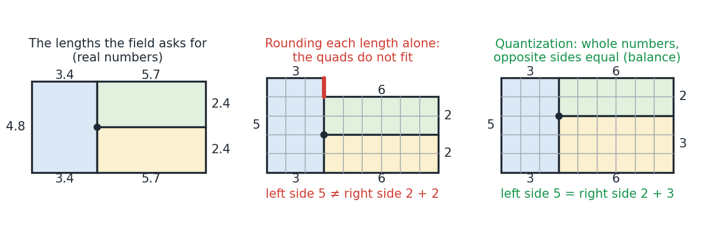

*The field asks for real lengths; rounding each one alone breaks the balance of the left patch;
quantization picks whole lengths so that opposite sides match and the quads fit.*

**Target lengths, deviation**. The real lengths the field asks for, and how far the whole
lengths chosen are from them. A larger deviation means quads that are less square.

**Deviation cap**. The largest deviation accepted when closing loops, relative to the plain
search: `DEVIATION_GROWTH` × plain + `DEVIATION_SLACK`. The simplicity setting moves it.

**Plain search**. The integer search with no loop closing, in the manner of the
minimum-deviation flow of Bi-MDF (Heistermann et al. 2023).

**Projection**. The smallest change of the real lengths that closes the chosen turns, solved by
least squares.

**Integer search**. The search for whole lengths near the projected ones that keep the
balances.

**Way**. One of the eight ways of choosing which turns to close (`CLOSE_WAYS`). They are all
tried, and the one that leaves the fewest spirals is kept.

**Repair walk, aimed repair**. Small changes of the whole lengths that try to close a remaining
helix.

**Cut round**. After a search, every strip of the whole lengths is walked, the helices the
field would have closed are added to the turns to close, and the search is run again.

**Active set**. In the projection, arcs that would come out with a negative length are held at
zero and the system is solved again.

**Candidate**. An admissible set of whole lengths, ranked by its spirals. When the chosen one
folds at meshing, the next ones are tried before the plain lengths.

**Fold guard**. The check that meshes other lengths when the chosen ones fold a quad.

**Simplicity**. The setting from 0 (most regular quads) to 1 (fewest poles and loops). The
presets sit at 0.25. It drives the singularity reach and the deviation cap.

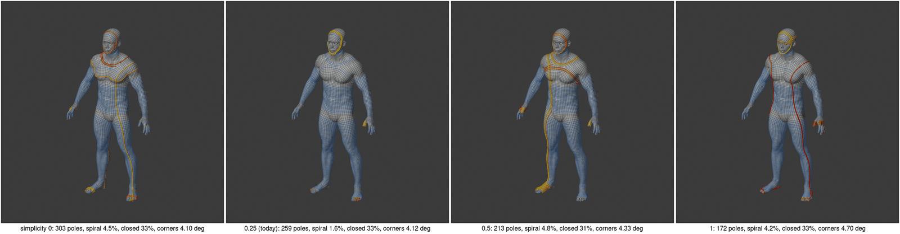

*The male body at simplicity 0, 0.25, 0.5 and 1: the number of poles falls as simplicity grows;
spiral loops are drawn yellow to red.*

## 6. Turns: the theory of the research note

**Turn**. A straight walk across the rectangles of the T-mesh that comes back to the side it
started from, going the same way. The strip of quads it follows is either a ring or a helix.

**Shift**. How far along its starting side a turn comes back: 0 for a ring, the pitch of the
helix otherwise. It is a linear form in the arc lengths (Proposition 1).

**Pitch**. The number of rows a helix advances per turn: its shift at whole lengths.

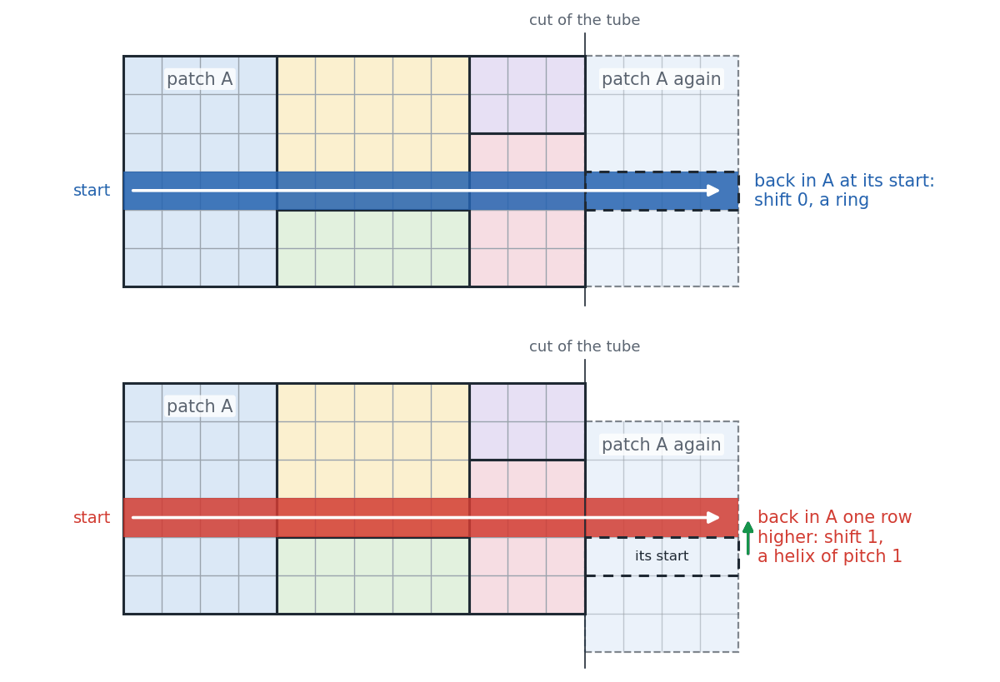

*A turn walks straight across the patches round a tube and comes back into its first patch: at
its start, the strip is a ring (shift 0); one row higher, it is a helix of pitch 1 (shift 1).*

**Around, along length**. The length of a turn's walk, its component along the walk.

**Lean**. The ratio of a turn's real shift to its length. A turn that the field nearly closes
(lean ≤ 0.12) is a ring of the field.

**Ring of the field**. A turn the field itself would nearly close: it should end up a ring.

**Undue helix**. A ring of the field that the whole lengths left as a helix: the rounding made
it, not the field.

**Station, half-integer start**. The midpoints of quad edges along a patch side (k + ½).
Walking from all of them finds every strip of the mesh (Proposition 2, completeness).

**Lattice walk, complete walk**. Walking from every station of every patch side at the whole
lengths, which lists all the strips of the final mesh.

**Burgers vector**. Borrowed from the dislocations of crystals: the translation that a loop
round some singular vertices fails to close by. The shift of a turn is the across component of
the Burgers vector of the singular vertices on one side of it.

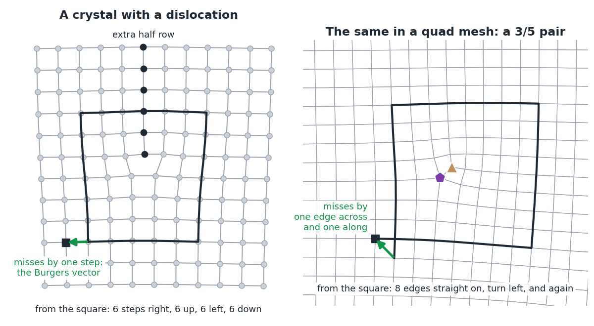

*Left: in a crystal with an extra half row of atoms, 6 steps right, up, left and down miss the
start by one step, the Burgers vector. Right: the same walk round a 3/5 pair of a quad mesh
misses by one edge across and one along. Both walks are computed.*

**Dislocation, 3/5 pair**. A valence-3 and a valence-5 vertex close to each other. Between two
parallel turns, such a pair makes their shifts differ by ±d₁±d₂, where d is the separation of
the pair.

**Staircase**. A path of arcs running in two directions a quarter turn apart between the two
vertices of a pair. The difference of the shifts of the two turns round it is the staircase's
length, so both can be rings only if the pair merges.

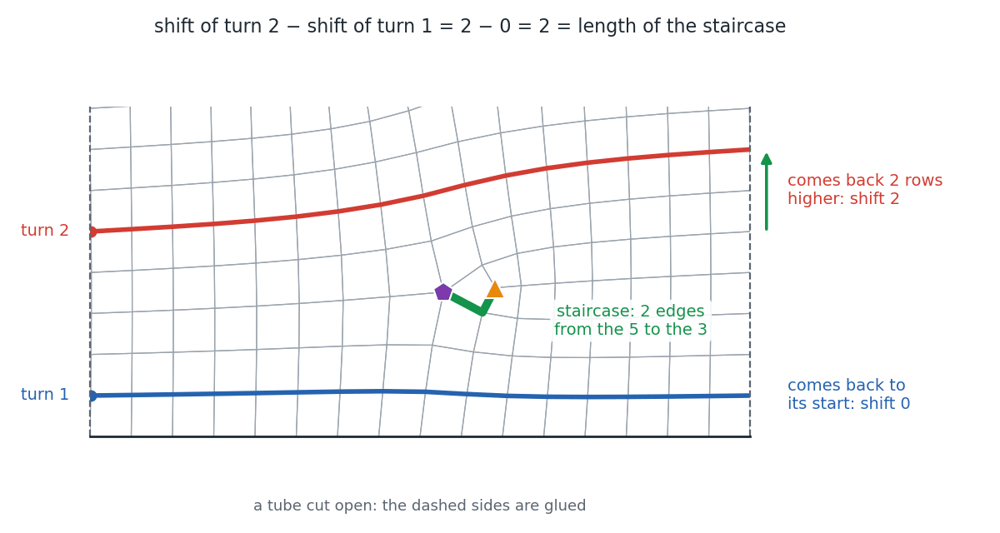

*A tube cut open with a 3/5 pair between two turns: turn 1 is a ring, turn 2 comes back 2 rows
higher, and the difference of their shifts is the length of the staircase from the 5 to the 3.
Shifts measured on the mesh.*

**Exchange of two vertices**. Two singular vertices of the same valence lying on opposite sides
of two crossing turns. It acts on the shifts like a dislocation.

**Cap**. A disc closed off by a turn, such as a fingertip, holding singular vertices whose
indices add up to 4, typically four of valence 3.

**Winding separatrix**. A separatrix that goes once round a limb and lands just beside its own
vertex. The turn round the limb is then held open by exactly that gap, as at the wrist of the
male body.

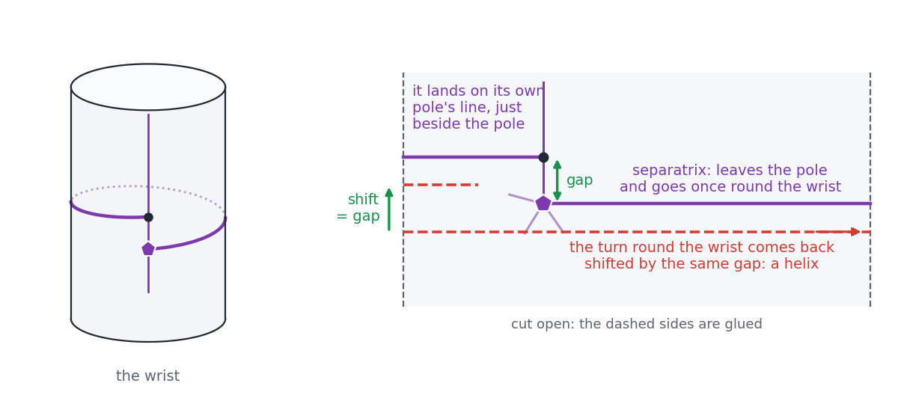

*A separatrix leaves a valence-5 pole, goes once round the wrist and lands on another line of
the same pole, just beside it; the turn round the wrist comes back shifted by that gap.*

**Gauss–Bonnet for turns**. A simple turn bounding a disc encloses singularities of total index
4. Two disjoint turns bounding an annulus enclose a total of 0.

**Parity of a turn**. On a closed sphere, the length plus the shift of a turn is even at whole
lengths. Every ring therefore has an even number of quads, and a helix of odd pitch can only
close if its length changes. It is false on surfaces with borders.

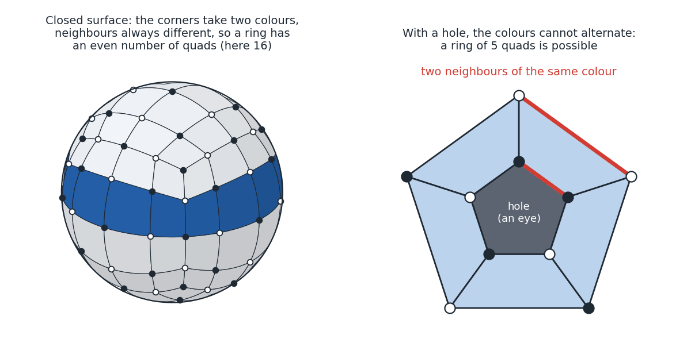

*On a closed surface the corners of the quads take two colours, neighbours always different, so
every ring has an even number of quads; round a hole, such as an eye, the colours clash and a
ring of 5 quads is possible.*

**Checkerboard rule**. Colour the whole points of the plane in a checkerboard. Two parallel
turns can both be rings only if an even number of odd-valence singular vertices between them
sit on white points.

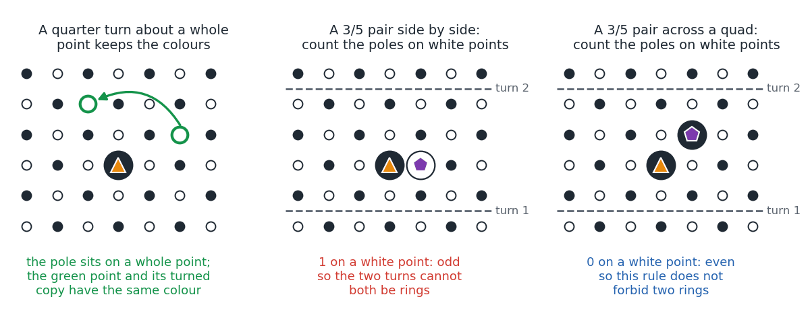

*A quarter turn about a whole point keeps the colours; between two turns, if an odd number of
the poles of valence 3 or 5 sit on white points, the two turns cannot both be rings.*

**Twisted winding, Fox–Burgers formula**. Any combination of shifts is a sum, over the singular
vertices, of a two-component winding times their Burgers term. The windings come from Fox's
free differential calculus. Plain winding numbers do not suffice.

**Sign-definite turn**. A turn whose shift keeps one sign whatever the lengths. It can never
close without collapsing an arc, so it must not be held.

**Farkas certificate**. A combination of shifts that proves a set of turns cannot all close: it
equals a non-negative sum of lengths containing an arc held at length 1 or more.

**Irreducible infeasible set**. A set of turns that cannot all close, although every smaller
subset can.

**Implicit zero**. An arc that every real solution of a closing system sets to zero. Collapsing
it shrinks the mesh.

**Lattice of closed quantizations**. All whole lengths that satisfy the balances and close a
set of turns: an integer lattice, ker_ℤ.

**Hermite normal form, LLL, Babai**. Tools of the geometry of numbers: an exact basis of a
lattice, a basis made of short vectors, and rounding to a nearby lattice point.

**Forced helices**. The fewest turns that any quantization must leave shifted, given the
singularities and their separation. On the male body there are 1 to 9 per way, where the engine
leaves 13 to 123.

**Chain of dislocations**. Nested parallel turns separated by dislocations of the same
orientation. m + 1 such turns force at least m helices.

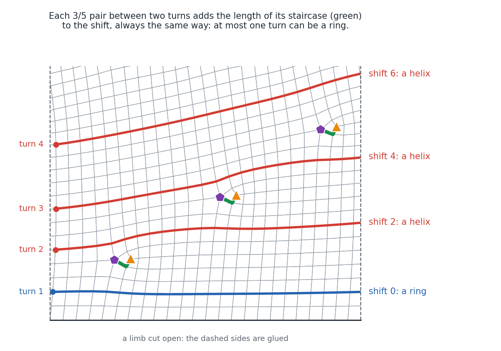

*Three 3/5 pairs of the same orientation up a limb: each adds the length of its staircase to
the shift, so the shifts climb (here 0, 2, 4, 6) and, in any quantization that keeps the pairs
apart, at most one of the four turns can be a ring. Shifts measured on the mesh.*

**Jenkins–Strebel differential, cylinder twist**. The classical picture of a surface cut into
flat cylinders. A helix is a cylinder whose twist is not a whole number.

## 7. Measures of the bench

**Spiral loop edges**. The share of edges that lie on spiral loops. Lower is better. A single
model's value is chaotic, so changes are judged over three budgets.

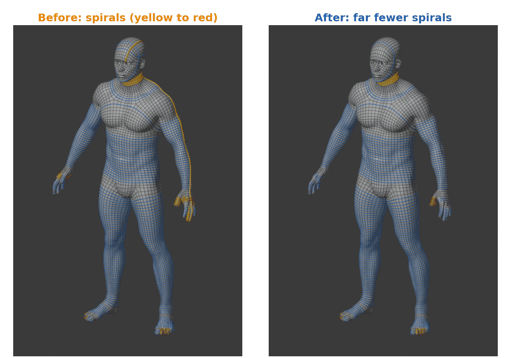

*The male body before and after closing loops: most spirals (yellow to red) become rings
(blue).*

**Closed loop edges**. The share of edges on closed loops. Higher is better.

**Helix loop edges**. The share of edges on helices of any pitch: loops that lie beside
themselves, the same way round, along a whole turn, however many quads apart. Lower is better.
Unlike the spiral loop edges, the engine does not choose its meshes by it, and the pitch has no
bound; a loop that comes back beside itself for less than a turn is not counted. The measure
also gives the helices of pitch above 4, which the spiral count misses, and the share of each
pitch.

**Hausdorff distance**. The largest distance between the result and the source, in thousandths
of the diagonal. It is chaotic for a single model.

**Mean distance**. The average distance between the result and the source.

**Thin-part distance**. The distance on the thin parts (fingers, ears, sheets), in quad edges.

**Aspect**. How elongated the quads are: 1 is square.

**Angle deviation**. How far the quads' corners are from 90°.

**Alignment**. How far the edges are from the principal curvature directions.

**Budget error**. How far the number of quads made is from the number asked for.

**Validity**. Closed where the source is closed, manifold, with no inverted or degenerate face.

**QuadSphere**. The academic answer for a sphere: the layout of a cube, with eight poles of
valence 3, six patches and every loop closed.

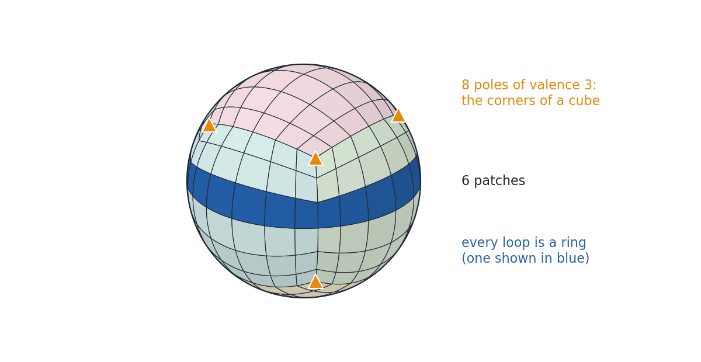

*The QuadSphere: a cube pushed onto a sphere, with 8 poles of valence 3 at its corners (their
indices add up to 8), 6 patches and every loop a ring.*

**Three-budget batch**. The 12 models of the quick comparison, each remeshed at 2,970, 3,000
and 3,030 quads, so that a change is not judged on one chaotic run.
