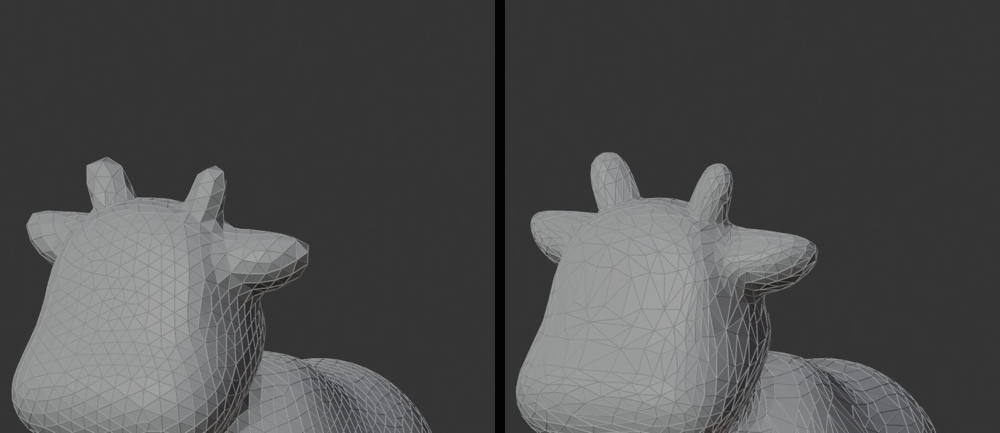

# Triangles against Blender's Decimate

*Output: Triangles* (DT-179) remeshes an object into triangles close to equilateral, for
simulation, 3D printing and collision meshes ([use cases](USE_CASES.md)). Blender already
reduces a mesh to triangles with its *Decimate* modifier. This page measures how the two differ,
so that the right one is chosen for the job.



## In short

- **The shape of the triangles: openclare.** Its triangles are close to equilateral everywhere: the smallest angle of a
  triangle is 48° to 54° on average, against 29° to 43° for *Collapse*; the worst 1 % stay at 20° to 44° on most models
  (*Collapse*: 1° to 13°), down to 6° and 7° on the ogre and jerry. A simulation of cloth or of a soft body, or an even surface to print, asks for that.
- **Fidelity to the shape: Decimate Collapse.** At the same number of triangles it is 1.6 to 20 times closer to the
  source (Hausdorff distance): it keeps vertices where the shape needs them and stretches its triangles to do so.
  openclare spreads them evenly; its *Adaptive Size* narrows the gap (the ogre at 100 % instead of 50 %: 3.27 % instead
  of 4.53 % by `openclare measure`), without closing it.
- **Closed, manifold, as the source.** Neither opens a closed model. openclare made a few triangles that cut through
  another one on three models (2 to 4) where *Collapse* made none; its report says how many, for they matter to a
  printer.
- **Time.** *Collapse* takes under a second; openclare 1 to 10 seconds.
- ***Planar* and *Un-Subdivide*** do not aim at a number of triangles. On sculpts they hardly reduce them: *Planar* keeps
  6,000 to 97,000 triangles of the models below, *Un-Subdivide* nearly all, as they are not made by subdivision.

## Measured

Twelve models of the bench, each at 6,000 triangles asked (*Collapse* set to the ratio that gives 6,000). In each
cell, **openclare / Collapse**. On an i7-7700K (4 cores, 8 threads, 62 GB), with other work running (load 6 to 8):
the times are an order of size, not a benchmark.

| Model | Source | Triangles | Least angle, mean | Least angle, worst 1 % | Edge ratio | Hausdorff | Crossing | Time |
|---|---|---|---|---|---|---|---|---|
| creature | 78,124 | 6,060 / 5,998 | 53° / 29° | 42° / 5° | 1.17 / 2.37 | 0.19 / 0.03 % | 0 / 0 | 1.6 / 0.4 s |
| blob | 124,004 | 6,048 / 6,000 | 54° / 43° | 44° / 13° | 1.14 / 1.54 | 0.78 / 0.08 % | 0 / 0 | 1.6 / 0.5 s |
| suzanne | 15,744 | 6,449 / 6,000 | 52° / 32° | 12° / 6° | 1.24 / 2.13 | 0.62 / 0.05 % | 81 / 138 | 2.3 / 0.0 s |
| spot | 100,250 | 6,040 / 6,000 | 53° / 34° | 37° / 10° | 1.17 / 1.91 | 0.73 / 0.07 % | 0 / 0 | 2.4 / 0.9 s |
| pig | 100,062 | 6,586 / 6,000 | 51° / 31° | 20° / 7° | 1.23 / 2.07 | 0.73 / 0.18 % | 2 / 0 | 5.5 / 0.5 s |
| ogre | 199,764 | 6,228 / 6,000 | 48° / 34° | 6° / 7° | 1.39 / 1.89 | 3.48 / 0.22 % | 4 / 0 | 10.5 / 1.0 s |
| bob | 102,756 | 5,966 / 6,000 | 52° / 34° | 41° / 10° | 1.18 / 1.88 | 0.54 / 0.05 % | 0 / 0 | 1.6 / 0.5 s |
| jerry | 39,856 | 6,576 / 6,000 | 48° / 30° | 7° / 5° | 1.39 / 2.23 | 1.61 / 0.11 % | 168 / 88 | 3.1 / 0.2 s |
| blub | 106,640 | 6,454 / 6,000 | 51° / 31° | 23° / 7° | 1.21 / 2.11 | 0.55 / 0.05 % | 4 / 0 | 5.2 / 0.5 s |
| rock | 81,920 | 5,844 / 6,000 | 53° / 38° | 43° / 13° | 1.15 / 1.66 | 0.44 / 0.27 % | 0 / 0 | 1.1 / 0.3 s |
| cage | 26,656 | 6,126 / 6,000 | 50° / 32° | 26° / 1° | 1.25 / 3.06 | 0.80 / 0.04 % | 0 / 0 | 1.3 / 0.1 s |
| part | 406 | 6,408 / 406 | 51° / 3° | 30° / 1° | 1.21 / 29.65 | 0.00 / 0.00 % | 0 / 0 | 1.5 / 0.0 s |

- **Least angle:** the smallest angle of each triangle; its mean, and the value under which the worst 1 % fall.
  An equilateral triangle has 60°.
- **Edge ratio:** the longest edge of a triangle over its shortest, on average. 1 is equilateral.
- **Hausdorff:** the farthest the two surfaces are from each other, either way, as a share of the diagonal of the
  box of the model. Measured from the vertices of each to the other, up to 40,000 vertices of the source.
- **Crossing:** triangles that cut through another one they share no vertex with. *suzanne* and *jerry* have open
  borders and crossings of their own in the source, which every method keeps.
- **part** has 406 triangles: *Collapse* has nothing to take away, and openclare makes 6,408 even ones of them.

## Where the measure stops

- One number of triangles, 6,000. A finer or coarser one may move the balance.
- openclare with the settings of its *Default* preset (*Adaptive Size* 50 %); the effect of 100 % is measured on two
  models only.
- No simulation was run and nothing was printed: the shape of the triangles and the crossings are what these uses
  are known to need, not a test of them.

## Again

The measures are in [bench/results/triangles-vs-decimate-6000.json](../bench/results/triangles-vs-decimate-6000.json),
made by [bench/triangles_vs_decimate.py](../bench/triangles_vs_decimate.py):

```bash
blender -b --factory-startup --python bench/triangles_vs_decimate.py -- blender bench/results/triangles-vs-decimate-6000.json 6000 bench/out/blob/source.obj
```
