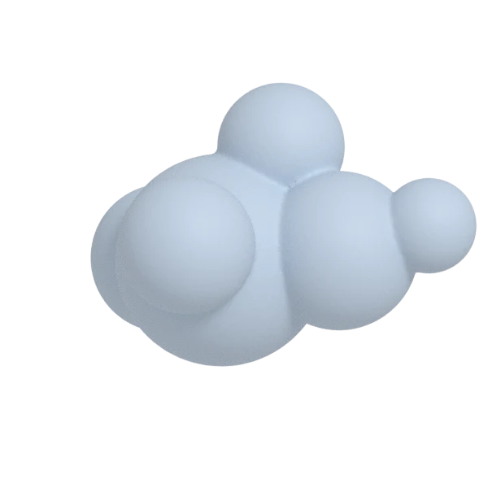
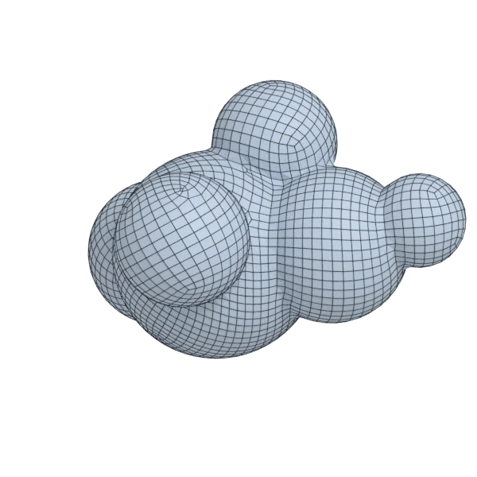
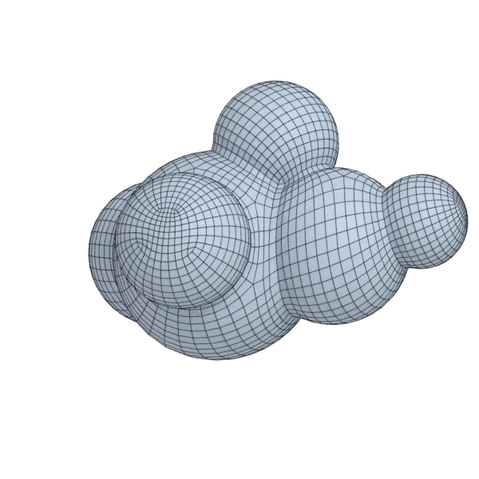
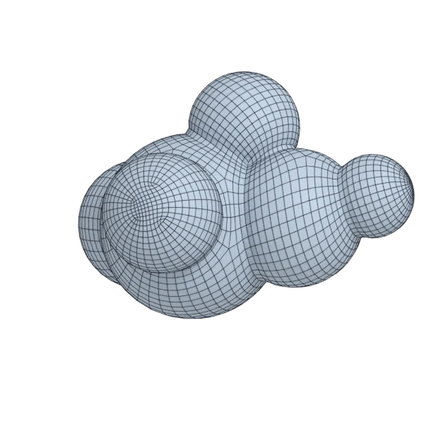

# blob

An organic model; 124 004 triangles in the source.
Author, source and licence: [CREDITS.md](../../CREDITS.md).

## At 3000 quads asked for

| Source | QuadriFlow (Blender) | openclare | Quad Remesher |
|---|---|---|---|
|  |  |  |  |
| 124 004 triangles | 2 796 quads | 3 005 quads | 3 370 quads |

## At equal quad count

Quad Remesher makes more quads than the 3000 it is asked for. Next to its mesh, openclare asked for as many quads as that mesh has.

| Quad Remesher | openclare, as many quads |
|---|---|
|  |  |
| 3 370 quads | 3 392 quads |

## Marks

From 0 to 100; how they are made is in [SCORES.md](../../bench/results/SCORES.md).

### 1000 quads

| Remesher | Quads | Overall | Validity | Alignment | Quad shape | Fidelity | Regularity | Structure | Budget | Speed |
|---|---|---|---|---|---|---|---|---|---|---|
| **openclare** | 990 | **84** | 100 | 80 | 71 | 87 | 84 | 20 | 96 | 83 |
| openclare-uniform | 1026 | **82** | 100 | 77 | 68 | 79 | 84 | 35 | 90 | 78 |
| quadremesher | 1362 | **76** | 100 | 85 | 66 | 85 | 87 | 62 | 0 | 36 |
| quadremesher-uniform | 878 | **76** | 100 | 78 | 68 | 62 | 79 | 51 | 51 | 37 |
| integer-grid | 867 | **70** | 100 | 67 | 52 | 65 | 82 | 31 | 47 | 63 |
| instant-meshes | 1036 | **61** | 100 | 21 | 62 | 70 | 34 | 0 | 86 | 87 |
| quadriflow | 941 | **57** | 80 | 20 | 54 | 71 | 70 | 0 | 76 | 84 |

At equal quad count: Quad Remesher's mesh as it is, and openclare asked for as many quads.

| Remesher | Quads | Overall | Validity | Alignment | Quad shape | Fidelity | Regularity | Structure | Budget | Speed |
|---|---|---|---|---|---|---|---|---|---|---|
| quadremesher-as-made | 1362 | **85** | 100 | 85 | 66 | 85 | 87 | 62 | 100 | 36 |
| openclare-matched | 1340 | **83** | 100 | 78 | 71 | 91 | 88 | 14 | 94 | 79 |

### 3000 quads

| Remesher | Quads | Overall | Validity | Alignment | Quad shape | Fidelity | Regularity | Structure | Budget | Speed |
|---|---|---|---|---|---|---|---|---|---|---|
| **openclare** | 3005 | **87** | 100 | 78 | 72 | 95 | 95 | 32 | 99 | 77 |
| openclare-uniform | 3021 | **85** | 100 | 76 | 69 | 94 | 95 | 22 | 97 | 69 |
| quadremesher-uniform | 2755 | **83** | 100 | 80 | 73 | 85 | 94 | 51 | 67 | 39 |
| quadremesher | 3370 | **83** | 100 | 83 | 71 | 92 | 95 | 46 | 51 | 32 |
| integer-grid | 2507 | **78** | 100 | 72 | 61 | 90 | 93 | 62 | 34 | 57 |
| instant-meshes | 3090 | **68** | 100 | 30 | 71 | 80 | 56 | 1 | 88 | 87 |
| quadriflow | 2781 | **57** | 60 | 22 | 56 | 83 | 89 | 3 | 71 | 76 |

At equal quad count: Quad Remesher's mesh as it is, and openclare asked for as many quads.

| Remesher | Quads | Overall | Validity | Alignment | Quad shape | Fidelity | Regularity | Structure | Budget | Speed |
|---|---|---|---|---|---|---|---|---|---|---|
| quadremesher-as-made | 3370 | **86** | 100 | 82 | 71 | 92 | 95 | 46 | 100 | 32 |
| openclare-matched | 3392 | **85** | 100 | 78 | 72 | 94 | 95 | 33 | 97 | 68 |

### 8000 quads

| Remesher | Quads | Overall | Validity | Alignment | Quad shape | Fidelity | Regularity | Structure | Budget | Speed |
|---|---|---|---|---|---|---|---|---|---|---|
| quadremesher | 7911 | **88** | 100 | 82 | 72 | 94 | 98 | 42 | 96 | 39 |
| **openclare** | 7979 | **86** | 100 | 76 | 71 | 96 | 98 | 15 | 99 | 54 |
| openclare-uniform | 8068 | **85** | 100 | 74 | 69 | 96 | 98 | 16 | 97 | 55 |
| quadremesher-uniform | 7035 | **84** | 100 | 80 | 72 | 93 | 98 | 59 | 52 | 38 |
| integer-grid | 7124 | **80** | 100 | 74 | 63 | 95 | 98 | 21 | 56 | 38 |
| instant-meshes | 8164 | **72** | 100 | 33 | 76 | 90 | 67 | 0 | 92 | 85 |
| quadriflow | 7590 | **62** | 60 | 34 | 61 | 90 | 96 | 2 | 80 | 65 |

At equal quad count: Quad Remesher's mesh as it is, and openclare asked for as many quads.

| Remesher | Quads | Overall | Validity | Alignment | Quad shape | Fidelity | Regularity | Structure | Budget | Speed |
|---|---|---|---|---|---|---|---|---|---|---|
| quadremesher-as-made | 7911 | **87** | 100 | 82 | 72 | 94 | 98 | 42 | 100 | 39 |
| openclare-matched | 7949 | **85** | 100 | 77 | 72 | 97 | 98 | 15 | 98 | 52 |
