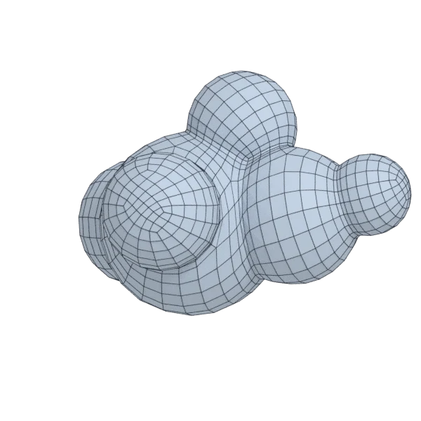

# blob

An organic model; 124 004 triangles in the source.
Author, source and licence: [CREDITS.md](../../CREDITS.md).

## At 3000 quads asked for

| Source | QuadriFlow (Blender) | AutoRemesher | openclare | Quad Remesher |
|---|---|---|---|---|
|  |  |  |  |  |
| 124 004 triangles | 2 796 quads | 1 165 quads | 3 019 quads | 3 370 quads |

## At equal quad count

Quad Remesher makes more quads than the 3000 it is asked for. Next to its mesh, openclare asked for as many quads as that mesh has.

| Quad Remesher | openclare, as many quads |
|---|---|
|  |  |
| 3 370 quads | 3 368 quads |

## Edge loops

At 3000 quads asked for. Each loop is followed straight on through every regular vertex: it closes, comes back beside itself a quad further (a spiral), stops at an irregular vertex, or runs from a border to a border. Share of the edges on each, those of borders and of faces that are not quads left out; "—" where the mesh is not a manifold.

| | closed | spiral | stops | border to border | spirals | longest that stops |
|---|---|---|---|---|---|---|
| Modelled by hand | — | — | — | — | — | — |
| QuadriFlow (Blender) | 0 % | 15 % | 85 % | 0 % | 3 | 321 |
| AutoRemesher | 17 % | 32 % | 51 % | 0 % | 7 | 120 |
| openclare | 40 % | 25 % | 35 % | 0 % | 2 | 243 |
| Quad Remesher | 23 % | 34 % | 43 % | 0 % | 7 | 274 |

## Marks

From 0 to 100; how they are made is in [SCORES.md](../../bench/results/SCORES.md).

### 1000 quads

| Remesher | Quads | Overall | Validity | Alignment | Quad shape | Fidelity | Regularity | Structure | Edge loops | Budget | Speed |
|---|---|---|---|---|---|---|---|---|---|---|---|
| **openclare** | 999 | **92** | 100 | 100 | 100 | 87 | 100 | 72 | 63 | 100 | 78 |
| openclare-uniform | 1017 | **88** | 100 | 100 | 100 | 79 | 100 | 46 | 53 | 93 | 87 |
| quadremesher-uniform | 878 | **87** | 100 | 100 | 100 | 62 | 100 | 51 | — | 51 | 37 |
| integer-grid | 867 | **84** | 100 | 100 | 90 | 65 | 100 | 31 | — | 47 | 65 |
| quadremesher | 1362 | **82** | 100 | 100 | 100 | 85 | 100 | 62 | 55 | 0 | 36 |
| instant-meshes | 1036 | **74** | 100 | 32 | 100 | 70 | 84 | 0 | — | 86 | 87 |
| autoremesher | 400 | **70** | 100 | 94 | 74 | 66 | 100 | 21 | 31 | 0 | 100 |
| quadriflow | 941 | **59** | 80 | 31 | 93 | 71 | 100 | 0 | 0 | 76 | 85 |

At equal quad count: Quad Remesher's mesh as it is, and openclare asked for as many quads.

| Remesher | Quads | Overall | Validity | Alignment | Quad shape | Fidelity | Regularity | Structure | Edge loops | Budget | Speed |
|---|---|---|---|---|---|---|---|---|---|---|---|
| quadremesher-as-made | 1362 | **95** | 100 | 100 | 100 | 85 | 100 | 62 | — | 100 | 36 |
| openclare-matched | 1354 | **90** | 100 | 100 | 100 | 90 | 100 | 69 | 50 | 98 | 85 |

### 3000 quads

| Remesher | Quads | Overall | Validity | Alignment | Quad shape | Fidelity | Regularity | Structure | Edge loops | Budget | Speed |
|---|---|---|---|---|---|---|---|---|---|---|---|
| quadremesher-uniform | 2755 | **92** | 100 | 100 | 100 | 85 | 100 | 51 | — | 67 | 39 |
| **openclare** | 3019 | **92** | 100 | 100 | 100 | 95 | 100 | 75 | 50 | 97 | 69 |
| openclare-uniform | 2980 | **91** | 100 | 100 | 100 | 94 | 100 | 56 | 57 | 97 | 78 |
| integer-grid | 2507 | **90** | 100 | 100 | 100 | 90 | 100 | 62 | — | 34 | 66 |
| quadremesher | 3370 | **86** | 100 | 100 | 100 | 92 | 100 | 46 | 50 | 51 | 32 |
| autoremesher | 1165 | **80** | 97 | 100 | 91 | 87 | 100 | — | 50 | 0 | 100 |
| instant-meshes | 3090 | **80** | 100 | 47 | 100 | 80 | 100 | 1 | — | 88 | 87 |
| quadriflow | 2781 | **59** | 60 | 35 | 96 | 83 | 100 | 3 | 15 | 71 | 81 |

At equal quad count: Quad Remesher's mesh as it is, and openclare asked for as many quads.

| Remesher | Quads | Overall | Validity | Alignment | Quad shape | Fidelity | Regularity | Structure | Edge loops | Budget | Speed |
|---|---|---|---|---|---|---|---|---|---|---|---|
| quadremesher-as-made | 3370 | **96** | 100 | 100 | 100 | 92 | 100 | 46 | — | 100 | 32 |
| openclare-matched | 3368 | **91** | 100 | 100 | 100 | 95 | 100 | 71 | 50 | 100 | 68 |

### 8000 quads

| Remesher | Quads | Overall | Validity | Alignment | Quad shape | Fidelity | Regularity | Structure | Edge loops | Budget | Speed |
|---|---|---|---|---|---|---|---|---|---|---|---|
| **openclare** | 8017 | **93** | 100 | 100 | 100 | 97 | 100 | 67 | 63 | 99 | 50 |
| quadremesher-uniform | 7035 | **92** | 100 | 100 | 100 | 93 | 100 | 59 | — | 52 | 38 |
| integer-grid | 7124 | **91** | 100 | 100 | 100 | 95 | 100 | 21 | — | 56 | 42 |
| openclare-uniform | 7931 | **91** | 100 | 100 | 100 | 96 | 100 | 55 | 50 | 97 | 55 |
| quadremesher | 7911 | **90** | 100 | 100 | 100 | 94 | 100 | 42 | 50 | 96 | 39 |
| instant-meshes | 8164 | **83** | 100 | 51 | 100 | 90 | 100 | 0 | — | 92 | 85 |
| autoremesher | 2795 | **82** | 100 | 100 | 93 | 94 | 100 | 58 | 56 | 0 | 77 |
| quadriflow | 7590 | **63** | 60 | 53 | 100 | 90 | 100 | 2 | 3 | 80 | 64 |

At equal quad count: Quad Remesher's mesh as it is, and openclare asked for as many quads.

| Remesher | Quads | Overall | Validity | Alignment | Quad shape | Fidelity | Regularity | Structure | Edge loops | Budget | Speed |
|---|---|---|---|---|---|---|---|---|---|---|---|
| quadremesher-as-made | 7911 | **96** | 100 | 100 | 100 | 94 | 100 | 42 | — | 100 | 39 |
| openclare-matched | 7838 | **91** | 100 | 100 | 100 | 97 | 100 | 68 | 50 | 96 | 52 |
