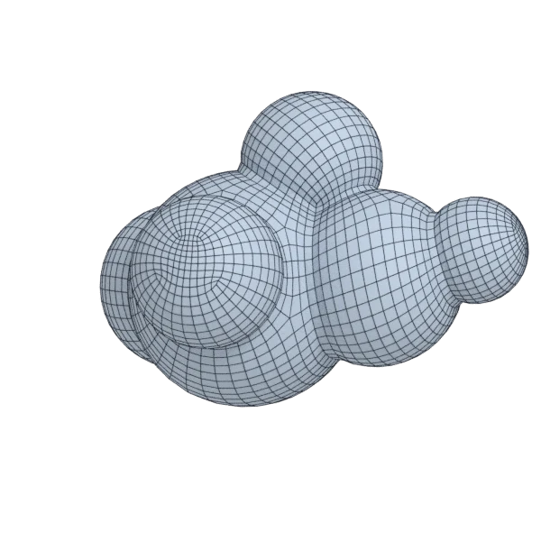

# blob

An organic model; 124 004 triangles in the source.
Author, source and licence: [CREDITS.md](../../CREDITS.md).

## At 3000 quads

| Source | QuadriFlow (Blender) | openclare | Quad Remesher |
|---|---|---|---|
|  |  |  |  |

## Marks

From 0 to 100; how they are made is in [SCORES.md](../../bench/results/SCORES.md).

### 1000 quads

| Remesher | Overall | Validity | Alignment | Quad shape | Fidelity | Regularity | Structure | Budget | Speed |
|---|---|---|---|---|---|---|---|---|---|
| **quad-layout-adaptive** | **82** | 100 | 79 | 72 | 75 | 84 | 20 | 99 | 89 |
| quad-layout | **81** | 100 | 77 | 68 | 72 | 84 | 35 | 90 | 91 |
| quadremesher | **76** | 100 | 85 | 66 | 85 | 87 | 62 | 0 | 36 |
| quadremesher-uniform | **76** | 100 | 78 | 68 | 62 | 79 | 51 | 51 | 37 |
| integer-grid | **69** | 100 | 66 | 52 | 57 | 82 | 31 | 47 | 68 |
| instant-meshes | **61** | 100 | 21 | 62 | 70 | 34 | 0 | 86 | 92 |
| quadriflow | **57** | 80 | 20 | 54 | 71 | 70 | 0 | 76 | 83 |

### 3000 quads

| Remesher | Overall | Validity | Alignment | Quad shape | Fidelity | Regularity | Structure | Budget | Speed |
|---|---|---|---|---|---|---|---|---|---|
| **quad-layout-adaptive** | **86** | 100 | 78 | 72 | 93 | 95 | 32 | 99 | 84 |
| quad-layout | **85** | 100 | 76 | 69 | 91 | 95 | 22 | 97 | 74 |
| quadremesher-uniform | **83** | 100 | 80 | 73 | 85 | 94 | 51 | 67 | 39 |
| quadremesher | **83** | 100 | 83 | 71 | 92 | 95 | 46 | 51 | 32 |
| integer-grid | **77** | 100 | 72 | 60 | 85 | 93 | 62 | 34 | 65 |
| instant-meshes | **68** | 100 | 30 | 71 | 80 | 56 | 1 | 88 | 87 |
| quadriflow | **57** | 60 | 22 | 56 | 83 | 89 | 3 | 71 | 84 |

### 8000 quads

| Remesher | Overall | Validity | Alignment | Quad shape | Fidelity | Regularity | Structure | Budget | Speed |
|---|---|---|---|---|---|---|---|---|---|
| quadremesher | **88** | 100 | 82 | 72 | 94 | 98 | 42 | 96 | 39 |
| **quad-layout-adaptive** | **86** | 100 | 76 | 71 | 96 | 98 | 15 | 99 | 61 |
| quad-layout | **85** | 100 | 74 | 69 | 95 | 98 | 16 | 97 | 62 |
| quadremesher-uniform | **84** | 100 | 80 | 72 | 93 | 98 | 59 | 52 | 38 |
| integer-grid | **80** | 100 | 74 | 63 | 94 | 98 | 21 | 56 | 37 |
| instant-meshes | **72** | 100 | 33 | 76 | 90 | 67 | 0 | 92 | 89 |
| quadriflow | **62** | 60 | 34 | 61 | 90 | 96 | 2 | 80 | 67 |
