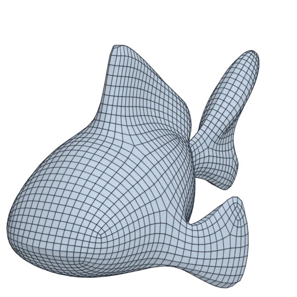

# blub

An organic model; 106 640 triangles in the source.
Author, source and licence: [CREDITS.md](../../CREDITS.md).

## At 3000 quads

| Source | QuadriFlow (Blender) | openclare | Quad Remesher |
|---|---|---|---|
|  |  |  |  |

## Marks

From 0 to 100; how they are made is in [SCORES.md](../../bench/results/SCORES.md).

### 1000 quads

| Remesher | Overall | Validity | Alignment | Quad shape | Fidelity | Regularity | Structure | Budget | Speed |
|---|---|---|---|---|---|---|---|---|---|
| quad-layout | **77** | 100 | 62 | 76 | 57 | 67 | 67 | 93 | 82 |
| **quad-layout-adaptive** | **74** | 100 | 59 | 72 | 61 | 58 | 47 | 96 | 83 |
| quadremesher | **72** | 100 | 78 | 66 | 84 | 68 | 49 | 0 | 35 |
| quadremesher-uniform | **67** | 100 | 69 | 58 | 41 | 50 | 51 | 57 | 38 |
| instant-meshes | **45** | 60 | 24 | 62 | 26 | 26 | 2 | 94 | 95 |
| quadriflow | **42** | 60 | 27 | 50 | 22 | 62 | 7 | 39 | 88 |
| integer-grid | **37** | 0 | 58 | 57 | 22 | 55 | — | 65 | 74 |

### 3000 quads

| Remesher | Overall | Validity | Alignment | Quad shape | Fidelity | Regularity | Structure | Budget | Speed |
|---|---|---|---|---|---|---|---|---|---|
| **quad-layout-adaptive** | **83** | 100 | 67 | 76 | 83 | 83 | 55 | 96 | 71 |
| quad-layout | **83** | 100 | 65 | 74 | 79 | 88 | 57 | 99 | 80 |
| quadremesher-uniform | **76** | 100 | 69 | 64 | 77 | 86 | 24 | 60 | 39 |
| quadremesher | **75** | 100 | 77 | 68 | 90 | 88 | 48 | 0 | 35 |
| instant-meshes | **67** | 100 | 31 | 72 | 69 | 51 | 4 | 95 | 95 |
| integer-grid | **48** | 0 | 63 | 57 | 71 | 83 | — | 54 | 56 |
| quadriflow | **45** | 60 | 29 | 46 | 19 | 84 | 4 | 60 | 85 |

### 8000 quads

| Remesher | Overall | Validity | Alignment | Quad shape | Fidelity | Regularity | Structure | Budget | Speed |
|---|---|---|---|---|---|---|---|---|---|
| **quad-layout-adaptive** | **85** | 100 | 71 | 69 | 93 | 94 | 45 | 100 | 50 |
| quad-layout | **85** | 100 | 69 | 67 | 91 | 95 | 58 | 100 | 51 |
| quadremesher | **82** | 100 | 72 | 68 | 91 | 95 | 27 | 74 | 33 |
| integer-grid | **78** | 100 | 68 | 56 | 89 | 94 | 58 | 53 | 31 |
| quadremesher-uniform | **76** | 100 | 66 | 62 | 84 | 94 | 29 | 47 | 37 |
| instant-meshes | **73** | 100 | 35 | 78 | 88 | 66 | 2 | 95 | 92 |
| quadriflow | **38** | 0 | 32 | 48 | 56 | 91 | 13 | 61 | 74 |
