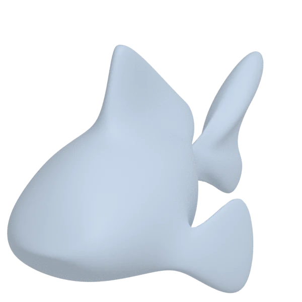
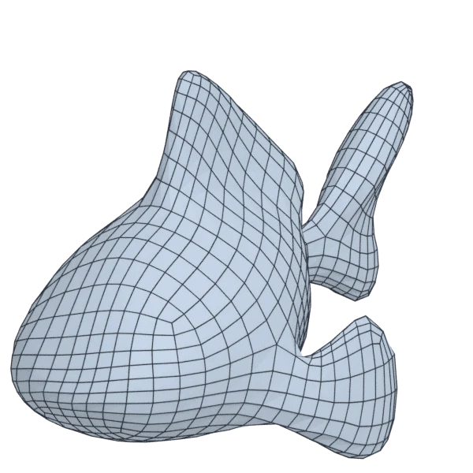
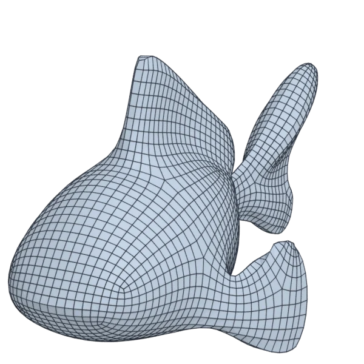
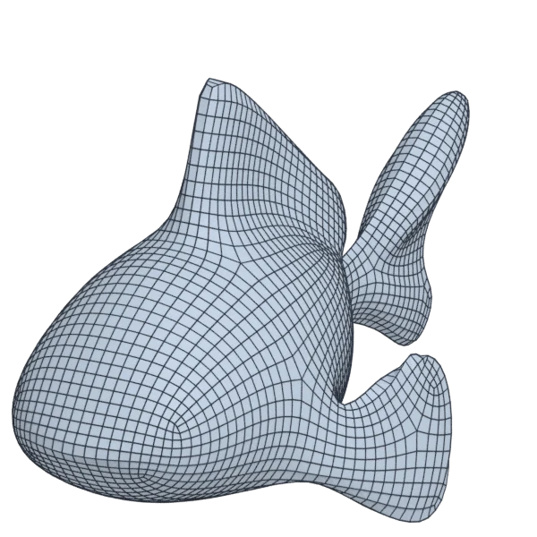

# blub

An organic model; 106 640 triangles in the source.
Author, source and licence: [CREDITS.md](../../CREDITS.md).

## At 3000 quads asked for

| Source | QuadriFlow (Blender) | AutoRemesher | openclare | Quad Remesher |
|---|---|---|---|---|
|  |  |  |  |  |
| 106 640 triangles | 2 770 quads | 1 343 quads | 3 030 quads | 3 889 quads |

## At equal quad count

Quad Remesher makes more quads than the 3000 it is asked for. Next to its mesh, openclare asked for as many quads as that mesh has.

| Quad Remesher | openclare, as many quads |
|---|---|
|  |  |
| 3 889 quads | 3 911 quads |

## Edge loops

At 3000 quads asked for. Each loop is followed straight on through every regular vertex: it closes, comes back beside itself a quad further (a spiral), stops at an irregular vertex, or runs from a border to a border. Share of the edges on each, those of borders and of faces that are not quads left out; "—" where the mesh is not a manifold.

| | closed | spiral | stops | border to border | spirals | longest that stops |
|---|---|---|---|---|---|---|
| QuadriFlow (Blender) | 0 % | 33 % | 64 % | 0 % | 13 | 225 |
| AutoRemesher | — | — | — | — | — | — |
| openclare | 36 % | 13 % | 51 % | 0 % | 8 | 170 |
| Quad Remesher | 25 % | 20 % | 54 % | 0 % | 6 | 201 |

## Marks

From 0 to 100; how they are made is in [SCORES.md](../../bench/results/SCORES.md).

### 1000 quads

| Remesher | Quads | Overall | Validity | Alignment | Quad shape | Fidelity | Regularity | Structure | Edge loops | Budget | Speed |
|---|---|---|---|---|---|---|---|---|---|---|---|
| openclare-uniform | 1027 | **77** | 100 | 63 | 75 | 65 | 69 | 55 | — | 89 | 77 |
| **openclare** | 984 | **71** | 100 | 60 | 72 | 76 | 57 | 46 | 21 | 94 | 75 |
| quadremesher | 1638 | **69** | 100 | 78 | 66 | 88 | 68 | 49 | 26 | 0 | 35 |
| quadremesher-uniform | 892 | **68** | 100 | 69 | 58 | 49 | 50 | 51 | — | 57 | 38 |
| instant-meshes | 996 | **47** | 60 | 24 | 62 | 36 | 26 | 2 | — | 94 | 97 |
| integer-grid | 888 | **41** | 0 | 59 | 57 | 48 | 61 | — | — | 55 | 73 |
| quadriflow | 847 | **40** | 60 | 27 | 50 | 31 | 62 | 7 | 10 | 39 | 83 |
| autoremesher | 604 | **20** | 0 | 35 | 48 | 18 | 4 | — | 35 | 0 | 92 |

At equal quad count: Quad Remesher's mesh as it is, and openclare asked for as many quads.

| Remesher | Quads | Overall | Validity | Alignment | Quad shape | Fidelity | Regularity | Structure | Edge loops | Budget | Speed |
|---|---|---|---|---|---|---|---|---|---|---|---|
| quadremesher-as-made | 1638 | **80** | 100 | 76 | 66 | 85 | 68 | 49 | — | 100 | 35 |
| openclare-matched | 1663 | **78** | 100 | 64 | 75 | 80 | 75 | 36 | — | 94 | 80 |

### 3000 quads

| Remesher | Quads | Overall | Validity | Alignment | Quad shape | Fidelity | Regularity | Structure | Edge loops | Budget | Speed |
|---|---|---|---|---|---|---|---|---|---|---|---|
| openclare-uniform | 2948 | **83** | 100 | 65 | 74 | 82 | 88 | 70 | — | 93 | 78 |
| **openclare** | 3030 | **80** | 100 | 65 | 75 | 84 | 83 | 58 | 48 | 96 | 73 |
| integer-grid | 2680 | **75** | 100 | 66 | 60 | 68 | 87 | 66 | — | 57 | 56 |
| quadremesher-uniform | 2703 | **74** | 100 | 69 | 64 | 69 | 86 | 24 | — | 60 | 39 |
| quadremesher | 3889 | **71** | 100 | 77 | 68 | 87 | 88 | 48 | 33 | 0 | 35 |
| instant-meshes | 3036 | **66** | 100 | 31 | 72 | 60 | 51 | 4 | — | 95 | 95 |
| quadriflow | 2698 | **40** | 60 | 29 | 46 | 13 | 84 | 4 | 0 | 60 | 87 |
| autoremesher | 1343 | **37** | 0 | 53 | 54 | 65 | 65 | — | — | 0 | 95 |

At equal quad count: Quad Remesher's mesh as it is, and openclare asked for as many quads.

| Remesher | Quads | Overall | Validity | Alignment | Quad shape | Fidelity | Regularity | Structure | Edge loops | Budget | Speed |
|---|---|---|---|---|---|---|---|---|---|---|---|
| openclare-matched | 3911 | **83** | 100 | 67 | 74 | 91 | 89 | 50 | — | 98 | 67 |
| quadremesher-as-made | 3889 | **82** | 100 | 76 | 68 | 84 | 88 | 48 | — | 100 | 35 |

### 8000 quads

| Remesher | Quads | Overall | Validity | Alignment | Quad shape | Fidelity | Regularity | Structure | Edge loops | Budget | Speed |
|---|---|---|---|---|---|---|---|---|---|---|---|
| openclare-uniform | 7990 | **85** | 100 | 69 | 67 | 93 | 95 | 58 | — | 100 | 49 |
| **openclare** | 7994 | **81** | 100 | 71 | 69 | 95 | 94 | 45 | 37 | 100 | 43 |
| integer-grid | 7057 | **78** | 100 | 68 | 56 | 91 | 94 | 58 | — | 53 | 27 |
| quadremesher | 8513 | **78** | 100 | 72 | 68 | 91 | 95 | 27 | 38 | 74 | 33 |
| quadremesher-uniform | 6943 | **76** | 100 | 66 | 62 | 84 | 94 | 29 | — | 47 | 37 |
| instant-meshes | 8100 | **73** | 100 | 35 | 78 | 88 | 66 | 2 | — | 95 | 96 |
| autoremesher | 3438 | **46** | 0 | 69 | 68 | 83 | 85 | — | 32 | 0 | 67 |
| quadriflow | 7229 | **35** | 0 | 32 | 48 | 56 | 91 | 13 | 9 | 61 | 69 |

At equal quad count: Quad Remesher's mesh as it is, and openclare asked for as many quads.

| Remesher | Quads | Overall | Validity | Alignment | Quad shape | Fidelity | Regularity | Structure | Edge loops | Budget | Speed |
|---|---|---|---|---|---|---|---|---|---|---|---|
| openclare-matched | 8369 | **85** | 100 | 71 | 69 | 95 | 94 | 67 | — | 93 | 45 |
| quadremesher-as-made | 8513 | **82** | 100 | 72 | 68 | 91 | 95 | 27 | — | 100 | 33 |
