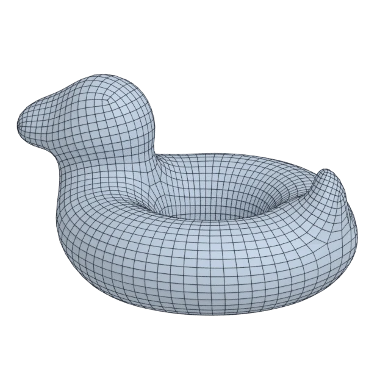

# bob

An organic model; 102 756 triangles in the source.
Author, source and licence: [CREDITS.md](../../CREDITS.md).

## At 3000 quads

| Source | QuadriFlow (Blender) | openclare | Quad Remesher |
|---|---|---|---|
|  |  |  |  |

## Marks

From 0 to 100; how they are made is in [SCORES.md](../../bench/results/SCORES.md).

### 1000 quads

| Remesher | Overall | Validity | Alignment | Quad shape | Fidelity | Regularity | Structure | Budget | Speed |
|---|---|---|---|---|---|---|---|---|---|
| **quad-layout-adaptive** | **88** | 100 | 84 | 78 | 89 | 79 | 81 | 89 | 91 |
| quad-layout | **87** | 100 | 81 | 78 | 84 | 82 | 76 | 97 | 89 |
| quadremesher | **85** | 100 | 86 | 73 | 85 | 78 | 58 | 82 | 38 |
| quadremesher-uniform | **82** | 100 | 84 | 69 | 85 | 76 | 74 | 57 | 32 |
| integer-grid | **76** | 100 | 81 | 73 | 53 | 79 | 79 | 44 | 75 |
| quadriflow | **64** | 100 | 11 | 60 | 75 | 71 | 1 | 89 | 90 |
| instant-meshes | **55** | 100 | 7 | 64 | 43 | 31 | 0 | 90 | 98 |

### 3000 quads

| Remesher | Overall | Validity | Alignment | Quad shape | Fidelity | Regularity | Structure | Budget | Speed |
|---|---|---|---|---|---|---|---|---|---|
| **quad-layout-adaptive** | **92** | 100 | 84 | 84 | 96 | 93 | 92 | 93 | 86 |
| quad-layout | **90** | 100 | 82 | 84 | 95 | 93 | 58 | 94 | 87 |
| quadremesher | **85** | 100 | 78 | 72 | 96 | 90 | 18 | 89 | 30 |
| integer-grid | **85** | 100 | 81 | 76 | 93 | 92 | 73 | 52 | 56 |
| quadremesher-uniform | **80** | 100 | 77 | 70 | 95 | 89 | 5 | 59 | 30 |
| quadriflow | **69** | 100 | 14 | 68 | 86 | 89 | 1 | 90 | 85 |
| instant-meshes | **66** | 100 | 8 | 73 | 85 | 57 | 0 | 95 | 93 |

### 8000 quads

| Remesher | Overall | Validity | Alignment | Quad shape | Fidelity | Regularity | Structure | Budget | Speed |
|---|---|---|---|---|---|---|---|---|---|
| quad-layout | **93** | 100 | 84 | 82 | 98 | 97 | 84 | 98 | 50 |
| **quad-layout-adaptive** | **91** | 100 | 83 | 81 | 97 | 98 | 64 | 99 | 55 |
| quadremesher | **80** | 100 | 76 | 68 | 97 | 95 | 30 | 45 | 26 |
| quadremesher-uniform | **80** | 100 | 74 | 66 | 97 | 96 | 45 | 42 | 31 |
| instant-meshes | **70** | 100 | 10 | 78 | 94 | 70 | 0 | 96 | 100 |
| quadriflow | **62** | 60 | 23 | 68 | 94 | 96 | 0 | 87 | 68 |
| integer-grid | **61** | 0 | 82 | 75 | 93 | 97 | 78 | 53 | 26 |
