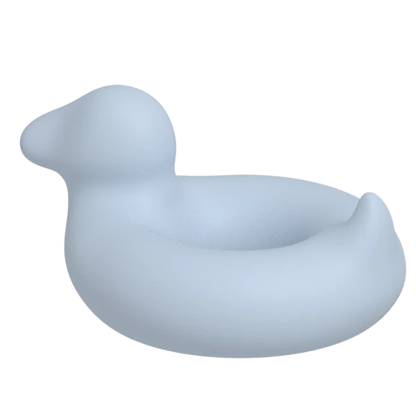
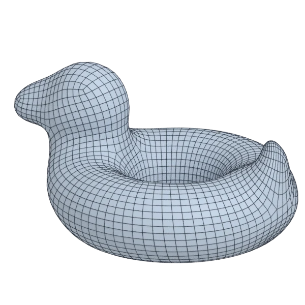

# bob

An organic model; 102 756 triangles in the source.
Author, source and licence: [CREDITS.md](../../CREDITS.md).

## At 3000 quads asked for

| Source | QuadriFlow (Blender) | AutoRemesher | openclare | Quad Remesher |
|---|---|---|---|---|
|  |  |  |  |  |
| 102 756 triangles | 2 871 quads | 1 583 quads | 2 968 quads | 2 920 quads |

## At equal quad count

Quad Remesher makes more quads than the 3000 it is asked for. Next to its mesh, openclare asked for as many quads as that mesh has.

| Quad Remesher | openclare, as many quads |
|---|---|
|  |  |
| 2 920 quads | 2 929 quads |

## Edge loops

At 3000 quads asked for. Each loop is followed straight on through every regular vertex: it closes, comes back beside itself a quad further (a spiral), stops at an irregular vertex, or runs from a border to a border. Share of the edges on each, those of borders and of faces that are not quads left out; "—" where the mesh is not a manifold.

| | closed | spiral | stops | border to border | spirals | longest that stops |
|---|---|---|---|---|---|---|
| Modelled by hand | — | — | — | — | — | — |
| QuadriFlow (Blender) | 1 % | 35 % | 65 % | 0 % | 9 | 309 |
| AutoRemesher | 45 % | 11 % | 44 % | 0 % | 3 | 172 |
| openclare | 74 % | 0 % | 26 % | 0 % | 0 | 122 |
| Quad Remesher | 9 % | 46 % | 45 % | 0 % | 12 | 218 |

## Marks

From 0 to 100; how they are made is in [SCORES.md](../../bench/results/SCORES.md).

### 1000 quads

| Remesher | Quads | Overall | Validity | Alignment | Quad shape | Fidelity | Regularity | Structure | Edge loops | Budget | Speed |
|---|---|---|---|---|---|---|---|---|---|---|---|
| **openclare** | 1009 | **98** | 100 | 100 | 100 | 92 | 100 | 82 | 100 | 96 | 83 |
| openclare-uniform | 1019 | **97** | 100 | 100 | 100 | 89 | 100 | 86 | 100 | 92 | 75 |
| quadremesher-uniform | 893 | **92** | 100 | 100 | 100 | 85 | 100 | 74 | — | 57 | 32 |
| quadremesher | 954 | **88** | 100 | 100 | 100 | 85 | 100 | 58 | 50 | 82 | 38 |
| integer-grid | 861 | **88** | 100 | 100 | 100 | 62 | 100 | 79 | — | 44 | 74 |
| autoremesher | 576 | **81** | 100 | 100 | 91 | 78 | 100 | 78 | 56 | 0 | 100 |
| instant-meshes | 1006 | **66** | 100 | 11 | 100 | 43 | 81 | 0 | — | 90 | 98 |
| quadriflow | 972 | **64** | 100 | 17 | 100 | 75 | 100 | 1 | 0 | 89 | 90 |

At equal quad count: Quad Remesher's mesh as it is, and openclare asked for as many quads.

| Remesher | Quads | Overall | Validity | Alignment | Quad shape | Fidelity | Regularity | Structure | Edge loops | Budget | Speed |
|---|---|---|---|---|---|---|---|---|---|---|---|
| openclare-matched | 936 | **97** | 100 | 100 | 100 | 93 | 100 | 74 | 96 | 92 | 73 |
| quadremesher-as-made | 954 | **95** | 100 | 100 | 100 | 85 | 100 | 58 | — | 100 | 38 |

### 3000 quads

| Remesher | Quads | Overall | Validity | Alignment | Quad shape | Fidelity | Regularity | Structure | Edge loops | Budget | Speed |
|---|---|---|---|---|---|---|---|---|---|---|---|
| **openclare** | 2968 | **99** | 100 | 100 | 100 | 97 | 100 | 92 | 100 | 96 | 68 |
| openclare-uniform | 2967 | **99** | 100 | 100 | 100 | 96 | 100 | 93 | 100 | 96 | 78 |
| integer-grid | 2642 | **93** | 100 | 100 | 100 | 95 | 100 | 73 | — | 52 | 55 |
| quadremesher-uniform | 2696 | **91** | 100 | 100 | 100 | 95 | 100 | 5 | — | 59 | 30 |
| quadremesher | 2920 | **87** | 100 | 100 | 100 | 96 | 100 | 18 | 40 | 89 | 30 |
| autoremesher | 1583 | **85** | 100 | 100 | 100 | 92 | 100 | 66 | 75 | 0 | 97 |
| instant-meshes | 3040 | **75** | 100 | 12 | 100 | 85 | 100 | 0 | — | 95 | 91 |
| quadriflow | 2928 | **67** | 100 | 22 | 100 | 86 | 100 | 1 | 3 | 90 | 87 |

At equal quad count: Quad Remesher's mesh as it is, and openclare asked for as many quads.

| Remesher | Quads | Overall | Validity | Alignment | Quad shape | Fidelity | Regularity | Structure | Edge loops | Budget | Speed |
|---|---|---|---|---|---|---|---|---|---|---|---|
| openclare-matched | 2929 | **99** | 100 | 100 | 100 | 96 | 100 | 94 | 100 | 99 | 74 |
| quadremesher-as-made | 2920 | **95** | 100 | 100 | 100 | 96 | 100 | 18 | — | 100 | 30 |

### 8000 quads

| Remesher | Quads | Overall | Validity | Alignment | Quad shape | Fidelity | Regularity | Structure | Edge loops | Budget | Speed |
|---|---|---|---|---|---|---|---|---|---|---|---|
| **openclare** | 8034 | **98** | 100 | 100 | 100 | 98 | 100 | 97 | 87 | 98 | 42 |
| openclare-uniform | 8111 | **92** | 100 | 100 | 100 | 99 | 100 | 82 | 50 | 94 | 46 |
| quadremesher-uniform | 6832 | **91** | 100 | 100 | 100 | 97 | 100 | 45 | — | 42 | 31 |
| quadremesher | 6896 | **85** | 100 | 100 | 100 | 97 | 100 | 30 | 47 | 45 | 26 |
| autoremesher | 4012 | **83** | 100 | 100 | 100 | 97 | 100 | 67 | 50 | 0 | 79 |
| instant-meshes | 8072 | **77** | 100 | 16 | 100 | 94 | 100 | 0 | — | 96 | 92 |
| integer-grid | 7052 | **68** | 0 | 100 | 100 | 93 | 100 | 78 | — | 53 | 32 |
| quadriflow | 8263 | **61** | 60 | 36 | 100 | 94 | 100 | 0 | 0 | 87 | 69 |

At equal quad count: Quad Remesher's mesh as it is, and openclare asked for as many quads.

| Remesher | Quads | Overall | Validity | Alignment | Quad shape | Fidelity | Regularity | Structure | Edge loops | Budget | Speed |
|---|---|---|---|---|---|---|---|---|---|---|---|
| quadremesher-as-made | 6896 | **96** | 100 | 100 | 100 | 97 | 100 | 30 | — | 100 | 26 |
| openclare-matched | 6900 | **91** | 100 | 100 | 100 | 98 | 100 | 68 | 50 | 100 | 51 |
