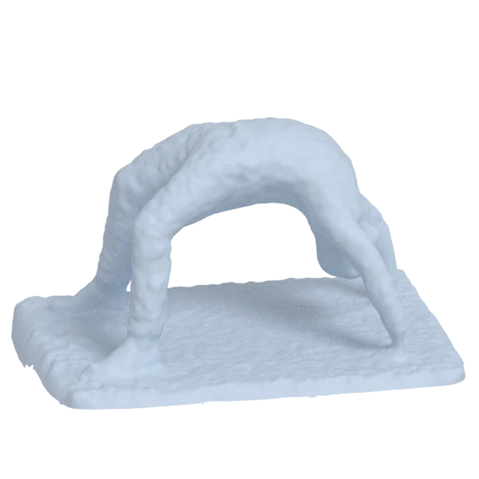
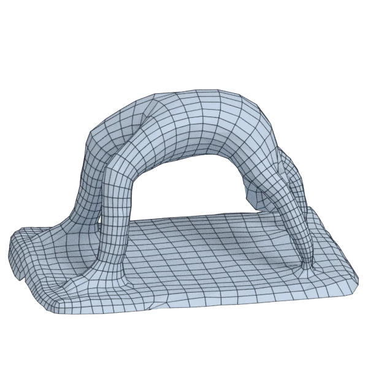
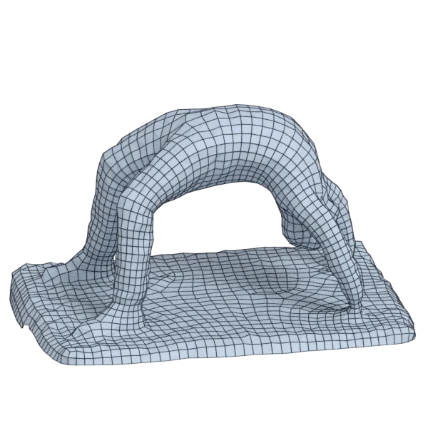
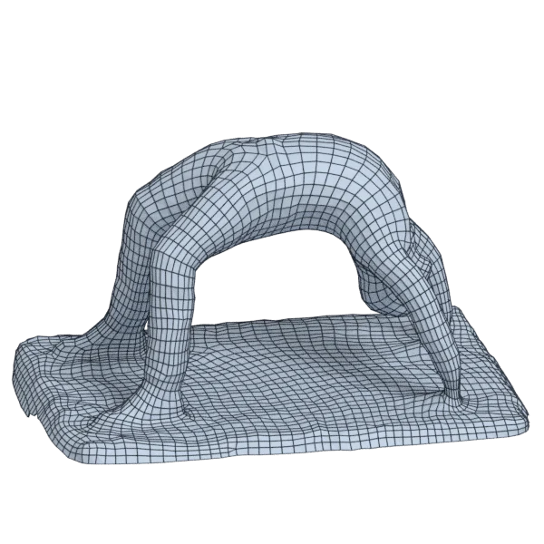
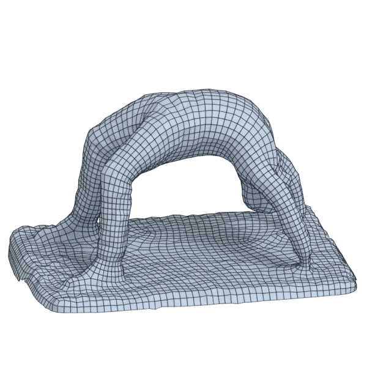

# bridge

An organic model, with open borders; 164 064 triangles in the source.
Author, source and licence: [CREDITS.md](../../CREDITS.md).

## At 3000 quads asked for

| Source | AutoRemesher | openclare | Quad Remesher |
|---|---|---|---|
|  |  |  |  |
| 164 064 triangles | 1 893 quads | 2 950 quads | 4 533 quads |

## At equal quad count

Quad Remesher makes more quads than the 3000 it is asked for. Next to its mesh, openclare asked for as many quads as that mesh has.

| Quad Remesher | openclare, as many quads |
|---|---|
|  |  |
| 4 533 quads | 4 467 quads |

## Marks

From 0 to 100; how they are made is in [SCORES.md](../../bench/results/SCORES.md).

### 1000 quads

| Remesher | Quads | Overall | Validity | Alignment | Quad shape | Fidelity | Regularity | Structure | Budget | Speed |
|---|---|---|---|---|---|---|---|---|---|---|
| openclare-uniform | 1008 | **82** | 100 | 69 | 79 | 78 | 64 | 75 | 97 | 76 |
| **openclare** | 1008 | **82** | 100 | 70 | 72 | 88 | 64 | 55 | 97 | 72 |
| integer-grid | 919 | **77** | 100 | 65 | 64 | 80 | 70 | 81 | 68 | 60 |
| quadremesher | 2105 | **70** | 100 | 71 | 60 | 91 | 64 | 36 | 0 | 37 |
| quadremesher-uniform | 936 | **46** | 0 | 60 | 51 | 81 | 42 | — | 74 | 40 |
| instant-meshes | 845 | **43** | 80 | 40 | 57 | 1 | 2 | 37 | 38 | 85 |
| autoremesher | 748 | **22** | 0 | 51 | 15 | 35 | 28 | — | 0 | 100 |
| quadriflow | — | **0** | 0 | — | — | — | — | — | — | 100 |

At equal quad count: Quad Remesher's mesh as it is, and openclare asked for as many quads.

| Remesher | Quads | Overall | Validity | Alignment | Quad shape | Fidelity | Regularity | Structure | Budget | Speed |
|---|---|---|---|---|---|---|---|---|---|---|
| openclare-matched | 2120 | **83** | 100 | 67 | 78 | 84 | 83 | 72 | 97 | 71 |
| quadremesher-as-made | 2105 | **77** | 100 | 68 | 60 | 89 | 64 | 36 | 100 | 37 |

### 3000 quads

| Remesher | Quads | Overall | Validity | Alignment | Quad shape | Fidelity | Regularity | Structure | Budget | Speed |
|---|---|---|---|---|---|---|---|---|---|---|
| **openclare** | 2950 | **85** | 100 | 67 | 80 | 87 | 85 | 76 | 93 | 67 |
| openclare-uniform | 3019 | **84** | 100 | 65 | 81 | 86 | 83 | 60 | 97 | 70 |
| integer-grid | 2750 | **79** | 100 | 61 | 64 | 86 | 81 | 81 | 67 | 42 |
| instant-meshes | 2903 | **66** | 100 | 44 | 69 | 44 | 48 | 35 | 87 | 73 |
| quadremesher-uniform | 2726 | **52** | 0 | 65 | 64 | 86 | 77 | — | 63 | 40 |
| quadremesher | 4533 | **48** | 0 | 71 | 67 | 88 | 82 | — | 0 | 41 |
| autoremesher | 1893 | **40** | 0 | 59 | 62 | 70 | 67 | — | 0 | 92 |
| quadriflow | — | **0** | 0 | — | — | — | — | — | — | 100 |

At equal quad count: Quad Remesher's mesh as it is, and openclare asked for as many quads.

| Remesher | Quads | Overall | Validity | Alignment | Quad shape | Fidelity | Regularity | Structure | Budget | Speed |
|---|---|---|---|---|---|---|---|---|---|---|
| openclare-matched | 4467 | **83** | 100 | 64 | 77 | 87 | 88 | 65 | 94 | 58 |
| quadremesher-as-made | 4533 | **53** | 0 | 67 | 67 | 88 | 82 | — | 100 | 41 |

### 8000 quads

| Remesher | Quads | Overall | Validity | Alignment | Quad shape | Fidelity | Regularity | Structure | Budget | Speed |
|---|---|---|---|---|---|---|---|---|---|---|
| **openclare** | 8109 | **83** | 100 | 60 | 77 | 87 | 90 | 66 | 95 | 52 |
| openclare-uniform | 7880 | **82** | 100 | 56 | 76 | 86 | 91 | 62 | 94 | 56 |
| quadremesher | 8805 | **79** | 100 | 63 | 69 | 87 | 91 | 67 | 60 | 33 |
| integer-grid | 7468 | **79** | 100 | 56 | 65 | 86 | 91 | 78 | 73 | 23 |
| instant-meshes | 7960 | **75** | 100 | 38 | 78 | 82 | 68 | 35 | 98 | 81 |
| quadremesher-uniform | 7054 | **52** | 0 | 59 | 66 | 87 | 89 | — | 53 | 40 |
| autoremesher | 4954 | **45** | 0 | 53 | 70 | 82 | 88 | — | 0 | 72 |
| quadriflow | — | **0** | 0 | — | — | — | — | — | — | 100 |

At equal quad count: Quad Remesher's mesh as it is, and openclare asked for as many quads.

| Remesher | Quads | Overall | Validity | Alignment | Quad shape | Fidelity | Regularity | Structure | Budget | Speed |
|---|---|---|---|---|---|---|---|---|---|---|
| openclare-matched | 8799 | **81** | 100 | 59 | 78 | 86 | 90 | 59 | 100 | 49 |
| quadremesher-as-made | 8805 | **81** | 100 | 61 | 69 | 87 | 91 | 67 | 100 | 33 |
