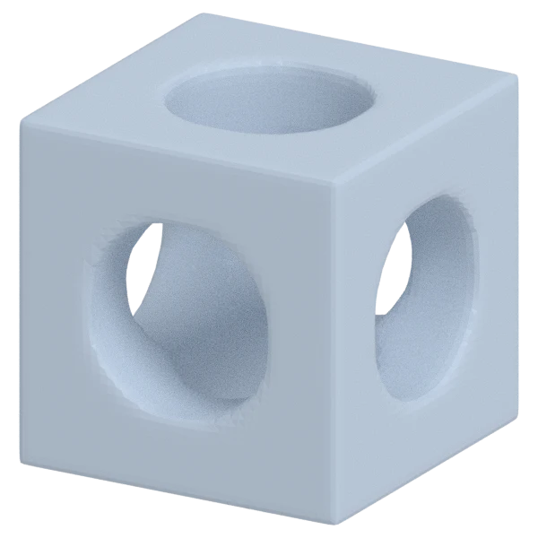
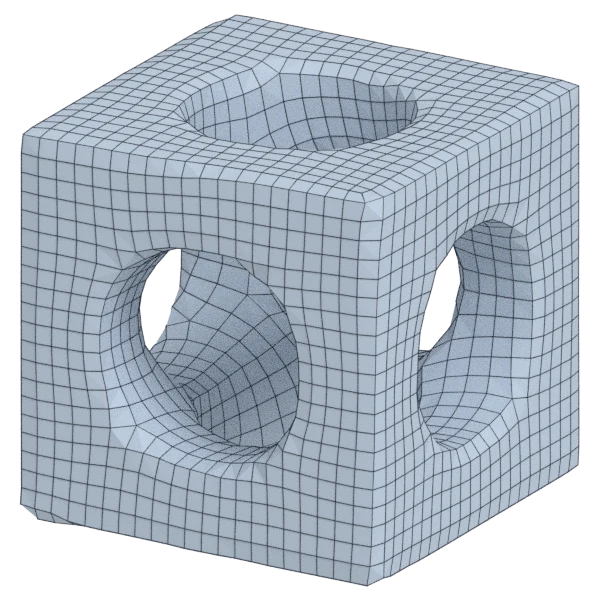
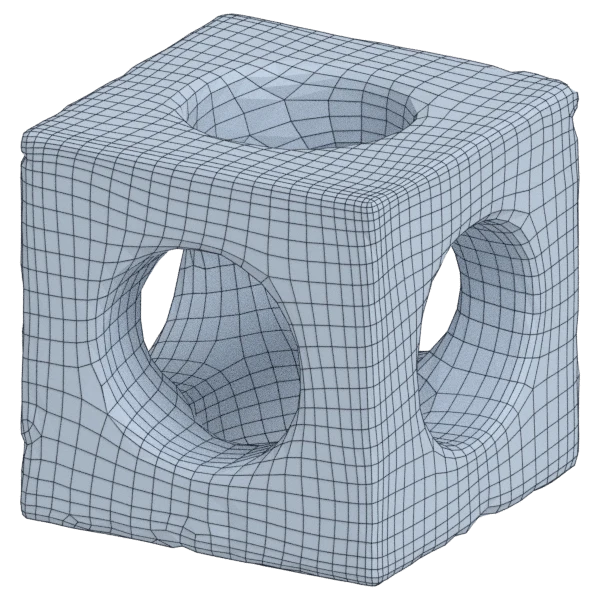
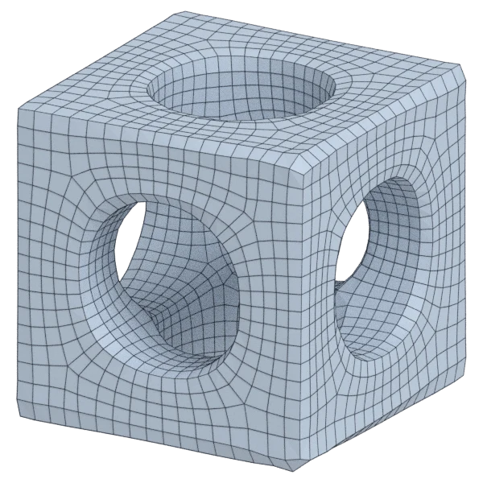
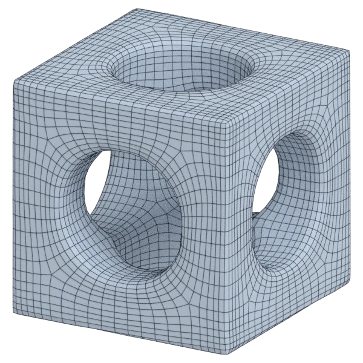
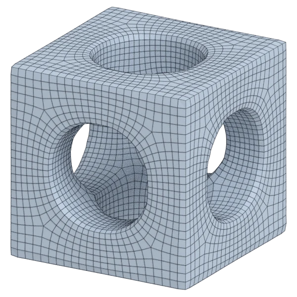

# cage

An organic model; 26 656 triangles in the source.
Author, source and licence: [CREDITS.md](../../CREDITS.md).

## At 3000 quads asked for

| Source | QuadriFlow (Blender) | AutoRemesher | openclare | Quad Remesher |
|---|---|---|---|---|
|  |  |  |  |  |
| 26 656 triangles | 2 885 quads | 4 039 quads | 3 011 quads | 5 809 quads |

## At equal quad count

Quad Remesher makes more quads than the 3000 it is asked for. Next to its mesh, openclare asked for as many quads as that mesh has.

| Quad Remesher | openclare, as many quads |
|---|---|
|  |  |
| 5 809 quads | 5 769 quads |

## Edge loops

At 3000 quads asked for. Each loop is followed straight on through every regular vertex: it closes, comes back beside itself a quad further (a spiral), stops at an irregular vertex, or runs from a border to a border. Share of the edges on each, those of borders and of faces that are not quads left out; "—" where the mesh is not a manifold.

| | closed | spiral | stops | border to border | spirals | longest that stops |
|---|---|---|---|---|---|---|
| Modelled by hand | — | — | — | — | — | — |
| QuadriFlow (Blender) | 18 % | 38 % | 42 % | 0 % | 20 | 86 |
| AutoRemesher | 4 % | 30 % | 66 % | 0 % | 24 | 110 |
| openclare | 62 % | 18 % | 20 % | 0 % | 5 | 69 |
| Quad Remesher | 55 % | 28 % | 17 % | 0 % | 10 | 92 |

## Marks

From 0 to 100; how they are made is in [SCORES.md](../../bench/results/SCORES.md).

### 1000 quads

| Remesher | Quads | Overall | Validity | Alignment | Quad shape | Fidelity | Regularity | Structure | Edge loops | Budget | Speed |
|---|---|---|---|---|---|---|---|---|---|---|---|
| **openclare** | 1013 | **94** | 100 | 100 | 100 | 79 | 100 | 83 | 87 | 95 | 87 |
| integer-grid | 970 | **93** | 100 | 100 | 100 | 65 | 100 | 90 | — | 88 | 68 |
| openclare-uniform | 984 | **91** | 100 | 100 | 100 | 63 | 100 | 83 | 82 | 94 | 85 |
| quadremesher-uniform | 934 | **87** | 100 | 100 | 100 | 36 | 100 | 77 | — | 74 | 66 |
| quadremesher | 3224 | **82** | 100 | 100 | 100 | 86 | 100 | 77 | 50 | 0 | 60 |
| quadriflow | 1043 | **80** | 100 | 100 | 100 | 57 | 100 | 31 | 27 | 83 | 100 |
| instant-meshes | 974 | **77** | 100 | 85 | 92 | 43 | 43 | 20 | — | 90 | 100 |
| autoremesher | 1720 | **41** | 0 | 94 | 85 | 0 | 100 | — | 25 | 0 | 100 |

At equal quad count: Quad Remesher's mesh as it is, and openclare asked for as many quads.

| Remesher | Quads | Overall | Validity | Alignment | Quad shape | Fidelity | Regularity | Structure | Edge loops | Budget | Speed |
|---|---|---|---|---|---|---|---|---|---|---|---|
| quadremesher-as-made | 3224 | **96** | 100 | 100 | 100 | 86 | 100 | 77 | — | 100 | 60 |
| openclare-matched | 3199 | **89** | 100 | 100 | 100 | 80 | 100 | 84 | 50 | 97 | 73 |

### 3000 quads

| Remesher | Quads | Overall | Validity | Alignment | Quad shape | Fidelity | Regularity | Structure | Edge loops | Budget | Speed |
|---|---|---|---|---|---|---|---|---|---|---|---|
| integer-grid | 2874 | **94** | 100 | 100 | 100 | 77 | 100 | 85 | — | 83 | 48 |
| openclare-uniform | 3005 | **93** | 100 | 100 | 100 | 78 | 100 | 89 | 72 | 99 | 79 |
| quadremesher-uniform | 2785 | **92** | 100 | 100 | 100 | 81 | 100 | 64 | — | 71 | 67 |
| **openclare** | 3011 | **91** | 100 | 100 | 100 | 79 | 100 | 90 | 56 | 99 | 70 |
| instant-meshes | 2944 | **90** | 100 | 100 | 100 | 71 | 93 | 21 | — | 93 | 100 |
| quadriflow | 2891 | **84** | 100 | 99 | 100 | 77 | 100 | 33 | 31 | 85 | 94 |
| quadremesher | 5809 | **82** | 100 | 100 | 100 | 89 | 100 | 81 | 50 | 0 | 65 |
| autoremesher | 4039 | **50** | 0 | 94 | 94 | 73 | 100 | — | 6 | 0 | 79 |

At equal quad count: Quad Remesher's mesh as it is, and openclare asked for as many quads.

| Remesher | Quads | Overall | Validity | Alignment | Quad shape | Fidelity | Regularity | Structure | Edge loops | Budget | Speed |
|---|---|---|---|---|---|---|---|---|---|---|---|
| openclare-matched | 5769 | **99** | 100 | 100 | 100 | 94 | 100 | 97 | 100 | 97 | 65 |
| quadremesher-as-made | 5809 | **97** | 100 | 100 | 100 | 89 | 100 | 81 | — | 100 | 65 |

### 8000 quads

| Remesher | Quads | Overall | Validity | Alignment | Quad shape | Fidelity | Regularity | Structure | Edge loops | Budget | Speed |
|---|---|---|---|---|---|---|---|---|---|---|---|
| **openclare** | 8013 | **99** | 100 | 100 | 100 | 91 | 100 | 98 | 100 | 99 | 54 |
| integer-grid | 7765 | **97** | 100 | 100 | 100 | 90 | 100 | 90 | — | 88 | 20 |
| quadremesher-uniform | 7510 | **94** | 100 | 100 | 100 | 88 | 100 | 74 | — | 76 | 61 |
| openclare-uniform | 8154 | **91** | 100 | 100 | 100 | 94 | 100 | 87 | 50 | 92 | 54 |
| instant-meshes | 8050 | **91** | 100 | 94 | 100 | 80 | 100 | 11 | — | 98 | 100 |
| quadriflow | 7932 | **83** | 100 | 99 | 100 | 87 | 100 | 8 | 18 | 97 | 58 |
| quadremesher | 11009 | **82** | 100 | 100 | 100 | 91 | 100 | 71 | 50 | 0 | 57 |
| autoremesher | 5928 | **82** | 99 | 100 | 100 | 85 | 100 | — | 50 | 0 | 71 |

At equal quad count: Quad Remesher's mesh as it is, and openclare asked for as many quads.

| Remesher | Quads | Overall | Validity | Alignment | Quad shape | Fidelity | Regularity | Structure | Edge loops | Budget | Speed |
|---|---|---|---|---|---|---|---|---|---|---|---|
| openclare-matched | 10912 | **99** | 100 | 100 | 100 | 96 | 100 | 99 | 100 | 96 | 47 |
| quadremesher-as-made | 11009 | **97** | 100 | 100 | 100 | 91 | 100 | 71 | — | 100 | 57 |
