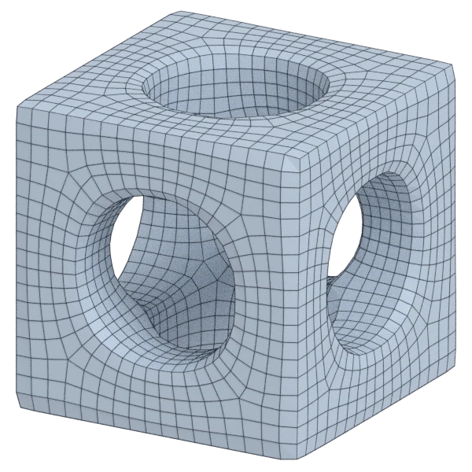

# cage

An organic model; 26 656 triangles in the source.
Author, source and licence: [CREDITS.md](../../CREDITS.md).

## At 3000 quads

| Source | QuadriFlow (Blender) | openclare | Quad Remesher |
|---|---|---|---|
|  |  |  |  |

## Marks

From 0 to 100; how they are made is in [SCORES.md](../../bench/results/SCORES.md).

### 1000 quads

| Remesher | Quads | Overall | Validity | Alignment | Quad shape | Fidelity | Regularity | Structure | Budget | Speed |
|---|---|---|---|---|---|---|---|---|---|---|
| **quad-layout-adaptive** | 1001 | **88** | 100 | 86 | 75 | 79 | 84 | 79 | 100 | 88 |
| integer-grid | 970 | **86** | 100 | 87 | 75 | 65 | 92 | 90 | 88 | 62 |
| quad-layout | 1001 | **82** | 100 | 82 | 76 | 49 | 84 | 74 | 100 | 100 |
| quadremesher | 3224 | **80** | 100 | 88 | 78 | 86 | 91 | 77 | 0 | 60 |
| quadremesher-uniform | 934 | **77** | 100 | 86 | 70 | 36 | 82 | 77 | 74 | 66 |
| quadriflow | 1043 | **73** | 100 | 66 | 65 | 57 | 69 | 31 | 83 | 100 |
| instant-meshes | 974 | **60** | 100 | 55 | 53 | 43 | 0 | 20 | 90 | 100 |

At equal quad count: Quad Remesher's mesh as it is, and openclare asked for as many quads.

| Remesher | Quads | Overall | Validity | Alignment | Quad shape | Fidelity | Regularity | Structure | Budget | Speed |
|---|---|---|---|---|---|---|---|---|---|---|
| quad-layout-matched | 3168 | **90** | 100 | 90 | 84 | 79 | 95 | 86 | 93 | 71 |
| quadremesher-as-made | 3224 | **89** | 100 | 88 | 78 | 86 | 91 | 77 | 100 | 60 |

### 3000 quads

| Remesher | Quads | Overall | Validity | Alignment | Quad shape | Fidelity | Regularity | Structure | Budget | Speed |
|---|---|---|---|---|---|---|---|---|---|---|
| **quad-layout-adaptive** | 2968 | **91** | 100 | 90 | 84 | 79 | 95 | 90 | 96 | 71 |
| quad-layout | 3040 | **90** | 100 | 86 | 85 | 79 | 95 | 77 | 95 | 84 |
| integer-grid | 2874 | **88** | 100 | 85 | 80 | 77 | 97 | 85 | 83 | 47 |
| quadremesher-uniform | 2785 | **87** | 100 | 89 | 79 | 81 | 96 | 64 | 71 | 67 |
| quadremesher | 5809 | **82** | 100 | 91 | 80 | 89 | 98 | 81 | 0 | 65 |
| quadriflow | 2891 | **79** | 100 | 64 | 71 | 77 | 88 | 33 | 85 | 89 |
| instant-meshes | 2944 | **73** | 100 | 65 | 68 | 71 | 43 | 21 | 93 | 100 |

At equal quad count: Quad Remesher's mesh as it is, and openclare asked for as many quads.

| Remesher | Quads | Overall | Validity | Alignment | Quad shape | Fidelity | Regularity | Structure | Budget | Speed |
|---|---|---|---|---|---|---|---|---|---|---|
| quad-layout-matched | 5890 | **94** | 100 | 91 | 87 | 94 | 97 | 92 | 94 | 58 |
| quadremesher-as-made | 5809 | **91** | 100 | 91 | 80 | 89 | 98 | 81 | 100 | 65 |

### 8000 quads

| Remesher | Quads | Overall | Validity | Alignment | Quad shape | Fidelity | Regularity | Structure | Budget | Speed |
|---|---|---|---|---|---|---|---|---|---|---|
| **quad-layout-adaptive** | 8057 | **95** | 100 | 91 | 89 | 94 | 97 | 97 | 97 | 46 |
| quad-layout | 8112 | **94** | 100 | 89 | 89 | 94 | 98 | 80 | 94 | 59 |
| integer-grid | 7765 | **92** | 100 | 88 | 82 | 90 | 99 | 90 | 88 | 16 |
| quadremesher-uniform | 7510 | **89** | 100 | 90 | 83 | 88 | 96 | 74 | 76 | 61 |
| quadremesher | 11009 | **83** | 100 | 91 | 84 | 91 | 97 | 71 | 0 | 57 |
| quadriflow | 7932 | **81** | 100 | 63 | 71 | 87 | 95 | 8 | 97 | 61 |
| instant-meshes | 8050 | **79** | 100 | 61 | 78 | 80 | 73 | 11 | 98 | 100 |

At equal quad count: Quad Remesher's mesh as it is, and openclare asked for as many quads.

| Remesher | Quads | Overall | Validity | Alignment | Quad shape | Fidelity | Regularity | Structure | Budget | Speed |
|---|---|---|---|---|---|---|---|---|---|---|
| quad-layout-matched | 11166 | **95** | 100 | 92 | 90 | 96 | 97 | 99 | 94 | 45 |
| quadremesher-as-made | 11009 | **92** | 100 | 91 | 84 | 91 | 97 | 71 | 100 | 57 |
