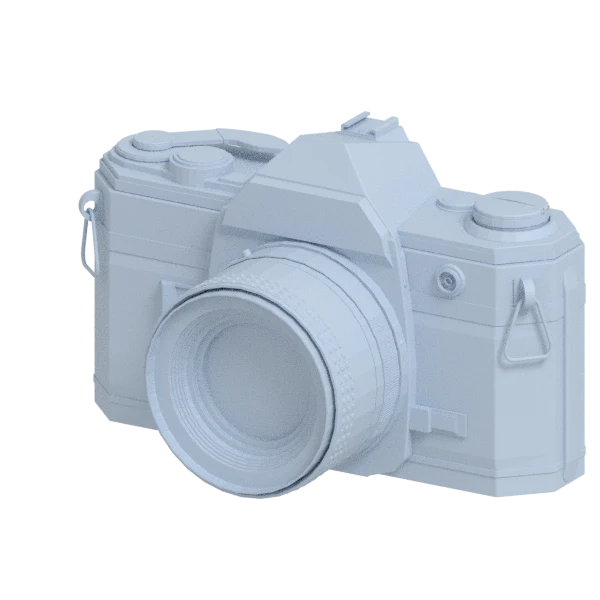
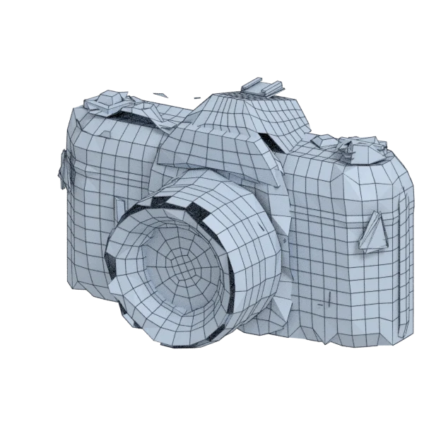
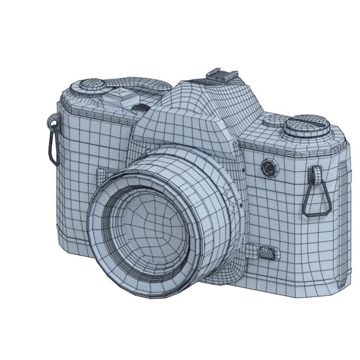
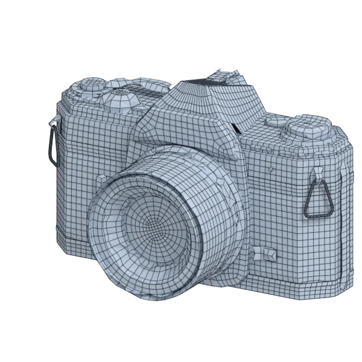

# camera

An extra model, with hard edges, with open borders; 34 600 triangles in the source.
Its licence does not allow passing it on: the model is not in the repository (`make blenderkit`).
Author, source and licence: [CREDITS.md](../../CREDITS.md).

## At 3000 quads asked for

| Source | openclare | Quad Remesher |
|---|---|---|
|  |  |  |
| 34 600 triangles | 3 409 quads | 12 621 quads |

## At equal quad count

Quad Remesher makes more quads than the 3000 it is asked for. Next to its mesh, openclare asked for as many quads as that mesh has.

| Quad Remesher | openclare, as many quads |
|---|---|
|  |  |
| 12 621 quads | 12 776 quads |

## Marks

From 0 to 100; how they are made is in [SCORES.md](../../bench/results/SCORES.md).

### 1000 quads

| Remesher | Quads | Overall | Validity | Alignment | Quad shape | Fidelity | Regularity | Structure | Budget | Speed |
|---|---|---|---|---|---|---|---|---|---|---|
| quadremesher | 9385 | **45** | 0 | 82 | 60 | 76 | 61 | — | 0 | 56 |
| quadremesher-uniform | 3134 | **34** | 0 | 81 | 44 | 58 | 8 | — | 0 | 60 |
| integer-grid | 843 | **34** | 0 | 63 | 50 | 54 | 3 | — | 37 | 25 |
| **openclare** | 1755 | **27** | 0 | 74 | 27 | 46 | 3 | — | 0 | 54 |
| openclare-uniform | 1834 | **27** | 0 | 75 | 10 | 48 | 15 | — | 0 | 77 |
| instant-meshes | 508 | **18** | 0 | 58 | 8 | 29 | 0 | 16 | 0 | 100 |
| quadriflow | — | **0** | 0 | — | — | — | — | — | — | 100 |

Lines of the scene, as openclare reports them: 13 edges laid along the guide curves and the borders between materials, lines let go on 13 pieces.

At equal quad count: Quad Remesher's mesh as it is, and openclare asked for as many quads.

| Remesher | Quads | Overall | Validity | Alignment | Quad shape | Fidelity | Regularity | Structure | Budget | Speed |
|---|---|---|---|---|---|---|---|---|---|---|
| quadremesher-as-made | 9385 | **50** | 0 | 85 | 60 | 71 | 61 | — | 100 | 56 |
| openclare-matched | 9483 | **50** | 0 | 80 | 60 | 68 | 70 | — | 96 | 11 |

### 3000 quads

| Remesher | Quads | Overall | Validity | Alignment | Quad shape | Fidelity | Regularity | Structure | Budget | Speed |
|---|---|---|---|---|---|---|---|---|---|---|
| quadremesher | 12621 | **47** | 0 | 81 | 64 | 84 | 65 | — | 0 | 61 |
| quadremesher-uniform | 5458 | **42** | 0 | 83 | 59 | 66 | 41 | — | 0 | 64 |
| **openclare** | 3409 | **41** | 0 | 81 | 35 | 63 | 35 | — | 45 | 43 |
| openclare-uniform | 3536 | **37** | 0 | 78 | 18 | 62 | 46 | — | 29 | 65 |
| integer-grid | 1109 | **28** | 0 | 62 | 37 | 32 | 37 | — | 0 | 0 |
| instant-meshes | 2216 | **27** | 0 | 62 | 40 | 45 | 0 | 24 | 0 | 97 |
| quadriflow | — | **0** | 0 | — | — | — | — | — | — | 100 |

Lines of the scene, as openclare reports them: 38 edges laid along the guide curves and the borders between materials, lines let go on 14 pieces.

At equal quad count: Quad Remesher's mesh as it is, and openclare asked for as many quads.

| Remesher | Quads | Overall | Validity | Alignment | Quad shape | Fidelity | Regularity | Structure | Budget | Speed |
|---|---|---|---|---|---|---|---|---|---|---|
| quadremesher-as-made | 12621 | **53** | 0 | 84 | 64 | 82 | 65 | — | 100 | 61 |
| openclare-matched | 12776 | **50** | 0 | 85 | 58 | 67 | 69 | — | 95 | 25 |

### 8000 quads

| Remesher | Quads | Overall | Validity | Alignment | Quad shape | Fidelity | Regularity | Structure | Budget | Speed |
|---|---|---|---|---|---|---|---|---|---|---|
| **openclare** | 8091 | **53** | 0 | 79 | 60 | 66 | 65 | — | 95 | 30 |
| quadremesher | 20326 | **51** | 0 | 85 | 71 | 89 | 77 | — | 0 | 52 |
| integer-grid | 7017 | **50** | 0 | 82 | 70 | 53 | 76 | — | 51 | 0 |
| openclare-uniform | 8426 | **50** | 0 | 86 | 33 | 67 | 72 | — | 79 | 60 |
| quadremesher-uniform | 10881 | **49** | 0 | 86 | 72 | 78 | 67 | — | 0 | 56 |
| instant-meshes | 6839 | **37** | 0 | 71 | 53 | 42 | 22 | 35 | 42 | 75 |
| quadriflow | — | **0** | 0 | — | — | — | — | — | — | 100 |

Lines of the scene, as openclare reports them: 54 edges laid along the guide curves and the borders between materials, lines let go on 15 pieces.

At equal quad count: Quad Remesher's mesh as it is, and openclare asked for as many quads.

| Remesher | Quads | Overall | Validity | Alignment | Quad shape | Fidelity | Regularity | Structure | Budget | Speed |
|---|---|---|---|---|---|---|---|---|---|---|
| quadremesher-as-made | 20326 | **57** | 0 | 85 | 71 | 88 | 77 | — | 100 | 52 |
| openclare-matched | 19954 | **54** | 0 | 84 | 66 | 73 | 80 | — | 93 | 0 |
