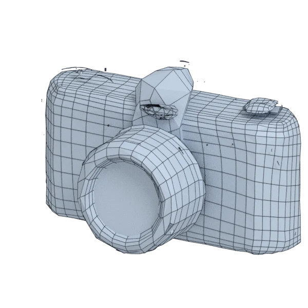

# camera

An extra model, with hard edges, with open borders; 34 600 triangles in the source.
Its licence does not allow passing it on: the model is not in the repository (`make blenderkit`).
Author, source and licence: [CREDITS.md](../../CREDITS.md).

## At 3000 quads asked for

| Source | AutoRemesher | openclare | Quad Remesher |
|---|---|---|---|
|  |  |  |  |
| 34 600 triangles | 2 222 quads | 3 427 quads | 12 621 quads |

## At equal quad count

Quad Remesher makes more quads than the 3000 it is asked for. Next to its mesh, openclare asked for as many quads as that mesh has.

| Quad Remesher | openclare, as many quads |
|---|---|
|  |  |
| 12 621 quads | 12 542 quads |

## Edge loops

At 3000 quads asked for. Each loop is followed straight on through every regular vertex: it closes, comes back beside itself a quad further (a spiral), stops at an irregular vertex, or runs from a border to a border. Share of the edges on each, those of borders and of faces that are not quads left out; "—" where the mesh is not a manifold.

| | closed | spiral | stops | border to border | spirals | longest that stops |
|---|---|---|---|---|---|---|
| Modelled by hand | — | — | — | — | — | — |
| QuadriFlow (Blender) | — | — | — | — | — | — |
| AutoRemesher | — | — | — | — | — | — |
| openclare | 50 % | 9 % | 30 % | 11 % | 95 | 52 |
| Quad Remesher | — | — | — | — | — | — |

## Marks

From 0 to 100; how they are made is in [SCORES.md](../../bench/results/SCORES.md).

### 1000 quads

| Remesher | Quads | Overall | Validity | Alignment | Quad shape | Fidelity | Regularity | Structure | Edge loops | Budget | Speed |
|---|---|---|---|---|---|---|---|---|---|---|---|
| quadremesher | 9385 | **64** | 0 | 100 | 100 | 76 | 100 | — | 92 | 0 | 56 |
| integer-grid | 843 | **53** | 0 | 98 | 88 | 54 | 53 | — | — | 37 | 25 |
| quadremesher-uniform | 3134 | **49** | 0 | 100 | 81 | 58 | 58 | — | — | 0 | 60 |
| **openclare** | 1670 | **41** | 0 | 100 | 24 | 48 | 41 | 71 | 58 | 0 | 76 |
| openclare-uniform | 1462 | **41** | 0 | 100 | 30 | 36 | 57 | — | 62 | 0 | 76 |
| autoremesher | 988 | **34** | 0 | 90 | 0 | 32 | 0 | — | — | 95 | 100 |
| instant-meshes | 508 | **29** | 0 | 90 | 39 | 29 | 0 | 16 | — | 0 | 100 |
| quadriflow | — | **0** | 0 | — | — | — | — | — | — | — | 100 |

Lines of the scene, as openclare reports them: 34 edges laid along the guide curves and the borders between materials, lines let go on 14 pieces.

At equal quad count: Quad Remesher's mesh as it is, and openclare asked for as many quads.

| Remesher | Quads | Overall | Validity | Alignment | Quad shape | Fidelity | Regularity | Structure | Edge loops | Budget | Speed |
|---|---|---|---|---|---|---|---|---|---|---|---|
| quadremesher-as-made | 9385 | **65** | 0 | 100 | 100 | 71 | 100 | — | — | 100 | 56 |
| openclare-matched | 8871 | **64** | 0 | 100 | 92 | 68 | 100 | — | — | 78 | 41 |

### 3000 quads

| Remesher | Quads | Overall | Validity | Alignment | Quad shape | Fidelity | Regularity | Structure | Edge loops | Budget | Speed |
|---|---|---|---|---|---|---|---|---|---|---|---|
| quadremesher | 12621 | **61** | 0 | 100 | 100 | 84 | 100 | — | — | 0 | 61 |
| openclare-uniform | 3105 | **60** | 0 | 100 | 47 | 61 | 92 | — | 81 | 86 | 43 |
| quadremesher-uniform | 5458 | **57** | 0 | 100 | 99 | 66 | 91 | — | — | 0 | 64 |
| **openclare** | 3427 | **53** | 0 | 100 | 26 | 61 | 89 | — | 81 | 43 | 72 |
| integer-grid | 1109 | **46** | 0 | 96 | 73 | 32 | 87 | — | — | 0 | 0 |
| instant-meshes | 2216 | **42** | 0 | 97 | 77 | 45 | 30 | 24 | — | 0 | 97 |
| autoremesher | 2222 | **28** | 0 | 100 | 17 | 25 | 0 | — | — | 0 | 100 |
| quadriflow | — | **0** | 0 | — | — | — | — | — | — | — | 100 |

Lines of the scene, as openclare reports them: 119 edges laid along the guide curves and the borders between materials, lines let go on 15 pieces.

At equal quad count: Quad Remesher's mesh as it is, and openclare asked for as many quads.

| Remesher | Quads | Overall | Validity | Alignment | Quad shape | Fidelity | Regularity | Structure | Edge loops | Budget | Speed |
|---|---|---|---|---|---|---|---|---|---|---|---|
| quadremesher-as-made | 12621 | **67** | 0 | 100 | 100 | 82 | 100 | — | — | 100 | 61 |
| openclare-matched | 12542 | **66** | 0 | 100 | 86 | 68 | 100 | — | 84 | 97 | 48 |

### 8000 quads

| Remesher | Quads | Overall | Validity | Alignment | Quad shape | Fidelity | Regularity | Structure | Edge loops | Budget | Speed |
|---|---|---|---|---|---|---|---|---|---|---|---|
| quadremesher | 20326 | **64** | 0 | 100 | 100 | 89 | 100 | — | 83 | 0 | 52 |
| integer-grid | 7017 | **61** | 0 | 100 | 100 | 53 | 100 | — | — | 51 | 0 |
| **openclare** | 8051 | **61** | 0 | 100 | 65 | 56 | 100 | — | — | 97 | 41 |
| openclare-uniform | 7801 | **61** | 0 | 100 | 69 | 56 | 100 | — | — | 90 | 43 |
| quadremesher-uniform | 10881 | **60** | 0 | 100 | 100 | 78 | 100 | — | — | 0 | 56 |
| instant-meshes | 6839 | **53** | 0 | 100 | 91 | 42 | 72 | 35 | — | 42 | 75 |
| autoremesher | 4114 | **34** | 0 | 95 | 36 | 18 | 52 | — | — | 0 | 97 |
| quadriflow | — | **0** | 0 | — | — | — | — | — | — | — | 100 |

Lines of the scene, as openclare reports them: 178 edges laid along the guide curves and the borders between materials, lines let go on 16 pieces.

At equal quad count: Quad Remesher's mesh as it is, and openclare asked for as many quads.

| Remesher | Quads | Overall | Validity | Alignment | Quad shape | Fidelity | Regularity | Structure | Edge loops | Budget | Speed |
|---|---|---|---|---|---|---|---|---|---|---|---|
| quadremesher-as-made | 20326 | **69** | 0 | 100 | 100 | 88 | 100 | — | — | 100 | 52 |
| openclare-matched | 19734 | **65** | 0 | 100 | 98 | 70 | 100 | — | — | 88 | 24 |
