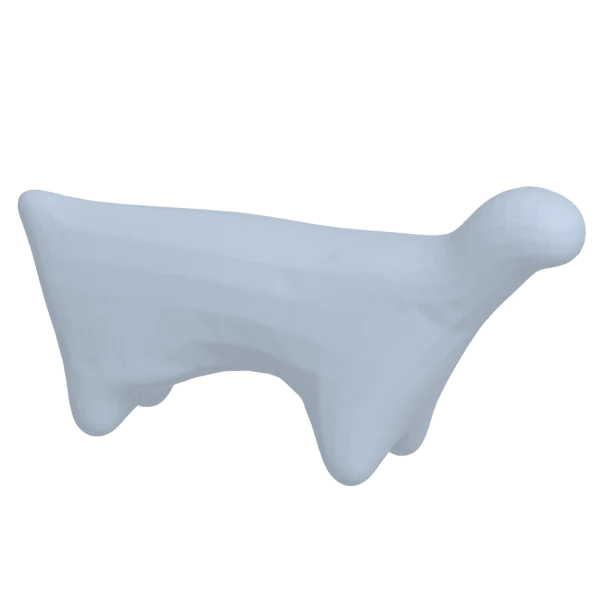
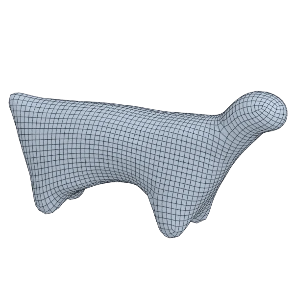
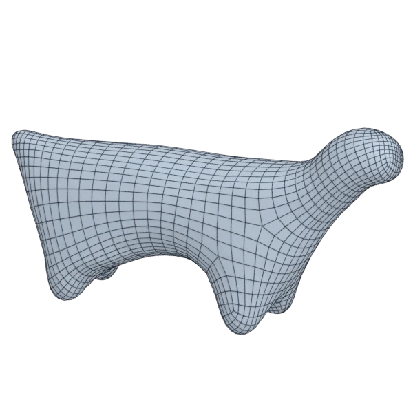

# creature

An organic model; 78 124 triangles in the source.
Author, source and licence: [CREDITS.md](../../CREDITS.md).

## At 3000 quads asked for

| Source | QuadriFlow (Blender) | AutoRemesher | openclare | Quad Remesher |
|---|---|---|---|---|
|  |  |  |  |  |
| 78 124 triangles | 2 779 quads | 1 991 quads | 3 041 quads | 2 941 quads |

## At equal quad count

Quad Remesher makes more quads than the 3000 it is asked for. Next to its mesh, openclare asked for as many quads as that mesh has.

| Quad Remesher | openclare, as many quads |
|---|---|
|  |  |
| 2 941 quads | 2 962 quads |

## Edge loops

At 3000 quads asked for. Each loop is followed straight on through every regular vertex: it closes, comes back beside itself a quad further (a spiral), stops at an irregular vertex, or runs from a border to a border. Share of the edges on each, those of borders and of faces that are not quads left out; "—" where the mesh is not a manifold.

| | closed | spiral | stops | border to border | spirals | longest that stops |
|---|---|---|---|---|---|---|
| Modelled by hand | — | — | — | — | — | — |
| QuadriFlow (Blender) | 0 % | 31 % | 69 % | 0 % | 4 | 377 |
| AutoRemesher | 31 % | 34 % | 35 % | 0 % | 6 | 166 |
| openclare | 38 % | 3 % | 58 % | 0 % | 2 | 275 |
| Quad Remesher | 25 % | 19 % | 56 % | 0 % | 8 | 331 |

## Marks

From 0 to 100; how they are made is in [SCORES.md](../../bench/results/SCORES.md).

### 1000 quads

| Remesher | Quads | Overall | Validity | Alignment | Quad shape | Fidelity | Regularity | Structure | Edge loops | Budget | Speed |
|---|---|---|---|---|---|---|---|---|---|---|---|
| **openclare** | 1011 | **97** | 100 | 100 | 100 | 92 | 100 | 62 | 100 | 96 | 77 |
| openclare-uniform | 1009 | **96** | 100 | 100 | 100 | 91 | 100 | 69 | 94 | 96 | 71 |
| quadremesher-uniform | 928 | **93** | 100 | 100 | 100 | 87 | 100 | 63 | — | 71 | 47 |
| instant-meshes | 994 | **84** | 100 | 73 | 100 | 62 | 100 | 17 | — | 94 | 99 |
| quadremesher | 1208 | **84** | 100 | 100 | 100 | 93 | 100 | 51 | 57 | 17 | 39 |
| autoremesher | 604 | **77** | 100 | 79 | 100 | 82 | 100 | 49 | 50 | 0 | 100 |
| integer-grid | 920 | **64** | 0 | 100 | 100 | 74 | 100 | 28 | — | 68 | 62 |
| quadriflow | 812 | **50** | 80 | 53 | 73 | 19 | 100 | 0 | 0 | 25 | 96 |

At equal quad count: Quad Remesher's mesh as it is, and openclare asked for as many quads.

| Remesher | Quads | Overall | Validity | Alignment | Quad shape | Fidelity | Regularity | Structure | Edge loops | Budget | Speed |
|---|---|---|---|---|---|---|---|---|---|---|---|
| openclare-matched | 1198 | **97** | 100 | 100 | 100 | 93 | 100 | 65 | 100 | 97 | 77 |
| quadremesher-as-made | 1208 | **96** | 100 | 100 | 100 | 93 | 100 | 51 | — | 100 | 39 |

### 3000 quads

| Remesher | Quads | Overall | Validity | Alignment | Quad shape | Fidelity | Regularity | Structure | Edge loops | Budget | Speed |
|---|---|---|---|---|---|---|---|---|---|---|---|
| **openclare** | 3041 | **97** | 100 | 100 | 100 | 96 | 100 | 71 | 97 | 95 | 68 |
| openclare-uniform | 2946 | **96** | 100 | 100 | 100 | 96 | 100 | 62 | 92 | 93 | 67 |
| quadremesher-uniform | 2719 | **93** | 100 | 100 | 100 | 95 | 100 | 52 | — | 63 | 46 |
| integer-grid | 2597 | **92** | 100 | 100 | 99 | 96 | 100 | 65 | — | 46 | 56 |
| quadremesher | 2941 | **90** | 100 | 100 | 100 | 95 | 100 | 50 | 53 | 92 | 41 |
| instant-meshes | 3070 | **88** | 100 | 72 | 100 | 93 | 100 | 7 | — | 91 | 100 |
| autoremesher | 1991 | **81** | 100 | 89 | 100 | 95 | 100 | 62 | 50 | 0 | 90 |
| quadriflow | 2667 | **71** | 100 | 66 | 100 | 84 | 100 | 0 | 0 | 56 | 93 |

At equal quad count: Quad Remesher's mesh as it is, and openclare asked for as many quads.

| Remesher | Quads | Overall | Validity | Alignment | Quad shape | Fidelity | Regularity | Structure | Edge loops | Budget | Speed |
|---|---|---|---|---|---|---|---|---|---|---|---|
| openclare-matched | 2962 | **97** | 100 | 100 | 100 | 96 | 100 | 72 | 94 | 97 | 70 |
| quadremesher-as-made | 2941 | **96** | 100 | 100 | 100 | 95 | 100 | 50 | — | 100 | 41 |

### 8000 quads

| Remesher | Quads | Overall | Validity | Alignment | Quad shape | Fidelity | Regularity | Structure | Edge loops | Budget | Speed |
|---|---|---|---|---|---|---|---|---|---|---|---|
| **openclare** | 7842 | **94** | 100 | 100 | 100 | 98 | 100 | 73 | 72 | 92 | 35 |
| openclare-uniform | 7858 | **94** | 100 | 100 | 100 | 98 | 100 | 74 | 66 | 93 | 34 |
| quadremesher-uniform | 7207 | **93** | 100 | 100 | 100 | 97 | 100 | 52 | — | 60 | 48 |
| instant-meshes | 8234 | **88** | 100 | 74 | 100 | 97 | 100 | 9 | — | 88 | 89 |
| quadremesher | 7186 | **88** | 100 | 100 | 100 | 98 | 100 | 55 | 50 | 59 | 38 |
| autoremesher | 6819 | **84** | 100 | 88 | 100 | 98 | 100 | 46 | 50 | 41 | 70 |
| quadriflow | 8170 | **70** | 80 | 61 | 100 | 94 | 100 | 0 | 0 | 92 | 58 |
| integer-grid | 6922 | **66** | 0 | 100 | 96 | 95 | 100 | 64 | — | 46 | 22 |

At equal quad count: Quad Remesher's mesh as it is, and openclare asked for as many quads.

| Remesher | Quads | Overall | Validity | Alignment | Quad shape | Fidelity | Regularity | Structure | Edge loops | Budget | Speed |
|---|---|---|---|---|---|---|---|---|---|---|---|
| quadremesher-as-made | 7186 | **97** | 100 | 100 | 100 | 98 | 100 | 55 | — | 100 | 38 |
| openclare-matched | 7163 | **91** | 100 | 100 | 100 | 98 | 100 | 77 | 50 | 99 | 40 |
