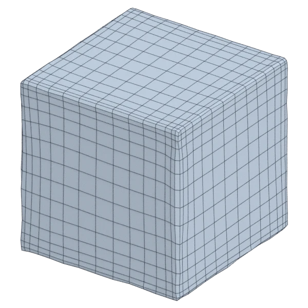

# cube

A mechanical model, with hard edges; 3 072 triangles in the source.
Author, source and licence: [CREDITS.md](../../CREDITS.md).

## At 3000 quads asked for

| Source | QuadriFlow (Blender) | AutoRemesher | openclare |
|---|---|---|---|
|  |  |  |  |
| 3 072 triangles | 2 904 quads | 1 260 quads | 2 992 quads |

## Edge loops

At 3000 quads asked for. Each loop is followed straight on through every regular vertex: it closes, comes back beside itself a quad further (a spiral), stops at an irregular vertex, or runs from a border to a border. Share of the edges on each, those of borders and of faces that are not quads left out; "—" where the mesh is not a manifold.

| | closed | spiral | stops | border to border | spirals | longest that stops |
|---|---|---|---|---|---|---|
| Modelled by hand | — | — | — | — | — | — |
| QuadriFlow (Blender) | 95 % | 0 % | 5 % | 0 % | 0 | 22 |
| AutoRemesher | 83 % | 0 % | 17 % | 0 % | 0 | 58 |
| openclare | 96 % | 0 % | 4 % | 0 % | 0 | 23 |

## Marks

From 0 to 100; how they are made is in [SCORES.md](../../bench/results/SCORES.md).

### 1000 quads

| Remesher | Quads | Overall | Validity | Alignment | Quad shape | Fidelity | Regularity | Structure | Edge loops | Budget | Speed |
|---|---|---|---|---|---|---|---|---|---|---|---|
| openclare-uniform | 1014 | **99** | 100 | 100 | 100 | 100 | 100 | 99 | 100 | 94 | 93 |
| **openclare** | 1014 | **99** | 100 | 100 | 100 | 100 | 100 | 99 | 100 | 94 | 90 |
| quadriflow | 1014 | **99** | 100 | 100 | 100 | 95 | 100 | 99 | 100 | 94 | 100 |
| instant-meshes | 900 | **95** | 100 | 100 | 100 | 100 | 100 | 81 | — | 60 | 100 |
| integer-grid | 999 | **87** | 100 | 100 | 100 | 49 | 100 | 0 | — | 100 | 74 |
| autoremesher | 573 | **83** | 93 | 100 | 100 | 53 | 100 | — | 100 | 0 | 100 |

### 3000 quads

| Remesher | Quads | Overall | Validity | Alignment | Quad shape | Fidelity | Regularity | Structure | Edge loops | Budget | Speed |
|---|---|---|---|---|---|---|---|---|---|---|---|
| openclare-uniform | 2992 | **100** | 100 | 100 | 100 | 100 | 100 | 100 | 100 | 99 | 75 |
| **openclare** | 2992 | **100** | 100 | 100 | 100 | 100 | 100 | 100 | 100 | 99 | 74 |
| instant-meshes | 2974 | **99** | 100 | 100 | 100 | 100 | 100 | 91 | — | 96 | 100 |
| quadriflow | 2904 | **98** | 100 | 100 | 100 | 90 | 100 | 100 | 100 | 87 | 95 |
| integer-grid | 2992 | **95** | 100 | 100 | 100 | 82 | 100 | 63 | — | 99 | 60 |
| autoremesher | 1260 | **88** | 100 | 100 | 100 | 78 | 100 | 97 | 100 | 0 | 100 |

### 8000 quads

| Remesher | Quads | Overall | Validity | Alignment | Quad shape | Fidelity | Regularity | Structure | Edge loops | Budget | Speed |
|---|---|---|---|---|---|---|---|---|---|---|---|
| openclare-uniform | 8066 | **100** | 100 | 100 | 100 | 100 | 100 | 100 | 100 | 97 | 58 |
| **openclare** | 8066 | **100** | 100 | 100 | 100 | 100 | 100 | 100 | 100 | 97 | 54 |
| quadriflow | 7920 | **99** | 100 | 100 | 100 | 98 | 100 | 100 | 100 | 96 | 65 |
| instant-meshes | 7802 | **99** | 100 | 100 | 100 | 100 | 100 | 95 | — | 90 | 100 |
| integer-grid | 8028 | **93** | 100 | 100 | 100 | 89 | 100 | 0 | — | 99 | 0 |
| autoremesher | 2774 | **82** | 99 | 100 | 100 | 90 | 100 | — | 50 | 0 | 94 |
