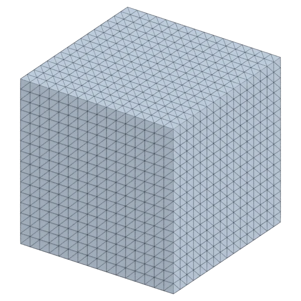
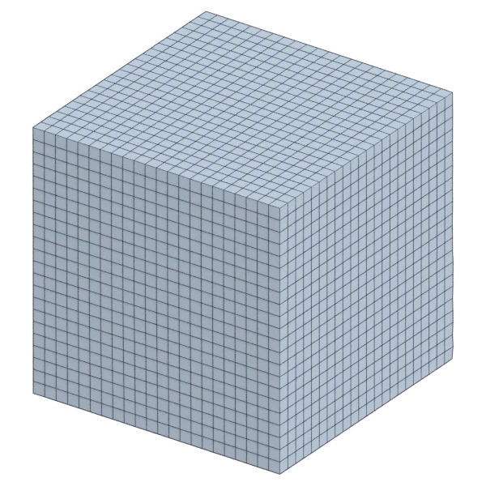
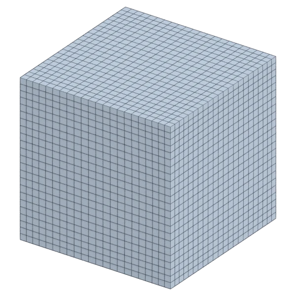
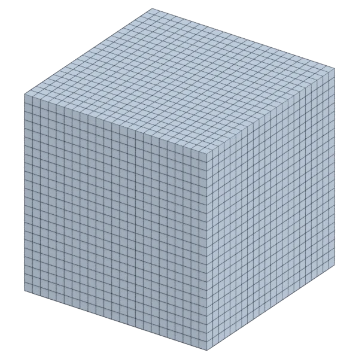

# cube

A mechanical model, with hard edges; 3 072 triangles in the source.
Author, source and licence: [CREDITS.md](../../CREDITS.md).

## At 3000 quads

| Source | QuadriFlow (Blender) | openclare | Quad Remesher |
|---|---|---|---|
|  |  |  |  |

## Marks

From 0 to 100; how they are made is in [SCORES.md](../../bench/results/SCORES.md).

### 1000 quads

| Remesher | Quads | Overall | Validity | Alignment | Quad shape | Fidelity | Regularity | Structure | Budget | Speed |
|---|---|---|---|---|---|---|---|---|---|---|
| quadremesher | 1014 | **99** | 100 | 100 | 100 | 100 | 100 | 99 | 94 | 79 |
| quadremesher-uniform | 1014 | **99** | 100 | 100 | 100 | 100 | 100 | 99 | 94 | 73 |
| quad-layout | 1014 | **99** | 100 | 100 | 100 | 100 | 100 | 99 | 94 | 100 |
| **quad-layout-adaptive** | 1014 | **99** | 100 | 99 | 98 | 100 | 100 | 99 | 94 | 98 |
| quadriflow | 1014 | **99** | 100 | 99 | 100 | 95 | 100 | 99 | 94 | 100 |
| instant-meshes | 900 | **91** | 100 | 94 | 90 | 100 | 91 | 81 | 60 | 100 |
| integer-grid | 999 | **84** | 100 | 93 | 87 | 49 | 100 | 0 | 100 | 67 |

At equal quad count: Quad Remesher's mesh as it is, and openclare asked for as many quads.

| Remesher | Quads | Overall | Validity | Alignment | Quad shape | Fidelity | Regularity | Structure | Budget | Speed |
|---|---|---|---|---|---|---|---|---|---|---|
| quadremesher-as-made | 1014 | **100** | 100 | 100 | 100 | 100 | 100 | 99 | 100 | 79 |
| quad-layout-matched | 1014 | **99** | 100 | 99 | 98 | 100 | 100 | 99 | 100 | 100 |

### 3000 quads

| Remesher | Quads | Overall | Validity | Alignment | Quad shape | Fidelity | Regularity | Structure | Budget | Speed |
|---|---|---|---|---|---|---|---|---|---|---|
| quad-layout | 2992 | **100** | 100 | 99 | 100 | 100 | 100 | 100 | 99 | 84 |
| **quad-layout-adaptive** | 2992 | **99** | 100 | 98 | 98 | 100 | 100 | 100 | 99 | 86 |
| quadremesher | 3082 | **99** | 100 | 99 | 100 | 100 | 100 | 100 | 89 | 73 |
| quadremesher-uniform | 3082 | **99** | 100 | 99 | 100 | 100 | 100 | 100 | 89 | 73 |
| quadriflow | 2904 | **97** | 100 | 99 | 99 | 90 | 100 | 100 | 87 | 100 |
| instant-meshes | 2974 | **96** | 100 | 91 | 92 | 100 | 95 | 91 | 96 | 100 |
| integer-grid | 2992 | **94** | 100 | 97 | 96 | 82 | 100 | 63 | 99 | 49 |

At equal quad count: Quad Remesher's mesh as it is, and openclare asked for as many quads.

| Remesher | Quads | Overall | Validity | Alignment | Quad shape | Fidelity | Regularity | Structure | Budget | Speed |
|---|---|---|---|---|---|---|---|---|---|---|
| quadremesher-as-made | 3082 | **100** | 100 | 99 | 100 | 100 | 100 | 100 | 100 | 73 |
| quad-layout-matched | 3082 | **99** | 100 | 98 | 98 | 100 | 100 | 100 | 100 | 83 |

### 8000 quads

| Remesher | Quads | Overall | Validity | Alignment | Quad shape | Fidelity | Regularity | Structure | Budget | Speed |
|---|---|---|---|---|---|---|---|---|---|---|
| quad-layout | 8066 | **100** | 100 | 99 | 100 | 100 | 100 | 100 | 97 | 61 |
| quadremesher | 7920 | **99** | 100 | 100 | 100 | 100 | 100 | 100 | 96 | 69 |
| quadremesher-uniform | 7920 | **99** | 100 | 100 | 100 | 100 | 100 | 100 | 96 | 74 |
| **quad-layout-adaptive** | 8066 | **99** | 100 | 99 | 99 | 100 | 100 | 100 | 97 | 65 |
| quadriflow | 7920 | **99** | 100 | 98 | 98 | 98 | 100 | 100 | 96 | 67 |
| instant-meshes | 7802 | **97** | 100 | 96 | 95 | 100 | 99 | 95 | 90 | 100 |
| integer-grid | 8028 | **92** | 100 | 97 | 95 | 89 | 100 | 0 | 99 | 0 |

At equal quad count: Quad Remesher's mesh as it is, and openclare asked for as many quads.

| Remesher | Quads | Overall | Validity | Alignment | Quad shape | Fidelity | Regularity | Structure | Budget | Speed |
|---|---|---|---|---|---|---|---|---|---|---|
| quadremesher-as-made | 7920 | **100** | 100 | 100 | 100 | 100 | 100 | 100 | 100 | 69 |
| quad-layout-matched | 7776 | **100** | 100 | 99 | 99 | 100 | 100 | 100 | 93 | 59 |
