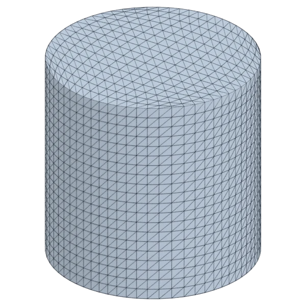
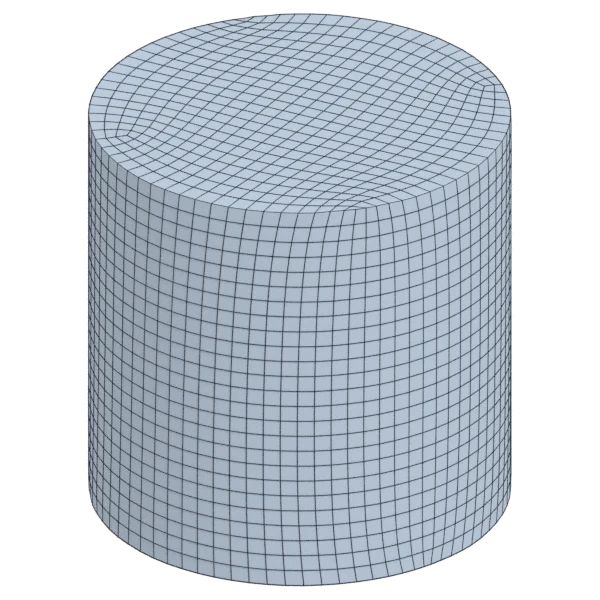
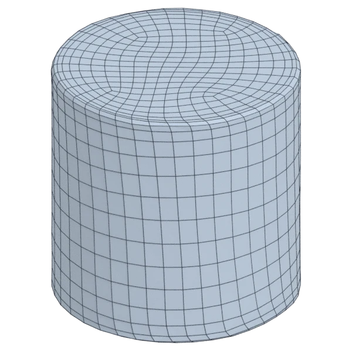
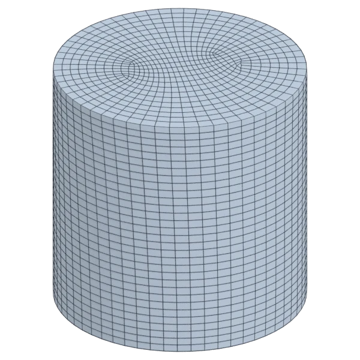
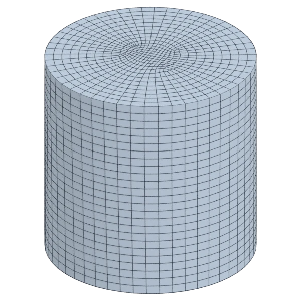
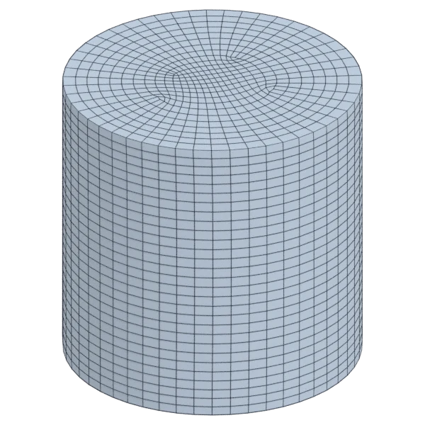

# cylinder

A mechanical model, with hard edges; 3 584 triangles in the source.
Author, source and licence: [CREDITS.md](../../CREDITS.md).

## At 3000 quads asked for

| Source | QuadriFlow (Blender) | AutoRemesher | openclare | Quad Remesher |
|---|---|---|---|---|
|  |  |  |  |  |
| 3 584 triangles | 2 892 quads | 1 306 quads | 2 952 quads | 2 458 quads |

## At equal quad count

Quad Remesher makes more quads than the 3000 it is asked for. Next to its mesh, openclare asked for as many quads as that mesh has.

| Quad Remesher | openclare, as many quads |
|---|---|
|  |  |
| 2 458 quads | 2 463 quads |

## Edge loops

At 3000 quads asked for. Each loop is followed straight on through every regular vertex: it closes, comes back beside itself a quad further (a spiral), stops at an irregular vertex, or runs from a border to a border. Share of the edges on each, those of borders and of faces that are not quads left out; "—" where the mesh is not a manifold.

| | closed | spiral | stops | border to border | spirals | longest that stops |
|---|---|---|---|---|---|---|
| Modelled by hand | — | — | — | — | — | — |
| QuadriFlow (Blender) | 33 % | 55 % | 12 % | 0 % | 6 | 207 |
| AutoRemesher | 75 % | 0 % | 25 % | 0 % | 0 | 178 |
| openclare | 95 % | 0 % | 5 % | 0 % | 0 | 32 |
| Quad Remesher | 42 % | 39 % | 19 % | 0 % | 2 | 345 |

## Marks

From 0 to 100; how they are made is in [SCORES.md](../../bench/results/SCORES.md).

### 1000 quads

| Remesher | Quads | Overall | Validity | Alignment | Quad shape | Fidelity | Regularity | Structure | Edge loops | Budget | Speed |
|---|---|---|---|---|---|---|---|---|---|---|---|
| **openclare** | 1000 | **100** | 100 | 100 | 100 | 97 | 100 | 99 | 100 | 100 | 90 |
| openclare-uniform | 1000 | **100** | 100 | 100 | 100 | 97 | 100 | 99 | 100 | 100 | 88 |
| integer-grid | 900 | **95** | 100 | 100 | 100 | 97 | 100 | 95 | — | 60 | 33 |
| quadriflow | 995 | **90** | 100 | 100 | 100 | 92 | 100 | 62 | 50 | 93 | 100 |
| quadremesher-uniform | 782 | **90** | 100 | 100 | 100 | 95 | 100 | 82 | — | 13 | 74 |
| instant-meshes | 994 | **87** | 80 | 100 | 100 | 69 | 100 | 42 | — | 96 | 100 |
| quadremesher | 782 | **84** | 100 | 100 | 100 | 95 | 100 | 82 | 50 | 13 | 74 |
| autoremesher | 612 | **79** | 100 | 100 | 95 | 71 | 100 | 73 | 50 | 0 | 100 |

At equal quad count: Quad Remesher's mesh as it is, and openclare asked for as many quads.

| Remesher | Quads | Overall | Validity | Alignment | Quad shape | Fidelity | Regularity | Structure | Edge loops | Budget | Speed |
|---|---|---|---|---|---|---|---|---|---|---|---|
| quadremesher-as-made | 782 | **98** | 100 | 100 | 100 | 95 | 100 | 82 | — | 100 | 74 |
| openclare-matched | 781 | **92** | 100 | 100 | 100 | 97 | 100 | 92 | 50 | 99 | 89 |

### 3000 quads

| Remesher | Quads | Overall | Validity | Alignment | Quad shape | Fidelity | Regularity | Structure | Edge loops | Budget | Speed |
|---|---|---|---|---|---|---|---|---|---|---|---|
| openclare-uniform | 2992 | **100** | 100 | 100 | 100 | 98 | 100 | 100 | 100 | 99 | 77 |
| **openclare** | 2952 | **99** | 100 | 100 | 100 | 98 | 100 | 100 | 100 | 94 | 70 |
| instant-meshes | 3100 | **93** | 100 | 100 | 100 | 93 | 100 | 2 | — | 87 | 100 |
| integer-grid | 2533 | **92** | 100 | 100 | 100 | 98 | 100 | 75 | — | 38 | 74 |
| quadremesher-uniform | 2458 | **92** | 100 | 100 | 100 | 97 | 100 | 83 | — | 28 | 78 |
| quadriflow | 2900 | **90** | 100 | 100 | 100 | 96 | 100 | 65 | 50 | 87 | 99 |
| autoremesher | 1306 | **88** | 100 | 100 | 99 | 81 | 100 | 95 | 100 | 0 | 100 |
| quadremesher | 2458 | **86** | 100 | 100 | 100 | 97 | 100 | 83 | 50 | 28 | 76 |

At equal quad count: Quad Remesher's mesh as it is, and openclare asked for as many quads.

| Remesher | Quads | Overall | Validity | Alignment | Quad shape | Fidelity | Regularity | Structure | Edge loops | Budget | Speed |
|---|---|---|---|---|---|---|---|---|---|---|---|
| quadremesher-as-made | 2458 | **99** | 100 | 100 | 100 | 97 | 100 | 83 | — | 100 | 76 |
| openclare-matched | 2463 | **91** | 100 | 100 | 100 | 98 | 100 | 75 | 50 | 99 | 75 |

### 8000 quads

| Remesher | Quads | Overall | Validity | Alignment | Quad shape | Fidelity | Regularity | Structure | Edge loops | Budget | Speed |
|---|---|---|---|---|---|---|---|---|---|---|---|
| **openclare** | 7960 | **100** | 100 | 100 | 100 | 99 | 100 | 100 | 100 | 98 | 54 |
| openclare-uniform | 7946 | **100** | 100 | 100 | 100 | 99 | 100 | 100 | 100 | 97 | 55 |
| integer-grid | 7276 | **95** | 100 | 100 | 100 | 99 | 100 | 82 | — | 64 | 50 |
| quadremesher-uniform | 6922 | **94** | 100 | 100 | 100 | 99 | 100 | 88 | — | 46 | 63 |
| quadriflow | 7916 | **91** | 100 | 100 | 100 | 96 | 100 | 67 | 50 | 96 | 63 |
| instant-meshes | 8024 | **91** | 80 | 100 | 100 | 96 | 100 | 38 | — | 98 | 100 |
| quadremesher | 6922 | **88** | 100 | 100 | 100 | 99 | 100 | 88 | 50 | 46 | 64 |
| autoremesher | 2565 | **82** | 98 | 100 | 100 | 89 | 100 | — | 50 | 0 | 99 |

At equal quad count: Quad Remesher's mesh as it is, and openclare asked for as many quads.

| Remesher | Quads | Overall | Validity | Alignment | Quad shape | Fidelity | Regularity | Structure | Edge loops | Budget | Speed |
|---|---|---|---|---|---|---|---|---|---|---|---|
| openclare-matched | 6832 | **100** | 100 | 100 | 100 | 99 | 100 | 100 | 100 | 95 | 57 |
| quadremesher-as-made | 6922 | **99** | 100 | 100 | 100 | 99 | 100 | 88 | — | 100 | 64 |
