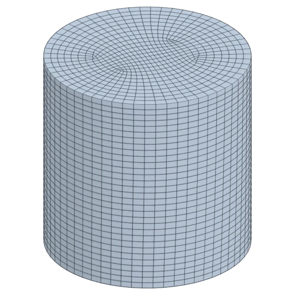

# cylinder

A mechanical model, with hard edges; 3 584 triangles in the source.
Author, source and licence: [CREDITS.md](../../CREDITS.md).

## At 3000 quads

| Source | QuadriFlow (Blender) | openclare | Quad Remesher |
|---|---|---|---|
|  |  |  |  |

## Marks

From 0 to 100; how they are made is in [SCORES.md](../../bench/results/SCORES.md).

### 1000 quads

| Remesher | Overall | Validity | Alignment | Quad shape | Fidelity | Regularity | Structure | Budget | Speed |
|---|---|---|---|---|---|---|---|---|---|
| quad-layout | **96** | 100 | 95 | 87 | 97 | 100 | 99 | 96 | 100 |
| **quad-layout-adaptive** | **93** | 100 | 92 | 81 | 97 | 100 | 81 | 87 | 100 |
| quadriflow | **89** | 100 | 82 | 78 | 92 | 100 | 62 | 93 | 100 |
| integer-grid | **89** | 100 | 91 | 78 | 97 | 100 | 80 | 57 | 81 |
| quadremesher | **85** | 100 | 93 | 80 | 95 | 100 | 82 | 13 | 74 |
| quadremesher-uniform | **85** | 100 | 93 | 80 | 95 | 100 | 82 | 13 | 74 |
| instant-meshes | **76** | 80 | 78 | 75 | 69 | 68 | 42 | 96 | 100 |

### 3000 quads

| Remesher | Overall | Validity | Alignment | Quad shape | Fidelity | Regularity | Structure | Budget | Speed |
|---|---|---|---|---|---|---|---|---|---|
| **quad-layout-adaptive** | **95** | 100 | 93 | 86 | 98 | 100 | 85 | 95 | 92 |
| quad-layout | **94** | 100 | 93 | 82 | 98 | 100 | 76 | 98 | 92 |
| quadriflow | **89** | 100 | 81 | 78 | 96 | 100 | 65 | 87 | 94 |
| quadremesher | **88** | 100 | 93 | 84 | 97 | 100 | 83 | 28 | 76 |
| quadremesher-uniform | **88** | 100 | 93 | 84 | 97 | 100 | 83 | 28 | 78 |
| integer-grid | **87** | 100 | 93 | 78 | 98 | 100 | 73 | 34 | 60 |
| instant-meshes | **82** | 100 | 76 | 79 | 93 | 73 | 2 | 87 | 100 |

### 8000 quads

| Remesher | Overall | Validity | Alignment | Quad shape | Fidelity | Regularity | Structure | Budget | Speed |
|---|---|---|---|---|---|---|---|---|---|
| quad-layout | **97** | 100 | 94 | 88 | 99 | 100 | 98 | 100 | 66 |
| **quad-layout-adaptive** | **96** | 100 | 94 | 89 | 99 | 100 | 82 | 95 | 66 |
| integer-grid | **93** | 100 | 94 | 87 | 99 | 100 | 82 | 66 | 46 |
| quadremesher | **89** | 100 | 92 | 78 | 99 | 100 | 88 | 46 | 64 |
| quadremesher-uniform | **89** | 100 | 92 | 78 | 99 | 100 | 88 | 46 | 63 |
| instant-meshes | **84** | 80 | 85 | 85 | 96 | 80 | 38 | 98 | 100 |
