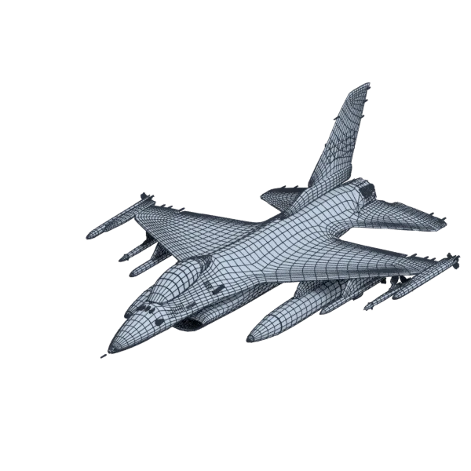
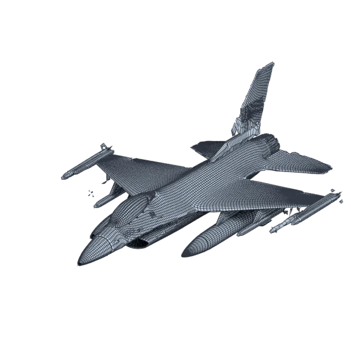

# f16

An extra model, with hard edges, with open borders; 261 232 triangles in the source.
Its licence does not allow passing it on: the model is not in the repository (`make blenderkit`).
Author, source and licence: [CREDITS.md](../../CREDITS.md).

## At 3000 quads asked for

| Source | openclare | Quad Remesher |
|---|---|---|
|  |  |  |
| 261 232 triangles | 1 843 quads | 36 038 quads |

## At equal quad count

Quad Remesher makes more quads than the 3000 it is asked for. Next to its mesh, openclare asked for as many quads as that mesh has.

| Quad Remesher | openclare, as many quads |
|---|---|
|  |  |
| 36 038 quads | 30 486 quads |

## Marks

From 0 to 100; how they are made is in [SCORES.md](../../bench/results/SCORES.md).

### 1000 quads

| Remesher | Quads | Overall | Validity | Alignment | Quad shape | Fidelity | Regularity | Structure | Budget | Speed |
|---|---|---|---|---|---|---|---|---|---|---|
| quadremesher | 30430 | **38** | 0 | 78 | 43 | 87 | 10 | — | 0 | 41 |
| instant-meshes | 465 | **22** | 60 | 33 | 0 | 0 | 0 | 5 | 0 | 66 |
| quadremesher-uniform | 4601 | **22** | 0 | 64 | 22 | 31 | 0 | — | 0 | 43 |
| **openclare** | 607 | **16** | 0 | 72 | 7 | 0 | 0 | — | 0 | 0 |
| openclare-uniform | 654 | **16** | 0 | 72 | 6 | 0 | 0 | — | 0 | 27 |
| integer-grid | 603 | **13** | 0 | 52 | 11 | 0 | 0 | — | 0 | 0 |
| quadriflow | — | **0** | 0 | — | — | — | — | — | — | 100 |

At equal quad count: Quad Remesher's mesh as it is, and openclare asked for as many quads.

| Remesher | Quads | Overall | Validity | Alignment | Quad shape | Fidelity | Regularity | Structure | Budget | Speed |
|---|---|---|---|---|---|---|---|---|---|---|
| openclare-matched | 25171 | **44** | 0 | 83 | 65 | 28 | 67 | — | 31 | 0 |
| quadremesher-as-made | 30430 | **40** | 0 | 78 | 43 | 75 | 10 | — | 100 | 41 |

### 3000 quads

| Remesher | Quads | Overall | Validity | Alignment | Quad shape | Fidelity | Regularity | Structure | Budget | Speed |
|---|---|---|---|---|---|---|---|---|---|---|
| quadremesher | 36038 | **39** | 0 | 78 | 45 | 88 | 15 | — | 0 | 45 |
| quadremesher-uniform | 6315 | **24** | 0 | 69 | 29 | 34 | 0 | — | 0 | 45 |
| **openclare** | 1843 | **22** | 0 | 77 | 29 | 11 | 0 | — | 0 | 0 |
| openclare-uniform | 1892 | **22** | 0 | 76 | 28 | 11 | 0 | — | 0 | 26 |
| instant-meshes | 1500 | **20** | 40 | 44 | 1 | 0 | 0 | 11 | 0 | 60 |
| integer-grid | 1333 | **17** | 0 | 61 | 23 | 0 | 0 | — | 0 | 0 |
| quadriflow | — | **0** | 0 | — | — | — | — | — | — | 100 |

At equal quad count: Quad Remesher's mesh as it is, and openclare asked for as many quads.

| Remesher | Quads | Overall | Validity | Alignment | Quad shape | Fidelity | Regularity | Structure | Budget | Speed |
|---|---|---|---|---|---|---|---|---|---|---|
| openclare-matched | 30486 | **44** | 0 | 83 | 64 | 29 | 70 | — | 38 | 0 |
| quadremesher-as-made | 36038 | **42** | 0 | 78 | 45 | 80 | 15 | — | 100 | 45 |

### 8000 quads

| Remesher | Quads | Overall | Validity | Alignment | Quad shape | Fidelity | Regularity | Structure | Budget | Speed |
|---|---|---|---|---|---|---|---|---|---|---|
| quadremesher | 46194 | **44** | 0 | 79 | 54 | 90 | 42 | — | 0 | 42 |
| integer-grid | 6707 | **33** | 0 | 75 | 53 | 27 | 4 | — | 35 | 0 |
| **openclare** | 6448 | **32** | 0 | 80 | 54 | 23 | 8 | — | 22 | 0 |
| openclare-uniform | 6415 | **32** | 0 | 81 | 54 | 25 | 0 | — | 21 | 15 |
| quadremesher-uniform | 10673 | **30** | 0 | 76 | 47 | 39 | 0 | — | 0 | 44 |
| instant-meshes | 4548 | **18** | 0 | 64 | 28 | 0 | 0 | 22 | 0 | 57 |
| quadriflow | — | **0** | 0 | — | — | — | — | — | — | 100 |

At equal quad count: Quad Remesher's mesh as it is, and openclare asked for as many quads.

| Remesher | Quads | Overall | Validity | Alignment | Quad shape | Fidelity | Regularity | Structure | Budget | Speed |
|---|---|---|---|---|---|---|---|---|---|---|
| quadremesher-as-made | 46194 | **48** | 0 | 79 | 54 | 85 | 42 | — | 100 | 42 |
| openclare-matched | 34351 | **45** | 0 | 84 | 67 | 31 | 70 | — | 0 | 0 |
