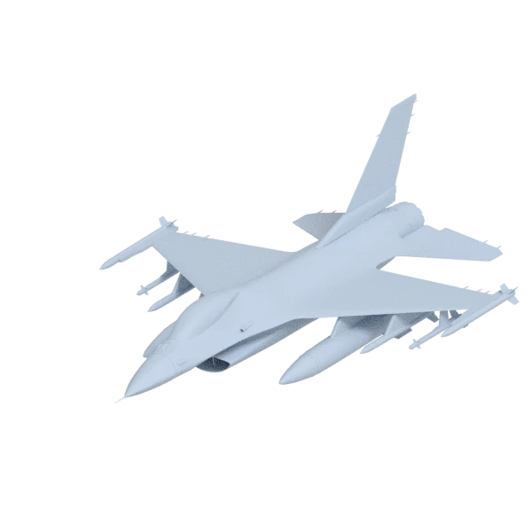
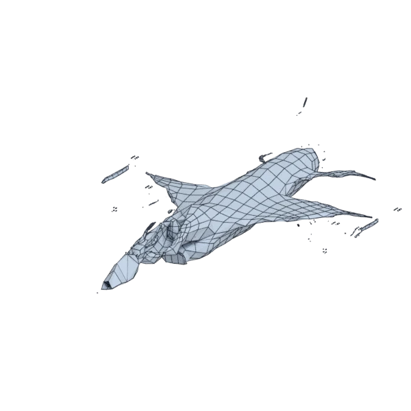
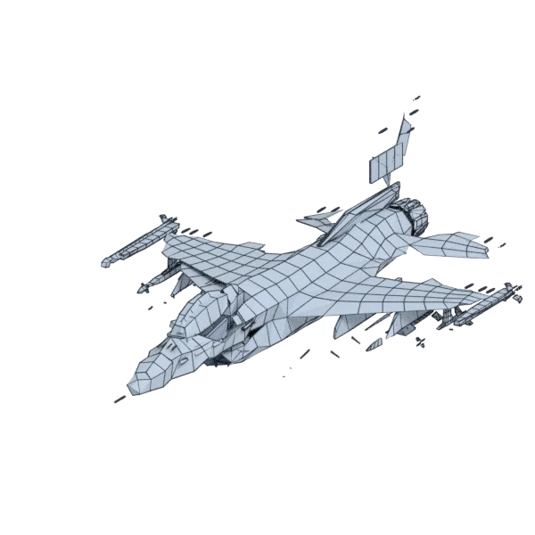

# f16

An extra model, with hard edges, with open borders; 261 232 triangles in the source.
Its licence does not allow passing it on: the model is not in the repository (`make blenderkit`).
Author, source and licence: [CREDITS.md](../../CREDITS.md).

## At 3000 quads asked for

| Source | AutoRemesher | openclare |
|---|---|---|
|  |  |  |
| 261 232 triangles | 4 122 quads | 4 395 quads |

## Marks

From 0 to 100; how they are made is in [SCORES.md](../../bench/results/SCORES.md).

### 1000 quads

| Remesher | Quads | Overall | Validity | Alignment | Quad shape | Fidelity | Regularity | Structure | Edge loops | Budget | Speed |
|---|---|---|---|---|---|---|---|---|---|---|---|
| instant-meshes | 465 | **27** | 60 | 52 | 11 | 0 | 0 | 5 | — | 0 | 66 |
| **openclare** | 2651 | **27** | 0 | 100 | 21 | 36 | 0 | — | 4 | 0 | 37 |
| openclare-uniform | 2598 | **26** | 0 | 100 | 20 | 34 | 0 | — | 4 | 0 | 43 |
| integer-grid | 603 | **24** | 0 | 81 | 42 | 0 | 0 | — | — | 0 | 1 |
| autoremesher | 3146 | **8** | 0 | 38 | 0 | 0 | 0 | — | — | 0 | 94 |
| quadriflow | — | **0** | 0 | — | — | — | — | — | — | — | 100 |

Lines of the scene, as openclare reports them: 9 edges laid along the guide curves and the borders between materials, lines let go on 6 pieces.

### 3000 quads

| Remesher | Quads | Overall | Validity | Alignment | Quad shape | Fidelity | Regularity | Structure | Edge loops | Budget | Speed |
|---|---|---|---|---|---|---|---|---|---|---|---|
| openclare-uniform | 4505 | **37** | 0 | 100 | 40 | 59 | 0 | — | — | 0 | 41 |
| **openclare** | 4395 | **37** | 0 | 100 | 47 | 51 | 0 | — | — | 0 | 40 |
| integer-grid | 1333 | **29** | 0 | 95 | 57 | 0 | 0 | — | — | 0 | 0 |
| instant-meshes | 1500 | **29** | 40 | 68 | 31 | 0 | 0 | 11 | — | 0 | 60 |
| autoremesher | 4122 | **11** | 0 | 53 | 0 | 0 | 0 | — | — | 0 | 81 |
| quadriflow | — | **0** | 0 | — | — | — | — | — | — | — | 100 |

Lines of the scene, as openclare reports them: 22 edges laid along the guide curves and the borders between materials, lines let go on 6 pieces.

### 8000 quads

| Remesher | Quads | Overall | Validity | Alignment | Quad shape | Fidelity | Regularity | Structure | Edge loops | Budget | Speed |
|---|---|---|---|---|---|---|---|---|---|---|---|
| **openclare** | 9383 | **50** | 0 | 100 | 88 | 76 | 0 | — | — | 31 | 36 |
| openclare-uniform | 9161 | **50** | 0 | 100 | 82 | 74 | 0 | — | — | 42 | 31 |
| integer-grid | 6707 | **49** | 0 | 100 | 91 | 27 | 54 | — | — | 35 | 0 |
| instant-meshes | 4548 | **30** | 0 | 99 | 62 | 0 | 0 | 22 | — | 0 | 57 |
| autoremesher | 6227 | **19** | 0 | 84 | 0 | 0 | 0 | — | — | 11 | 69 |
| quadriflow | — | **0** | 0 | — | — | — | — | — | — | — | 100 |

Lines of the scene, as openclare reports them: 58 edges laid along the guide curves and the borders between materials, lines let go on 7 pieces.
