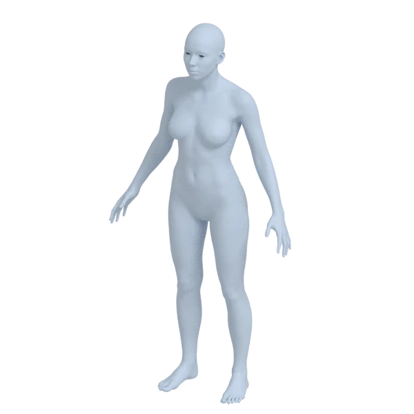
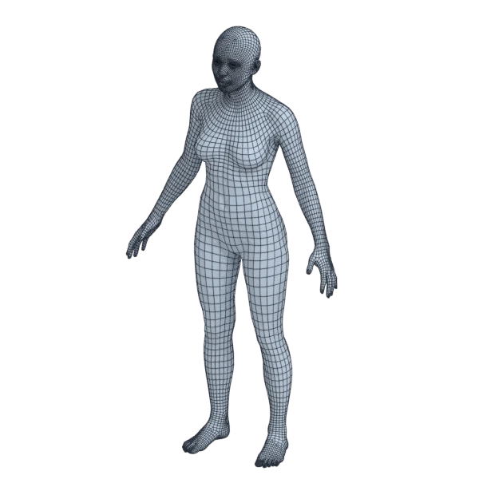
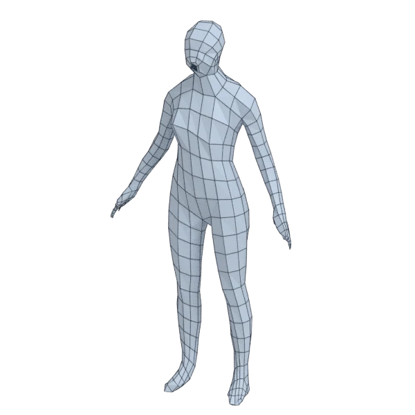
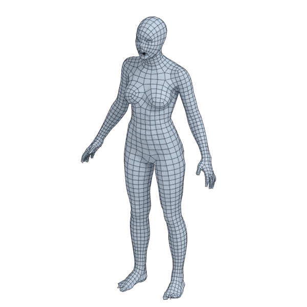
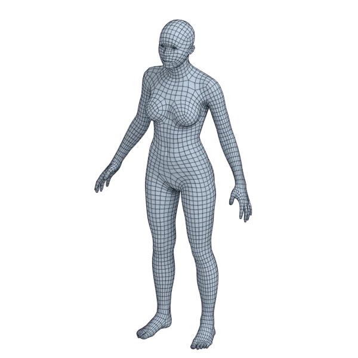
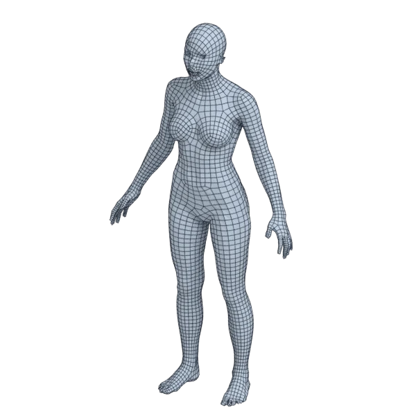

# human_female

An organic model; 1 354 880 triangles in the source.
Its licence does not allow passing it on: the model is not in the repository (`make blenderkit`).
Author, source and licence: [CREDITS.md](../../CREDITS.md).

## At 3000 quads asked for

| Source | Modelled by hand | AutoRemesher | openclare | Quad Remesher |
|---|---|---|---|---|
|  |  |  |  |  |
| 1 354 880 triangles | 10 590 quads | 689 quads | 2 977 quads | 5 391 quads |

## At equal quad count

Quad Remesher makes more quads than the 3000 it is asked for. Next to its mesh, openclare asked for as many quads as that mesh has.

| Quad Remesher | openclare, as many quads |
|---|---|
|  |  |
| 5 391 quads | 5 320 quads |

## Edge loops

At 3000 quads asked for. Each loop is followed straight on through every regular vertex: it closes, comes back beside itself a quad further (a spiral), stops at an irregular vertex, or runs from a border to a border. Share of the edges on each, those of borders and of faces that are not quads left out; "—" where the mesh is not a manifold.

| | closed | spiral | stops | border to border | spirals | longest that stops |
|---|---|---|---|---|---|---|
| Modelled by hand | 32 % | 3 % | 66 % | 0 % | 3 | 274 |
| QuadriFlow (Blender) | — | — | — | — | — | — |
| AutoRemesher | 12 % | 20 % | 68 % | 0 % | 18 | 46 |
| openclare | 20 % | 14 % | 67 % | 0 % | 13 | 166 |
| Quad Remesher | 29 % | 1 % | 69 % | 0 % | 5 | 211 |

## Marks

From 0 to 100; how they are made is in [SCORES.md](../../bench/results/SCORES.md).

### 1000 quads

| Remesher | Quads | Overall | Validity | Alignment | Quad shape | Fidelity | Regularity | Structure | Edge loops | Budget | Speed |
|---|---|---|---|---|---|---|---|---|---|---|---|
| openclare-as-handmade | 10656 | **96** | 100 | 100 | 100 | 88 | 100 | 61 | 94 | 98 | 17 |
| handmade | 10590 | **96** | 96 | 90 | 95 | 94 | 100 | — | 98 | 100 | — |
| openclare-uniform | 984 | **90** | 100 | 100 | 100 | 44 | 100 | 64 | 94 | 94 | 39 |
| **openclare** | 995 | **83** | 100 | 97 | 99 | 61 | 55 | 43 | 62 | 98 | 32 |
| quadremesher | 2809 | **79** | 94 | 100 | 100 | 82 | 71 | — | 63 | 0 | 23 |
| integer-grid | 869 | **79** | 100 | 100 | 100 | 9 | 100 | 68 | 76 | 48 | 35 |
| quadremesher-uniform | 845 | **68** | 81 | 100 | 100 | 0 | 34 | — | 82 | 38 | 25 |
| instant-meshes | 877 | **45** | 0 | 79 | 89 | 0 | 68 | 27 | 64 | 51 | 26 |
| autoremesher | 172 | **17** | 0 | 70 | 0 | 0 | 0 | — | 31 | 0 | 70 |
| quadriflow | — | **0** | 0 | — | — | — | — | — | — | — | 100 |

At equal quad count: Quad Remesher's mesh as it is, and openclare asked for as many quads.

| Remesher | Quads | Overall | Validity | Alignment | Quad shape | Fidelity | Regularity | Structure | Edge loops | Budget | Speed |
|---|---|---|---|---|---|---|---|---|---|---|---|
| openclare-matched | 2798 | **93** | 100 | 100 | 100 | 73 | 96 | 59 | 94 | 98 | 33 |
| quadremesher-as-made | 2809 | **87** | 94 | 100 | 100 | 78 | 71 | — | 63 | 100 | 23 |

### 3000 quads

| Remesher | Quads | Overall | Validity | Alignment | Quad shape | Fidelity | Regularity | Structure | Edge loops | Budget | Speed |
|---|---|---|---|---|---|---|---|---|---|---|---|
| openclare-as-handmade | 10656 | **96** | 100 | 100 | 100 | 88 | 100 | 61 | 94 | 98 | 13 |
| handmade | 10590 | **96** | 96 | 90 | 95 | 94 | 100 | — | 98 | 100 | — |
| openclare-uniform | 2947 | **90** | 100 | 100 | 100 | 50 | 100 | 62 | 90 | 93 | 36 |
| quadremesher | 5391 | **89** | 99 | 100 | 100 | 87 | 100 | — | 100 | 0 | 25 |
| **openclare** | 2977 | **88** | 100 | 100 | 100 | 69 | 95 | 40 | 64 | 97 | 32 |
| quadremesher-uniform | 2635 | **81** | 95 | 100 | 100 | 6 | 96 | — | 96 | 51 | 27 |
| integer-grid | 2766 | **56** | 0 | 100 | 100 | 11 | 100 | — | 57 | 69 | 30 |
| instant-meshes | 2837 | **48** | 0 | 82 | 100 | 0 | 81 | 17 | 46 | 78 | 26 |
| autoremesher | 689 | **30** | 0 | 74 | 60 | 9 | 38 | — | 26 | 0 | 62 |
| quadriflow | — | **0** | 0 | — | — | — | — | — | — | — | 100 |

At equal quad count: Quad Remesher's mesh as it is, and openclare asked for as many quads.

| Remesher | Quads | Overall | Validity | Alignment | Quad shape | Fidelity | Regularity | Structure | Edge loops | Budget | Speed |
|---|---|---|---|---|---|---|---|---|---|---|---|
| quadremesher-as-made | 5391 | **98** | 99 | 100 | 100 | 85 | 100 | — | 100 | 100 | 25 |
| openclare-matched | 5320 | **90** | 100 | 100 | 100 | 85 | 100 | 41 | 67 | 95 | 25 |

### 8000 quads

| Remesher | Quads | Overall | Validity | Alignment | Quad shape | Fidelity | Regularity | Structure | Edge loops | Budget | Speed |
|---|---|---|---|---|---|---|---|---|---|---|---|
| openclare-as-handmade | 10656 | **96** | 100 | 100 | 100 | 88 | 100 | 61 | 94 | 98 | 17 |
| handmade | 10590 | **96** | 96 | 90 | 95 | 94 | 100 | — | 98 | 100 | — |
| **openclare** | 7890 | **94** | 100 | 100 | 100 | 86 | 100 | 62 | 87 | 94 | 20 |
| openclare-uniform | 7977 | **92** | 100 | 100 | 100 | 69 | 100 | 61 | 86 | 99 | 22 |
| quadremesher | 10897 | **87** | 100 | 100 | 100 | 89 | 100 | 55 | 97 | 0 | 25 |
| quadremesher-uniform | 7322 | **84** | 99 | 100 | 100 | 45 | 100 | — | 58 | 66 | 24 |
| integer-grid | 7201 | **59** | 0 | 100 | 100 | 43 | 100 | — | 50 | 60 | 12 |
| instant-meshes | 7648 | **50** | 0 | 75 | 100 | 17 | 98 | 16 | 42 | 82 | 26 |
| autoremesher | 2564 | **47** | 0 | 87 | 98 | 24 | 91 | — | — | 0 | 54 |
| quadriflow | — | **0** | 0 | — | — | — | — | — | — | — | 100 |

At equal quad count: Quad Remesher's mesh as it is, and openclare asked for as many quads.

| Remesher | Quads | Overall | Validity | Alignment | Quad shape | Fidelity | Regularity | Structure | Edge loops | Budget | Speed |
|---|---|---|---|---|---|---|---|---|---|---|---|
| quadremesher-as-made | 10897 | **96** | 100 | 100 | 100 | 88 | 100 | 55 | 97 | 100 | 25 |
| openclare-matched | 10896 | **94** | 100 | 100 | 100 | 88 | 100 | 56 | 88 | 100 | 18 |
