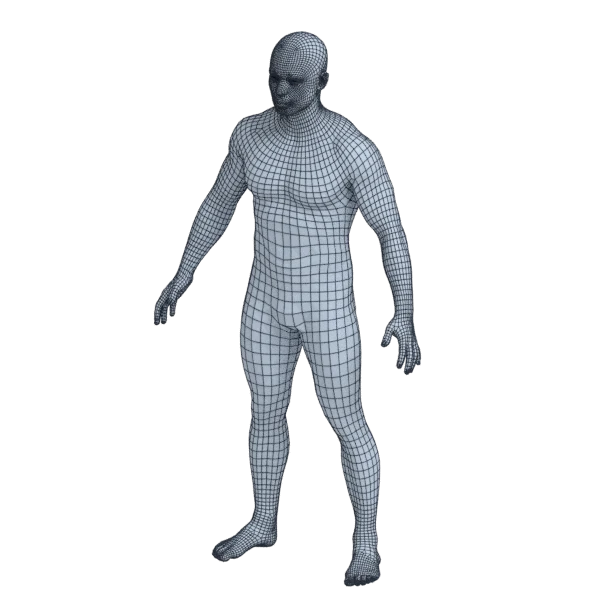
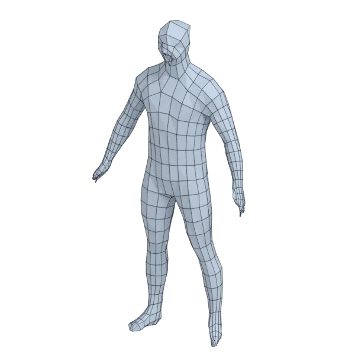
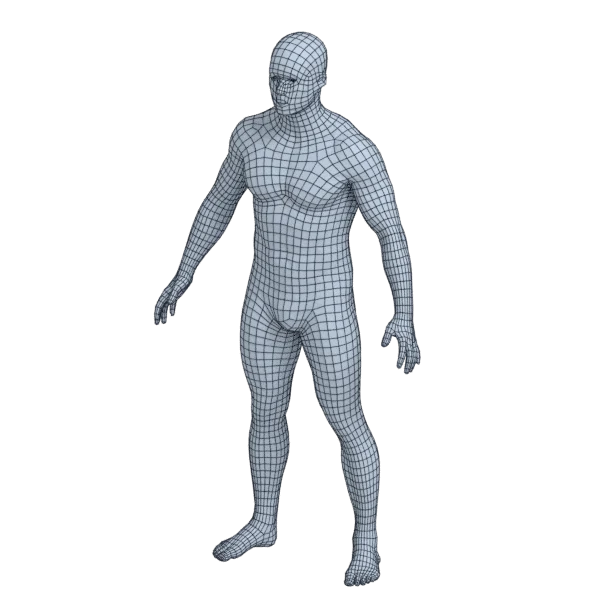
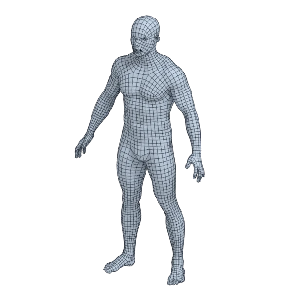

# human_male

An organic model; 1 354 880 triangles in the source.
Its licence does not allow passing it on: the model is not in the repository (`make blenderkit`).
Author, source and licence: [CREDITS.md](../../CREDITS.md).

## At 3000 quads asked for

| Source | Modelled by hand | AutoRemesher | openclare | Quad Remesher |
|---|---|---|---|---|
|  |  |  |  |  |
| 1 354 880 triangles | 10 590 quads | 854 quads | 2 979 quads | 5 322 quads |

## At equal quad count

Quad Remesher makes more quads than the 3000 it is asked for. Next to its mesh, openclare asked for as many quads as that mesh has.

| Quad Remesher | openclare, as many quads |
|---|---|
|  |  |
| 5 322 quads | 5 408 quads |

## Edge loops

At 3000 quads asked for. Each loop is followed straight on through every regular vertex: it closes, comes back beside itself a quad further (a spiral), stops at an irregular vertex, or runs from a border to a border. Share of the edges on each, those of borders and of faces that are not quads left out; "—" where the mesh is not a manifold.

| | closed | spiral | stops | border to border | spirals | longest that stops |
|---|---|---|---|---|---|---|
| Modelled by hand | 32 % | 3 % | 66 % | 0 % | 3 | 274 |
| QuadriFlow (Blender) | — | — | — | — | — | — |
| AutoRemesher | — | — | — | — | — | — |
| openclare | 31 % | 5 % | 65 % | 0 % | 8 | 121 |
| Quad Remesher | 29 % | 6 % | 65 % | 0 % | 7 | 177 |

## Marks

From 0 to 100; how they are made is in [SCORES.md](../../bench/results/SCORES.md).

### 1000 quads

| Remesher | Quads | Overall | Validity | Alignment | Quad shape | Fidelity | Regularity | Structure | Edge loops | Budget | Speed |
|---|---|---|---|---|---|---|---|---|---|---|---|
| handmade | 10590 | **94** | 96 | 87 | 93 | 92 | 100 | — | 98 | 100 | — |
| openclare-as-handmade | 9426 | **82** | 100 | 97 | 100 | 66 | 100 | 43 | 50 | 56 | 0 |
| **openclare** | 984 | **82** | 100 | 92 | 100 | 67 | 44 | 52 | 62 | 94 | 32 |
| quadremesher | 2672 | **79** | 97 | 100 | 100 | 85 | 71 | — | 53 | 0 | 24 |
| integer-grid | 613 | **70** | 100 | 100 | 91 | 20 | 88 | 51 | 50 | 0 | 36 |
| openclare-uniform | 594 | **70** | 100 | 99 | 86 | 19 | 88 | 59 | 54 | 0 | 17 |
| quadremesher-uniform | 920 | **50** | 0 | 100 | 100 | 3 | 57 | — | — | 68 | 22 |
| instant-meshes | 868 | **49** | 20 | 79 | 90 | 0 | 62 | 33 | 62 | 47 | 27 |
| autoremesher | 176 | **25** | 0 | 73 | 48 | 0 | 0 | — | 35 | 0 | 66 |
| quadriflow | — | **0** | 0 | — | — | — | — | — | — | — | 100 |

At equal quad count: Quad Remesher's mesh as it is, and openclare asked for as many quads.

| Remesher | Quads | Overall | Validity | Alignment | Quad shape | Fidelity | Regularity | Structure | Edge loops | Budget | Speed |
|---|---|---|---|---|---|---|---|---|---|---|---|
| openclare-matched | 2667 | **93** | 100 | 100 | 100 | 71 | 98 | 61 | 91 | 99 | 32 |
| quadremesher-as-made | 2672 | **87** | 97 | 100 | 100 | 82 | 71 | — | 53 | 100 | 24 |

### 3000 quads

| Remesher | Quads | Overall | Validity | Alignment | Quad shape | Fidelity | Regularity | Structure | Edge loops | Budget | Speed |
|---|---|---|---|---|---|---|---|---|---|---|---|
| handmade | 10590 | **94** | 96 | 87 | 93 | 92 | 100 | — | 98 | 100 | — |
| **openclare** | 2979 | **94** | 100 | 100 | 100 | 77 | 100 | 61 | 93 | 97 | 31 |
| openclare-uniform | 3013 | **92** | 100 | 100 | 100 | 62 | 100 | 67 | 86 | 98 | 32 |
| quadremesher | 5322 | **87** | 99 | 100 | 100 | 89 | 100 | — | 86 | 0 | 30 |
| integer-grid | 2710 | **83** | 99 | 100 | 100 | 12 | 100 | — | 93 | 61 | 29 |
| openclare-as-handmade | 9426 | **82** | 100 | 97 | 100 | 66 | 100 | 43 | 50 | 56 | 0 |
| instant-meshes | 2814 | **55** | 20 | 82 | 100 | 3 | 87 | 28 | 62 | 75 | 24 |
| quadremesher-uniform | 2598 | **53** | 0 | 100 | 100 | 2 | 100 | — | — | 46 | 31 |
| autoremesher | 854 | **40** | 0 | 89 | 86 | 18 | 47 | — | — | 0 | 63 |
| quadriflow | — | **0** | 0 | — | — | — | — | — | — | — | 100 |

At equal quad count: Quad Remesher's mesh as it is, and openclare asked for as many quads.

| Remesher | Quads | Overall | Validity | Alignment | Quad shape | Fidelity | Regularity | Structure | Edge loops | Budget | Speed |
|---|---|---|---|---|---|---|---|---|---|---|---|
| quadremesher-as-made | 5322 | **96** | 99 | 100 | 100 | 87 | 100 | — | 86 | 100 | 30 |
| openclare-matched | 5408 | **94** | 100 | 100 | 100 | 76 | 100 | 64 | 90 | 94 | 25 |

### 8000 quads

| Remesher | Quads | Overall | Validity | Alignment | Quad shape | Fidelity | Regularity | Structure | Edge loops | Budget | Speed |
|---|---|---|---|---|---|---|---|---|---|---|---|
| handmade | 10590 | **94** | 96 | 87 | 93 | 92 | 100 | — | 98 | 100 | — |
| **openclare** | 8083 | **94** | 100 | 100 | 100 | 88 | 100 | 64 | 78 | 96 | 19 |
| openclare-uniform | 8135 | **91** | 100 | 98 | 100 | 74 | 100 | 64 | 75 | 93 | 23 |
| quadremesher-uniform | 7045 | **85** | 98 | 100 | 100 | 66 | 100 | — | 58 | 52 | 26 |
| openclare-as-handmade | 9426 | **82** | 100 | 97 | 100 | 66 | 100 | 43 | 50 | 56 | 0 |
| quadremesher | 11084 | **64** | 0 | 100 | 100 | 91 | 100 | 57 | 84 | 0 | 25 |
| integer-grid | 7214 | **59** | 0 | 100 | 100 | 45 | 100 | — | 50 | 61 | 8 |
| instant-meshes | 7652 | **52** | 0 | 74 | 100 | 15 | 98 | 24 | 57 | 83 | 26 |
| autoremesher | 2520 | **47** | 0 | 80 | 95 | 40 | 88 | — | — | 0 | 58 |
| quadriflow | — | **0** | 0 | — | — | — | — | — | — | — | 100 |

At equal quad count: Quad Remesher's mesh as it is, and openclare asked for as many quads.

| Remesher | Quads | Overall | Validity | Alignment | Quad shape | Fidelity | Regularity | Structure | Edge loops | Budget | Speed |
|---|---|---|---|---|---|---|---|---|---|---|---|
| openclare-matched | 10877 | **96** | 100 | 99 | 100 | 87 | 100 | 67 | 96 | 93 | 18 |
| quadremesher-as-made | 11084 | **70** | 0 | 100 | 100 | 90 | 100 | 57 | 84 | 100 | 25 |
