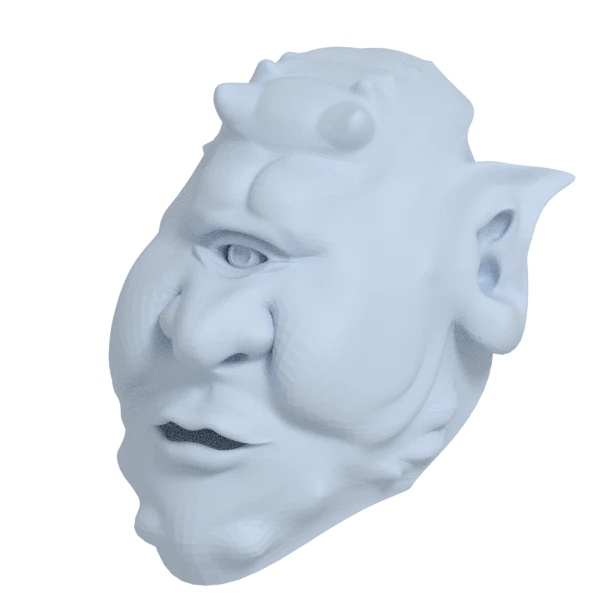
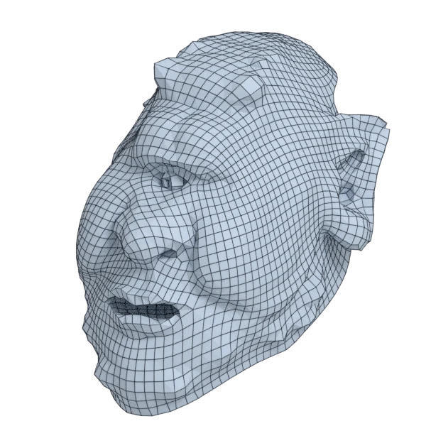
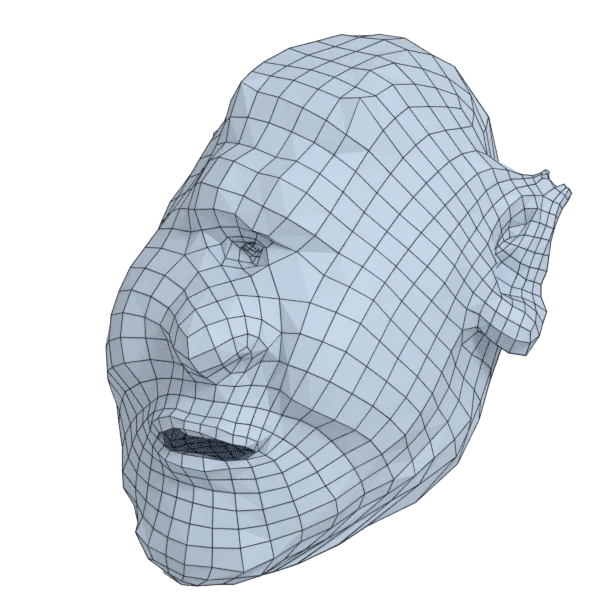
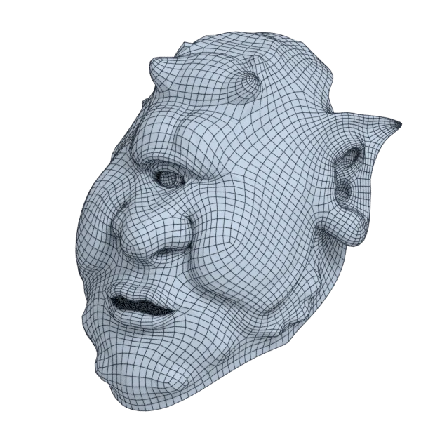
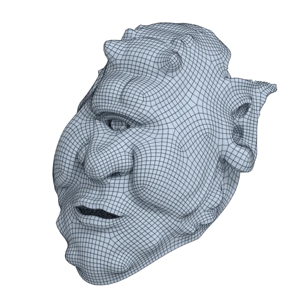

# jerry

An organic model, with open borders; 39 856 triangles in the source.
Author, source and licence: [CREDITS.md](../../CREDITS.md).

## At 3000 quads asked for

| Source | QuadriFlow (Blender) | AutoRemesher | openclare | Quad Remesher |
|---|---|---|---|---|
|  |  |  |  |  |
| 39 856 triangles | 3 015 quads | 1 102 quads | 3 049 quads | 6 872 quads |

## At equal quad count

Quad Remesher makes more quads than the 3000 it is asked for. Next to its mesh, openclare asked for as many quads as that mesh has.

| Quad Remesher | openclare, as many quads |
|---|---|
|  |  |
| 6 872 quads | 6 903 quads |

## Edge loops

At 3000 quads asked for. Each loop is followed straight on through every regular vertex: it closes, comes back beside itself a quad further (a spiral), stops at an irregular vertex, or runs from a border to a border. Share of the edges on each, those of borders and of faces that are not quads left out; "—" where the mesh is not a manifold.

| | closed | spiral | stops | border to border | spirals | longest that stops |
|---|---|---|---|---|---|---|
| QuadriFlow (Blender) | 0 % | 1 % | 82 % | 17 % | 1 | 155 |
| AutoRemesher | 0 % | 13 % | 87 % | 0 % | 6 | 64 |
| openclare | 2 % | 3 % | 88 % | 7 % | 5 | 132 |
| Quad Remesher | 3 % | 6 % | 85 % | 5 % | 10 | 282 |

## Marks

From 0 to 100; how they are made is in [SCORES.md](../../bench/results/SCORES.md).

### 1000 quads

| Remesher | Quads | Overall | Validity | Alignment | Quad shape | Fidelity | Regularity | Structure | Edge loops | Budget | Speed |
|---|---|---|---|---|---|---|---|---|---|---|---|
| openclare-uniform | 1004 | **64** | 100 | 36 | 61 | 42 | 49 | 39 | — | 98 | 78 |
| **openclare** | 987 | **59** | 100 | 33 | 53 | 59 | 16 | 13 | 43 | 95 | 77 |
| integer-grid | 867 | **48** | 100 | 26 | 44 | 9 | 42 | 24 | — | 47 | 69 |
| quadriflow | 900 | **44** | 80 | 18 | 49 | 22 | 23 | 20 | 50 | 60 | 100 |
| quadremesher | 3093 | **35** | 0 | 46 | 46 | 88 | 41 | — | 34 | 0 | 54 |
| instant-meshes | 886 | **31** | 60 | 14 | 45 | 8 | 0 | 4 | — | 54 | 100 |
| quadremesher-uniform | 876 | **24** | 0 | 36 | 38 | 32 | 0 | — | — | 50 | 42 |
| autoremesher | 305 | **3** | 0 | 9 | 7 | 0 | 0 | — | 0 | 0 | 100 |

At equal quad count: Quad Remesher's mesh as it is, and openclare asked for as many quads.

| Remesher | Quads | Overall | Validity | Alignment | Quad shape | Fidelity | Regularity | Structure | Edge loops | Budget | Speed |
|---|---|---|---|---|---|---|---|---|---|---|---|
| openclare-matched | 3034 | **62** | 100 | 38 | 65 | 57 | 43 | 14 | — | 92 | 74 |
| quadremesher-as-made | 3093 | **38** | 0 | 43 | 46 | 83 | 41 | — | — | 100 | 54 |

### 3000 quads

| Remesher | Quads | Overall | Validity | Alignment | Quad shape | Fidelity | Regularity | Structure | Edge loops | Budget | Speed |
|---|---|---|---|---|---|---|---|---|---|---|---|
| openclare-uniform | 3014 | **67** | 100 | 38 | 69 | 38 | 72 | 33 | — | 98 | 76 |
| **openclare** | 3049 | **65** | 100 | 40 | 67 | 63 | 47 | 18 | 45 | 93 | 71 |
| quadremesher-uniform | 2573 | **58** | 100 | 40 | 50 | 66 | 30 | 19 | — | 43 | 53 |
| integer-grid | 2595 | **53** | 100 | 34 | 52 | 2 | 63 | 40 | — | 46 | 51 |
| quadriflow | 3122 | **52** | 80 | 20 | 44 | 38 | 67 | 29 | 48 | 84 | 87 |
| quadremesher | 6872 | **40** | 0 | 51 | 52 | 88 | 70 | — | 39 | 0 | 53 |
| instant-meshes | 2959 | **29** | 20 | 18 | 57 | 11 | 10 | 0 | — | 95 | 100 |
| autoremesher | 1102 | **11** | 0 | 20 | 24 | 0 | 24 | — | 17 | 0 | 92 |

At equal quad count: Quad Remesher's mesh as it is, and openclare asked for as many quads.

| Remesher | Quads | Overall | Validity | Alignment | Quad shape | Fidelity | Regularity | Structure | Edge loops | Budget | Speed |
|---|---|---|---|---|---|---|---|---|---|---|---|
| openclare-matched | 6903 | **70** | 100 | 45 | 69 | 77 | 61 | 18 | — | 98 | 48 |
| quadremesher-as-made | 6872 | **44** | 0 | 50 | 52 | 86 | 70 | — | — | 100 | 53 |

### 8000 quads

| Remesher | Quads | Overall | Validity | Alignment | Quad shape | Fidelity | Regularity | Structure | Edge loops | Budget | Speed |
|---|---|---|---|---|---|---|---|---|---|---|---|
| openclare-uniform | 7903 | **73** | 100 | 43 | 74 | 61 | 79 | 31 | — | 95 | 58 |
| **openclare** | 7951 | **71** | 100 | 45 | 71 | 80 | 65 | 14 | 43 | 98 | 48 |
| integer-grid | 7345 | **64** | 100 | 41 | 57 | 44 | 76 | 29 | — | 67 | 12 |
| quadremesher | 13714 | **64** | 100 | 53 | 59 | 92 | 82 | 15 | 32 | 0 | 45 |
| quadriflow | 7781 | **58** | 80 | 22 | 61 | 44 | 86 | 36 | 42 | 89 | 56 |
| quadremesher-uniform | 6947 | **42** | 0 | 44 | 58 | 75 | 64 | — | — | 47 | 48 |
| instant-meshes | 7933 | **37** | 20 | 17 | 67 | 32 | 38 | 2 | — | 97 | 100 |
| autoremesher | 2740 | **24** | 0 | 30 | 49 | 25 | 60 | — | — | 0 | 78 |

At equal quad count: Quad Remesher's mesh as it is, and openclare asked for as many quads.

| Remesher | Quads | Overall | Validity | Alignment | Quad shape | Fidelity | Regularity | Structure | Edge loops | Budget | Speed |
|---|---|---|---|---|---|---|---|---|---|---|---|
| quadremesher-as-made | 13714 | **74** | 100 | 52 | 59 | 91 | 82 | 15 | — | 100 | 45 |
| openclare-matched | 13817 | **72** | 100 | 48 | 70 | 79 | 74 | 15 | — | 97 | 33 |
