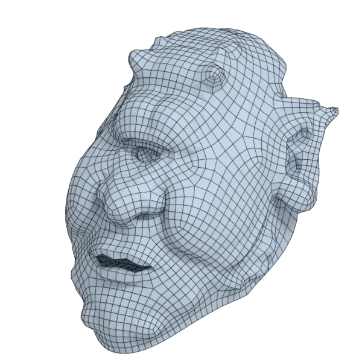

# jerry

An organic model, with open borders; 39 856 triangles in the source.
Author, source and licence: [CREDITS.md](../../CREDITS.md).

## At 3000 quads

| Source | QuadriFlow (Blender) | openclare | Quad Remesher |
|---|---|---|---|
|  |  |  |  |

## Marks

From 0 to 100; how they are made is in [SCORES.md](../../bench/results/SCORES.md).

### 1000 quads

| Remesher | Overall | Validity | Alignment | Quad shape | Fidelity | Regularity | Structure | Budget | Speed |
|---|---|---|---|---|---|---|---|---|---|
| quad-layout | **62** | 100 | 34 | 62 | 28 | 49 | 40 | 100 | 98 |
| **quad-layout-adaptive** | **59** | 100 | 32 | 56 | 49 | 17 | 12 | 98 | 83 |
| integer-grid | **46** | 100 | 30 | 46 | 0 | 37 | 28 | 32 | 14 |
| quadriflow | **40** | 80 | 18 | 49 | 0 | 23 | 20 | 60 | 100 |
| quadremesher | **35** | 0 | 46 | 46 | 85 | 41 | — | 0 | 54 |
| instant-meshes | **30** | 60 | 14 | 45 | 0 | 0 | 4 | 54 | 100 |
| quadremesher-uniform | **19** | 0 | 36 | 38 | 1 | 0 | — | 50 | 42 |

### 3000 quads

| Remesher | Overall | Validity | Alignment | Quad shape | Fidelity | Regularity | Structure | Budget | Speed |
|---|---|---|---|---|---|---|---|---|---|
| quad-layout | **67** | 100 | 36 | 69 | 37 | 71 | 32 | 100 | 73 |
| **quad-layout-adaptive** | **66** | 100 | 40 | 67 | 55 | 47 | 18 | 93 | 78 |
| quadremesher-uniform | **59** | 100 | 40 | 50 | 70 | 30 | 19 | 43 | 53 |
| integer-grid | **54** | 100 | 33 | 52 | 11 | 64 | 25 | 49 | 55 |
| quadriflow | **50** | 80 | 20 | 44 | 22 | 67 | 29 | 84 | 82 |
| quadremesher | **40** | 0 | 51 | 52 | 87 | 70 | — | 0 | 53 |
| instant-meshes | **28** | 20 | 18 | 57 | 2 | 10 | 0 | 95 | 100 |

### 8000 quads

| Remesher | Overall | Validity | Alignment | Quad shape | Fidelity | Regularity | Structure | Budget | Speed |
|---|---|---|---|---|---|---|---|---|---|
| quad-layout | **74** | 100 | 43 | 74 | 70 | 79 | 32 | 94 | 58 |
| **quad-layout-adaptive** | **73** | 100 | 45 | 70 | 80 | 66 | 13 | 95 | 40 |
| quadremesher | **67** | 100 | 53 | 59 | 92 | 82 | 15 | 0 | 45 |
| quadriflow | **58** | 80 | 22 | 61 | 37 | 86 | 36 | 89 | 59 |
| quadremesher-uniform | **43** | 0 | 44 | 58 | 79 | 64 | — | 47 | 48 |
| integer-grid | **42** | 0 | 41 | 57 | 62 | 77 | — | 67 | 6 |
| instant-meshes | **38** | 20 | 17 | 67 | 41 | 38 | 2 | 97 | 100 |
