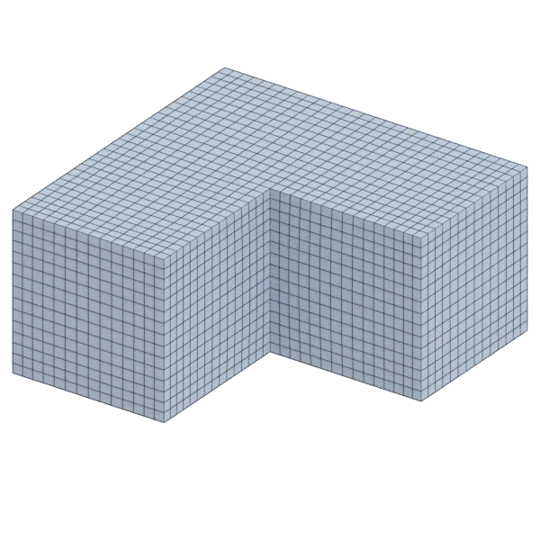

# lblock

A mechanical model, with hard edges; 4 032 triangles in the source.
Author, source and licence: [CREDITS.md](../../CREDITS.md).

## At 3000 quads

| Source | QuadriFlow (Blender) | openclare | Quad Remesher |
|---|---|---|---|
|  |  |  |  |

## Marks

From 0 to 100; how they are made is in [SCORES.md](../../bench/results/SCORES.md).

### 1000 quads

| Remesher | Overall | Validity | Alignment | Quad shape | Fidelity | Regularity | Structure | Budget | Speed |
|---|---|---|---|---|---|---|---|---|---|
| quad-layout | **99** | 100 | 98 | 100 | 100 | 96 | 99 | 98 | 100 |
| **quad-layout-adaptive** | **98** | 100 | 97 | 98 | 100 | 96 | 99 | 98 | 100 |
| quadremesher | **98** | 100 | 98 | 98 | 100 | 96 | 99 | 96 | 75 |
| quadremesher-uniform | **98** | 100 | 98 | 98 | 100 | 96 | 99 | 96 | 76 |
| instant-meshes | **93** | 100 | 95 | 93 | 100 | 91 | 91 | 61 | 100 |
| quadriflow | **91** | 100 | 94 | 94 | 81 | 96 | 91 | 72 | 100 |
| integer-grid | **91** | 100 | 92 | 90 | 66 | 96 | 97 | 97 | 74 |

### 3000 quads

| Remesher | Overall | Validity | Alignment | Quad shape | Fidelity | Regularity | Structure | Budget | Speed |
|---|---|---|---|---|---|---|---|---|---|
| quadremesher | **99** | 100 | 97 | 98 | 100 | 99 | 100 | 96 | 75 |
| quadremesher-uniform | **99** | 100 | 97 | 98 | 100 | 99 | 100 | 96 | 74 |
| quad-layout | **99** | 100 | 98 | 100 | 100 | 99 | 100 | 92 | 95 |
| **quad-layout-adaptive** | **98** | 100 | 96 | 97 | 100 | 99 | 100 | 96 | 93 |
| integer-grid | **98** | 100 | 97 | 97 | 100 | 99 | 100 | 88 | 1 |
| instant-meshes | **93** | 100 | 93 | 92 | 100 | 94 | 83 | 71 | 100 |
| quadriflow | **89** | 80 | 95 | 96 | 79 | 99 | 97 | 90 | 92 |

### 8000 quads

| Remesher | Overall | Validity | Alignment | Quad shape | Fidelity | Regularity | Structure | Budget | Speed |
|---|---|---|---|---|---|---|---|---|---|
| quadremesher | **99** | 100 | 98 | 100 | 100 | 100 | 100 | 97 | 72 |
| quadremesher-uniform | **99** | 100 | 98 | 100 | 100 | 100 | 100 | 97 | 72 |
| integer-grid | **99** | 100 | 97 | 100 | 100 | 100 | 100 | 97 | 62 |
| quad-layout | **99** | 100 | 97 | 100 | 100 | 100 | 100 | 97 | 68 |
| **quad-layout-adaptive** | **98** | 100 | 96 | 98 | 100 | 100 | 100 | 97 | 66 |
| instant-meshes | **98** | 100 | 95 | 96 | 100 | 98 | 91 | 100 | 93 |
