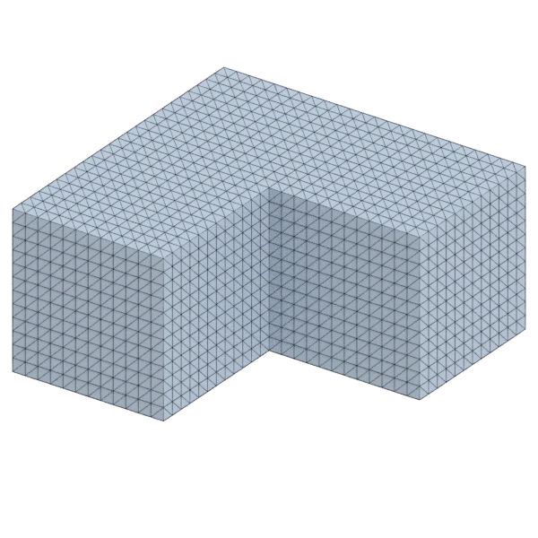
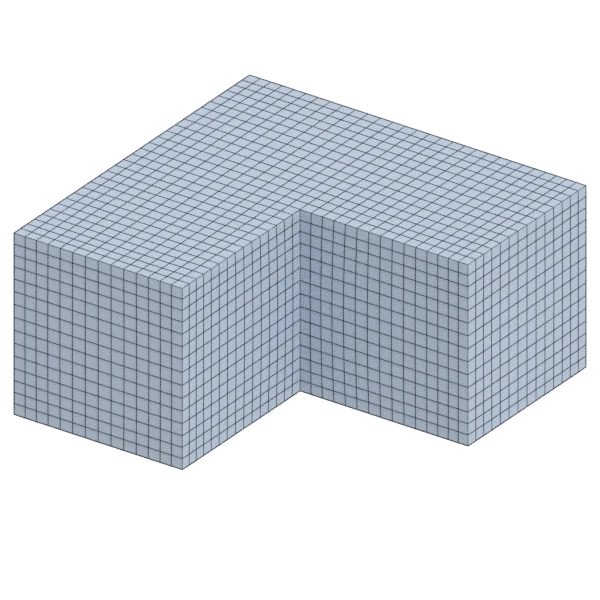

# lblock

A mechanical model, with hard edges; 4 032 triangles in the source.
Author, source and licence: [CREDITS.md](../../CREDITS.md).

## At 3000 quads asked for

| Source | QuadriFlow (Blender) | AutoRemesher | openclare | Quad Remesher |
|---|---|---|---|---|
|  |  |  |  |  |
| 4 032 triangles | 2 928 quads | 1 328 quads | 2 972 quads | 3 030 quads |

## At equal quad count

Quad Remesher makes more quads than the 3000 it is asked for. Next to its mesh, openclare asked for as many quads as that mesh has.

| Quad Remesher | openclare, as many quads |
|---|---|
|  |  |
| 3 030 quads | 2 972 quads |

## Edge loops

At 3000 quads asked for. Each loop is followed straight on through every regular vertex: it closes, comes back beside itself a quad further (a spiral), stops at an irregular vertex, or runs from a border to a border. Share of the edges on each, those of borders and of faces that are not quads left out; "—" where the mesh is not a manifold.

| | closed | spiral | stops | border to border | spirals | longest that stops |
|---|---|---|---|---|---|---|
| Modelled by hand | — | — | — | — | — | — |
| QuadriFlow (Blender) | 78 % | 14 % | 8 % | 0 % | 1 | 86 |
| AutoRemesher | 26 % | 62 % | 11 % | 0 % | 5 | 58 |
| openclare | 93 % | 0 % | 7 % | 0 % | 0 | 43 |
| Quad Remesher | 93 % | 0 % | 7 % | 0 % | 0 | 45 |

## Marks

From 0 to 100; how they are made is in [SCORES.md](../../bench/results/SCORES.md).

### 1000 quads

| Remesher | Quads | Overall | Validity | Alignment | Quad shape | Fidelity | Regularity | Structure | Edge loops | Budget | Speed |
|---|---|---|---|---|---|---|---|---|---|---|---|
| openclare-uniform | 994 | **100** | 100 | 100 | 100 | 100 | 100 | 99 | 100 | 98 | 100 |
| **openclare** | 994 | **100** | 100 | 100 | 100 | 100 | 100 | 99 | 100 | 98 | 97 |
| quadremesher | 1010 | **100** | 100 | 100 | 100 | 100 | 100 | 99 | 100 | 96 | 75 |
| quadremesher-uniform | 1010 | **100** | 100 | 100 | 100 | 100 | 100 | 99 | — | 96 | 76 |
| instant-meshes | 902 | **96** | 100 | 100 | 100 | 100 | 100 | 91 | — | 61 | 100 |
| integer-grid | 992 | **95** | 100 | 100 | 100 | 73 | 100 | 97 | — | 97 | 67 |
| quadriflow | 930 | **90** | 100 | 100 | 100 | 81 | 100 | 91 | 68 | 72 | 100 |
| autoremesher | 588 | **79** | 100 | 100 | 100 | 42 | 100 | 78 | 74 | 0 | 100 |

At equal quad count: Quad Remesher's mesh as it is, and openclare asked for as many quads.

| Remesher | Quads | Overall | Validity | Alignment | Quad shape | Fidelity | Regularity | Structure | Edge loops | Budget | Speed |
|---|---|---|---|---|---|---|---|---|---|---|---|
| openclare-matched | 1028 | **100** | 100 | 100 | 100 | 100 | 100 | 99 | 100 | 93 | 97 |
| quadremesher-as-made | 1010 | **100** | 100 | 100 | 100 | 100 | 100 | 99 | — | 100 | 75 |

### 3000 quads

| Remesher | Quads | Overall | Validity | Alignment | Quad shape | Fidelity | Regularity | Structure | Edge loops | Budget | Speed |
|---|---|---|---|---|---|---|---|---|---|---|---|
| **openclare** | 2972 | **100** | 100 | 100 | 100 | 100 | 100 | 100 | 100 | 96 | 79 |
| quadremesher | 3030 | **100** | 100 | 100 | 100 | 100 | 100 | 100 | 100 | 96 | 75 |
| quadremesher-uniform | 3030 | **100** | 100 | 100 | 100 | 100 | 100 | 100 | — | 96 | 74 |
| openclare-uniform | 3060 | **99** | 100 | 100 | 100 | 100 | 100 | 100 | 100 | 92 | 71 |
| integer-grid | 2800 | **97** | 100 | 100 | 100 | 100 | 100 | 100 | — | 73 | 23 |
| instant-meshes | 2780 | **96** | 100 | 100 | 100 | 100 | 100 | 83 | — | 71 | 100 |
| quadriflow | 2928 | **88** | 80 | 100 | 100 | 79 | 100 | 97 | 67 | 90 | 96 |
| autoremesher | 1328 | **80** | 100 | 100 | 100 | 77 | 100 | 53 | 50 | 0 | 100 |

At equal quad count: Quad Remesher's mesh as it is, and openclare asked for as many quads.

| Remesher | Quads | Overall | Validity | Alignment | Quad shape | Fidelity | Regularity | Structure | Edge loops | Budget | Speed |
|---|---|---|---|---|---|---|---|---|---|---|---|
| openclare-matched | 2972 | **100** | 100 | 100 | 100 | 100 | 100 | 100 | 100 | 92 | 78 |
| quadremesher-as-made | 3030 | **100** | 100 | 100 | 100 | 100 | 100 | 100 | — | 100 | 75 |

### 8000 quads

| Remesher | Quads | Overall | Validity | Alignment | Quad shape | Fidelity | Regularity | Structure | Edge loops | Budget | Speed |
|---|---|---|---|---|---|---|---|---|---|---|---|
| openclare-uniform | 8064 | **100** | 100 | 100 | 100 | 100 | 100 | 100 | 100 | 97 | 55 |
| **openclare** | 8064 | **100** | 100 | 100 | 100 | 100 | 100 | 100 | 100 | 97 | 54 |
| quadremesher | 8064 | **100** | 100 | 100 | 100 | 100 | 100 | 100 | 100 | 97 | 72 |
| integer-grid | 8064 | **100** | 100 | 100 | 100 | 100 | 100 | 100 | — | 97 | 59 |
| quadremesher-uniform | 8064 | **100** | 100 | 100 | 100 | 100 | 100 | 100 | — | 97 | 72 |
| instant-meshes | 8000 | **100** | 100 | 100 | 100 | 100 | 100 | 91 | — | 100 | 100 |
| autoremesher | 3035 | **82** | 99 | 100 | 100 | 89 | 100 | — | 50 | 0 | 90 |
| quadriflow | 8016 | **79** | 20 | 100 | 100 | 99 | 100 | 95 | 74 | 98 | — |

At equal quad count: Quad Remesher's mesh as it is, and openclare asked for as many quads.

| Remesher | Quads | Overall | Validity | Alignment | Quad shape | Fidelity | Regularity | Structure | Edge loops | Budget | Speed |
|---|---|---|---|---|---|---|---|---|---|---|---|
| openclare-matched | 8064 | **100** | 100 | 100 | 100 | 100 | 100 | 100 | 100 | 100 | 52 |
| quadremesher-as-made | 8064 | **100** | 100 | 100 | 100 | 100 | 100 | 100 | — | 100 | 72 |
