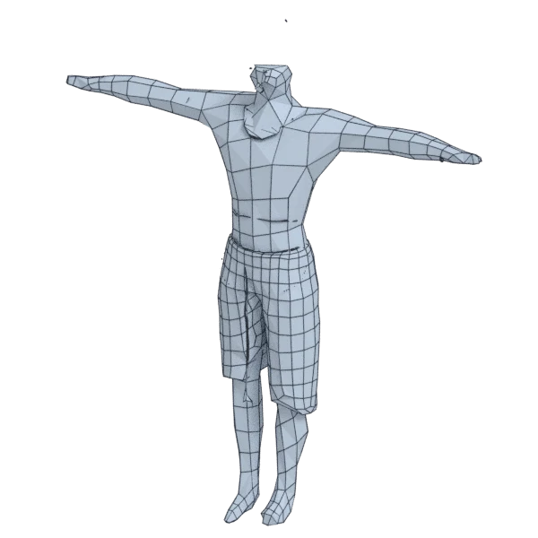

# mahaveer

An extra model, with open borders; 418 472 triangles in the source.
Its licence does not allow passing it on: the model is not in the repository (`make blenderkit`).
Author, source and licence: [CREDITS.md](../../CREDITS.md).

## At 3000 quads asked for

| Source | AutoRemesher | openclare | Quad Remesher |
|---|---|---|---|
|  |  |  |  |
| 418 472 triangles | 1 325 quads | 3 236 quads | 46 202 quads |

## At equal quad count

Quad Remesher makes more quads than the 3000 it is asked for. Next to its mesh, openclare asked for as many quads as that mesh has.

| Quad Remesher | openclare, as many quads |
|---|---|
|  |  |
| 46 202 quads | 45 479 quads |

## Marks

From 0 to 100; how they are made is in [SCORES.md](../../bench/results/SCORES.md).

### 1000 quads

| Remesher | Quads | Overall | Validity | Alignment | Quad shape | Fidelity | Regularity | Structure | Budget | Speed |
|---|---|---|---|---|---|---|---|---|---|---|
| quadremesher | 41821 | **28** | 0 | 33 | 35 | 79 | 26 | — | 0 | 31 |
| integer-grid | 532 | **24** | 0 | 62 | 44 | 17 | 15 | — | 0 | 37 |
| instant-meshes | 562 | **22** | 0 | 49 | 25 | 0 | 77 | 25 | 0 | 58 |
| quadremesher-uniform | 2688 | **14** | 0 | 35 | 15 | 28 | 0 | — | 0 | 33 |
| autoremesher | 636 | **13** | 0 | 61 | 0 | 0 | 0 | — | 0 | 92 |
| openclare-uniform | 2037 | **10** | 0 | 46 | 0 | 0 | 0 | — | 0 | 46 |
| **openclare** | 1869 | **4** | 0 | 21 | 0 | 0 | 0 | — | 0 | 47 |
| quadriflow | — | **0** | 0 | — | — | — | — | — | — | 100 |

At equal quad count: Quad Remesher's mesh as it is, and openclare asked for as many quads.

| Remesher | Quads | Overall | Validity | Alignment | Quad shape | Fidelity | Regularity | Structure | Budget | Speed |
|---|---|---|---|---|---|---|---|---|---|---|
| openclare-matched | 40889 | **47** | 0 | 74 | 73 | 53 | 66 | — | 91 | 20 |
| quadremesher-as-made | 41821 | **24** | 0 | 37 | 35 | 36 | 26 | — | 100 | 31 |

### 3000 quads

| Remesher | Quads | Overall | Validity | Alignment | Quad shape | Fidelity | Regularity | Structure | Budget | Speed |
|---|---|---|---|---|---|---|---|---|---|---|
| integer-grid | 2080 | **37** | 0 | 68 | 62 | 38 | 69 | — | 0 | 28 |
| quadremesher | 46202 | **30** | 0 | 40 | 38 | 75 | 33 | — | 0 | 35 |
| **openclare** | 3236 | **26** | 0 | 67 | 0 | 16 | 0 | 65 | 69 | 49 |
| quadremesher-uniform | 4324 | **25** | 0 | 48 | 37 | 54 | 0 | — | 0 | 34 |
| openclare-uniform | 2721 | **23** | 0 | 58 | 8 | 16 | 0 | — | 63 | 51 |
| instant-meshes | 1699 | **20** | 0 | 56 | 52 | 0 | 0 | 28 | 0 | 52 |
| autoremesher | 1325 | **14** | 0 | 58 | 0 | 9 | 0 | — | 0 | 93 |
| quadriflow | — | **0** | 0 | — | — | — | — | — | — | 100 |

At equal quad count: Quad Remesher's mesh as it is, and openclare asked for as many quads.

| Remesher | Quads | Overall | Validity | Alignment | Quad shape | Fidelity | Regularity | Structure | Budget | Speed |
|---|---|---|---|---|---|---|---|---|---|---|
| openclare-matched | 45479 | **47** | 0 | 74 | 72 | 51 | 68 | — | 94 | 21 |
| quadremesher-as-made | 46202 | **27** | 0 | 40 | 38 | 37 | 33 | — | 100 | 35 |

### 8000 quads

| Remesher | Quads | Overall | Validity | Alignment | Quad shape | Fidelity | Regularity | Structure | Budget | Speed |
|---|---|---|---|---|---|---|---|---|---|---|
| **openclare** | 7890 | **45** | 0 | 78 | 59 | 42 | 28 | — | 94 | 48 |
| integer-grid | 6148 | **40** | 0 | 73 | 63 | 40 | 73 | — | 7 | 0 |
| quadremesher-uniform | 8791 | **37** | 0 | 60 | 56 | 55 | 0 | — | 60 | 40 |
| openclare-uniform | 6472 | **34** | 0 | 78 | 51 | 33 | 18 | — | 24 | 45 |
| quadremesher | 55181 | **33** | 0 | 49 | 44 | 69 | 43 | — | 0 | 36 |
| instant-meshes | 5345 | **26** | 0 | 57 | 58 | 18 | 21 | 25 | 0 | 53 |
| autoremesher | 2996 | **15** | 0 | 59 | 0 | 14 | 0 | — | 0 | 79 |
| quadriflow | — | **0** | 0 | — | — | — | — | — | — | 100 |

At equal quad count: Quad Remesher's mesh as it is, and openclare asked for as many quads.

| Remesher | Quads | Overall | Validity | Alignment | Quad shape | Fidelity | Regularity | Structure | Budget | Speed |
|---|---|---|---|---|---|---|---|---|---|---|
| openclare-matched | 53461 | **48** | 0 | 78 | 72 | 45 | 78 | — | 88 | 5 |
| quadremesher-as-made | 55181 | **30** | 0 | 46 | 44 | 38 | 43 | — | 100 | 36 |
