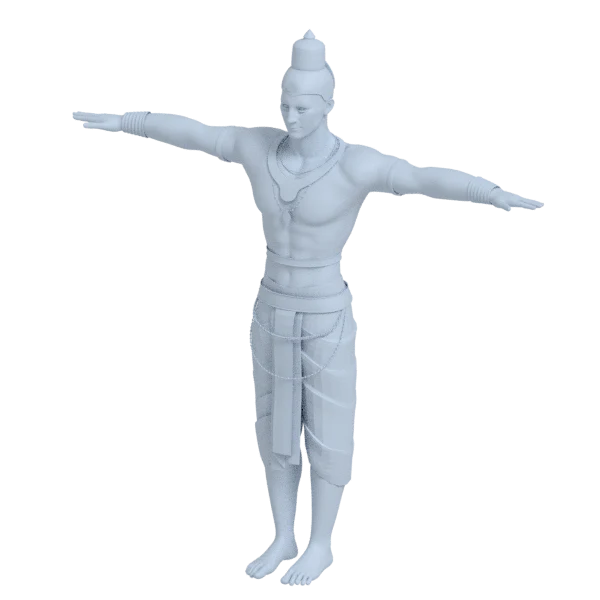
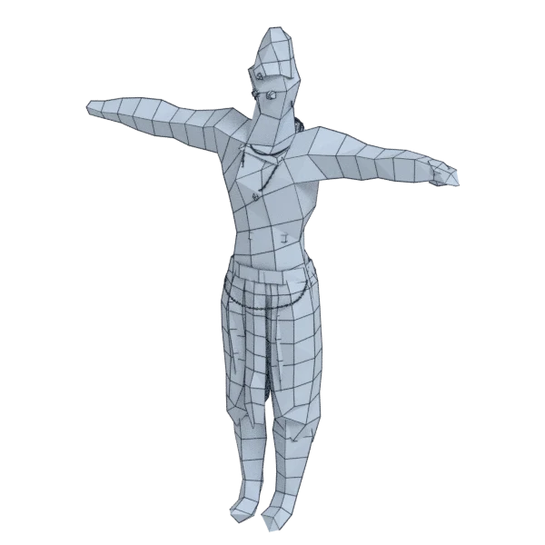
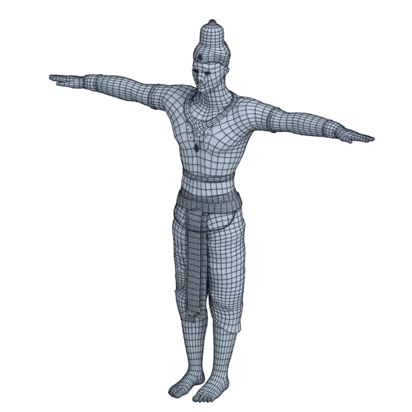
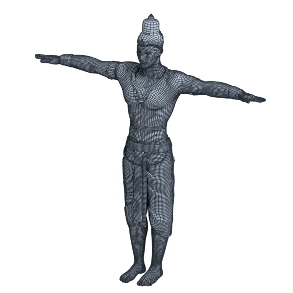

# mahaveer

An extra model, with open borders; 418 472 triangles in the source.
Its licence does not allow passing it on: the model is not in the repository (`make blenderkit`).
Author, source and licence: [CREDITS.md](../../CREDITS.md).

## At 3000 quads asked for

| Source | openclare | Quad Remesher |
|---|---|---|
|  |  |  |
| 418 472 triangles | 2 996 quads | 46 202 quads |

## At equal quad count

Quad Remesher makes more quads than the 3000 it is asked for. Next to its mesh, openclare asked for as many quads as that mesh has.

| Quad Remesher | openclare, as many quads |
|---|---|
|  |  |
| 46 202 quads | 44 281 quads |

## Marks

From 0 to 100; how they are made is in [SCORES.md](../../bench/results/SCORES.md).

### 1000 quads

| Remesher | Quads | Overall | Validity | Alignment | Quad shape | Fidelity | Regularity | Structure | Budget | Speed |
|---|---|---|---|---|---|---|---|---|---|---|
| integer-grid | 662 | **57** | 100 | 67 | 51 | 24 | 32 | 76 | 0 | 32 |
| quadremesher | 41821 | **28** | 0 | 33 | 35 | 79 | 26 | — | 0 | 31 |
| instant-meshes | 562 | **22** | 0 | 49 | 25 | 0 | 77 | 25 | 0 | 58 |
| quadremesher-uniform | 2688 | **14** | 0 | 35 | 15 | 28 | 0 | — | 0 | 33 |
| openclare-uniform | 2053 | **5** | 0 | 23 | 0 | 0 | 0 | — | 0 | 49 |
| **openclare** | 2021 | **4** | 0 | 21 | 0 | 0 | 0 | — | 0 | 40 |
| quadriflow | — | **0** | 0 | — | — | — | — | — | — | 100 |

At equal quad count: Quad Remesher's mesh as it is, and openclare asked for as many quads.

| Remesher | Quads | Overall | Validity | Alignment | Quad shape | Fidelity | Regularity | Structure | Budget | Speed |
|---|---|---|---|---|---|---|---|---|---|---|
| openclare-matched | 40442 | **43** | 0 | 58 | 64 | 58 | 69 | — | 87 | 0 |
| quadremesher-as-made | 41821 | **24** | 0 | 37 | 35 | 36 | 26 | — | 100 | 31 |

### 3000 quads

| Remesher | Quads | Overall | Validity | Alignment | Quad shape | Fidelity | Regularity | Structure | Budget | Speed |
|---|---|---|---|---|---|---|---|---|---|---|
| integer-grid | 2127 | **64** | 100 | 68 | 62 | 34 | 69 | 82 | 0 | 22 |
| quadremesher | 46202 | **30** | 0 | 40 | 38 | 75 | 33 | — | 0 | 35 |
| openclare-uniform | 3011 | **26** | 0 | 33 | 0 | 35 | 0 | 76 | 99 | 35 |
| quadremesher-uniform | 4324 | **25** | 0 | 48 | 37 | 54 | 0 | — | 0 | 34 |
| **openclare** | 2996 | **23** | 0 | 34 | 0 | 33 | 0 | — | 99 | 31 |
| instant-meshes | 1699 | **20** | 0 | 56 | 52 | 0 | 0 | 28 | 0 | 52 |
| quadriflow | — | **0** | 0 | — | — | — | — | — | — | 100 |

At equal quad count: Quad Remesher's mesh as it is, and openclare asked for as many quads.

| Remesher | Quads | Overall | Validity | Alignment | Quad shape | Fidelity | Regularity | Structure | Budget | Speed |
|---|---|---|---|---|---|---|---|---|---|---|
| openclare-matched | 44276 | **43** | 0 | 59 | 65 | 54 | 73 | — | 83 | 0 |
| quadremesher-as-made | 46202 | **27** | 0 | 40 | 38 | 37 | 33 | — | 100 | 35 |

### 8000 quads

| Remesher | Quads | Overall | Validity | Alignment | Quad shape | Fidelity | Regularity | Structure | Budget | Speed |
|---|---|---|---|---|---|---|---|---|---|---|
| openclare-uniform | 7854 | **38** | 0 | 45 | 35 | 66 | 30 | — | 93 | 32 |
| integer-grid | 5779 | **38** | 0 | 70 | 60 | 39 | 70 | — | 0 | 0 |
| quadremesher-uniform | 8791 | **37** | 0 | 60 | 56 | 55 | 0 | — | 60 | 40 |
| **openclare** | 7714 | **36** | 0 | 46 | 33 | 67 | 16 | — | 86 | 28 |
| quadremesher | 55181 | **33** | 0 | 49 | 44 | 69 | 43 | — | 0 | 36 |
| instant-meshes | 5345 | **26** | 0 | 57 | 58 | 18 | 21 | 25 | 0 | 53 |
| quadriflow | — | **0** | 0 | — | — | — | — | — | — | 100 |

At equal quad count: Quad Remesher's mesh as it is, and openclare asked for as many quads.

| Remesher | Quads | Overall | Validity | Alignment | Quad shape | Fidelity | Regularity | Structure | Budget | Speed |
|---|---|---|---|---|---|---|---|---|---|---|
| openclare-matched | 53000 | **44** | 0 | 60 | 65 | 50 | 78 | — | 84 | 0 |
| quadremesher-as-made | 55181 | **30** | 0 | 46 | 44 | 38 | 43 | — | 100 | 36 |
