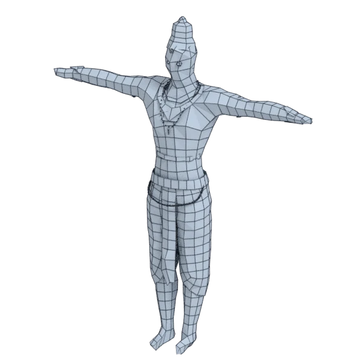

# mahaveer

An extra model, with open borders; 418 472 triangles in the source.
Its licence does not allow passing it on: the model is not in the repository (`make blenderkit`).
Author, source and licence: [CREDITS.md](../../CREDITS.md).

## At 3000 quads

| Source | openclare | Quad Remesher |
|---|---|---|
|  |  |  |

## Marks

From 0 to 100; how they are made is in [SCORES.md](../../bench/results/SCORES.md).

### 1000 quads

| Remesher | Overall | Validity | Alignment | Quad shape | Fidelity | Regularity | Structure | Budget | Speed |
|---|---|---|---|---|---|---|---|---|---|
| **quad-layout-adaptive** | **6** | 0 | 29 | 0 | 0 | 0 | — | 0 | 50 |
| quad-layout | **6** | 0 | 28 | 0 | 0 | 0 | — | 0 | 53 |

### 3000 quads

| Remesher | Overall | Validity | Alignment | Quad shape | Fidelity | Regularity | Structure | Budget | Speed |
|---|---|---|---|---|---|---|---|---|---|
| **quad-layout-adaptive** | **24** | 0 | 38 | 0 | 18 | 0 | 76 | 99 | 41 |
| quad-layout | **24** | 0 | 37 | 0 | 18 | 0 | 76 | 99 | 44 |

### 8000 quads

| Remesher | Overall | Validity | Alignment | Quad shape | Fidelity | Regularity | Structure | Budget | Speed |
|---|---|---|---|---|---|---|---|---|---|
| quad-layout | **39** | 0 | 48 | 33 | 69 | 30 | — | 93 | 32 |
| **quad-layout-adaptive** | **39** | 0 | 49 | 32 | 69 | 29 | — | 93 | 34 |
