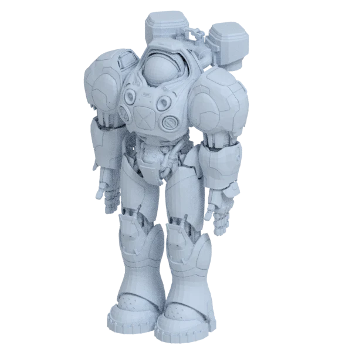
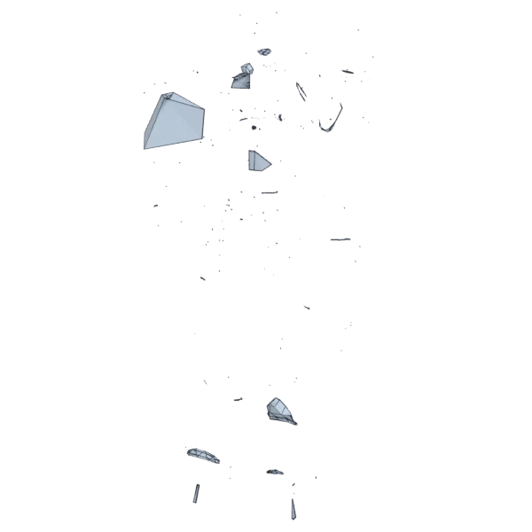
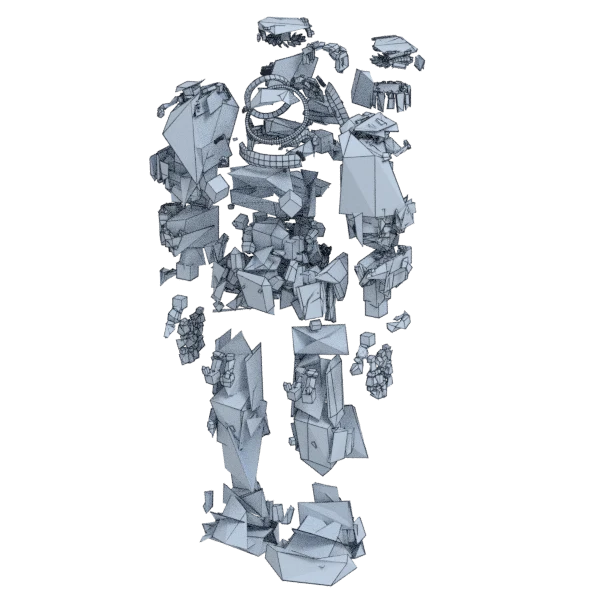
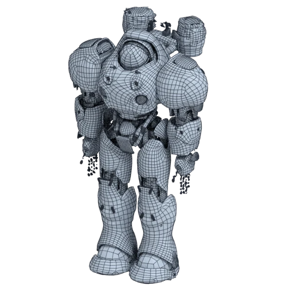
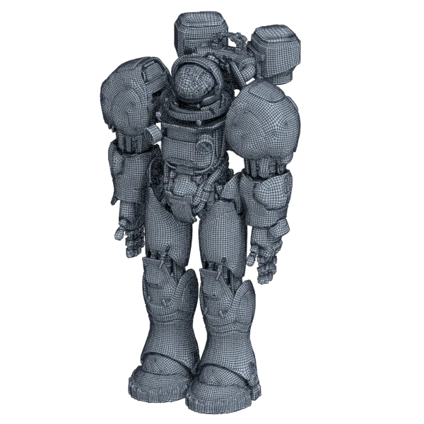

# marine

An extra model, with open borders; 247 198 triangles in the source.
Its licence does not allow passing it on: the model is not in the repository (`make blenderkit`).
Author, source and licence: [CREDITS.md](../../CREDITS.md).

## At 3000 quads asked for

| Source | AutoRemesher | openclare | Quad Remesher |
|---|---|---|---|
|  |  |  |  |
| 247 198 triangles | 870 quads | 8 883 quads | 214 018 quads |

## At equal quad count

Quad Remesher makes more quads than the 3000 it is asked for. Next to its mesh, openclare asked for as many quads as that mesh has.

| Quad Remesher | openclare, as many quads |
|---|---|
|  |  |
| 214 018 quads | 201 494 quads |

## Marks

From 0 to 100; how they are made is in [SCORES.md](../../bench/results/SCORES.md).

### 1000 quads

| Remesher | Quads | Overall | Validity | Alignment | Quad shape | Fidelity | Regularity | Structure | Edge loops | Budget | Speed |
|---|---|---|---|---|---|---|---|---|---|---|---|
| quadremesher | 205185 | **57** | 0 | 86 | 87 | 93 | 98 | — | — | 0 | 36 |
| quadremesher-uniform | 10623 | **25** | 0 | — | 44 | 84 | 0 | — | — | 0 | 47 |
| instant-meshes | 204 | **20** | 0 | 22 | 0 | 39 | 100 | 0 | — | 0 | 70 |
| **openclare** | 7930 | **20** | 0 | — | 14 | 86 | 0 | — | — | 0 | 30 |
| openclare-uniform | 8160 | **19** | 0 | — | 8 | 85 | 0 | — | — | 0 | 30 |
| autoremesher | 1110 | **15** | 0 | — | 0 | 39 | 0 | — | — | 56 | 94 |
| integer-grid | — | **0** | 0 | — | — | — | — | — | — | — | — |
| quadriflow | — | **0** | 0 | — | — | — | — | — | — | — | 100 |

At equal quad count: Quad Remesher's mesh as it is, and openclare asked for as many quads.

| Remesher | Quads | Overall | Validity | Alignment | Quad shape | Fidelity | Regularity | Structure | Edge loops | Budget | Speed |
|---|---|---|---|---|---|---|---|---|---|---|---|
| openclare-matched | 193999 | **65** | 0 | 96 | 100 | 79 | 90 | — | 65 | 78 | 0 |
| quadremesher-as-made | 205185 | **51** | 0 | 65 | 87 | 48 | 98 | — | — | 100 | 36 |

### 3000 quads

| Remesher | Quads | Overall | Validity | Alignment | Quad shape | Fidelity | Regularity | Structure | Edge loops | Budget | Speed |
|---|---|---|---|---|---|---|---|---|---|---|---|
| quadremesher | 214018 | **57** | 0 | 85 | 89 | 91 | 100 | — | — | 0 | 39 |
| quadremesher-uniform | 11340 | **33** | 0 | 61 | 47 | 82 | 0 | — | — | 0 | 42 |
| **openclare** | 8883 | **31** | 0 | 70 | 23 | 81 | 0 | — | — | 0 | 32 |
| openclare-uniform | 9101 | **31** | 0 | 70 | 20 | 80 | 0 | — | — | 0 | 37 |
| instant-meshes | 1225 | **14** | 0 | 33 | 7 | 43 | 0 | 7 | — | 0 | 66 |
| autoremesher | 870 | **13** | 0 | 31 | 0 | 40 | 0 | — | — | 0 | 100 |
| integer-grid | — | **0** | 0 | — | — | — | — | — | — | — | — |
| quadriflow | — | **0** | 0 | — | — | — | — | — | — | — | 100 |

At equal quad count: Quad Remesher's mesh as it is, and openclare asked for as many quads.

| Remesher | Quads | Overall | Validity | Alignment | Quad shape | Fidelity | Regularity | Structure | Edge loops | Budget | Speed |
|---|---|---|---|---|---|---|---|---|---|---|---|
| openclare-matched | 201494 | **64** | 0 | 96 | 100 | 78 | 93 | — | 61 | 77 | 7 |
| quadremesher-as-made | 214018 | **53** | 0 | 71 | 89 | 48 | 100 | — | — | 100 | 39 |

### 8000 quads

| Remesher | Quads | Overall | Validity | Alignment | Quad shape | Fidelity | Regularity | Structure | Edge loops | Budget | Speed |
|---|---|---|---|---|---|---|---|---|---|---|---|
| quadremesher | 246063 | **57** | 0 | 84 | 97 | 88 | 100 | — | — | 0 | 37 |
| quadremesher-uniform | 14915 | **35** | 0 | 63 | 58 | 78 | 0 | — | — | 0 | 37 |
| openclare-uniform | 12358 | **32** | 0 | 74 | 45 | 81 | 0 | — | 9 | 0 | 39 |
| **openclare** | 11983 | **31** | 0 | 73 | 42 | 80 | 0 | — | 10 | 0 | 28 |
| autoremesher | 2388 | **18** | 0 | 51 | 0 | 43 | 0 | — | — | 0 | 97 |
| instant-meshes | 4146 | **17** | 0 | 32 | 26 | 44 | 0 | 11 | — | 0 | 61 |
| integer-grid | — | **0** | 0 | — | — | — | — | — | — | — | — |
| quadriflow | — | **0** | 0 | — | — | — | — | — | — | — | 100 |

At equal quad count: Quad Remesher's mesh as it is, and openclare asked for as many quads.

| Remesher | Quads | Overall | Validity | Alignment | Quad shape | Fidelity | Regularity | Structure | Edge loops | Budget | Speed |
|---|---|---|---|---|---|---|---|---|---|---|---|
| openclare-matched | 231974 | **66** | 0 | 98 | 100 | 78 | 99 | — | 65 | 77 | 2 |
| quadremesher-as-made | 246063 | **55** | 0 | 76 | 97 | 48 | 100 | — | — | 100 | 37 |
