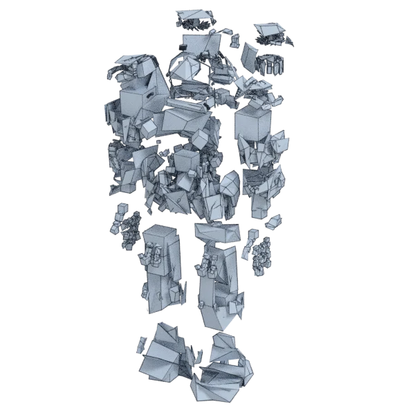

# marine

An extra model, with open borders; 247 198 triangles in the source.
Its licence does not allow passing it on: the model is not in the repository (`make blenderkit`).
Author, source and licence: [CREDITS.md](../../CREDITS.md).

## At 3000 quads

| Source | openclare | Quad Remesher |
|---|---|---|
|  |  |  |

## Marks

From 0 to 100; how they are made is in [SCORES.md](../../bench/results/SCORES.md).

### 1000 quads

| Remesher | Quads | Overall | Validity | Alignment | Quad shape | Fidelity | Regularity | Structure | Budget | Speed |
|---|---|---|---|---|---|---|---|---|---|---|
| quadremesher | 205185 | **39** | 0 | 55 | 49 | 93 | 48 | — | 0 | 36 |
| quadremesher-uniform | 10623 | **19** | 0 | — | 12 | 84 | 0 | — | 0 | 47 |
| instant-meshes | 204 | **19** | 0 | 14 | 0 | 39 | 100 | 0 | 0 | 70 |
| quad-layout | 6485 | **17** | 0 | — | 0 | 84 | 0 | — | 0 | 9 |
| **quad-layout-adaptive** | 6364 | **17** | 0 | — | 0 | 84 | 0 | — | 0 | 1 |
| integer-grid | — | **0** | 0 | — | — | — | — | — | — | — |
| quadriflow | — | **0** | 0 | — | — | — | — | — | — | 100 |

At equal quad count: Quad Remesher's mesh as it is, and openclare asked for as many quads.

| Remesher | Quads | Overall | Validity | Alignment | Quad shape | Fidelity | Regularity | Structure | Budget | Speed |
|---|---|---|---|---|---|---|---|---|---|---|
| quad-layout-matched | 188593 | **45** | 0 | 63 | 74 | 67 | 41 | — | 68 | 0 |
| quadremesher-as-made | 205185 | **33** | 0 | 42 | 49 | 48 | 48 | — | 100 | 36 |

### 3000 quads

| Remesher | Quads | Overall | Validity | Alignment | Quad shape | Fidelity | Regularity | Structure | Budget | Speed |
|---|---|---|---|---|---|---|---|---|---|---|
| quadremesher | 214018 | **39** | 0 | 55 | 51 | 91 | 52 | — | 0 | 39 |
| quadremesher-uniform | 11340 | **24** | 0 | 39 | 15 | 82 | 0 | — | 0 | 42 |
| quad-layout | 6485 | **22** | 0 | 45 | 0 | 79 | 0 | — | 0 | 9 |
| **quad-layout-adaptive** | 6364 | **21** | 0 | 40 | 0 | 79 | 0 | — | 0 | 2 |
| instant-meshes | 1225 | **11** | 0 | 21 | 0 | 43 | 0 | 7 | 0 | 66 |
| integer-grid | — | **0** | 0 | — | — | — | — | — | — | — |
| quadriflow | — | **0** | 0 | — | — | — | — | — | — | 100 |

At equal quad count: Quad Remesher's mesh as it is, and openclare asked for as many quads.

| Remesher | Quads | Overall | Validity | Alignment | Quad shape | Fidelity | Regularity | Structure | Budget | Speed |
|---|---|---|---|---|---|---|---|---|---|---|
| quad-layout-matched | 197141 | **45** | 0 | 63 | 74 | 67 | 45 | — | 68 | 0 |
| quadremesher-as-made | 214018 | **34** | 0 | 46 | 51 | 48 | 52 | — | 100 | 39 |

### 8000 quads

| Remesher | Quads | Overall | Validity | Alignment | Quad shape | Fidelity | Regularity | Structure | Budget | Speed |
|---|---|---|---|---|---|---|---|---|---|---|
| quadremesher | 246063 | **40** | 0 | 54 | 57 | 88 | 58 | — | 0 | 37 |
| quad-layout | 8972 | **27** | 0 | 43 | 0 | 81 | 0 | — | 51 | 8 |
| **quad-layout-adaptive** | 9207 | **25** | 0 | 38 | 0 | 80 | 0 | — | 40 | 1 |
| quadremesher-uniform | 14915 | **25** | 0 | 40 | 24 | 78 | 0 | — | 0 | 37 |
| instant-meshes | 4146 | **11** | 0 | 20 | 0 | 44 | 0 | 11 | 0 | 61 |
| integer-grid | — | **0** | 0 | — | — | — | — | — | — | — |
| quadriflow | — | **0** | 0 | — | — | — | — | — | — | 100 |

At equal quad count: Quad Remesher's mesh as it is, and openclare asked for as many quads.

| Remesher | Quads | Overall | Validity | Alignment | Quad shape | Fidelity | Regularity | Structure | Budget | Speed |
|---|---|---|---|---|---|---|---|---|---|---|
| quad-layout-matched | 227098 | **46** | 0 | 64 | 75 | 64 | 51 | — | 69 | 0 |
| quadremesher-as-made | 246063 | **37** | 0 | 49 | 57 | 48 | 58 | — | 100 | 37 |
