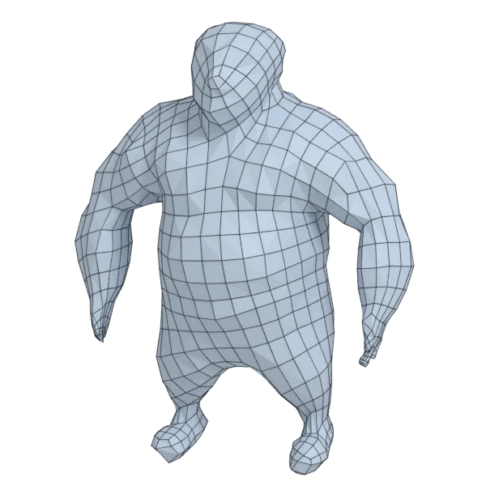
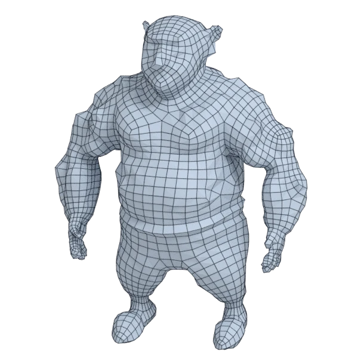
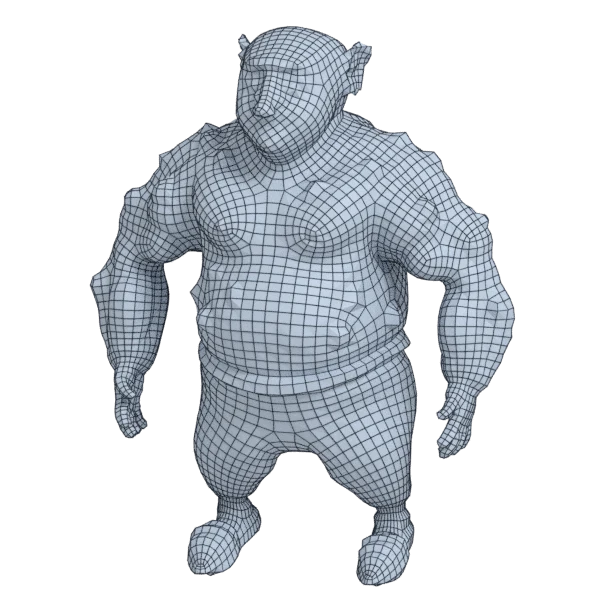

# ogre

An organic model; 199 764 triangles in the source.
Author, source and licence: [CREDITS.md](../../CREDITS.md).

## At 3000 quads asked for

| Source | QuadriFlow (Blender) | AutoRemesher | openclare | Quad Remesher |
|---|---|---|---|---|
|  |  |  |  |  |
| 199 764 triangles | 3 049 quads | 1 081 quads | 2 949 quads | 6 134 quads |

## At equal quad count

Quad Remesher makes more quads than the 3000 it is asked for. Next to its mesh, openclare asked for as many quads as that mesh has.

| Quad Remesher | openclare, as many quads |
|---|---|
|  |  |
| 6 134 quads | 6 179 quads |

## Marks

From 0 to 100; how they are made is in [SCORES.md](../../bench/results/SCORES.md).

### 1000 quads

| Remesher | Quads | Overall | Validity | Alignment | Quad shape | Fidelity | Regularity | Structure | Budget | Speed |
|---|---|---|---|---|---|---|---|---|---|---|
| openclare-uniform | 972 | **70** | 100 | 53 | 63 | 51 | 61 | 49 | 89 | 75 |
| **openclare** | 1019 | **65** | 100 | 51 | 55 | 64 | 8 | 32 | 92 | 70 |
| quadremesher | 2890 | **59** | 100 | 65 | 53 | 68 | 18 | 24 | 0 | 28 |
| instant-meshes | 932 | **39** | 80 | 16 | 52 | 0 | 0 | 8 | 73 | 76 |
| quadriflow | 891 | **29** | 60 | 7 | 29 | 0 | 28 | 0 | 56 | 71 |
| integer-grid | 802 | **28** | 0 | 47 | 42 | 31 | 41 | — | 21 | 62 |
| quadremesher-uniform | 799 | **19** | 0 | 53 | 38 | 0 | 0 | — | 20 | 31 |
| autoremesher | 311 | **10** | 0 | 24 | 34 | 0 | 0 | — | 0 | 99 |

At equal quad count: Quad Remesher's mesh as it is, and openclare asked for as many quads.

| Remesher | Quads | Overall | Validity | Alignment | Quad shape | Fidelity | Regularity | Structure | Budget | Speed |
|---|---|---|---|---|---|---|---|---|---|---|
| openclare-matched | 2891 | **66** | 100 | 48 | 68 | 63 | 50 | 11 | 100 | 64 |
| quadremesher-as-made | 2890 | **64** | 100 | 58 | 53 | 63 | 18 | 24 | 100 | 28 |

### 3000 quads

| Remesher | Quads | Overall | Validity | Alignment | Quad shape | Fidelity | Regularity | Structure | Budget | Speed |
|---|---|---|---|---|---|---|---|---|---|---|
| **openclare** | 2949 | **70** | 100 | 49 | 68 | 64 | 50 | 18 | 93 | 58 |
| openclare-uniform | 3001 | **69** | 100 | 46 | 67 | 45 | 77 | 10 | 100 | 67 |
| quadremesher | 6134 | **65** | 100 | 63 | 54 | 87 | 50 | 16 | 0 | 28 |
| instant-meshes | 2874 | **45** | 80 | 17 | 63 | 4 | 30 | 3 | 83 | 76 |
| quadriflow | 2935 | **31** | 20 | 14 | 40 | 13 | 67 | 3 | 83 | 67 |
| integer-grid | 2465 | **31** | 0 | 46 | 55 | 14 | 69 | — | 29 | 49 |
| quadremesher-uniform | 2417 | **22** | 0 | 52 | 43 | 11 | 9 | 17 | 22 | 31 |
| autoremesher | 1081 | **19** | 0 | 28 | 48 | 19 | 22 | — | 0 | 90 |

At equal quad count: Quad Remesher's mesh as it is, and openclare asked for as many quads.

| Remesher | Quads | Overall | Validity | Alignment | Quad shape | Fidelity | Regularity | Structure | Budget | Speed |
|---|---|---|---|---|---|---|---|---|---|---|
| openclare-matched | 6179 | **72** | 100 | 52 | 70 | 75 | 67 | 21 | 97 | 49 |
| quadremesher-as-made | 6134 | **71** | 100 | 59 | 54 | 84 | 50 | 16 | 100 | 28 |

### 8000 quads

| Remesher | Quads | Overall | Validity | Alignment | Quad shape | Fidelity | Regularity | Structure | Budget | Speed |
|---|---|---|---|---|---|---|---|---|---|---|
| **openclare** | 7997 | **77** | 100 | 52 | 68 | 87 | 71 | 23 | 100 | 39 |
| openclare-uniform | 8009 | **76** | 100 | 50 | 69 | 76 | 76 | 35 | 100 | 41 |
| quadremesher | 12717 | **68** | 100 | 62 | 60 | 87 | 74 | 22 | 0 | 23 |
| integer-grid | 6967 | **40** | 0 | 48 | 55 | 49 | 76 | — | 48 | 13 |
| quadremesher-uniform | 6761 | **39** | 0 | 57 | 58 | 56 | 52 | — | 38 | 22 |
| quadriflow | 7763 | **35** | 0 | 21 | 42 | 51 | 80 | 5 | 88 | 62 |
| instant-meshes | 7836 | **33** | 0 | 21 | 69 | 34 | 45 | 2 | 92 | 77 |
| autoremesher | 4622 | **30** | 0 | 42 | 63 | 22 | 69 | — | 0 | 68 |

At equal quad count: Quad Remesher's mesh as it is, and openclare asked for as many quads.

| Remesher | Quads | Overall | Validity | Alignment | Quad shape | Fidelity | Regularity | Structure | Budget | Speed |
|---|---|---|---|---|---|---|---|---|---|---|
| openclare-matched | 12532 | **77** | 100 | 54 | 71 | 93 | 78 | 28 | 94 | 29 |
| quadremesher-as-made | 12717 | **75** | 100 | 61 | 60 | 86 | 74 | 22 | 100 | 23 |
