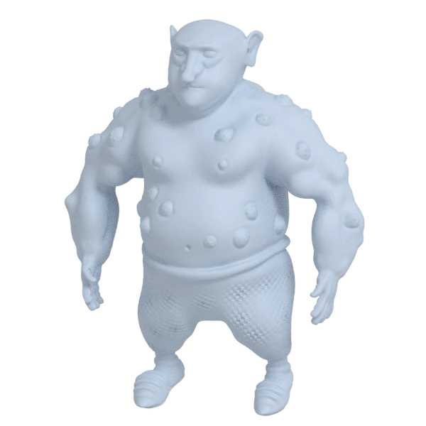
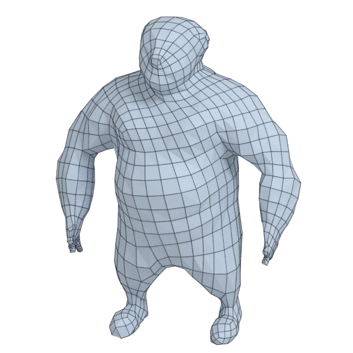
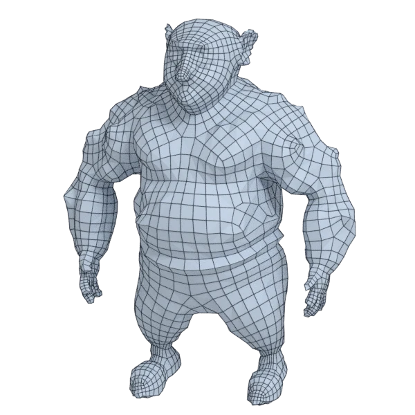
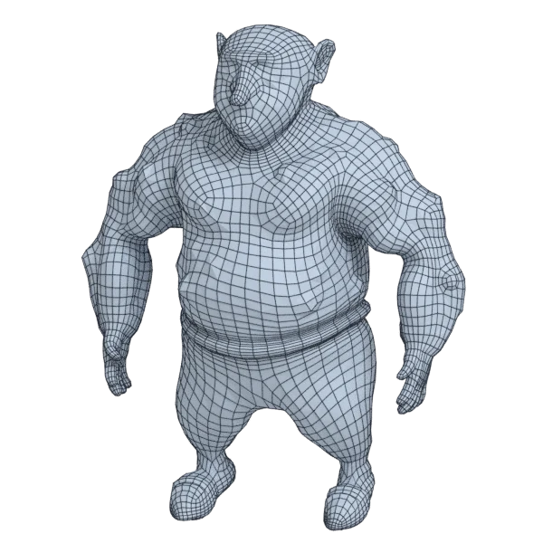
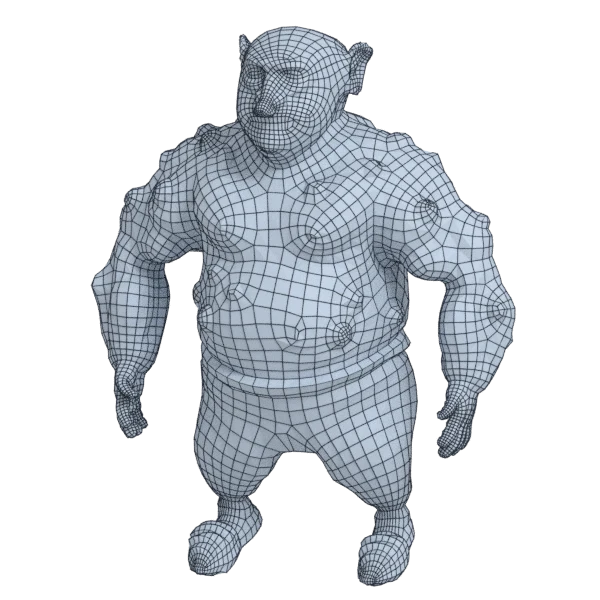

# ogre_hp

An extra model; 4 686 394 triangles in the source.
Author, source and licence: [CREDITS.md](../../CREDITS.md).

## At 3000 quads asked for

| Source | AutoRemesher | openclare | Quad Remesher |
|---|---|---|---|
|  |  |  |  |
| 4 686 394 triangles | 1 283 quads | 2 954 quads | 6 269 quads |

## At equal quad count

Quad Remesher makes more quads than the 3000 it is asked for. Next to its mesh, openclare asked for as many quads as that mesh has.

| Quad Remesher | openclare, as many quads |
|---|---|
|  |  |
| 6 269 quads | 6 213 quads |

## Marks

From 0 to 100; how they are made is in [SCORES.md](../../bench/results/SCORES.md).

### 1000 quads

| Remesher | Quads | Overall | Validity | Alignment | Quad shape | Fidelity | Regularity | Structure | Budget | Speed |
|---|---|---|---|---|---|---|---|---|---|---|
| openclare-uniform | 1019 | **65** | 100 | 35 | 59 | 45 | 63 | 31 | 92 | 1 |
| **openclare** | 1011 | **60** | 100 | 33 | 53 | 64 | 0 | 27 | 96 | 2 |
| quadremesher | 2921 | **57** | 100 | 53 | 51 | 67 | 24 | 26 | 0 | 12 |
| integer-grid | 743 | **51** | 100 | 36 | 47 | 23 | 52 | 51 | 0 | 0 |
| instant-meshes | 940 | **38** | 80 | 13 | 48 | 0 | 0 | 3 | 76 | 0 |
| quadremesher-uniform | 812 | **17** | 0 | 37 | 40 | 3 | 0 | — | 25 | 15 |
| autoremesher | 334 | **7** | 0 | 16 | 25 | 0 | 0 | — | 0 | 33 |
| quadriflow | — | **0** | 0 | — | — | — | — | — | — | 100 |

Lines of the scene, as openclare reports them: 11 edges laid along the guide curves and the borders between materials, 5 along the sharp curves, lines let go on 1 pieces.

At equal quad count: Quad Remesher's mesh as it is, and openclare asked for as many quads.

| Remesher | Quads | Overall | Validity | Alignment | Quad shape | Fidelity | Regularity | Structure | Budget | Speed |
|---|---|---|---|---|---|---|---|---|---|---|
| openclare-matched | 2885 | **64** | 100 | 42 | 65 | 72 | 30 | 19 | 95 | 0 |
| quadremesher-as-made | 2921 | **63** | 100 | 53 | 51 | 64 | 24 | 26 | 100 | 12 |

### 3000 quads

| Remesher | Quads | Overall | Validity | Alignment | Quad shape | Fidelity | Regularity | Structure | Budget | Speed |
|---|---|---|---|---|---|---|---|---|---|---|
| **openclare** | 2954 | **69** | 100 | 45 | 67 | 72 | 37 | 18 | 94 | 0 |
| openclare-uniform | 2964 | **68** | 100 | 39 | 69 | 49 | 73 | 7 | 95 | 1 |
| quadremesher | 6269 | **65** | 100 | 59 | 53 | 89 | 57 | 21 | 0 | 12 |
| instant-meshes | 2836 | **38** | 60 | 18 | 61 | 0 | 23 | 4 | 78 | 0 |
| integer-grid | 2515 | **29** | 0 | 39 | 54 | 11 | 66 | — | 35 | 1 |
| quadremesher-uniform | 2409 | **22** | 0 | 47 | 47 | 8 | 13 | — | 21 | 12 |
| autoremesher | 1283 | **19** | 0 | 25 | 48 | 19 | 32 | — | 0 | 32 |
| quadriflow | — | **0** | 0 | — | — | — | — | — | — | 100 |

At equal quad count: Quad Remesher's mesh as it is, and openclare asked for as many quads.

| Remesher | Quads | Overall | Validity | Alignment | Quad shape | Fidelity | Regularity | Structure | Budget | Speed |
|---|---|---|---|---|---|---|---|---|---|---|
| openclare-matched | 6213 | **72** | 100 | 53 | 67 | 87 | 51 | 19 | 96 | 0 |
| quadremesher-as-made | 6269 | **71** | 100 | 58 | 53 | 86 | 57 | 21 | 100 | 12 |

### 8000 quads

| Remesher | Quads | Overall | Validity | Alignment | Quad shape | Fidelity | Regularity | Structure | Budget | Speed |
|---|---|---|---|---|---|---|---|---|---|---|
| **openclare** | 7952 | **76** | 100 | 55 | 67 | 91 | 56 | 23 | 98 | 0 |
| openclare-uniform | 8133 | **75** | 100 | 46 | 70 | 81 | 77 | 19 | 93 | 1 |
| quadremesher | 13801 | **43** | 0 | 61 | 60 | 89 | 74 | 22 | 0 | 7 |
| integer-grid | 6805 | **40** | 0 | 45 | 56 | 59 | 76 | — | 40 | 0 |
| quadremesher-uniform | 6640 | **37** | 0 | 53 | 56 | 54 | 48 | — | 32 | 7 |
| instant-meshes | 7700 | **31** | 0 | 24 | 67 | 20 | 42 | 3 | 85 | 0 |
| autoremesher | 4422 | **30** | 0 | 38 | 64 | 33 | 61 | — | 0 | 31 |
| quadriflow | — | **0** | 0 | — | — | — | — | — | — | 100 |

Lines of the scene, as openclare reports them: 70 edges laid along the guide curves and the borders between materials, 14 along the sharp curves.

At equal quad count: Quad Remesher's mesh as it is, and openclare asked for as many quads.

| Remesher | Quads | Overall | Validity | Alignment | Quad shape | Fidelity | Regularity | Structure | Budget | Speed |
|---|---|---|---|---|---|---|---|---|---|---|
| openclare-matched | 13743 | **76** | 100 | 57 | 70 | 92 | 69 | 15 | 98 | 0 |
| quadremesher-as-made | 13801 | **47** | 0 | 59 | 60 | 87 | 74 | 22 | 100 | 7 |
