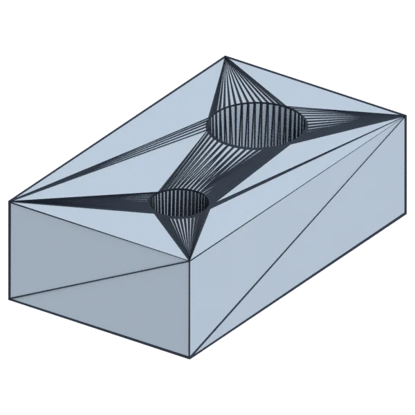
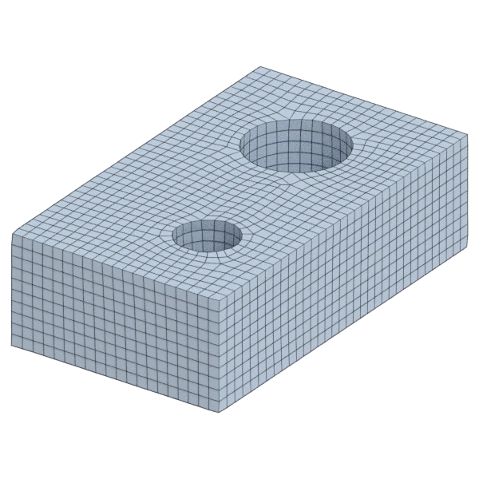
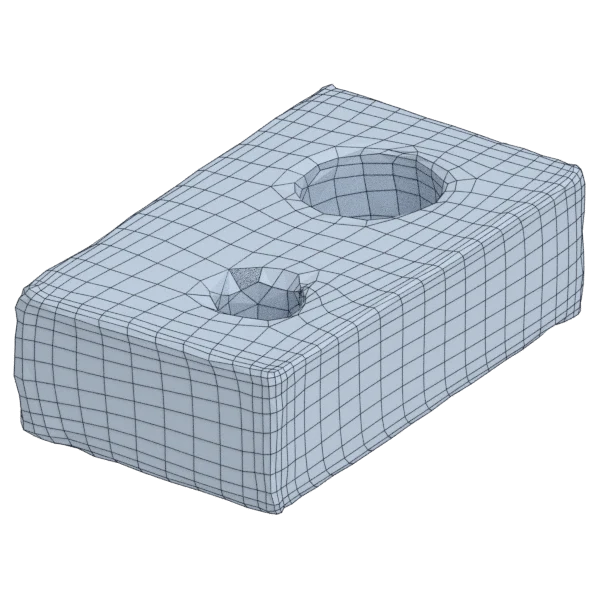
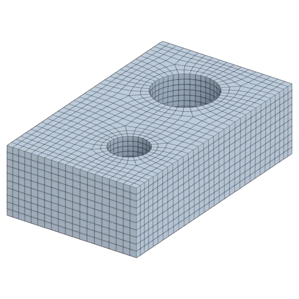
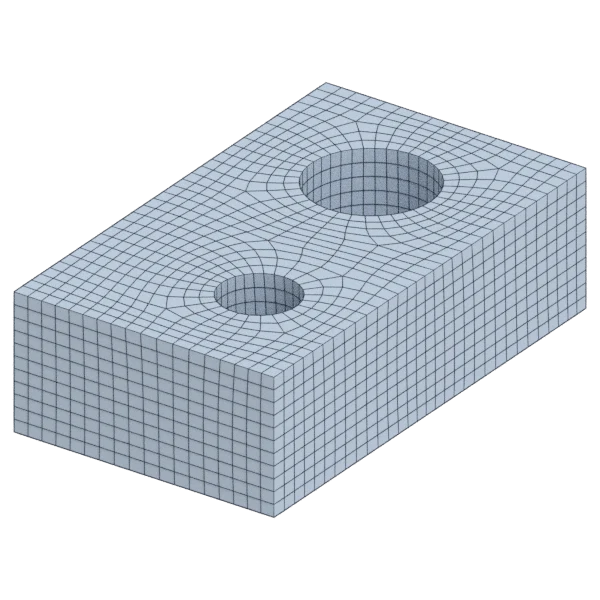
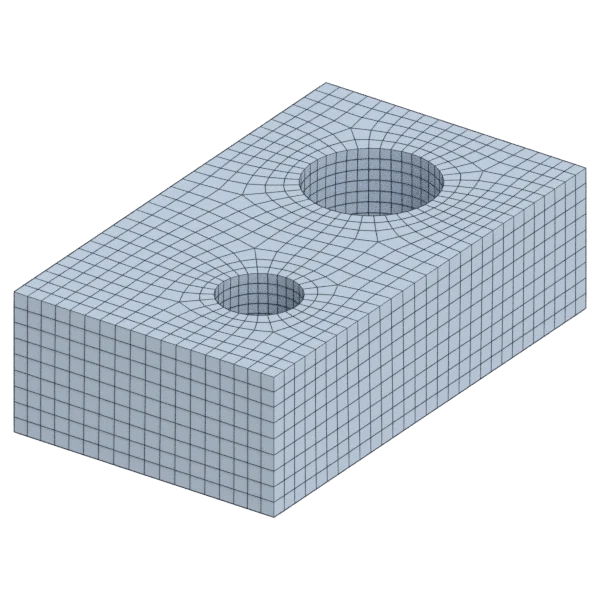

# part

A mechanical model, with hard edges; 406 triangles in the source.
Author, source and licence: [CREDITS.md](../../CREDITS.md).

## At 3000 quads asked for

| Source | QuadriFlow (Blender) | AutoRemesher | openclare | Quad Remesher |
|---|---|---|---|---|
|  |  |  |  |  |
| 406 triangles | 2 843 quads | 1 855 quads | 2 978 quads | 2 815 quads |

## At equal quad count

Quad Remesher makes more quads than the 3000 it is asked for. Next to its mesh, openclare asked for as many quads as that mesh has.

| Quad Remesher | openclare, as many quads |
|---|---|
|  |  |
| 2 815 quads | 2 828 quads |

## Edge loops

At 3000 quads asked for. Each loop is followed straight on through every regular vertex: it closes, comes back beside itself a quad further (a spiral), stops at an irregular vertex, or runs from a border to a border. Share of the edges on each, those of borders and of faces that are not quads left out; "—" where the mesh is not a manifold.

| | closed | spiral | stops | border to border | spirals | longest that stops |
|---|---|---|---|---|---|---|
| QuadriFlow (Blender) | 51 % | 24 % | 26 % | 0 % | 6 | 120 |
| AutoRemesher | — | — | — | — | — | — |
| openclare | 61 % | 22 % | 17 % | 0 % | 4 | 52 |
| Quad Remesher | 56 % | 16 % | 28 % | 0 % | 5 | 229 |

## Marks

From 0 to 100; how they are made is in [SCORES.md](../../bench/results/SCORES.md).

### 1000 quads

| Remesher | Quads | Overall | Validity | Alignment | Quad shape | Fidelity | Regularity | Structure | Budget | Speed |
|---|---|---|---|---|---|---|---|---|---|---|
| **openclare** | 1018 | **86** | 100 | 52 | 89 | 97 | 84 | 93 | 93 | 97 |
| quadremesher | 1013 | **82** | 100 | 51 | 78 | 97 | 82 | 64 | 95 | 73 |
| openclare-uniform | 976 | **80** | 100 | 45 | 90 | 71 | 84 | 91 | 90 | 99 |
| quadremesher-uniform | 924 | **80** | 100 | 51 | 77 | 95 | 83 | 68 | 70 | 76 |
| quadriflow | 943 | **77** | 100 | 40 | 81 | 84 | 77 | 76 | 77 | 100 |
| integer-grid | 959 | **74** | 100 | 43 | 76 | 66 | 83 | 60 | 84 | 49 |
| instant-meshes | 1036 | **60** | 100 | 35 | 57 | 59 | 0 | 39 | 86 | 100 |
| autoremesher | 348 | **3** | 0 | 14 | 2 | 0 | 0 | — | 0 | 100 |

At equal quad count: Quad Remesher's mesh as it is, and openclare asked for as many quads.

| Remesher | Quads | Overall | Validity | Alignment | Quad shape | Fidelity | Regularity | Structure | Budget | Speed |
|---|---|---|---|---|---|---|---|---|---|---|
| openclare-matched | 1018 | **85** | 100 | 52 | 89 | 97 | 84 | 93 | 98 | 98 |
| quadremesher-as-made | 1013 | **81** | 100 | 51 | 78 | 97 | 82 | 64 | 100 | 73 |

### 3000 quads

| Remesher | Quads | Overall | Validity | Alignment | Quad shape | Fidelity | Regularity | Structure | Budget | Speed |
|---|---|---|---|---|---|---|---|---|---|---|
| **openclare** | 2978 | **88** | 100 | 53 | 89 | 99 | 95 | 90 | 97 | 75 |
| openclare-uniform | 3049 | **87** | 100 | 47 | 93 | 98 | 95 | 97 | 93 | 70 |
| integer-grid | 2976 | **86** | 100 | 48 | 87 | 98 | 95 | 97 | 97 | 66 |
| quadremesher | 2815 | **84** | 100 | 52 | 85 | 98 | 94 | 82 | 75 | 75 |
| quadremesher-uniform | 2815 | **84** | 100 | 52 | 85 | 98 | 94 | 82 | 75 | 74 |
| quadriflow | 2890 | **77** | 80 | 42 | 87 | 89 | 93 | 79 | 85 | 80 |
| instant-meshes | 2938 | **70** | 100 | 38 | 69 | 81 | 33 | 39 | 92 | 100 |
| autoremesher | 1855 | **26** | 0 | 30 | 38 | 64 | 37 | — | 0 | 86 |

At equal quad count: Quad Remesher's mesh as it is, and openclare asked for as many quads.

| Remesher | Quads | Overall | Validity | Alignment | Quad shape | Fidelity | Regularity | Structure | Budget | Speed |
|---|---|---|---|---|---|---|---|---|---|---|
| openclare-matched | 2828 | **87** | 100 | 53 | 91 | 99 | 94 | 94 | 98 | 74 |
| quadremesher-as-made | 2815 | **85** | 100 | 52 | 85 | 98 | 94 | 82 | 100 | 75 |

### 8000 quads

| Remesher | Quads | Overall | Validity | Alignment | Quad shape | Fidelity | Regularity | Structure | Budget | Speed |
|---|---|---|---|---|---|---|---|---|---|---|
| **openclare** | 8098 | **89** | 100 | 54 | 95 | 99 | 98 | 99 | 95 | 55 |
| openclare-uniform | 8078 | **88** | 100 | 47 | 94 | 99 | 98 | 95 | 96 | 56 |
| integer-grid | 7824 | **87** | 100 | 47 | 92 | 99 | 98 | 98 | 91 | 43 |
| quadremesher | 7353 | **83** | 100 | 52 | 82 | 99 | 98 | 90 | 68 | 76 |
| quadremesher-uniform | 7353 | **83** | 100 | 52 | 82 | 99 | 98 | 90 | 68 | 76 |
| instant-meshes | 7732 | **74** | 100 | 40 | 77 | 90 | 57 | 39 | 87 | 80 |
| quadriflow | 7983 | **73** | 60 | 41 | 87 | 90 | 96 | 85 | 99 | 48 |
| autoremesher | 4954 | **34** | 0 | 38 | 31 | 77 | 81 | — | 0 | 72 |

At equal quad count: Quad Remesher's mesh as it is, and openclare asked for as many quads.

| Remesher | Quads | Overall | Validity | Alignment | Quad shape | Fidelity | Regularity | Structure | Budget | Speed |
|---|---|---|---|---|---|---|---|---|---|---|
| openclare-matched | 7279 | **88** | 100 | 53 | 94 | 99 | 98 | 96 | 96 | 58 |
| quadremesher-as-made | 7353 | **85** | 100 | 52 | 82 | 99 | 98 | 90 | 100 | 76 |
