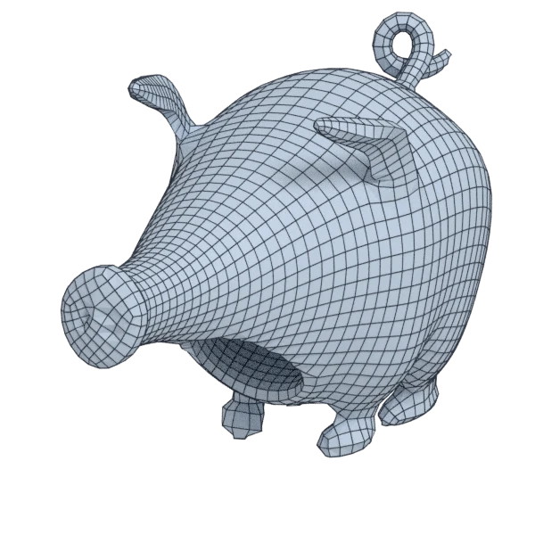

# pig

An organic model; 100 062 triangles in the source.
Author, source and licence: [CREDITS.md](../../CREDITS.md).

## At 3000 quads

| Source | QuadriFlow (Blender) | openclare | Quad Remesher |
|---|---|---|---|
|  |  |  |  |

## Marks

From 0 to 100; how they are made is in [SCORES.md](../../bench/results/SCORES.md).

### 1000 quads

| Remesher | Overall | Validity | Alignment | Quad shape | Fidelity | Regularity | Structure | Budget | Speed |
|---|---|---|---|---|---|---|---|---|---|
| **quad-layout-adaptive** | **69** | 100 | 60 | 65 | 60 | 17 | 40 | 96 | 71 |
| quadremesher | **66** | 100 | 67 | 59 | 77 | 56 | 42 | 0 | 31 |
| quad-layout | **45** | 0 | 48 | 70 | 53 | 48 | 46 | 96 | 83 |
| integer-grid | **32** | 0 | 44 | 58 | 23 | 35 | — | 61 | 66 |
| quadremesher-uniform | **24** | 0 | 54 | 53 | 0 | 0 | — | 41 | 33 |
| instant-meshes | **23** | 0 | 28 | 58 | 0 | 18 | 5 | 64 | 97 |
| quadriflow | **14** | 0 | 23 | 23 | 0 | 12 | 2 | 44 | 88 |

### 3000 quads

| Remesher | Overall | Validity | Alignment | Quad shape | Fidelity | Regularity | Structure | Budget | Speed |
|---|---|---|---|---|---|---|---|---|---|
| **quad-layout-adaptive** | **78** | 100 | 60 | 74 | 78 | 69 | 39 | 96 | 71 |
| quad-layout | **74** | 100 | 53 | 71 | 64 | 77 | 21 | 93 | 81 |
| quadremesher-uniform | **69** | 100 | 58 | 60 | 75 | 66 | 28 | 40 | 32 |
| quadremesher | **45** | 0 | 68 | 64 | 80 | 79 | 36 | 0 | 35 |
| integer-grid | **43** | 0 | 53 | 62 | 52 | 73 | — | 61 | 45 |
| instant-meshes | **29** | 0 | 28 | 66 | 3 | 37 | 3 | 96 | 97 |
| quadriflow | **22** | 0 | 23 | 28 | 11 | 57 | 2 | 57 | 84 |

### 8000 quads

| Remesher | Overall | Validity | Alignment | Quad shape | Fidelity | Regularity | Structure | Budget | Speed |
|---|---|---|---|---|---|---|---|---|---|
| **quad-layout-adaptive** | **81** | 100 | 64 | 72 | 86 | 89 | 34 | 93 | 36 |
| quad-layout | **79** | 100 | 58 | 65 | 83 | 90 | 26 | 95 | 41 |
| quadremesher-uniform | **75** | 100 | 61 | 67 | 81 | 87 | 39 | 53 | 32 |
| instant-meshes | **62** | 80 | 34 | 75 | 57 | 55 | 4 | 94 | 96 |
| integer-grid | **49** | 0 | 59 | 56 | 83 | 89 | 37 | 59 | 13 |
| quadremesher | **48** | 0 | 67 | 68 | 82 | 90 | — | 9 | 31 |
| quadriflow | **25** | 0 | 30 | 43 | 0 | 82 | 2 | 49 | 65 |
