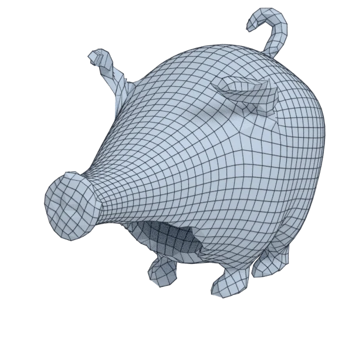
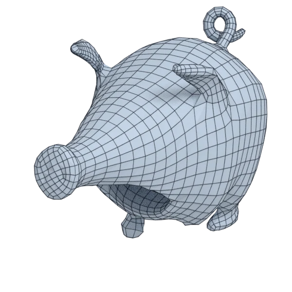
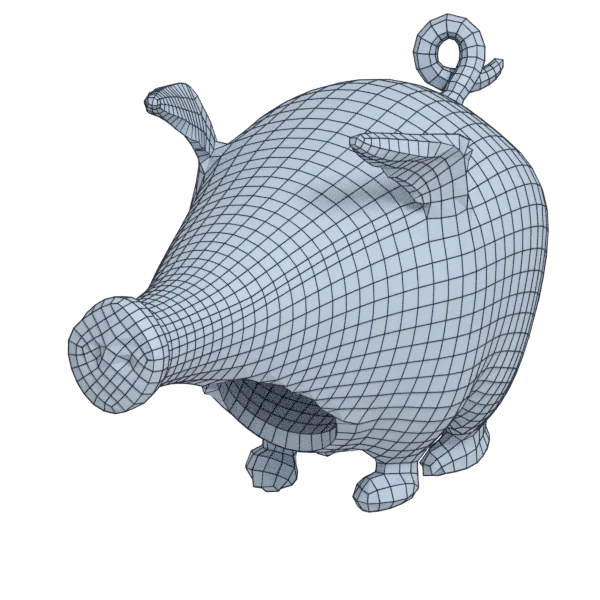
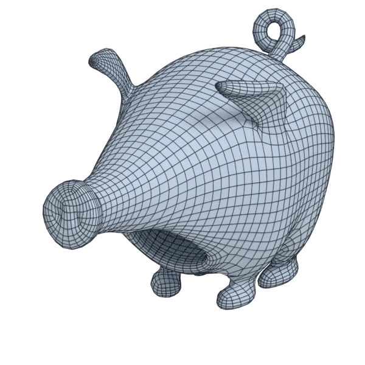
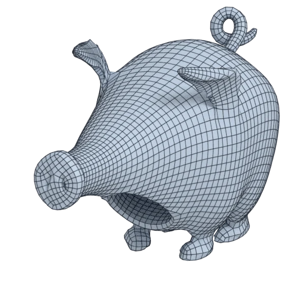

# pig

An organic model; 100 062 triangles in the source.
Author, source and licence: [CREDITS.md](../../CREDITS.md).

## At 3000 quads asked for

| Source | QuadriFlow (Blender) | AutoRemesher | openclare | Quad Remesher |
|---|---|---|---|---|
|  |  |  |  |  |
| 100 062 triangles | 2 675 quads | 1 808 quads | 3 054 quads | 4 698 quads |

## At equal quad count

Quad Remesher makes more quads than the 3000 it is asked for. Next to its mesh, openclare asked for as many quads as that mesh has.

| Quad Remesher | openclare, as many quads |
|---|---|
|  |  |
| 4 698 quads | 4 652 quads |

## Edge loops

At 3000 quads asked for. Each loop is followed straight on through every regular vertex: it closes, comes back beside itself a quad further (a spiral), stops at an irregular vertex, or runs from a border to a border. Share of the edges on each, those of borders and of faces that are not quads left out; "—" where the mesh is not a manifold.

| | closed | spiral | stops | border to border | spirals | longest that stops |
|---|---|---|---|---|---|---|
| QuadriFlow (Blender) | 0 % | 10 % | 90 % | 0 % | 12 | 218 |
| AutoRemesher | 11 % | 6 % | 84 % | 0 % | 5 | 113 |
| openclare | 25 % | 9 % | 66 % | 0 % | 9 | 145 |
| Quad Remesher | 18 % | 24 % | 58 % | 0 % | 20 | 191 |

## Marks

From 0 to 100; how they are made is in [SCORES.md](../../bench/results/SCORES.md).

### 1000 quads

| Remesher | Quads | Overall | Validity | Alignment | Quad shape | Fidelity | Regularity | Structure | Edge loops | Budget | Speed |
|---|---|---|---|---|---|---|---|---|---|---|---|
| **openclare** | 1008 | **70** | 100 | 59 | 64 | 82 | 19 | 42 | 51 | 97 | 83 |
| openclare-uniform | 989 | **69** | 100 | 45 | 64 | 59 | 47 | 41 | — | 96 | 82 |
| quadremesher | 1975 | **67** | 100 | 67 | 59 | 85 | 56 | 42 | 55 | 0 | 31 |
| integer-grid | 877 | **36** | 0 | 42 | 56 | 44 | 49 | 48 | — | 51 | 62 |
| quadremesher-uniform | 853 | **24** | 0 | 54 | 53 | 0 | 0 | — | — | 41 | 33 |
| instant-meshes | 910 | **23** | 0 | 28 | 58 | 0 | 18 | 5 | — | 64 | 98 |
| autoremesher | 548 | **18** | 0 | 35 | 39 | 5 | 0 | — | 50 | 0 | 100 |
| quadriflow | 861 | **14** | 0 | 23 | 23 | 0 | 12 | 2 | 16 | 44 | 81 |

At equal quad count: Quad Remesher's mesh as it is, and openclare asked for as many quads.

| Remesher | Quads | Overall | Validity | Alignment | Quad shape | Fidelity | Regularity | Structure | Edge loops | Budget | Speed |
|---|---|---|---|---|---|---|---|---|---|---|---|
| quadremesher-as-made | 1975 | **75** | 100 | 67 | 59 | 83 | 56 | 42 | — | 100 | 31 |
| openclare-matched | 1953 | **72** | 100 | 55 | 70 | 71 | 56 | 40 | — | 96 | 73 |

### 3000 quads

| Remesher | Quads | Overall | Validity | Alignment | Quad shape | Fidelity | Regularity | Structure | Edge loops | Budget | Speed |
|---|---|---|---|---|---|---|---|---|---|---|---|
| **openclare** | 3054 | **76** | 100 | 59 | 72 | 82 | 69 | 45 | 50 | 93 | 74 |
| openclare-uniform | 3047 | **75** | 100 | 52 | 70 | 67 | 77 | 36 | — | 94 | 74 |
| quadremesher-uniform | 2552 | **68** | 100 | 58 | 60 | 71 | 66 | 28 | — | 40 | 32 |
| quadremesher | 4698 | **44** | 0 | 68 | 64 | 86 | 79 | 36 | 27 | 0 | 35 |
| integer-grid | 2680 | **41** | 0 | 52 | 59 | 50 | 69 | — | — | 57 | 44 |
| instant-meshes | 3016 | **33** | 0 | 28 | 66 | 25 | 37 | 3 | — | 96 | 97 |
| autoremesher | 1808 | **29** | 0 | 49 | 55 | 21 | 45 | — | 48 | 0 | 90 |
| quadriflow | 2675 | **22** | 0 | 23 | 28 | 5 | 57 | 2 | 28 | 57 | 88 |

At equal quad count: Quad Remesher's mesh as it is, and openclare asked for as many quads.

| Remesher | Quads | Overall | Validity | Alignment | Quad shape | Fidelity | Regularity | Structure | Edge loops | Budget | Speed |
|---|---|---|---|---|---|---|---|---|---|---|---|
| openclare-matched | 4652 | **78** | 100 | 61 | 72 | 85 | 79 | 26 | — | 96 | 53 |
| quadremesher-as-made | 4698 | **50** | 0 | 67 | 64 | 83 | 79 | 36 | — | 100 | 35 |

### 8000 quads

| Remesher | Quads | Overall | Validity | Alignment | Quad shape | Fidelity | Regularity | Structure | Edge loops | Budget | Speed |
|---|---|---|---|---|---|---|---|---|---|---|---|
| openclare-uniform | 8093 | **78** | 100 | 58 | 65 | 77 | 90 | 26 | — | 95 | 50 |
| **openclare** | 8108 | **77** | 100 | 64 | 72 | 88 | 89 | 34 | 29 | 95 | 37 |
| quadremesher-uniform | 7070 | **74** | 100 | 61 | 67 | 74 | 87 | 39 | — | 53 | 32 |
| instant-meshes | 8116 | **63** | 80 | 34 | 75 | 67 | 55 | 4 | — | 94 | 92 |
| quadremesher | 9824 | **49** | 0 | 67 | 68 | 87 | 90 | — | 50 | 9 | 31 |
| integer-grid | 7187 | **48** | 0 | 58 | 56 | 76 | 89 | 37 | — | 59 | 14 |
| autoremesher | 4682 | **36** | 0 | 50 | 66 | 68 | 71 | — | 10 | 0 | 63 |
| quadriflow | 6973 | **23** | 0 | 30 | 43 | 0 | 82 | 2 | 3 | 49 | 72 |

At equal quad count: Quad Remesher's mesh as it is, and openclare asked for as many quads.

| Remesher | Quads | Overall | Validity | Alignment | Quad shape | Fidelity | Regularity | Structure | Edge loops | Budget | Speed |
|---|---|---|---|---|---|---|---|---|---|---|---|
| openclare-matched | 9900 | **80** | 100 | 62 | 70 | 89 | 91 | 38 | — | 97 | 35 |
| quadremesher-as-made | 9824 | **53** | 0 | 67 | 68 | 86 | 90 | — | — | 100 | 31 |
