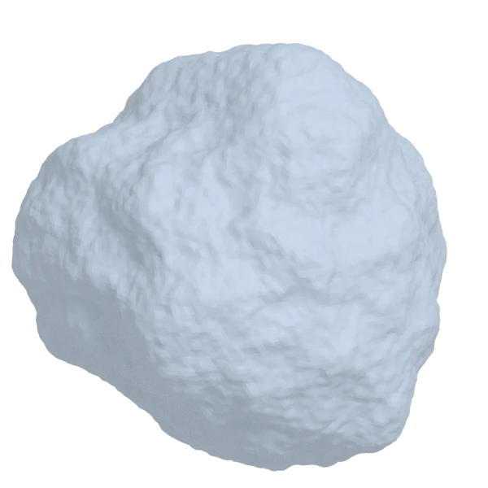
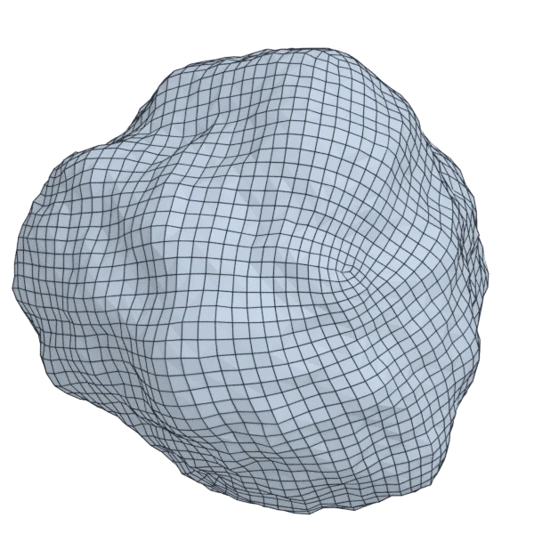
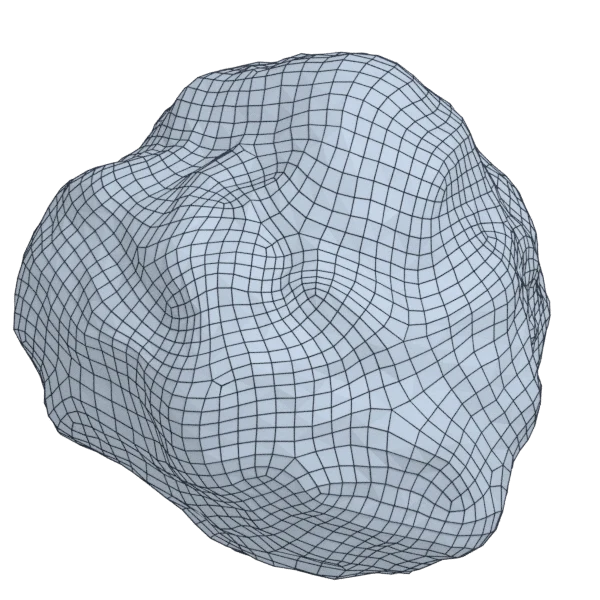

# rock

An organic model; 81 920 triangles in the source.
Author, source and licence: [CREDITS.md](../../CREDITS.md).

## At 3000 quads

| Source | QuadriFlow (Blender) | openclare | Quad Remesher |
|---|---|---|---|
|  |  |  |  |

## Marks

From 0 to 100; how they are made is in [SCORES.md](../../bench/results/SCORES.md).

### 1000 quads

| Remesher | Overall | Validity | Alignment | Quad shape | Fidelity | Regularity | Structure | Budget | Speed |
|---|---|---|---|---|---|---|---|---|---|
| **quad-layout-adaptive** | **71** | 100 | 25 | 76 | 82 | 82 | 0 | 92 | 94 |
| quad-layout | **71** | 100 | 25 | 72 | 81 | 82 | 22 | 91 | 97 |
| quadriflow | **65** | 100 | 0 | 69 | 81 | 100 | 1 | 79 | 97 |
| integer-grid | **64** | 100 | 28 | 53 | 79 | 80 | 0 | 59 | 68 |
| instant-meshes | **63** | 100 | 0 | 70 | 79 | 67 | 6 | 86 | 100 |
| quadremesher | **55** | 100 | 40 | 45 | 80 | 36 | 0 | 0 | 19 |
| quadremesher-uniform | **54** | 100 | 36 | 40 | 75 | 9 | 0 | 35 | 32 |

### 3000 quads

| Remesher | Overall | Validity | Alignment | Quad shape | Fidelity | Regularity | Structure | Budget | Speed |
|---|---|---|---|---|---|---|---|---|---|
| **quad-layout-adaptive** | **73** | 100 | 30 | 75 | 89 | 81 | 0 | 98 | 77 |
| quad-layout | **73** | 100 | 27 | 74 | 89 | 86 | 0 | 96 | 84 |
| quadriflow | **68** | 100 | 0 | 71 | 89 | 100 | 6 | 91 | 92 |
| integer-grid | **67** | 100 | 30 | 56 | 89 | 84 | 0 | 58 | 53 |
| instant-meshes | **65** | 100 | 0 | 74 | 89 | 71 | 0 | 86 | 99 |
| quadremesher | **63** | 100 | 37 | 50 | 90 | 70 | 0 | 28 | 26 |
| quadremesher-uniform | **62** | 100 | 35 | 47 | 88 | 63 | 0 | 37 | 31 |

### 8000 quads

| Remesher | Overall | Validity | Alignment | Quad shape | Fidelity | Regularity | Structure | Budget | Speed |
|---|---|---|---|---|---|---|---|---|---|
| **quad-layout-adaptive** | **74** | 100 | 28 | 73 | 93 | 84 | 0 | 97 | 59 |
| quad-layout | **73** | 100 | 26 | 71 | 94 | 86 | 0 | 97 | 54 |
| integer-grid | **68** | 100 | 29 | 54 | 92 | 86 | 0 | 70 | 11 |
| instant-meshes | **68** | 100 | 0 | 79 | 94 | 80 | 0 | 90 | 98 |
| quadremesher | **66** | 100 | 23 | 51 | 92 | 92 | 0 | 54 | 29 |
| quadriflow | **65** | 100 | 1 | 69 | 86 | 100 | 0 | 67 | 68 |
| quadremesher-uniform | **64** | 100 | 23 | 51 | 91 | 91 | 0 | 38 | 29 |
