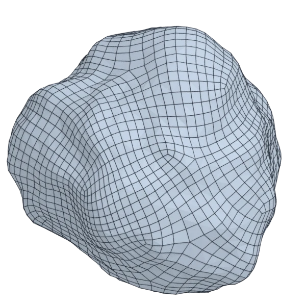
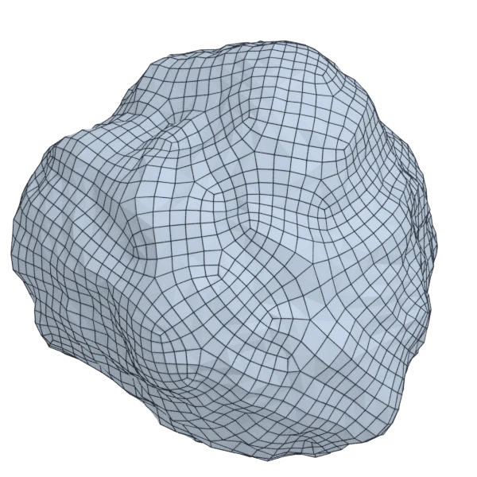

# rock

An organic model; 81 920 triangles in the source.
Author, source and licence: [CREDITS.md](../../CREDITS.md).

## At 3000 quads asked for

| Source | QuadriFlow (Blender) | AutoRemesher | openclare |
|---|---|---|---|
|  |  |  |  |
| 81 920 triangles | 3 036 quads | 2 412 quads | 3 010 quads |

## Edge loops

At 3000 quads asked for. Each loop is followed straight on through every regular vertex: it closes, comes back beside itself a quad further (a spiral), stops at an irregular vertex, or runs from a border to a border. Share of the edges on each, those of borders and of faces that are not quads left out; "—" where the mesh is not a manifold.

| | closed | spiral | stops | border to border | spirals | longest that stops |
|---|---|---|---|---|---|---|
| Modelled by hand | — | — | — | — | — | — |
| QuadriFlow (Blender) | 0 % | 57 % | 43 % | 0 % | 5 | 528 |
| AutoRemesher | 0 % | 27 % | 73 % | 0 % | 4 | 317 |
| openclare | 0 % | 9 % | 91 % | 0 % | 3 | 207 |

## Marks

From 0 to 100; how they are made is in [SCORES.md](../../bench/results/SCORES.md).

### 1000 quads

| Remesher | Quads | Overall | Validity | Alignment | Quad shape | Fidelity | Regularity | Structure | Edge loops | Budget | Speed |
|---|---|---|---|---|---|---|---|---|---|---|---|
| openclare-uniform | 1011 | **77** | 100 | 40 | 100 | 86 | 100 | 0 | 50 | 96 | 82 |
| integer-grid | 898 | **75** | 100 | 43 | 92 | 78 | 100 | 0 | — | 59 | 59 |
| **openclare** | 988 | **74** | 100 | 40 | 100 | 84 | 100 | 11 | 27 | 95 | 74 |
| instant-meshes | 966 | **71** | 100 | 0 | 100 | 79 | 100 | 6 | — | 86 | 96 |
| quadriflow | 947 | **61** | 100 | 0 | 100 | 81 | 100 | 1 | 0 | 79 | 98 |
| autoremesher | 778 | **61** | 100 | 22 | 100 | 72 | 100 | 35 | 11 | 11 | 100 |

### 3000 quads

| Remesher | Quads | Overall | Validity | Alignment | Quad shape | Fidelity | Regularity | Structure | Edge loops | Budget | Speed |
|---|---|---|---|---|---|---|---|---|---|---|---|
| integer-grid | 2687 | **78** | 100 | 46 | 95 | 91 | 100 | 0 | — | 58 | 53 |
| **openclare** | 3010 | **76** | 100 | 47 | 100 | 91 | 100 | 0 | 30 | 99 | 56 |
| openclare-uniform | 3039 | **74** | 100 | 43 | 100 | 91 | 100 | 0 | 25 | 95 | 60 |
| instant-meshes | 2898 | **72** | 100 | 0 | 100 | 89 | 100 | 0 | — | 86 | 99 |
| quadriflow | 3036 | **63** | 100 | 0 | 100 | 89 | 100 | 6 | 0 | 91 | 95 |
| autoremesher | 2412 | **61** | 100 | 26 | 100 | 85 | 100 | 0 | 0 | 22 | 85 |

### 8000 quads

| Remesher | Quads | Overall | Validity | Alignment | Quad shape | Fidelity | Regularity | Structure | Edge loops | Budget | Speed |
|---|---|---|---|---|---|---|---|---|---|---|---|
| integer-grid | 7393 | **79** | 100 | 45 | 93 | 93 | 100 | 0 | — | 70 | 14 |
| openclare-uniform | 8037 | **78** | 100 | 41 | 100 | 95 | 100 | 0 | 50 | 98 | 51 |
| **openclare** | 8092 | **78** | 100 | 42 | 100 | 95 | 100 | 0 | 50 | 95 | 46 |
| instant-meshes | 7792 | **73** | 100 | 0 | 100 | 94 | 100 | 0 | — | 90 | 91 |
| autoremesher | 5842 | **62** | 100 | 27 | 100 | 92 | 100 | 14 | 12 | 0 | 71 |
| quadriflow | 7342 | **61** | 100 | 1 | 100 | 86 | 100 | 0 | 0 | 67 | 65 |
