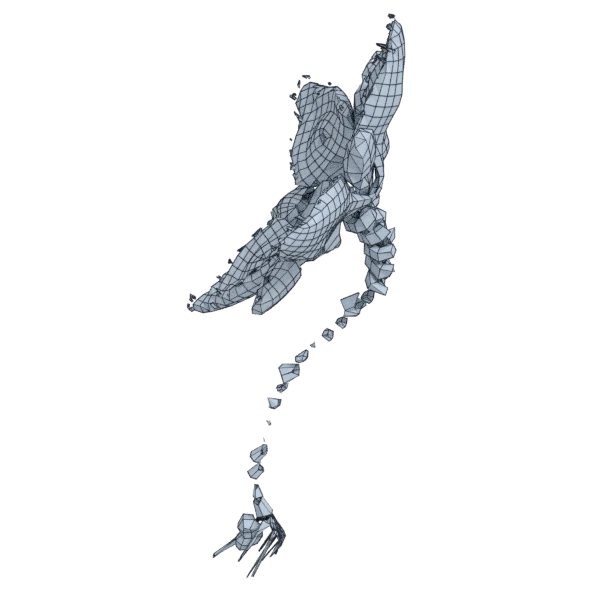

# rose

An organic model; 140 336 triangles in the source.
Author, source and licence: [CREDITS.md](../../CREDITS.md).

## At 3000 quads

| Source | QuadriFlow (Blender) | openclare | Quad Remesher |
|---|---|---|---|
|  |  |  |  |

## Marks

From 0 to 100; how they are made is in [SCORES.md](../../bench/results/SCORES.md).

### 1000 quads

| Remesher | Overall | Validity | Alignment | Quad shape | Fidelity | Regularity | Structure | Budget | Speed |
|---|---|---|---|---|---|---|---|---|---|
| quadremesher | **25** | 0 | 58 | 55 | 0 | 36 | — | 0 | 36 |
| quadremesher-uniform | **10** | 0 | 36 | 16 | 0 | 0 | — | 0 | 46 |
| integer-grid | **9** | 0 | 28 | 18 | 0 | 0 | — | 0 | 51 |
| **quad-layout-adaptive** | **5** | 0 | 24 | 0 | 0 | 0 | — | 0 | 51 |
| quadriflow | **5** | 0 | 18 | 7 | 0 | 0 | 8 | 0 | 80 |
| quad-layout | **5** | 0 | 23 | 0 | 0 | 0 | — | 0 | 48 |
| instant-meshes | **4** | 0 | 17 | 0 | 0 | 0 | 6 | 0 | 88 |

### 3000 quads

| Remesher | Overall | Validity | Alignment | Quad shape | Fidelity | Regularity | Structure | Budget | Speed |
|---|---|---|---|---|---|---|---|---|---|
| quadremesher | **27** | 0 | 60 | 55 | 0 | 51 | — | 0 | 45 |
| quad-layout | **19** | 0 | 35 | 1 | 29 | 0 | — | 68 | 51 |
| quadremesher-uniform | **19** | 0 | 37 | 32 | 0 | 0 | — | 59 | 42 |
| **quad-layout-adaptive** | **17** | 0 | 37 | 2 | 29 | 0 | — | 37 | 50 |
| integer-grid | **12** | 0 | 28 | 38 | 0 | 0 | — | 0 | 23 |
| instant-meshes | **7** | 0 | 15 | 22 | 0 | 0 | 12 | 0 | 85 |
| quadriflow | **7** | 0 | 18 | 18 | 0 | 0 | 10 | 0 | 79 |

### 8000 quads

| Remesher | Overall | Validity | Alignment | Quad shape | Fidelity | Regularity | Structure | Budget | Speed |
|---|---|---|---|---|---|---|---|---|---|
| quad-layout | **36** | 0 | 47 | 47 | 69 | 24 | 19 | 63 | 44 |
| **quad-layout-adaptive** | **34** | 0 | 48 | 49 | 53 | 0 | — | 69 | 46 |
| quadremesher | **28** | 0 | 60 | 57 | 0 | 65 | — | 0 | 45 |
| quadremesher-uniform | **21** | 0 | 45 | 42 | 0 | 0 | — | 45 | 50 |
| integer-grid | **20** | 0 | 37 | 49 | 0 | 15 | — | 28 | 0 |
| instant-meshes | **15** | 0 | 18 | 40 | 0 | 0 | 7 | 47 | 88 |
| quadriflow | **12** | 0 | 19 | 26 | 0 | 0 | 3 | 38 | 71 |
