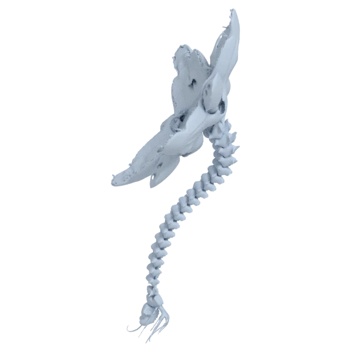
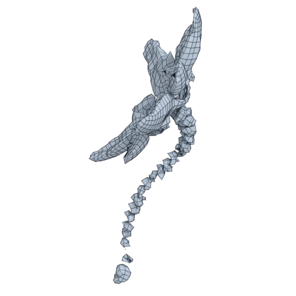
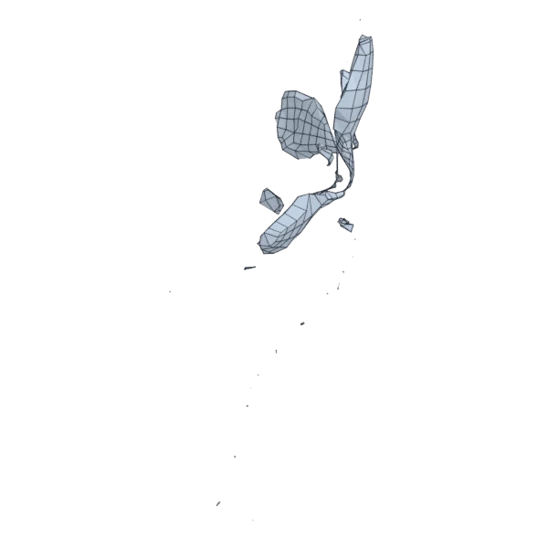
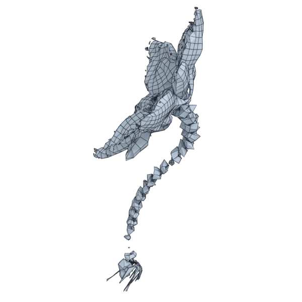
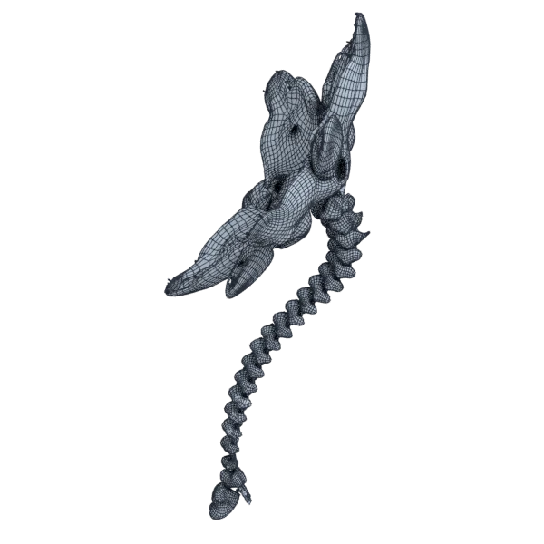
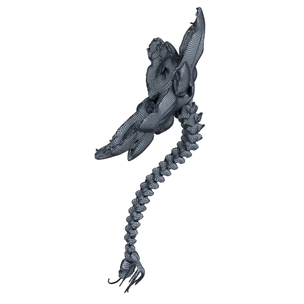

# rose

An organic model; 140 336 triangles in the source.
Author, source and licence: [CREDITS.md](../../CREDITS.md).

## At 3000 quads asked for

| Source | QuadriFlow (Blender) | AutoRemesher | openclare | Quad Remesher |
|---|---|---|---|---|
|  |  |  |  |  |
| 140 336 triangles | 2 208 quads | 636 quads | 3 584 quads | 35 874 quads |

## At equal quad count

Quad Remesher makes more quads than the 3000 it is asked for. Next to its mesh, openclare asked for as many quads as that mesh has.

| Quad Remesher | openclare, as many quads |
|---|---|
|  |  |
| 35 874 quads | 36 000 quads |

## Edge loops

At 3000 quads asked for. Each loop is followed straight on through every regular vertex: it closes, comes back beside itself a quad further (a spiral), stops at an irregular vertex, or runs from a border to a border. Share of the edges on each, those of borders and of faces that are not quads left out; "—" where the mesh is not a manifold.

| | closed | spiral | stops | border to border | spirals | longest that stops |
|---|---|---|---|---|---|---|
| QuadriFlow (Blender) | 3 % | 5 % | 90 % | 1 % | 8 | 43 |
| AutoRemesher | — | — | — | — | — | — |
| openclare | — | — | — | — | — | — |
| Quad Remesher | — | — | — | — | — | — |

## Marks

From 0 to 100; how they are made is in [SCORES.md](../../bench/results/SCORES.md).

### 1000 quads

| Remesher | Quads | Overall | Validity | Alignment | Quad shape | Fidelity | Regularity | Structure | Budget | Speed |
|---|---|---|---|---|---|---|---|---|---|---|
| quadremesher | 26339 | **32** | 0 | 58 | 55 | 44 | 36 | — | 0 | 36 |
| quadremesher-uniform | 1271 | **13** | 0 | 36 | 16 | 21 | 0 | — | 0 | 46 |
| integer-grid | 511 | **9** | 0 | 30 | 14 | 2 | 0 | — | 0 | 56 |
| openclare-uniform | 1571 | **8** | 0 | 40 | 0 | 0 | 0 | — | 0 | 67 |
| quadriflow | 494 | **5** | 0 | 18 | 6 | 0 | 0 | 8 | 0 | 82 |
| autoremesher | 157 | **4** | 0 | 19 | 0 | 0 | 0 | — | 0 | 100 |
| instant-meshes | 530 | **4** | 0 | 17 | 0 | 0 | 0 | 6 | 0 | 88 |
| **openclare** | 1403 | **0** | 0 | — | 0 | 0 | 0 | — | 0 | 67 |

At equal quad count: Quad Remesher's mesh as it is, and openclare asked for as many quads.

| Remesher | Quads | Overall | Validity | Alignment | Quad shape | Fidelity | Regularity | Structure | Budget | Speed |
|---|---|---|---|---|---|---|---|---|---|---|
| openclare-matched | 26471 | **42** | 0 | 56 | 61 | 83 | 38 | 25 | 98 | 32 |
| quadremesher-as-made | 26339 | **24** | 0 | 44 | 55 | 0 | 36 | — | 100 | 36 |

### 3000 quads

| Remesher | Quads | Overall | Validity | Alignment | Quad shape | Fidelity | Regularity | Structure | Budget | Speed |
|---|---|---|---|---|---|---|---|---|---|---|
| quadremesher | 35874 | **33** | 0 | 60 | 55 | 38 | 51 | — | 0 | 45 |
| quadremesher-uniform | 2689 | **21** | 0 | 37 | 32 | 15 | 0 | — | 59 | 42 |
| openclare-uniform | 3358 | **19** | 0 | 34 | 0 | 44 | 0 | — | 52 | 83 |
| **openclare** | 3584 | **15** | 0 | 33 | 6 | 33 | 0 | — | 22 | 65 |
| integer-grid | 1923 | **13** | 0 | 28 | 34 | 10 | 0 | — | 0 | 32 |
| quadriflow | 2085 | **9** | 0 | 19 | 18 | 11 | 0 | 10 | 0 | 80 |
| instant-meshes | 2226 | **8** | 0 | 15 | 22 | 4 | 0 | 12 | 0 | 82 |
| autoremesher | 636 | **3** | 0 | 14 | 0 | 0 | 0 | — | 0 | 86 |

At equal quad count: Quad Remesher's mesh as it is, and openclare asked for as many quads.

| Remesher | Quads | Overall | Validity | Alignment | Quad shape | Fidelity | Regularity | Structure | Budget | Speed |
|---|---|---|---|---|---|---|---|---|---|---|
| openclare-matched | 36000 | **45** | 0 | 59 | 65 | 82 | 51 | 23 | 99 | 30 |
| quadremesher-as-made | 35874 | **27** | 0 | 50 | 55 | 0 | 51 | — | 100 | 45 |

### 8000 quads

| Remesher | Quads | Overall | Validity | Alignment | Quad shape | Fidelity | Regularity | Structure | Budget | Speed |
|---|---|---|---|---|---|---|---|---|---|---|
| openclare-uniform | 8296 | **37** | 0 | 43 | 39 | 71 | 27 | 18 | 85 | 73 |
| **openclare** | 8343 | **34** | 0 | 44 | 33 | 72 | 0 | 22 | 83 | 50 |
| quadremesher | 53874 | **33** | 0 | 60 | 57 | 28 | 65 | — | 0 | 45 |
| integer-grid | 6584 | **22** | 0 | 37 | 49 | 13 | 13 | — | 29 | 0 |
| quadremesher-uniform | 6896 | **22** | 0 | 45 | 42 | 7 | 0 | — | 45 | 50 |
| instant-meshes | 6932 | **15** | 0 | 18 | 40 | 2 | 0 | 7 | 47 | 86 |
| quadriflow | 6758 | **13** | 0 | 19 | 26 | 6 | 0 | 3 | 38 | 71 |
| autoremesher | 3828 | **6** | 0 | 19 | 11 | 0 | 0 | — | 0 | 72 |

At equal quad count: Quad Remesher's mesh as it is, and openclare asked for as many quads.

| Remesher | Quads | Overall | Validity | Alignment | Quad shape | Fidelity | Regularity | Structure | Budget | Speed |
|---|---|---|---|---|---|---|---|---|---|---|
| openclare-matched | 53886 | **46** | 0 | 58 | 69 | 82 | 64 | 20 | 100 | 27 |
| quadremesher-as-made | 53874 | **29** | 0 | 50 | 57 | 0 | 65 | — | 100 | 45 |
