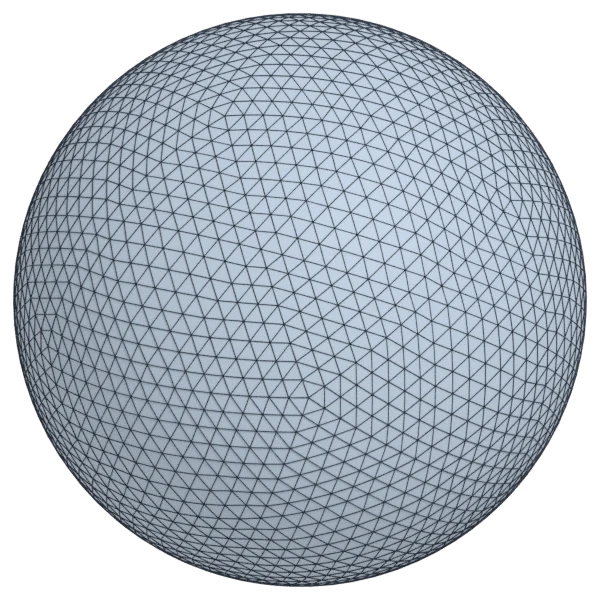
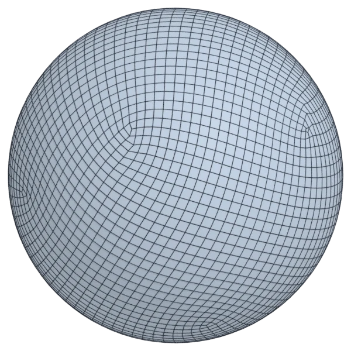
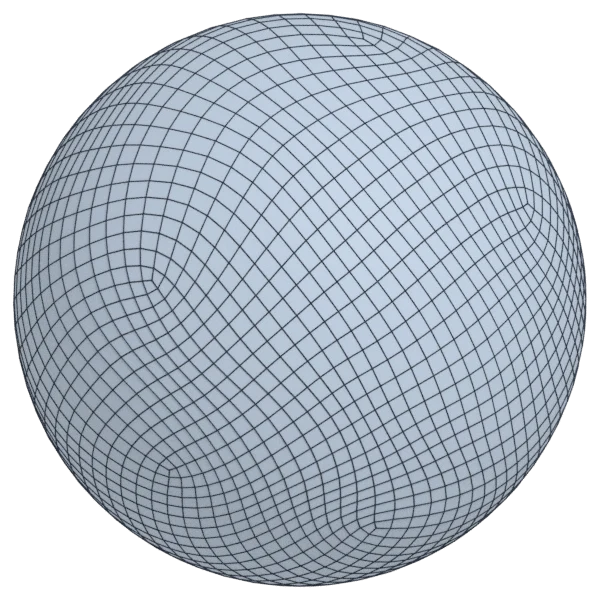
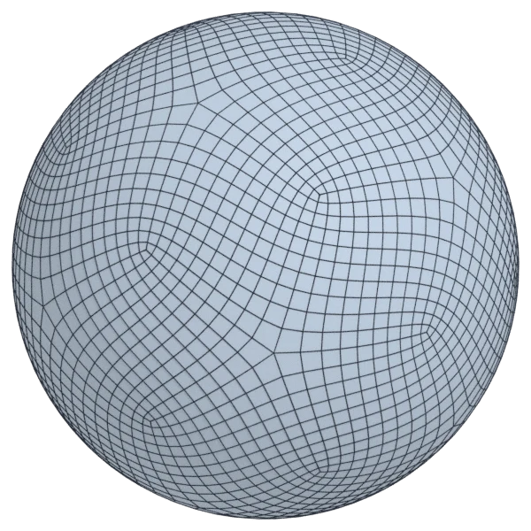
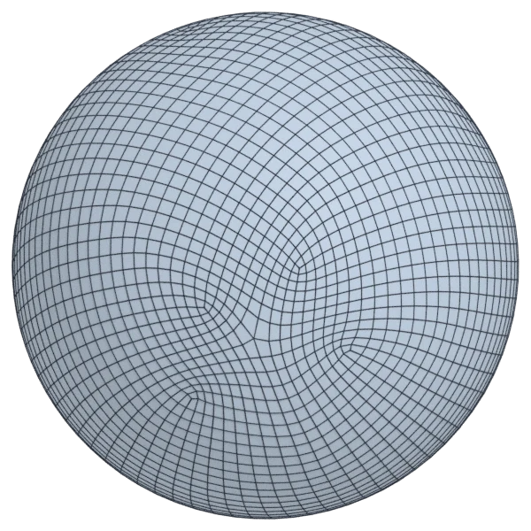
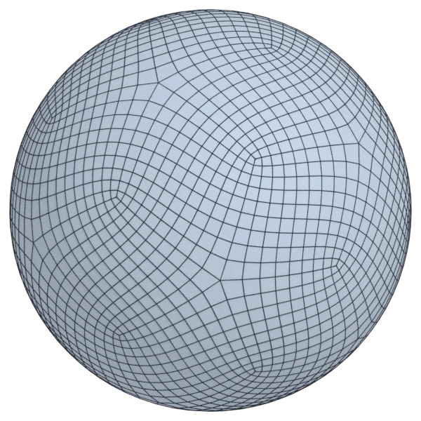

# sphere

A calibration model; 5 120 triangles in the source.
Author, source and licence: [CREDITS.md](../../CREDITS.md).

## At 3000 quads asked for

| Source | QuadriFlow (Blender) | AutoRemesher | openclare | Quad Remesher |
|---|---|---|---|---|
|  |  |  |  |  |
| 5 120 triangles | 3 253 quads | 2 086 quads | 2 990 quads | 2 740 quads |

## At equal quad count

Quad Remesher makes more quads than the 3000 it is asked for. Next to its mesh, openclare asked for as many quads as that mesh has.

| Quad Remesher | openclare, as many quads |
|---|---|
|  |  |
| 2 740 quads | 2 728 quads |

## Edge loops

At 3000 quads asked for. Each loop is followed straight on through every regular vertex: it closes, comes back beside itself a quad further (a spiral), stops at an irregular vertex, or runs from a border to a border. Share of the edges on each, those of borders and of faces that are not quads left out; "—" where the mesh is not a manifold.

| | closed | spiral | stops | border to border | spirals | longest that stops |
|---|---|---|---|---|---|---|
| Modelled by hand | — | — | — | — | — | — |
| QuadriFlow (Blender) | 6 % | 70 % | 15 % | 0 % | 5 | 276 |
| AutoRemesher | 2 % | 74 % | 24 % | 0 % | 6 | 298 |
| openclare | 96 % | 0 % | 4 % | 0 % | 0 | 23 |
| Quad Remesher | 17 % | 69 % | 14 % | 0 % | 6 | 158 |

## Marks

From 0 to 100; how they are made is in [SCORES.md](../../bench/results/SCORES.md).

### 1000 quads

| Remesher | Quads | Overall | Validity | Alignment | Quad shape | Fidelity | Regularity | Structure | Edge loops | Budget | Speed |
|---|---|---|---|---|---|---|---|---|---|---|---|
| openclare-uniform | 1012 | **99** | 100 | — | 100 | 98 | 100 | 99 | 100 | 95 | 73 |
| **openclare** | 1014 | **99** | 100 | — | 100 | 98 | 100 | 99 | 100 | 94 | 30 |
| quadremesher-uniform | 915 | **90** | 100 | — | 100 | 96 | 100 | 24 | — | 66 | 68 |
| instant-meshes | 1066 | **90** | 100 | — | 100 | 97 | 100 | 0 | — | 74 | 100 |
| integer-grid | 923 | **89** | 100 | — | 98 | 98 | 100 | 0 | — | 69 | 86 |
| quadremesher | 915 | **80** | 100 | — | 100 | 96 | 100 | 24 | 22 | 66 | 62 |
| quadriflow | 950 | **76** | 100 | — | 100 | 97 | 100 | 1 | 0 | 80 | 100 |
| autoremesher | 768 | **68** | 100 | — | 100 | 94 | 100 | 0 | 0 | 7 | 100 |

At equal quad count: Quad Remesher's mesh as it is, and openclare asked for as many quads.

| Remesher | Quads | Overall | Validity | Alignment | Quad shape | Fidelity | Regularity | Structure | Edge loops | Budget | Speed |
|---|---|---|---|---|---|---|---|---|---|---|---|
| openclare-matched | 912 | **100** | 100 | — | 100 | 98 | 100 | 99 | 100 | 99 | 28 |
| quadremesher-as-made | 915 | **94** | 100 | — | 100 | 96 | 100 | 24 | — | 100 | 62 |

### 3000 quads

| Remesher | Quads | Overall | Validity | Alignment | Quad shape | Fidelity | Regularity | Structure | Edge loops | Budget | Speed |
|---|---|---|---|---|---|---|---|---|---|---|---|
| openclare-uniform | 2990 | **100** | 100 | — | 100 | 99 | 100 | 100 | 100 | 99 | 70 |
| **openclare** | 2990 | **100** | 100 | — | 100 | 99 | 100 | 100 | 100 | 99 | 72 |
| integer-grid | 3000 | **99** | 100 | — | 98 | 99 | 100 | 99 | — | 100 | 84 |
| instant-meshes | 3090 | **92** | 100 | — | 100 | 99 | 100 | 0 | — | 88 | 100 |
| quadremesher-uniform | 2740 | **91** | 100 | — | 100 | 98 | 100 | 35 | — | 65 | 70 |
| quadremesher | 2740 | **85** | 100 | — | 100 | 98 | 100 | 35 | 50 | 65 | 69 |
| quadriflow | 3107 | **80** | 100 | — | 100 | 99 | 100 | 12 | 12 | 86 | 86 |
| autoremesher | 2086 | **70** | 100 | — | 100 | 97 | 100 | 4 | 12 | 0 | 100 |

At equal quad count: Quad Remesher's mesh as it is, and openclare asked for as many quads.

| Remesher | Quads | Overall | Validity | Alignment | Quad shape | Fidelity | Regularity | Structure | Edge loops | Budget | Speed |
|---|---|---|---|---|---|---|---|---|---|---|---|
| openclare-matched | 2728 | **100** | 100 | — | 100 | 99 | 100 | 100 | 100 | 98 | 77 |
| quadremesher-as-made | 2740 | **95** | 100 | — | 100 | 98 | 100 | 35 | — | 100 | 69 |

### 8000 quads

| Remesher | Quads | Overall | Validity | Alignment | Quad shape | Fidelity | Regularity | Structure | Edge loops | Budget | Speed |
|---|---|---|---|---|---|---|---|---|---|---|---|
| openclare-uniform | 8056 | **100** | 100 | — | 100 | 99 | 100 | 100 | 100 | 97 | 38 |
| instant-meshes | 8190 | **92** | 100 | — | 100 | 99 | 100 | 0 | — | 90 | 100 |
| integer-grid | 7568 | **91** | 100 | — | 100 | 99 | 100 | 0 | — | 78 | 37 |
| quadremesher-uniform | 7088 | **90** | 100 | — | 100 | 99 | 100 | 30 | — | 54 | 65 |
| quadremesher | 7088 | **83** | 100 | — | 100 | 99 | 100 | 30 | 50 | 54 | 65 |
| **openclare** | 7991 | **79** | 100 | — | 100 | 99 | 100 | 0 | 0 | 100 | 0 |
| autoremesher | 6520 | **72** | 100 | — | 100 | 98 | 100 | 4 | 8 | 26 | 84 |
| quadriflow | 7736 | **67** | 60 | — | 100 | 99 | 100 | 0 | 0 | 87 | 63 |

At equal quad count: Quad Remesher's mesh as it is, and openclare asked for as many quads.

| Remesher | Quads | Overall | Validity | Alignment | Quad shape | Fidelity | Regularity | Structure | Edge loops | Budget | Speed |
|---|---|---|---|---|---|---|---|---|---|---|---|
| openclare-matched | 7072 | **100** | 100 | — | 100 | 99 | 100 | 100 | 100 | 99 | 0 |
| quadremesher-as-made | 7088 | **95** | 100 | — | 100 | 99 | 100 | 30 | — | 100 | 65 |
