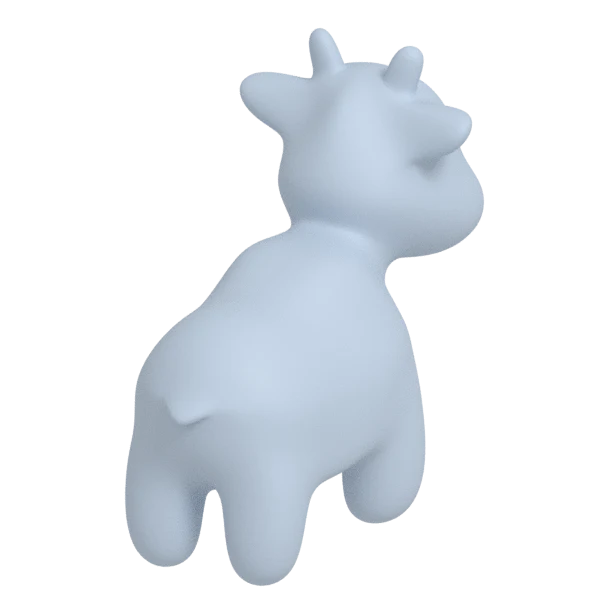
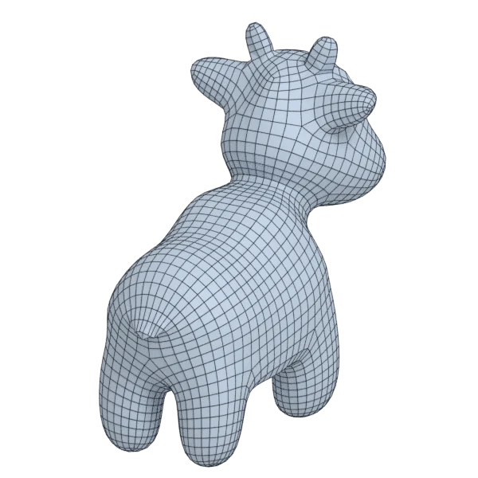
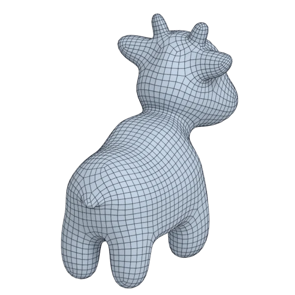

# spot

An organic model; 100 250 triangles in the source.
Author, source and licence: [CREDITS.md](../../CREDITS.md).

## At 3000 quads

| Source | QuadriFlow (Blender) | openclare | Quad Remesher |
|---|---|---|---|
|  |  |  |  |

## Marks

From 0 to 100; how they are made is in [SCORES.md](../../bench/results/SCORES.md).

### 1000 quads

| Remesher | Quads | Overall | Validity | Alignment | Quad shape | Fidelity | Regularity | Structure | Budget | Speed |
|---|---|---|---|---|---|---|---|---|---|---|
| **quad-layout-adaptive** | 991 | **73** | 100 | 66 | 65 | 66 | 39 | 27 | 96 | 78 |
| quad-layout | 990 | **72** | 100 | 58 | 64 | 74 | 43 | 22 | 96 | 81 |
| quadremesher | 1497 | **67** | 100 | 72 | 59 | 79 | 53 | 28 | 0 | 30 |
| quadremesher-uniform | 882 | **66** | 100 | 68 | 55 | 70 | 23 | 29 | 53 | 36 |
| integer-grid | 907 | **62** | 100 | 51 | 44 | 55 | 44 | 18 | 63 | 54 |
| quadriflow | 1024 | **60** | 100 | 19 | 62 | 50 | 47 | 6 | 89 | 89 |
| instant-meshes | 1016 | **52** | 100 | 21 | 63 | 17 | 14 | 3 | 94 | 80 |

At equal quad count: Quad Remesher's mesh as it is, and openclare asked for as many quads.

| Remesher | Quads | Overall | Validity | Alignment | Quad shape | Fidelity | Regularity | Structure | Budget | Speed |
|---|---|---|---|---|---|---|---|---|---|---|
| quad-layout-matched | 1514 | **74** | 100 | 65 | 69 | 68 | 60 | 36 | 95 | 82 |
| quadremesher-as-made | 1497 | **74** | 100 | 71 | 59 | 77 | 53 | 28 | 100 | 30 |

### 3000 quads

| Remesher | Quads | Overall | Validity | Alignment | Quad shape | Fidelity | Regularity | Structure | Budget | Speed |
|---|---|---|---|---|---|---|---|---|---|---|
| **quad-layout-adaptive** | 2979 | **82** | 100 | 65 | 72 | 91 | 79 | 44 | 97 | 61 |
| quad-layout | 3048 | **81** | 100 | 61 | 72 | 91 | 80 | 43 | 94 | 68 |
| quadremesher | 3478 | **75** | 100 | 72 | 68 | 85 | 79 | 30 | 36 | 28 |
| integer-grid | 2686 | **74** | 100 | 59 | 55 | 88 | 77 | 33 | 58 | 45 |
| quadremesher-uniform | 2686 | **72** | 100 | 66 | 65 | 68 | 71 | 21 | 58 | 34 |
| quadriflow | 2964 | **61** | 100 | 19 | 64 | 32 | 80 | 2 | 95 | 82 |
| instant-meshes | 3044 | **60** | 100 | 24 | 72 | 31 | 52 | 2 | 94 | 95 |

At equal quad count: Quad Remesher's mesh as it is, and openclare asked for as many quads.

| Remesher | Quads | Overall | Validity | Alignment | Quad shape | Fidelity | Regularity | Structure | Budget | Speed |
|---|---|---|---|---|---|---|---|---|---|---|
| quad-layout-matched | 3436 | **81** | 100 | 65 | 72 | 93 | 82 | 46 | 95 | 63 |
| quadremesher-as-made | 3478 | **80** | 100 | 72 | 68 | 87 | 79 | 30 | 100 | 28 |

### 8000 quads

| Remesher | Quads | Overall | Validity | Alignment | Quad shape | Fidelity | Regularity | Structure | Budget | Speed |
|---|---|---|---|---|---|---|---|---|---|---|
| quadremesher | 7965 | **84** | 100 | 66 | 72 | 91 | 91 | 42 | 98 | 30 |
| **quad-layout-adaptive** | 8093 | **83** | 100 | 66 | 68 | 96 | 91 | 38 | 95 | 35 |
| quad-layout | 7967 | **83** | 100 | 65 | 68 | 96 | 91 | 33 | 98 | 43 |
| quadremesher-uniform | 7274 | **79** | 100 | 63 | 70 | 88 | 90 | 47 | 64 | 30 |
| integer-grid | 7084 | **77** | 100 | 62 | 55 | 95 | 90 | 48 | 54 | 8 |
| instant-meshes | 8098 | **71** | 100 | 25 | 78 | 86 | 66 | 2 | 95 | 95 |
| quadriflow | 7874 | **67** | 80 | 25 | 69 | 89 | 91 | 1 | 94 | 69 |

At equal quad count: Quad Remesher's mesh as it is, and openclare asked for as many quads.

| Remesher | Quads | Overall | Validity | Alignment | Quad shape | Fidelity | Regularity | Structure | Budget | Speed |
|---|---|---|---|---|---|---|---|---|---|---|
| quad-layout-matched | 8007 | **82** | 100 | 67 | 70 | 96 | 91 | 34 | 98 | 37 |
| quadremesher-as-made | 7965 | **82** | 100 | 66 | 72 | 91 | 91 | 42 | 100 | 30 |
