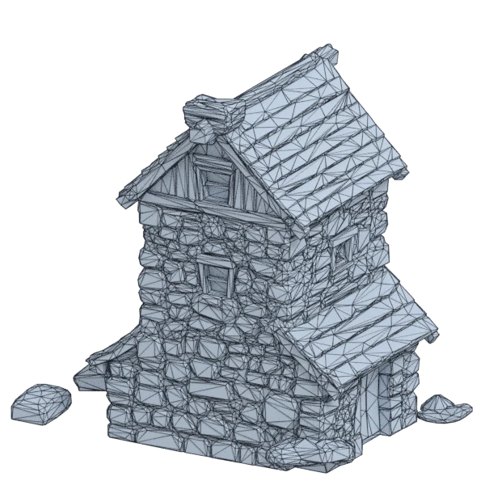
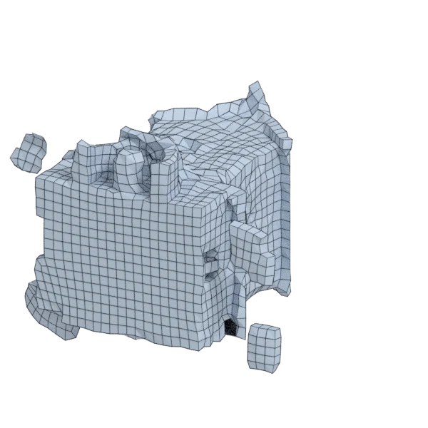
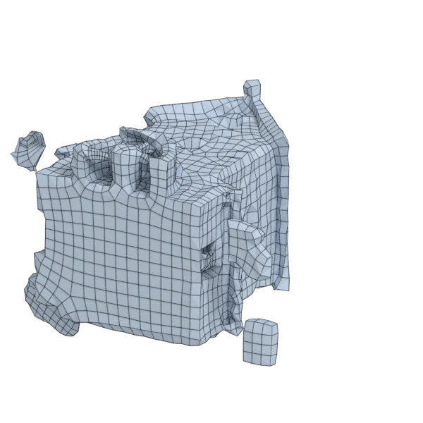
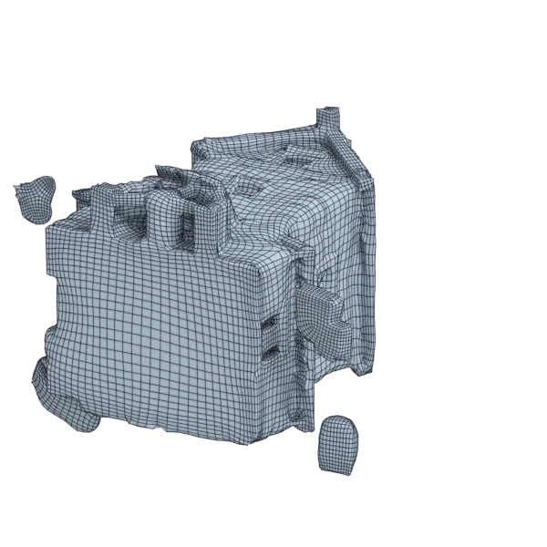
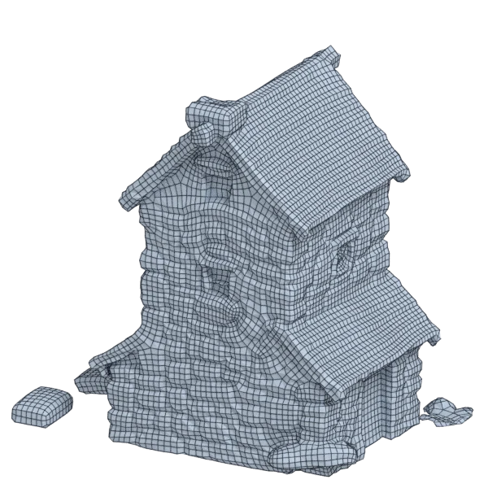

# stonemill

An extra model; 14 942 triangles in the source.
Author, source and licence: [CREDITS.md](../../CREDITS.md).

## At 3000 quads asked for

| Source | QuadriFlow (Blender) | openclare | Quad Remesher |
|---|---|---|---|
|  |  |  |  |
| 14 942 triangles | 2 445 quads | 3 017 quads | 14 154 quads |

## At equal quad count

Quad Remesher makes more quads than the 3000 it is asked for. Next to its mesh, openclare asked for as many quads as that mesh has.

| Quad Remesher | openclare, as many quads |
|---|---|
|  |  |
| 14 154 quads | 14 264 quads |

## Marks

From 0 to 100; how they are made is in [SCORES.md](../../bench/results/SCORES.md).

### 3000 quads

| Remesher | Quads | Overall | Validity | Alignment | Quad shape | Fidelity | Regularity | Structure | Budget | Speed |
|---|---|---|---|---|---|---|---|---|---|---|
| openclare-uniform | 3053 | **70** | 100 | 42 | 73 | 56 | 79 | 6 | 93 | 73 |
| **openclare** | 3017 | **42** | 0 | 41 | 64 | 63 | 47 | 4 | 98 | 69 |
| quadremesher | 14154 | **35** | 0 | 49 | 61 | 63 | 47 | — | 0 | 15 |
| integer-grid | 2592 | **29** | 0 | 41 | 59 | 0 | 61 | — | 46 | 44 |
| quadremesher-uniform | 2831 | **28** | 0 | 41 | 60 | 10 | 0 | — | 77 | 11 |
| quadriflow | 2465 | **26** | 0 | 39 | 52 | 46 | 8 | 4 | 29 | 82 |
| instant-meshes | 2638 | **21** | 0 | 36 | 53 | 0 | 7 | 4 | 52 | 100 |

At equal quad count: Quad Remesher's mesh as it is, and openclare asked for as many quads.

| Remesher | Quads | Overall | Validity | Alignment | Quad shape | Fidelity | Regularity | Structure | Budget | Speed |
|---|---|---|---|---|---|---|---|---|---|---|
| openclare-matched | 14264 | **71** | 100 | 46 | 75 | 69 | 78 | 5 | 97 | 36 |
| quadremesher-as-made | 14154 | **32** | 0 | 43 | 61 | 31 | 47 | — | 100 | 15 |
